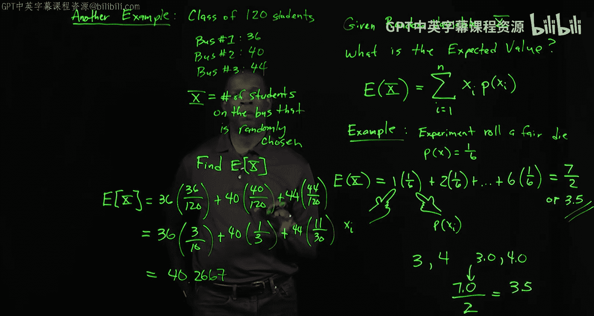

# 约翰霍普金斯大学《计算机科学的统计方法｜Statistical Methods for Computer Science》中英字幕 p30 29_期望值计算.zh_en -BV1r483zbEzN_p30-

Hello and welcome back。

In this particular section， we're going to be talking about a very important concept in。

Statistics and probability and that concept is expected value。

 So one of the important concepts in probability theory。

 expected value is really looking for that weighted average of all the possible values is trying to say。

 okay， if I have a random variable。What can I expect that value to be？On average， Okay， and so。

The random variable again， So if we have a random variable， so given。Random variable。Okay。Um。So what？

Is the。Expected。Value。All right， so there's some notation that we're going to be taking on here。

 okay？um。You know， a couple things， we write the expected value of a random variable and again this section is kind of a precursor to a larger section of talking about expected value that's going to be coming up in later modules。

 but in this section I want to give you a precursor to understand that first of all。😡。

Every random variable。Has an expected value。 And so in this case， we're going to use the notation。

 the capital E。 and then we're going to say we'll put our expected value in there。

So then what are we looking at when we're talking about this expected value， all right。

 well we want to think of this in terms of a weighted average。So I have all the values。Of。You know。

 I have all the values of the expected value。I mean of the random variable。

But now I need to weight those values by so all the values of the expected variable。

 if we were to write that would be。The sum， so this would be I is equal to 1 to some n where n is the total number of values that the random variable could actually take。

And so now all of those values would be Xabbi。So， x sub I。Are the number。

The numbers that this expected value can attain。Right， it's all the numbers。Then the question is。

How do I weight these values so that I can see what the expected value is。

 while I'm going to weight these numbers by the probability。Of its occurrence。Okay。

I'm going to wait these。These values by the probability。Of its occurrence。

 And so you can see here now that whatever the values are for x sub I。

 the probability of its occurrence now is going to weight the value that I put on。Actually。

 seeing that number come up。 So let's look at an example。 This probably is a way to kind of。

Kind of look at this and give it some clarity。So by way of an example。Okay， let's suppose that。

We roll a fair die。So， the experiment。The experiment is to roll。A fair。Dai。Okay， all right。

 so in doing that， I'm looking at the probabilities of。Of。You know， if it's a fair die。

 I have six sides， what is the probability that I roll a one？

Well the probability that I roll the one is going to be one over6。

 the probability that I roll the two is going to be one over6。 so in this experiment。

The probability P。Of x is equal to 1，6。Okay， just kind of think about that in your mind。

So now what I want to find is I want to find the expected value of this experiment。 Well。

 if I look at。Okay， if I look at。The random variable being equal to the。The number that I roll。

 right， the number that I roll in this case。Well， if that's the case。

 then what I want to show is I want to show that。If I use the formula that I have here。

 I want to take the sum。Of all possible values that I roll。So in that case， can I roll a zero？No。

That is not a possible value。What about a one， yes， so I'll put a one here。Okay。

 so this is my exabom。So， this。This is Xab by。And what is the probability？That I roll a one。 well。

 it is one over six。So this then。This is P of x sub I。응  흐。Okay， now recall， I'm doing a summation。

 so I'm going to add。What is the next possible value that my random variable could be like could be a two？

And what is the probability of rolling a two， it's a fair die， therefore it has to be16。Okay。

 and I'm going to continue this。I'm going to continue this all the way until I get to the last value。

 which is a6 and the probability being 16。So what is the expected value then？Well。

 it turns out all you have to do to find the expected value。Is some these altogether。

 And the answer is。7even。Haves or。3。5。Aha， you say， wait， hey， Dr。 Jay。You can't roll a 3。5。

How can you roll a 3。5？We're not talking about what you can roll。

 We're talking about what the expected value is going to be and the expected value is going to be one dimension below。

You know， one significant decimal place below the values that you have in your。In your set。

 now you may say， well， how could that be， well， think about averages， right？

Any time you calculate an average。 And again， this weighted。You know。

 average is a weighted mean anytime you calculate an average， right。

 the average is going to be at a dimension of resolution that's greater than the dimension of numbers that are being average。

 for instance， if I have two numbers， if I have two numbers let's say three and let's say four。

 right。I have two numbers  three and4， right， or you could say 3。0 and 4。0。

 right while you sum them together， you get 7。0 and you divide by 2。And the answer is going to be。

You're going to have a decimal here， right， and that's going to be 3。5。 Why， because it's in between。

U so we're not looking at necessarily at 3。5 being an outcome， we're looking at 3。

5 being an expected value。Okay。Let's look at another example。

Sose you have a class and in that class you have 120 students so heres so we're going to do another example。

Another example。So we have a class。Of 1 hundred and twenty0 students。Okay。

 and there are three buses that are charged with going out。

And basically going and grabbing these students and bringing them to a performance and so in this in this situation we have bus number one。

Bus number one has 36 students。Bus number two。Has 40 students and bus number3。Has 44 students。Okay。

 now when the buses arrive， so they go and they pick up the students， the buses arrive。

 one of the students is randomly chosen， were is going to pick a student at random from one of these three buses。

So we're going to have a random variable， we're going to say x。

It's going to be our random variable and it's going to denote the number of students on the bus。Okay。

Number of students。On the bus。That。Is。Randomly。Choseen。So we pick a student at random， right and。

X is going to be the number of students on the bus that is randomly chosen。

 And so what we want to do is we want to find。The expected value。What value？Can I expect。

In this particular experiment。What value can I expect in this in this particular experiment， Okay。

 so the first thing we need is we know the expected value is this right here。 Okay。

 so I need two things， I need the value that x could take on right？

 and how many values Can x actually be。Would it only be three values。 It can be06， it could be 40。

 it could be 44。That's the only。 That's the only。Possibility， right？

 So now I just need the probabilities。 Okay， the probabilities。

 So the probabilities now is going to be。The number of students on the bus divided by the total number of students in the class。

 and so now this becomes a simple exercise， and we can say the expected value。

It's going to be equal to so the first one is going to be。36 is the number。

 and the probability is going to be。36 over 120。Is the probability plus this is going to be 40。

And the probability is going to be 40。Over 1，20。And finally。

 we're going to have 44 and the probability is going to be 44。Over 1，20。Okay， so。Now that we have。

Now that we have this。What do we calculate now as the probability？

What do we calculate now as the probability。So we can reduce this。

 we can say that this is actually equal to 36 and then this is if we did some。

 we can say that this is going to be。What is this going to be， that's 36 over 120。

 that's going to be 3 over 10。Yep， and then this is going to be， well。

 that's going to be 40 and that's going to be one third。Right。

And then this right here is going to be 44。 and that's going to be， was that 11。Over 30。Y。Aha。

Allright， And then this calculation now comes out to be。嗯。Yeah， 40 point， aha，2，6，6，7。

 and I think that's just basically 40 and2 third。Or not two3s， but 40。

 and then that's 667 is an approximation。Cut it off at some point。Okay。

 so now what does this tell us， right， what does this tell us now？Well。

If if we were to just strictly look at the average。Number of students。

This is a very interesting thing here。Let's do a mental exercise here。

So we're going to go back into a cloud。A thought。If we were simply looking at a simple mental exercise of the average number of students。

We would find that you have 120 students。And there are three buses。So the average would be 40。Okay。

 that's what we would be looking at we be looking at there will be an average number。

Of 40 students on the bus。And the expected value then would be 40， right， because we'd be。40，40，40。

But that's not the case what we have here， in fact。Because of the way that the students are arranged。

 if I choose one randomly。The students。Actually， the expected value is larger than the average。

 and the question is why？Well。Look at the waiting。That we have here。Look at the weight of 44。

And the weight of 36。And so this kind of sets up this idea of center of gravity right so imagine we're still in this thing of thought。

 imagine you have a level bar right， and we have some weights that are sitting on the bar so you have a weight here。

 you have a larger weight here， you have an even larger weight here。

And you have an even larger steel weight here。Okay。Basically， the question is。

 where would the center of gravity be？In such a situation， right。

 where would the center of gravity be？Well， if all the weights were equal。

 the center of gravity would be right in the center。But because the weights are not equal， right？

The center of gravity is going to shift， and in this case。

 the center of gravity would shift in this direction。Okay。

 and this is a very key point in understanding expected value。 So in expected value， again。

 we're not looking for a number。Like that's we're not looking for 36， 40。

44 in of a number that's going to be in the set of possible numbers for the random variable。

 What we're looking for is the point at which we have balance。In the random number。

And that balance is the expected value。