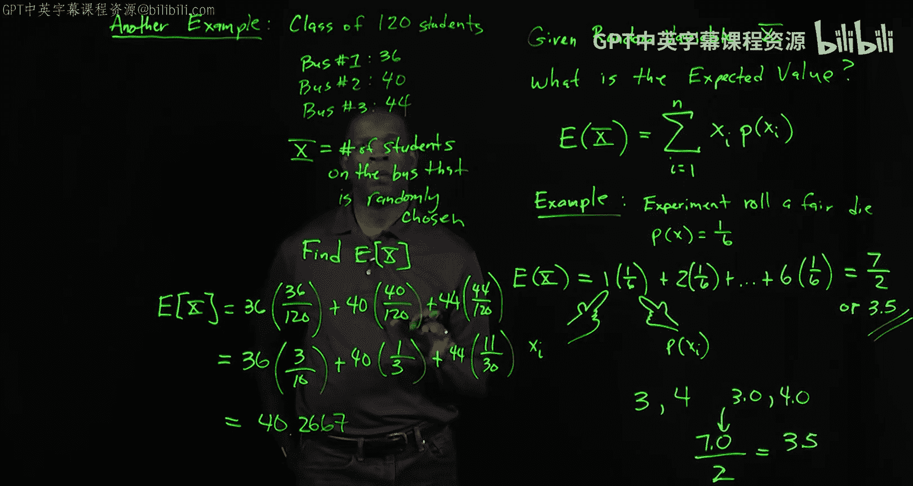

# 计算机科学的统计方法：30：期望值计算 📊

在本节课中，我们将学习概率论与统计学中的一个核心概念——期望值。期望值本质上是一个随机变量所有可能取值的加权平均，它回答了“平均而言，这个随机变量会是多少？”的问题。

## 什么是期望值？🤔

上一节我们介绍了随机变量的概念，本节中我们来看看如何计算它的“中心”或“平均”值，即期望值。

首先，每一个随机变量都有一个期望值。我们使用大写字母 **E** 来表示随机变量 **X** 的期望值，记作 **E[X]**。

从概念上讲，期望值是一个加权平均值。我们需要考虑随机变量所有可能的取值，并用每个值出现的概率对其进行“加权”。其计算公式如下：

**E[X] = Σ (x_i * P(X = x_i))**

其中：
*   **x_i** 是随机变量 **X** 的第 **i** 个可能取值。
*   **P(X = x_i)** 是 **X** 取值 **x_i** 的概率。
*   **Σ** 表示对所有可能的 **i** 求和。

## 通过例子理解期望值 🎲

为了更清晰地理解这个概念，让我们看一个简单的例子。

假设我们投掷一枚公平的骰子。这个实验的随机变量 **X** 表示掷出的点数。

由于是公平骰子，掷出任何一点（1到6）的概率都是 **1/6**。现在，我们使用公式计算期望值：

**E[X] = (1 * 1/6) + (2 * 1/6) + (3 * 1/6) + (4 * 1/6) + (5 * 1/6) + (6 * 1/6) = 21/6 = 3.5**

计算结果 **3.5** 可能让你感到疑惑：骰子不可能掷出 **3.5** 点。这引出了期望值的一个关键点：它不一定等于随机变量可能的某个具体取值。就像计算数字 **3** 和 **4** 的平均值是 **3.5** 一样，期望值 **3.5** 代表了所有可能结果的平均水平或“平衡点”。

## 一个更复杂的例子：校车问题 🚌

让我们通过一个更贴近生活的例子来深化理解。

假设一个班级有 **120** 名学生，他们乘坐三辆巴士去参加活动：
*   巴士1：**36** 名学生
*   巴士2：**40** 名学生
*   巴士3：**44** 名学生

巴士到达后，我们随机选择一名学生。定义随机变量 **X** 为“被选中学生所乘坐巴士上的学生总数”。**X** 的可能取值只能是 **36**、**40** 或 **44**。

要计算 **E[X]**，我们需要每个值对应的概率。选中巴士1上学生的概率是 **36/120**，巴士2是 **40/120**，巴士3是 **44/120**。

因此，期望值计算如下：
**E[X] = (36 * 36/120) + (40 * 40/120) + (44 * 44/120)**
简化计算后，结果约为 **40.267**。

## 期望值与平均值的区别 ⚖️

这个结果揭示了一个有趣的现象。如果我们简单地计算每辆巴士的平均学生数（120名学生 / 3辆巴士），结果是 **40**。

然而，我们计算出的期望值 **~40.267** 却略高于这个简单平均值。这是为什么呢？

关键在于“加权”的过程。想象一个跷跷板或天平，两端的重量不同。较重的 **44** 名学生这个“权重”将平衡点（期望值）拉向了自己一侧。在期望值的计算中，学生人数多的巴士被选中的概率也更高（因为学生多），因此它对最终“平均”值的贡献更大，导致期望值偏向于较大的数字。

这完美诠释了期望值的本质：**它寻找的是概率分布上的“重心”或“平衡点”**，而不仅仅是数字的算术平均。

## 总结 📝

本节课中我们一起学习了期望值的核心概念。
1.  **定义**：期望值 **E[X]** 是随机变量所有可能取值的概率加权平均。
2.  **公式**：**E[X] = Σ (x_i * P(X = x_i))**。
3.  **理解**：期望值代表长期实验的平均结果，是概率分布的“重心”，它不一定等于随机变量的某个具体可能值。
4.  **关键洞见**：期望值受高概率结果的影响更大，这使其与简单算术平均值区分开来，尤其在数据分布不均匀时。

掌握期望值是理解许多高级统计概念（如方差、协方差及各种概率模型）的基础。