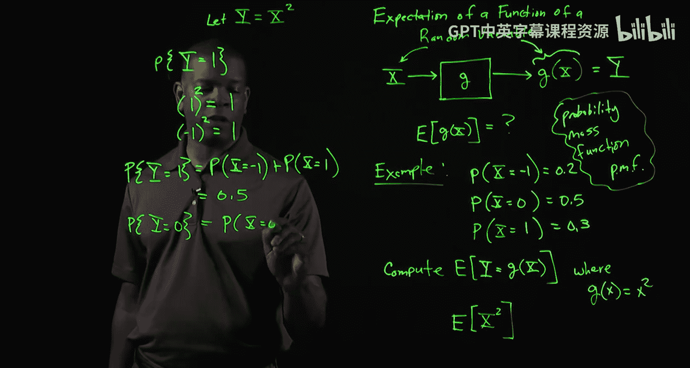

# 约翰霍普金斯大学《计算机科学的统计方法｜Statistical Methods for Computer Science》中英字幕 p31 30_随机变量函数期望.zh_en -BV1r483zbEzN_p31-

Welcome back， we're going to be talking about the expectation of a random variable。

 but we're going to talk about it in a different way。

We're going to talk about it in terms of a function of a random variable。

So we talked about expectation in a kind of general sense and we looked at how you actually calculate expectation in terms of the possible values of the random variable and the probability or the weight of that variable actually occurring。

 so we're looking at the probability as being and that weight。

We use the concept of center of gravity to kind of give a visual as to how， you know。

 what you're really trying to achieve， you know， in a physical sense。

 you're trying to achieve that balance。 So where is that balance point given all values of your random variable right。

 Where is that Where is that。That balance point。 and that balance point is your expected value。

 But what about when we're looking at expectation。And we're looking at expectation of。A function。

Of a。Random variable。Okay， so in this regard， then we're saying that there is some。

So there is some discrete random variable。Okay。And。

If that is a if this discrete random variable or if this random variable is going into some process that I have。

Right。And we can call this process G。So this is going in。Right， what's coming out？

Is going to be G of。This random variable。 And so the question now becomes if。

X is a random variable is G of x also。A random variable。 Is it a random。嗯。Process。And the answer is。

Yes。嗯。G of x is going to also be a random variable which is which is really neat and so the fact that G of x is also a random variable。

 if I'm looking for expectation now， I'm going to be looking at the expectation of G of x。Aha。

So the question is。How do I find that？ And that's what we're going to discuss in this。

This push in this video。All right。So maybe an example would suffice。Suppose I have。

 so let's look at an example。S I do have such a process and in that process。

 let's say I have the values。The probabilities。For my random variable。 Okay。

 so I have the probability。 So， so here again is my。Manum variableable。Okay。

 but it turns out that this is also。A random variable， this entire。Peace。Allright。

 so let's give us some values here。 So let's say that P of x。

 when x is equal to let's say negative one has a probability of 0。2。 Okay， the probability。

 So whatever this experiment is when the random variable is negative 1。

 the probability of that occurring is 0。2。 So we have another value for this random variable。

 and let's say this equals。We're going to say that this equals zero。

And the probability of this occurring is going to be 0。5。 Finally。

 we have our random variable and the last possible。

Number it could take on is going to be positive one。And we know what this probability has to be。

 it has to be 0。3 why， because the sum of all the probabilities must equal that's right， one， okay。

 so the question is， I want to compute。I want to compute the expected value。Of not x。응哼。No。

 I want to compute these expected value of。Let's write it， like。I want。Why。

Which is a random variable that's equal to。G。Of。The random variable x。Where。G。Of。

X is equal to x squared。Okay。Where g of x is equal to x squared。Aha。

So notice that this random variable G of x is simply a new random variable that we can just call cap Y。

Okay， so how do we do it？Well。So， let's let。Equal。Square。

 so what I've done is Ive based I've applied the function G of x。

 and now what we're really looking for here is we're looking for E。That's what we're looking for。

That's the expected value that we are attempting to calculate Okay。

 so what we need now is we need the values of why。That's what we're going to be looking for。

 the values of y。Whenever。You know， whenever we get to the point where we are defining you know。

 these spaces， so for instance， we defined this space and we calculated all the probability the probabilities for this space。

 right？In discrete terms， this is actually called the probability。Mass。Function。We could say PMF。

Okay， and really。In terms of everything we're doing。

 we need to determine that probability mass function in order to be able to validate that this random variable。

 which is discrete， that this random this discrete random variable is actually consistent and is actually actually a discrete random variable。

 so we did it for the X。😡，But I told you that y is also a random variable。

 even though it's a function of a random variable， and so we have to do the same thing with why and so what we have to look at now。

We have to look at what are the possible values of why？What are the possible values of Y？All right。

 so let's just do a mental exercise here。If I say。Looking at the possible values of y。

 so I'm going to say the probability。And then this is going to be。We're looking at now。When why。

 so let's write this as we're going to say this is going to be the probability。When。Cap y。

It's equal to one here。Aha。Cap Y is equal to one。 So let's take a look at that well。

Cap Y is equal to x squared。Right。So now what are the values？Of x that will equal one。

 given the function G。 Well， let's take a look。 So it turns out that if I was to write this out。

I could say that。One。Square is equal to  one。And negative one squared is equal to one。啊哈。

You see the function。There are two values in x that would give me the one value in y。

Taking that into account， I can right now， I can say that P。

And this is going to be cap y equal 1 is actually equal to the probability。

 and it's going to be x cap x equals negative 1。Plus， the probability of cap x equals to1。

Let that sink in for a minute。Okay， let that sink in for a minute because this is occurring because of the function G of x is equal to x squared。

 Allright， so now that is the case。 I can calculate this and this value is going to be 0。5。Right。

So let's look at what other value can y take on。So cap Y can be equal to0。ASo now we look at this。

 okay， what is the last possible value that x has left in the quiver？

While it's going to be probability capex equals 0， and in this case， that's going to equal to 0。5。

 Have we found all the values that y can attain。

The answer is yes。There is no way that capli as a random variable can be any other number。

 It can't be a negative one。Because when you put a negative one into G of x， you get a positive one。

It can't be two or five， or it can't be any of those things because。

Cap X only takes on the values of negative 1，0 and1。 That's the key。 Okay。

 And so now let's ask ourselves， have we defined a probability mass function。The answer is yes。

 how do we know， Because when I sum the probabilities of the possible values of why cap Y， I get one。

Y can take on the value of 1， probability is 0。5， y can take on the value of 0。

 and the probability is also 0。5。So now。We wish to calculate。This value， we're ready now to compute。

Dis guy。Right， because this is actually。い。Kt why。Aha， so let's do it。 So when I do this now。

 I'm going to say E。Cap why。Is actually equal to E。Cap an x square。

And then that's going to be equal to， so let's take the values of y so y can be1 and the weight of that is zero。

嗯。The weight of that is going to be 0。5。Plus， y can be zero。Or you said， why not put the zero first。

 well， okay， well， I could be zero。And the weight of that is 0。5。

 and that gives me a expected value of 0。5。So I've been able to now using simply using the function of a random variable。

 I'm able to calculate the expectation of that function of a random variable using the same methods that we used before to calculate the expectation of a random variable itself。

That way we're not changing any of the rules that we had before。

 we're simply calculating a new random variable based on a function。Of a previous random variable。

 and then we're using the same idea of weight and center of gravity to calculate and find that point of balance。

