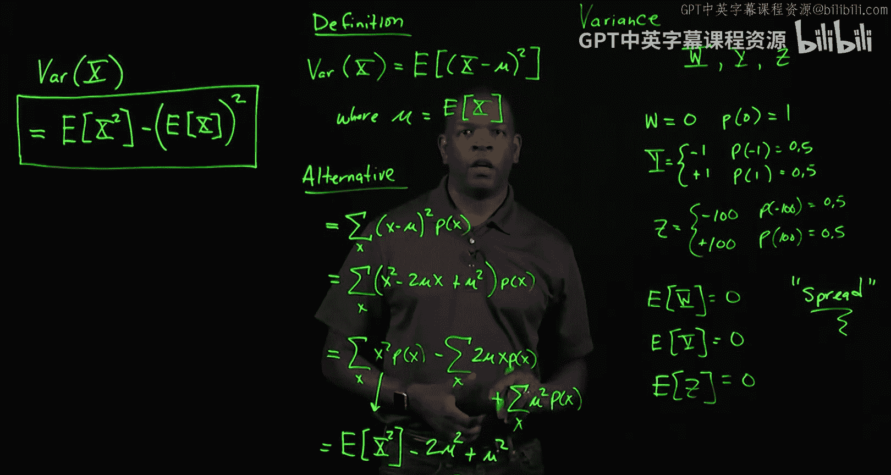

# 约翰霍普金斯大学《计算机科学的统计方法｜Statistical Methods for Computer Science》中英字幕 p32 31_随机变量方差.zh_en -BV1r483zbEzN_p32-

Hello， in this video， we're going to be talking about another property of a random variable。

 and that property is going to be variance。

And so again， we're going to go into a lot more detail in these quantities and these properties。

As we move through the course。But to kind of wet your appetite a little bit to understand the importance of variance and why。

 why we need something other than just expected value， we can look at a simple。Illustration。

 so suppose I have a a probability mass function of three variables， right。

 So I have random variable W。I have random variable。X。Yeah， let's say random variable。Well， W Y。And。

Z。Okay， so these these are some random variables that I have and these random variables have values where。

Let's say W。Is equal to zero。It is the only value that it can take on and the probability。Pi。😔，嗯。

Of W。So we're going to say that the probability of zero。For W is equal to1。So we have why。嗯。

In this guy， why has two values？So y can be， let's say， negative one and positive one and P。

Of negative 1 is equal to 0。5 and p of one is equal to 0。5。All。

 and then the final one is going to be Z。 Z can also take on two values， negative 100 and。

Positive 100。And the probability of negative 100 is 0。5， and the probability of 100 is 0。5。Okay。So。

What's interesting here？Is that。If I calculate。The expected value。Of each of these random variables。

 what you will find is the expected value。Of W。Would be equal to0？Jrry。😊，Why， well。

 because the weight of zero is 100%， there's nothing else you could do。

What would be the expected value of， let's say， why？Well。Expected value here would also be 0。Why。

 because look at it， the center of gravity is going to be equally positioned between these two points。

 negative  one and positive  one， and so without even thinking about it。

 we know that the expected value of z。It's going to also be zero。 How about that？So clearly。

 these random variables are describing different phenomena。

 but if I only have expectation as a means to characterize what's going on， I get，Basically。

 no information here。So let's look at this carefully。When you look at this， what？

Could be something that you'd be interested in。Okay。No， no， you'd be interested in。Okay， well。

 expected value is。Is the center， so we got that cover， but what else is there？Correct， that's right。

 It is how far these values are from the center。 We call that， you know。

 we can think of that as the spread。Okay。Right。The spread。

 how far of these values spread out across the center is what we're talking about。

 and this spread is what we call the variance， How much do these values vary from the center？Okay。

 so then if we're looking at then how far these values spread from the center， right。

 then we're looking at some quantity that's going to measure the distance。

That the you know starting from the expected value， which is in the center。

 we have to anchor there and then we're looking at the distance from that value to all the other numbers we now have a definition for variance that we want to explore and so we're going to write that the definition。

😡，And the definition is going to go like this。 We're going to say that the variance。

 and we're going to denote that with var。Of the expected random variable， I mean。

 of the random variable， we're going to say v。Of the random variable is going to be equal to。

And we're going to say that this is going to be。The expected value。

 and now we're going to have the expected value of a function。Right。

 and this function is going to be。X minus。New。Square。Where x is the。

Random variable and its possible outcomes。And mu。M is going to be equal to the expected value。

Of the random variable。Okay， so just take a look at what what you have here。

 We've defined variance in terms of a function， and that function measures the distance between each one of the possible values of the random variable and the expected value of the random variable。

 so just think back to here when were talking about spread in this case。The expected value is 0。

And then the values of x， the random variable would take on in this case it would be negative 1 and1。

 and this case with Z itd be negative 100 and 100， so this definition is actually exactly what we said it would be。

 it is going to measure the spread and it's going to give me an expected value as a function of the spread。

That is going to be key and what we want to be able to do is say that that will give me more information than having the expected value alone。

Now there is an alternate definition of variance that we can use that's a little bit more applicable when we're working problems and it's actually derived from what we have already sitting here and so so let's look at an alternative。

So an alternative then is going to go something like this。

 we're going to start with this definition and we're going to use what we learned about expectation of a function of a random variable to evaluate what's in here and so we begin by saying okay。

 I know the expectation is going to be this God's going to be equal to the sum。

And this is going to be of。Summing over the X is， this is going to be X。Minus mu square times P of x。

Okay。And now what I'm going to do is I'm going to go ahead and do， I'm going to break this out。

And I know that this is going to be x squared。Minus2 mu x。Plus， muse square。

And that's going to be times P of x。So I'm going to go ahead and break this up， the sum。

 and I'm going to break these out。This one is going to be the sum。

And this is going to be x squared P of x here。This is going to be minus the sum。

And this is going to be。2。Mu X， P of x。And this is going to be plus， and this is going to be the sum。

Mu square。P of x。All right， so what do we have here？Well。If we look at these terms。

 we'll leave this one the same， but at the second one， so we can say then that this right here。

 this first term is actually the expected value。Of a function of a random variable。

 and that function is。Cex Square。You see that this actually。Is this？Allright。

 then we're going to have minus。And we're going to have two mu because I'm going to pull the two mu out and when I do。

 because there's no x dependence there， when I do， I get。Expected value， right。

 X P of x is the expected value。 But if you recall。

 we define that the expected value in this case is mu。 So then this becomes simply。Mu square。Again。

 in this final term， and this final term， I have the sum of p of x， and by axiom。

 the sum of all probabilities has to be equal to 1， so then this is going to be plus mu squared。

So now with this being defined， we can rewrite our variance in terms of we can rewrite our variance in terms of expectation and the expectation of a function of a random variable and so now our alternate is var。

Of our random variable is going to be equal to。 And so what we have is we have the expectation of a function of our random variable。

 which in this case would be G of x is equal to x squared。 And then this is going to be minus。

 And so what we have here is that this becomes minus。New squared。ok。

And so this is going to be then and new is equal to so this is going to be a quantity of the expected random variable。

X。And we're going to square that quantity。Note and want to be very clear here that these quantities are not the same。

Okay， these quantities are not the same。 This is squaring the expected value， right？

And this is a function of a random。Variable。And the expectation of the function of that random variable。

 which we talked about in the previous video。 And so now what we have here is an alternate definition。

Of determining the characteristic of variance for a discrete random variable。

