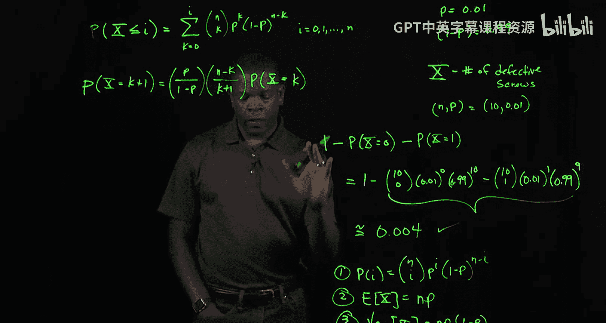

# 约翰霍普金斯大学《计算机科学的统计方法｜Statistical Methods for Computer Science》中英字幕 p33 32_伯努利随机变量与质量函数.zh_en -BV1r483zbEzN_p33-

Welcome back in this video we're going to talk a little bit more about random variables。

 but we're going to talk a little bit more in specific in specifics in terms of。

A couple random variables that you're going to see over and over。 in fact。

 when you go through the tutorial。And look at some of the R examples in the R code。

 you're going to find that there are certain functions that many statistical software will provide for you because these types of random variables are so common。

One of those is going to be what's called the Bernoulli or binomial random variable。Now， there are。

Mini。Different types of random variables。 And usually a random variable is going to be associated with a type of distribution。

 And when we talk about this distribution， we're talking about like when we looked at that。That。

The probability mass function。That was how are the probabilities distributed across the different values of this particular variable。

 So we know that。For instance， we know that all the probabilities for the different outcomes of a discrete random process。

 we know all those probabilities have to sum to one。And all of that together creates or you know。

Establishes a distribution。 So let's think about this for a minute。 Suppose you have a trial。

You have an experiment that has a trial and the outcome of that trial can be classified as either success。

Or。Failure。You either succeed or you don't。In an experiment such as this。

 this is a classic application of a Bernoulli random variable or a binomial random variable now。

We have to ask ourselves， how do we classify， like。

 how do we even begin to put this in a mathematical framework for which we can actually do some analysis。

 Well， the first thing we have to say， okay， let's identify that if the possible outcomes of success and failure。

 why don't we associate those with two numbers，0 and。1。So we're say that the probability of a zero。

 which is failure is going to be。1 minus p。 so clearly you can see that I've established P as being the probability of success right。

 and so P1 probability is going to be equal to P。All right。

 now we can see now that p is going to have to have a value that' is going to vary between zero and1。

Okay， if p is equal to1， it is certain to happen。 If P is equal to 0。

 it is certain not to happen and everything in between is going to be a probability。

 So in this regard now， if we establish。This type of scenario。

 this is a Bernoulli random variable now。We want to add to this。We want to add to this。

 so we're going to add。We want to add a value in。Now in is going to be the number of independent trials。

Okay， this is going to be the number of independent trials。And so by adding this。

Each time that a trial。Is successful。That's going to go towards the probability P and each time as trial fails。

 that's going to go towards the probability of1 minus p Okay。

 so now that we've done this we've added this。We started with the Bernoulli。

But because of this in in these independent trials， we've added this parameter where x now。My。

Random variable。Has parameters now。And those parameters are in and P。Again。

 N is going to be the number of independent trials and P is going to be the number of successes。

 so that being the case， this now becomes what's known as a binomial random variable and a binomial random variable is a beernoulli random variable which has parameters in NP P and in this regard now we can establish a well-know and very useful function and that function is going to be that the probability。

P sub I is going to be equal to， it's going to be equal to in I。 so this is。

The number of trials chosen i times， okay？Right， okay。

 and that's going to be the probability I times。The probability of failure，1 minus P。Of n minus I。

 and then this is going to be where I is equal to zero，1，2， dot dot dot all the way to n。

And now we have established what's known as。This is the。Bomial theorem for probability Okay。

 so now let's see how what can we do Well， the first thing we want to do is we have to check this。

We have to know whether or not this actually is a probability。

 and one property that must hold is that the sum of all probabilities， P of I or P of I。

 the sum of all of them must equal one。 So let's do that。 So we're going to take。嗯。

When' going to take the sum。Of I。Eals 0 to infinity。 And why am I picking infinity。

 because I don't know how many there could be an infinite number of。You know。

 we can approach an infinite number of different probabilities over the space after to account for them all okay and so then this is going to be p sub I and we know because this is a discrete random variable that I'm going to have a finite number so what I really have to calculate is going to be in terms of the number N of possible values that the discrete random variable can take。

Okay， that's the that's that's the key。 So I've whittled down from an infinite possibility to end。

 and now what I'm going to do is I'm going to go ahead and I'm going to establish now。嗯。

How I'm going to actually。Break down this summation。 So it starts with in the combination here。

 this is going to be in I。 And then I'm going to have piece of I。1 minus P。

 and then this is going to be in minus I。All right， so what happens now in the sum。 Well。

 in the sum now， this now becomes。This is going to be。P。Plus。All right。

 so I'm going to be doing both， it's going to be P， and then it's going to be plus。1 minus P。

 and then that's going to be to the in。Well， this right here。Is equal to。1。To the end。

So no matter what in you pick。This value， because this is p plus 1 minus p that's1 to the n。

 so that's equal to one。 And so now this checks out。Okay， this is going to check out。

So what we want to do now is let's look at an example。

So here we have the foundation of what we're going to be talking about in terms of the binomial random variable。

Let's look at an example of how we would actually use this。So suppose you have five coins。

 So we say five。Coins。Okay， and we're going to flip them。So what are we going to keep track of。

 we want to keep track of the outcomes， we assume that every time I flip the coin it's an independent trial。

 and I want to find the probability mass function of the number of heads that we get。Okay。

 so five coins are flipped。Fine。PMF。4。嗯。Heads。Outcomes。Again， when we talk about PMF。

 that means I have to find all possible values。And then I have to find the。

Probability for every value and then those probabilities must sum to one。If you don't do that。

 you don't have a PMF okay， the PMF is very important and that's a very good check on making sure that you can actually do that All right。

 so what do we have here， so we know if I have five coins then I know then that N has got to be equal to five because that's the number of independent trials for this particular experiment。

I did not make any statement about whether it was a fair co or not if we don't make a statement。

Whether it's on a quiz or whatever， you assume that the coin is fair， if it's not fair。

 we will make a specific statement to say。The coin is not fair and you know。

 life is not fair and the world is not fair， okay， we will let you know that。

 but in the absence of any statement like that， the coin is fair so then we know that P is equal to。

What he。 All right， so let's do it。 So what are the possible values， Well， I could have a situation。

Where I have no。No heads， right？ That could be a situation。 And so， so in that regard。

 if I have no heads。诶。Well， then I could say this， I could say that the probability of my random variable having zero as an outcome。

Okay zero as an outcome， so now I'm going to go back to my binomial theorem here and I'm going to calculate it。

 so that's going to be equal to so I have five trials in and of those five trials zero was successful。

Okay。Then the probability now。嗯。Of success。 So that's going to be P。

 The probability was 0 and the probability of failure。That's gonna be。1 minus P。Is5。Aha。

 I think you see it now， right？so I， I。N minus I is 5 minus0 that gives me 5。

 And so we can write this like this。 This is going to be。5，2，0。

Of one half to the zero power times one half to the fifth power。Okay。And so。We could do the next one。

 P of。X what if it' equal to1。Well， that's going to be。5。But I'm going to choose one this time。

The probability P， and so I'm just going to write this as1 half。

 so this is going to be1 half to the first power times1 half to the what fourth power。Oh。

 now you see it， right， so I can go P。Equals 2。 This is gonna be 5， chooseose 2。

This is going to be1 half and this is going to be square and this is going to be1 half。

 this is going to be cubed。Okay， I can do。What if there are three heads？Okay。

 I flip the coin five times， three of them aheads， then the probability is going to be five。

 choose three。One half， this is going to be three， but then this is going to be2。Probability X bar。

 This is 4。 This is going be 5。 chooseose 4 now。 Okay，5， chooseose 4。 and then this is going to be1。

 half，4，1， half。 and then this is one。Okay， and then we're going to get back down to the final。

Probability， x。The random variable has five heads， okay。

 five I flip the coin five times it comes heads and this is going to be equal to。

 this is going to be five， choose five now， one， half， five and one， half zero。No。

We've defined the rubric that you're going to use using this theorem to actually calculate all possible outcomes。

And what do we find？What do we find， Well， it turns out that this number right here is actually  one over 32。

Meaning out of the 32 possible combinations of this flipped coin right and you said。

 well what does the 32 come from Well， there's a couple ways we could do it if you wanted to brute force it and Dr。

 McCulllough talked about this a lot in counting there is a way we could brutefor it we know that there are two outcomes。

 heads and tails and we're going to do it five times so two to the fifth power is。32。

 so there is only one outcome out of those 32 where I will get no。Hs。There's only one outcome。

Similarly down here， there is only one outcome in which I would get five heads。

 And so in this one it's going to be one over 32。 aha really。

 so the real thing is we can book in this process as one over 32， simply because just by intuition。

 we know that there is only one outcome on the bookends， but what happens in the middle。

Right what happens in the middle， Well， it turns out that in the middle for this binomial process。

 we're going to have some interesting things happen。Okay。

 some interesting things happen When you do this calculation。

 you're going to find here that this is going to be five occurrences out of 32。

So let's think about that。 So I'm only I only have one hits， right。And I can move that one head。

 I can move that head around。 So， for instance， here's the example that I'm referring to。

 So by example， I can say the probability and what I'm looking at here is I'm looking at a situation where I have。

I could have。Tales， tails， tails， tails， heads。 That's one possibility for。

That's one possibility out of the thighhi。What are the other four possibilities， right， you got it。

 the other four would move the head into a different place。Right。So in this case。

 let's say we moved ahead。I get a head here and a tails。All the way down。 And you can just move that。

 So you can see by intuition that this is correct。 But you don't have to do that。

 You can actually do this calculation， and you will get 5 over 32。

 So now what happens as we move forward。 Well， then we're gonna get 10 over 32。Okay。

 because now I have more possibilities for heads， okay， but then here I get 10 over 32 again。

Can you think why that will be happening， What do we see here， as we progress through this。

 What do we see here， So if you could figure out why that happens， Okay。

 and then if you know that and you figure out this pattern and you know what's happening。

 then you know right away that this is going to be 5 over 32。

And so here we see that we have this kind of symmetry involved in the binomial process and with the symmetry。

 right， we can make a lot of inferences about exactly how the coefficients。Namely。

 these binomial coefficients are going to actually。Come to be。

 So you might want to think in terms of when you talk about the binomial random variable。

 think about a binomial term and binomial factoring， you know。

 so when you have a situation where you have a plus B squared or we want to say a plus B to the N for any power。

 right？So kind of thing you could think of as like for a plus b squared。

 you would have something like the coefficients of this would be one。2。😔，1。Oh。

 you don't remember Yeah， you remember that right That's right。

 So these are the coefficients of this。 And then basically you just count down so you go a squared and the coefficient is one plus and then it's2。

 A B， which is to the one and the one power。Okay， there's the coefficient 2 plus。

 and then the one coefficient again。 And then so you go B to the0。

 If you want to look at it like this， A to the1， B to the one， and then it's a to the0。

 and then B to the two。 So what's happening， The A's accounting down and the B's accounting up。 Okay。

 look at what you have here。 You have the successes accounting up。And the failures are counting down。

 Sues start at 0， and they count up to 5。 The failures start at 5， and they count down to 0。 Well。

 this givess way to the famous Pascal's triangle for finding any coefficient。 So for any in。

 this right here， Okay， this was。This was n equals two right， if I did n equals three。

 I would just simply， I know that it book ends at a one。1 plus 2 is 3。2 plus 1 is 3。

 and I book in then at a1。 So this is n equals 3。 So this is a plus B cubed。Well。

 we could do this again， I could say one， four， six， four， one。That's to the fourth power。

 And if I wanted to go to the fifth power， which is where we're working right now。

 I can see that I have one。5，10，10，5， and 1。 And so all that's necessary then in this process is for me to determine the sample space。

 And once I determine the sample space， which I know now is going to be 2。

 So my sample space is going to be。Sample space。It's going to be2 to the fifth power which equals 32 I have everything I need in order to do this calculation and that's how we could do it you know this particular calculation by hand and now I know that outcome  zero is going to be one over 32。

 one is going to be5 over 32， 10 over 32， 10 over 32。

5 over 32 and finally I'm going to have one over 32 and I have solved all possible outcomes for this experiment and I have answered the question by finding the probability mass function。

Okay， let's look at another example in talking about the binomial random variables。

 so let's suppose that we know we have a company and we know that this company would produce a certain item or a certain product that will be defective with a probability of 01 so。

Success now is that is defective， right， So we're just going to say that the probability P is equal to。

 we're going to say the probability is going to be equal to 0。01。

And so that means that  one minus p is going to be equal to 0。99。

And so we are going to do some independent tests。And。

Let's say that the company offers a money back guarantee。If at most。

 you know that at most one of the 1 products and in this case。

 the products could be something like a bag of nails or screws or whatever， right， but that。

There should be at most， you know， one defective and if there's more than that。

 then they'll give a money back guarantee or something。 So the question is。

 what proportion of the packages sold will the company have to replace。

 meaning that it goes beyond that。All right。嗯。If we start with a random variable。

 so let's make x again， our random variable。So x is going to be our random variable and now what we're asking is we're saying that if we're talking about。

The number of defective。嗯。Screws in the package， then。

This is the number of defective screws in a package。So。Defective screws。Okay。

 so there are 10 screws in the package。And the probability of failure。Is 01。

 So we have our parameters。 So we need so N P is going to be equal to 10 and 0。01。

So now we could do it， we know we have N， we have P。We have one minus P。And so。

The probability now that this package。Will have to be replaced。 In other words。

 because of a guarantee that we have is's going to be what。 So let's use our binomial theorem again。

 Well， a cup， first of all。We're looking for the probability that。At most， there will only be one。

 right， so if there are two。Defective peace parts。We got to replace。Okay， so。

 so what we're looking at is we're going to take one。Minus the probability that there is。嗯。

That there are no。Defective parts。Minus。The probability that there is。1。Defective part。Right。

Because so so this right here would give me the probability that there's two or more。

Which is what we're looking for。Okay。So let's see what this equals。

 So we're going to say that this then is going to be equal to。

 So the probability that there are no defective parts。Well。

 that's going to be so this is going to be1 minus， so it's going to be 10 choose zero。

And then p is 0。01 to the zero， and then this is going to be。99。To the tin。Yeah。

And then this is going to be minus and again， this is going to be 10， choose one。0。01 to the。one。

And this is going be 0。99。To the9。That's it， that's how you set this up。Okay。And then。

When you calculate。This piece right here。You're going to subtract it from one。

And your answer is gonna be somewhere approximately 0。004。

So that's the probability that you will have to。Give somebody their money back because they are more than one defective screw in a bag of tin。

ok。So that means that's pretty good odds。I would say。Right，That's pretty good art。Okay。

 so let's talk about some other things that that are going to be important so for a binomial variable random variable。

 of course， we want to know a couple things now。In this section， in this module。

I just went through in detail the binomial variable， our random variable。

 but there are some other distributions that I want you to consider there is the Poon distribution and for each one of these distributions。

 really what you're looking for are the same things。

You're looking for the function that governs the distribution which will be given。

 so in the case of the binomial， the function is p of I is equal to the parameter n。

 choose I P to the I1 minus p to the n minus I。That's for binomial， so we need three things。

Well we're looking for three things for each one of these random variables。

 we're looking for the we've already checked this and we know that this is legit right。

 so this is thing number one， we want the actual function that calculates the probability and we need that probability that function to be a probability mass function so that we can derive the distribution In this case。

 it would be a binomial distribution of all possible values of the random variable。

What else do we need， We want expectation。 Okay， what can I expect from that？

 And so it turns out that the expectation。Of the binomial random variable。It's going to be equal to。

N times p。How easy， right？ That's very， very easy。 Okay， so we want to know the function。

Probably mass function， we want to know the expectation of the random variable， and finally。

 we want to know the variance of the random variable in this case， it will be。Wait for it。

 Wait for it。 It's going to be。The variance is going to be NPp times。1 minus p。

NP times 1 minus P and there are some decent proofs in your book。

 these are very common proofs for binomial distribution。

 they're all over the internet and these are very easy things to derive。Okay。

 and so what you're going to do then is you're going to do the same thing for。

 let's say a pe distribution or hypergemetric distribution。

 all of these things are going to follow the same pattern。

 you need to find the probability mass function， you need to verify that it is correct function you need to find the expectation of that random variable for the binomials MP for the pon distribution it might be something different okay might be lambda okay that kind of thing and then you want to find the variance for that random variable。

Okay， and so then with doing that。We get down to talking about how do I actually compute a distribution now I showed you one way to compute the distribution and in that particular way I showed you how using Pascal's triangle if you recall。

 where you can actually calculate the coefficients and then if you know the sample space。

 you just put those coefficients over top of the sample space and that computes the probabilities。

Well， that only works。When the probability of success and failure are equal。

 like if you flip in a fair coin。嗯。some phenomena like that， that only works in that case。

A more general way to do it。Would be something like this。 supposeuppose we have a random variable。

 It is a binomial variable with parameters N and P。 we want we can say。

 and this is a general way to calculate， no matter whether it's fair or not， if you have N and P。

 we can say that the probability。Okay， and we're going to calculate the random variable。

Being less than or equal to some value I。Okay， well， this is going to be equal to the sum。

This is going to be， we're going to take k now equals zero。Up to a value I。

 And we're going to say in choose K。And then this is going to be p to the K1 minus p to the n minus k。

And that's for all in， let mean all I equal to0，1。Dot， dot， dot to in。Now if we want to utilize this。

We， we can utilize this by taking note of a relationship。 and when we break this down。

 this relationship comes out to be a recursive one where we find that P of。

The random variableial x being equal to， and this is going to be k plus1。

This is going to form a recursive relationship where I'm going to have P over 1 minus p。Times。

N minus k over。K plus1。And that is going to be multiplied by the previous value， the previous。

Probability。Of the random value variable x when it was equal to in this case， k。

Now you might be saying， well wait， you man Dr。 Jay Wood in the world， okay， follow me for a minute。

 right？In your book， if the proof for this to get to here is in is going to follow proposition number six in your book。

 but for now， let's look at an example and I think the example will make the utility of this process pay for itself。

Right。It's not going to cost you anything right as long as you make sure that you have what you need in order to actually do the calculation so let's suppose we have a binomial process and it' maybe it's flipping a coin or not but whatever the case it is not fair right in other words。

 the probability of success is not equal to the probability of failure okay so we're going to do it six times so let's say we have we got this binomial process and we're going to do this you know this NP and so this guy is going to be N as six and P is 0。

4。What we know and we're given， let's say that we're given。As a starting point。

We're given as a starting point。 What are we given， Well， we're given that about this。

 We're given that P。Is equal to that this value is equal to。So。We gotta say that this value is。

t6 to the 6。We're giving that value as a starting point。Okay。All right。

 now that so that's where we start。We don't expect this to be symmetrical。

 we don't expect it to follow Pascal's triangle per se because。Because of。The other piece。

 but then again， some of it should follow if you look at the coefficients of the combinations up here。

 right？Okay， all right， so how do we do it？Well。Okay， so let's just start。So let's so let's so。

P0 is given， so we need to do P。Equals  one。So what do we do， Well， we start with。嗯。So here we go。

 we have these， so we're going to say p over p minus1。So what's our P here？And then we got。So， P。

Its equal to。Poin4。And 04 over p minus1， which is 0。6。 that's going to give me4。

 So we're going to say this is going to be 04。Over。6。Oh you don't like that。Well， I mean。

 because the quantity is the same， we could easily say you know， that this is four over six。

 same same。Okay， then we got n minus k， so n is6。All right， and what is k， Well， K， remember。

 is going to be。嗯。If we're starting here。This is k plus1。So K must be0。

So then this is going to be n minus k is going to be6 and k plus1 is right here is going to be1 aha。

And then this is going to be times P of。X。Equals zero。 a there you go。Do you see the recursion。Okay。

 let's do the next one。 We'll try the next one。 So I got P。This time， I'm looking for this value。

Now remember， I need to get all of them in order to define the probability mass function so that I can build out the distribution so what do we get here Okay。

 so on this one， again， this is going to be the same thing。 it's always p over pma over 1 minus p。

 so this is going to be4 over 6。But this is going to be five over， and this is going to be two now。

And this is going to be p of x equal 1。 it's the previous one。Well， at this point now。

 I think you're able to step this all the way out。Okay， so that being the case。

 you can step this all the way out。And you can go all the way down to the final one。

which would be six and that's going to equal so again this is a constant four over six。

 but then this is going to be one over six， so you see we started here。Okay。

And then this is going to be p of x equal to5 here。And as it turns out。

 when you actually do these calculations， what you're going to find is that these calculations are not going to be symmetric。

They're not going to be symmetric。 and the reason is because we're starting out with the probability of success and the probability of failure being。

Unequal。and so this is a more robust way to generate those probabilities and those distributions。

 but when you are done you will have a probability for every value and then what you have to do in the final analysis that you have to add up all of the probability probable values add them all together and then what you're going to do is you're going to go ahead and see if it sums to one and if it does you did it correctly and you can congratulate yourself on having a clear and very complete understanding of discrete random variables in terms of the binomial theorem and so what you want to do now is move on to Poisson and to some of the other distributions that are located in the textbook thanks for watching and I'll see you in the next module。

