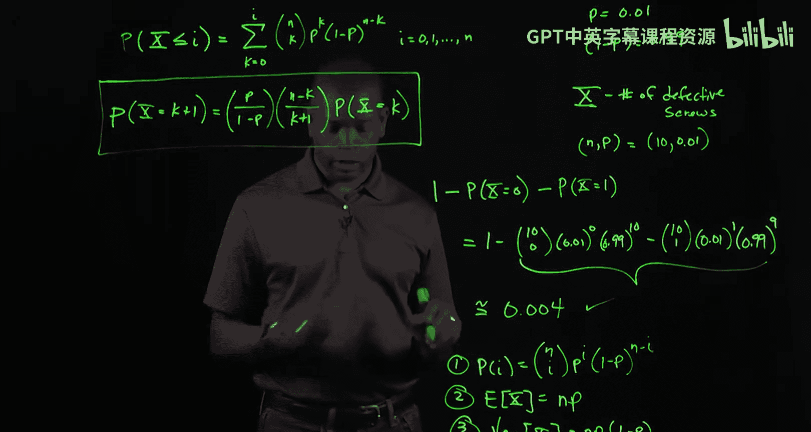

# 约翰霍普金斯大学《计算机科学的统计方法｜Statistical Methods for Computer Science》中英字幕 p34 33_次品检测实例研究.zh_en -BV1r483zbEzN_p34-

Okay， let's look at another example in talking about the binomial random variables。

 So let's suppose that we know we have a company and we know that this company would produce a certain item or a certain product that will be defective with a probability of 01 so。

Success now is that is defective， right， So we're just going to say that the probability P is equal to。

 we're going to say the probability is going to be equal to 0。01。

And so that means that 1 minus p is going to be equal to 0。99。

And so we are going to do some independent tests。And。

Let's say that the company offers a money back guarantee。If at most。

 you know that at most one of the 1 products and in this case。

 the products could be something like a bag of nails or screws or whatever， right， but that。

There should be at most， you know， one defective and if there's more than that。

 then they'll give a money back guarantee or something so the question is what proportion of the package is sold。

Will the company have to replace？Meaning that it goes beyond that。All right。嗯。

If we start with a random variable， so let's make X again， our random variable。

So x is going to be our random variable and now what we're asking is we're saying that if we're talking about。

The number of defective。嗯。Screws in the package， then。

This is the number of defective screws in a package。So。Defective screws。Okay。

 so there are 10 screws in the package。And the probability of failure。Is 01。

 so we have our parameters。 So we need so NP P is going to be equal to 10 and 0。01。

So now we could do it， we know we have N， we have P。We have one minus P。And so。

The probability now that this package。Will have to be replaced In other words。

 because of a guarantee that we have is's going to be what。 So let's use our binomial theorem again。

 Well， a cup， first of all。We're looking for the probability that。At most， there will only be one。

 right， so if there are two。Defective peace parts。We got to replace。Okay， so。

 so what we're looking at is we're going to take one。Minus the probability that there is。嗯。

That there are no。Defective parts。Minus。The probability that there is。1。Defective part。Right。

Because so this right here would give me the probability that there's two or more。

Which is what we're looking for。Okay。So let's see what this equals。

 So we're going to say that this then is going to be equal to。

 So the probability that there are no defective parts。Well。

 that's going to be so this is going to be1 minus， so it's going to be 10， choose zero。

And then p is 0。01 to the zero， and then this is going to be。99。To the tin。Yeah。

And then this is going to be minus and again， this is going to be 10， choose one。0。01 to the。one。

And this is gonna be 0。99。To the9。That's it， that's how you set this up。Okay。And then。

When you calculate。This piece right here。You're going to subtract it from one。

And your answer is gonna be somewhere approximately 0。004。

So that's the probability that you will have to。Give somebody of their money back because they are more than one defective screw in a bag of tin。

Okay。So that means that's pretty good odds。I would say。Right，That's pretty good art。Okay。

 so let's talk about some other things that that are going to be important right so for a binomial variable。

 random variable， of course， we want to know a couple things now。In this section， in this module。

I just went through in detail the binomial variable， our random variable。

 but there are some other distributions that I want you to consider there is the Poon distribution and for each one of these distributions。

 really what you're looking for are the same things。

You're looking for the function that governs the distribution which will be given。

 so in the case of the binomial， the function is p of I is equal to the parameter n。

 choose I P to the I1 minus p to the n minus I。That's for binomial， so we need three things。

Well we're looking for three things for each one of these random variables。

 we're looking for the we've already checked this and we know that this is legit right so this is thing number one。

 we want the actual function that calculates the probability and we need that probability that function to be a probability mass function so that we can derive the distribution in this case。

 it would be a binomial distribution of all possible values of the random variable。

What else do we need， We want expectation。 Okay， what can I expect from that？

 And so it turns out that the expectation。Of the binomial random variable。It's going to be equal to。

N times p。How easy， right， That's very， very easy。 Okay， so we want to know the function。

Probably mass function， we want to know the expectation of the random variable， and finally。

 we want to know the variance of the random variable in this case， it will be。Wait for it。

 Wait for it， It's going to be。The variance is going to be NPp times。1 minus p。NPP times1 minus P。

 and there are some decent proofs in your book， these are very common proofs for binomial distribution。

 they're all over the internet and these are very easy things to derive。Okay。

 and so what you're going to do then is you're going to do the same thing for。

 let's say a p distribution or hypergemetric distribution。

 all of these things are going to follow the same pattern。

 you need to find the probability mass function， you need to verify that it is correct function you need to find the expectation of that random variable for the binomials MP for the pon distribution it might be something different okay might be lambda okay that kind of thing and then you want to find the variance for that random variable。

Okay， and so then with doing that。We get down to talking about how do I actually compute a distribution now I showed you one way to compute the distribution and in that particular way I showed you how using Pascal's triangle if you recall。

 where you can actually calculate the coefficients and then if you know the sample space。

 you just put those coefficients over top of the sample space and that computes the probabilities。

Well， that only works。When the probability of success and failure are equal。

 like if you flip in a fair coin。嗯。some phenomena like that， that only works in that case。

A more general way to do it。Would be something like this。 supposeuppose we have a random variable。

 It is a binomial variable with parameters N and P。 we want we can say。

 and this is a general way to calculate， no matter whether it's fair or not， if you have N and P。

 we can say that the probability。Okay， and we're going to calculate the random variable。

Being less than or equal to some value I。Okay， well， this is going to be equal to the sum。

This is going to be we're going to take k now equals zero up to a value I。

 and we're going to say in choose k。And then this is going to be p to the K1 minus p to the n minus k。

And that's for all in， let me all I equal to0，1。Dot， dot dot to in。Now if we want to utilize this。We。

 we can， we can utilize this by taking note of a relationship。 And when we break this down。

 this relationship comes out to be a recursive one where we find that P of。

The random variableial x being equal to， and this is going to be k plus 1。

This is going to form a recursive relationship where I'm going to have P over1 minus p。Times。

N minus K over。K plus1。And that is going to be multiplied by the previous value， the previous。

Probability。Of the random value variable x when it was equal to in this case， k。

Now you might be saying， well wait， man， Dr。 J Wood in the world， okay， follow me for a minute。

 right？In your book， if the proof for this to get to here is in is's going to follow proposition number six in your book。

 but for now， let's look at an example and I think the example will make the utility of this process pay for itself。

Right。It's not going to cost you anything right as long as you make sure that you have what you need in order to actually do the calculation。

 so let's suppose we have a binomial process and it's maybe it's flipping a coin or not but whatever the case it is not fair right in other words the probability of success is not equal to the probability of failure okay so we're going to do it six times so let's say we have we got this binomial process and we're going to do this you know this N and so this guy iss going to be N is6 and P is 0。

4。

What we know and we're given， let's say that we're given。As a starting point。

We're given as a starting point。 What are we given， Well， we're given that about this。

 We're given that P。Is equal to that this value is equal to。So。We gotta say that this value is。😔。

t6 to the 6。We're giving that value as a starting point。Okay。All right。

 now that so that's where we start。We don't expect this to be symmetrical。

 we don't expect it to follow Pascal's triangle per se because。Because of。The other piece。

 but then again， some of it should follow if you look at the coefficients of the combinations up here。

 right？Okay， all right， so how do we do it？Well。Okay， so let's just start。So let's so let's so。

P0 is given， so we need to do P。Equals 1。So what do we do Well， we start with。嗯。So here we go。

 we have these， so we're going to say p over p minus1。So what's our P here？And then we got。So， P。

Its equal to。Point4。And 04 over p minus1， which is 0。6。 that's going to give me four。

 So we're going to say this is going to be 04。Over。6。Oh you don't like that。Well， I mean。

 because the quantity is the same， we could easily say you know， that this is four over six。

 same same。Okay， then we got n minus k， so n is6。All right， and what is k Well， K。

 remember is going to be。If we're starting here。This is k plus1。So K must be zero。

So then this is going to be n minus k is going to be6 and k plus1 is right here is going to be1 aha。

And then this is going to be times P of。X。Equals0。 there you go。Do you see the recursion。Okay。

 let's do the next one。 We'll try the next one。 So I got P。This time， I'm looking for this value。

Now remember， I need to get all of them in order to define the probability mass function so that I can build out the distribution so what do we get here Okay。

 so on this one， again， this is going to be the same thing， it's always p over pma over 1 minus p。

 so this is going to be4 over 6。But this is going to be five over， and this is going to be two now。

And this is going to be p of x equal1。 It's the previous one。Well， at this point now。

 I think you're able to step this all the way out。Okay， so。That be the case。

 you can step this all the way out。And you can go all the way down to the final one。

Which would be six。And that's going to equal。 So again， this is a constant four over six。

 but then this is going to be one over six。 So you see we started here。Okay。

And then this is going to be P of。X equal to5 here。And as you as it turns out。

 when you actually do these calculations， what you're going to find is that these calculations are not going to be symmetric okay。

 they're not going to be symmetric and the reason is because we're starting out with the probability of success and the probability of failure being。

Unequal。Right and so this is a more robust way to generate those probabilities and those distributions。

 but when you are done you will have a probability for every value and then what you have to do in the final analysis and you have to add up all of the probability probable values add them all together and then what you're going to do is you're going to go ahead and see if it' sums to one and if it does you did it correctly and you can congratulate yourself on having a clear and very complete understanding of discrete random variables in terms of the binomial theorem and so what you want to do now is move on to Poisson and to some of the other distributions that are located in the textbook thanks for watching and I'll see you in the next module。

