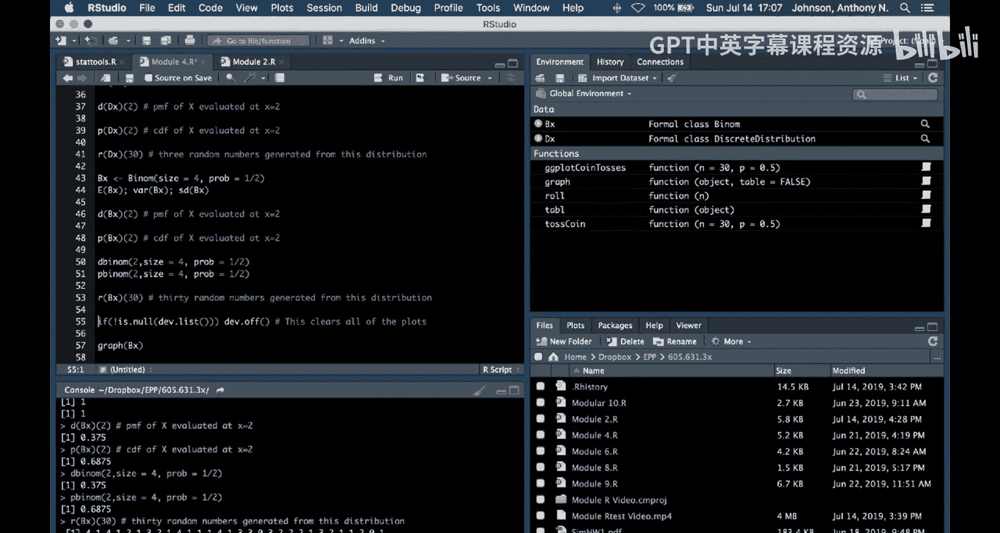
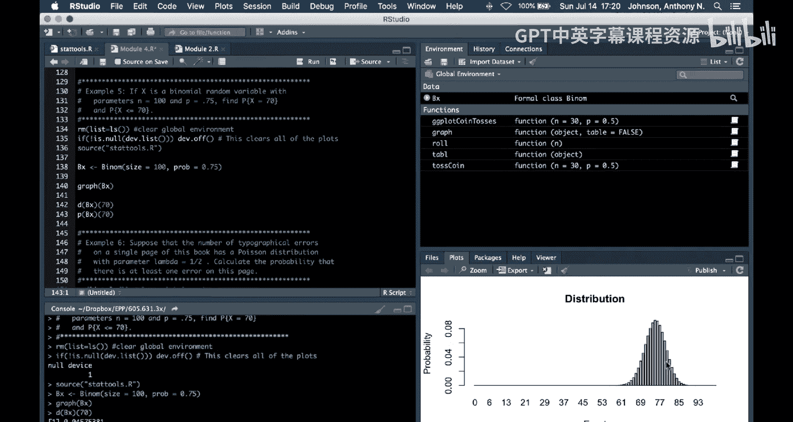
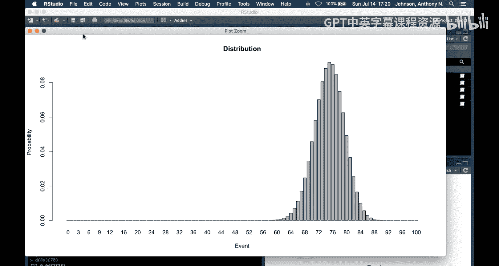
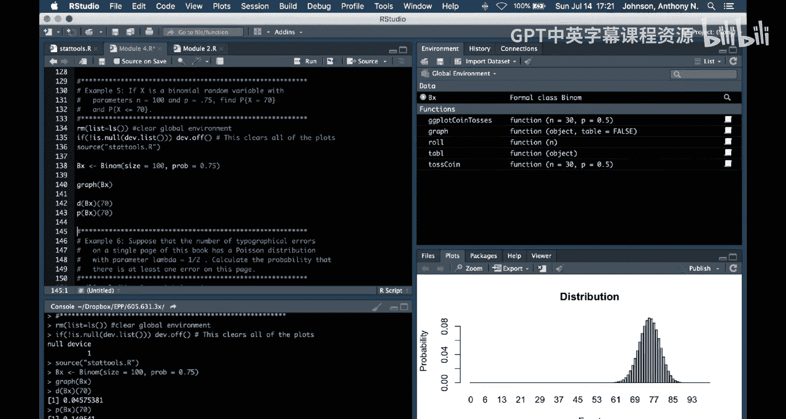
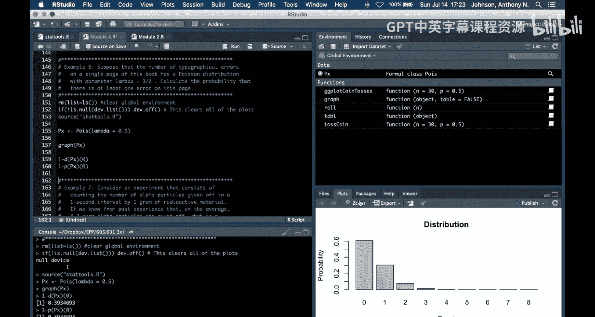
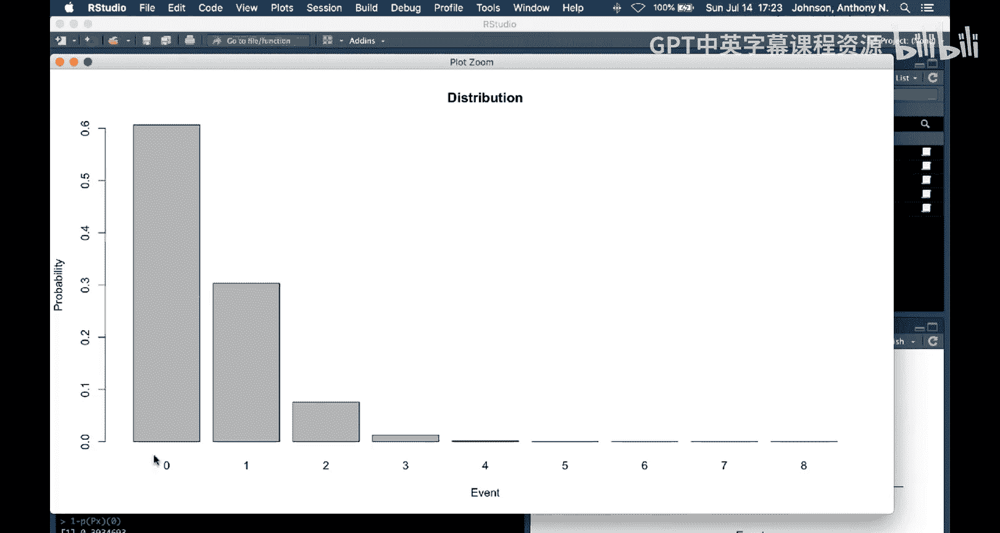
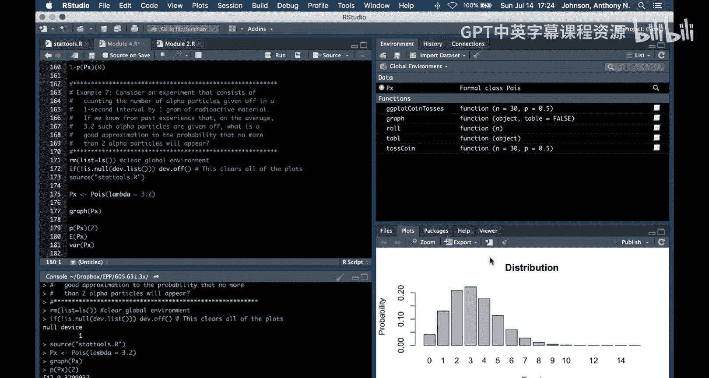
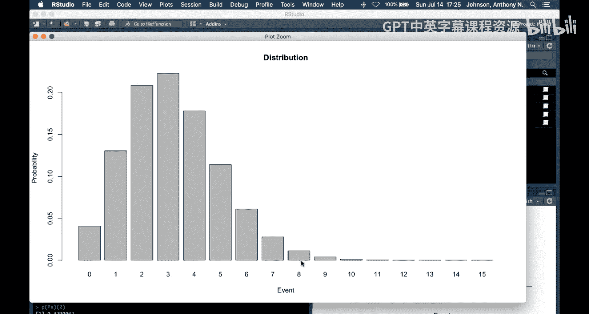
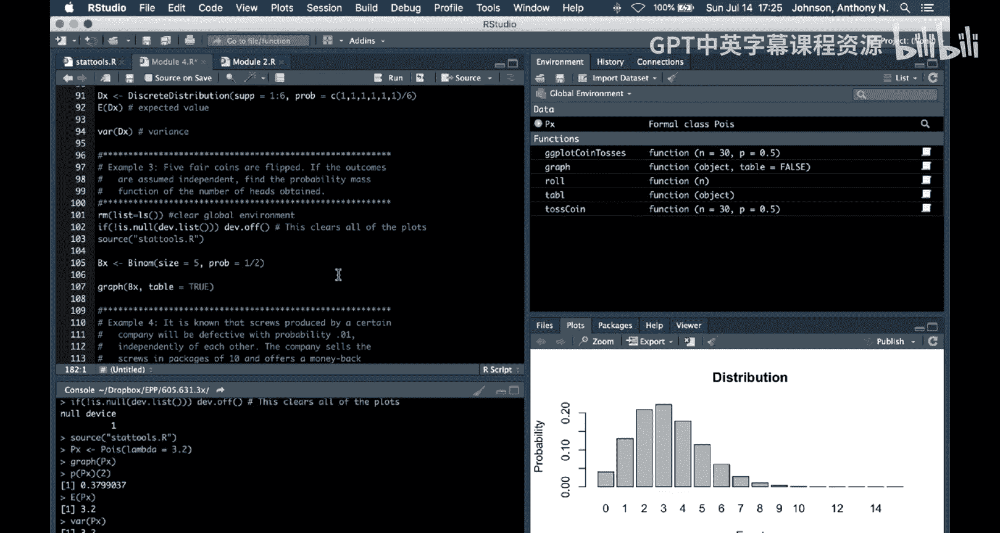

# 约翰霍普金斯大学《计算机科学的统计方法｜Statistical Methods for Computer Science》中英字幕 p35 34_R语言教程.zh_en -BV1r483zbEzN_p35-

Hey guys， welcome back this Dr。 Johnson in this module we've been talking about discrete random variables and this tutorial in R is just going to go over some of the concepts and then what I'd like to do is really dig down into some examples。

So as we saw before， you know， we could clear the environment。Just make sure if thing is cleared。

 we can load up our stack tools that we're going to use and keep in mind that when I ran stack tools here。

 I didn't have as that many functions， but as I update more and more put more things in it when you run it。

 you may have a lot more functions here， but just keep that in mind。

So when we're talking about these discrete random variables and looking at the mean and the variance of them。

 we can start by thinking about discrete random variables by thinking about discrete random events。

 so suppose we had let's say we wanted to count the number of heads in a series of coin tosses so let's say if we toss the coin。

 let's say three times right。And when we do that coin toss three times， here is the sample space。

And if I am looking at for a discrete random variable， the number of times。

That heads occur in that event。 Okay， the number of times I get head。 So what's the number of times。

 So we start with 0 here。 So's the number of times that there will be no heads。

 So there's a heads there there there There is only one time。That there are no heads， right。

 So the frequency at which。No heads occur would would be one。

And the total number in the sample space is eight。 and so what we get then is we get this idea of you know。

 kind of looking at the probability if you want to think of it that way of seeing no heads in an experiment where I toss three coins is going to be one out of eight times。

Okay， one out of eight times。All right， we look at one。What's the occurrence that I would see？

You one head。 So I go down here and I see， well， here's one at row 7。Here's another one at row 6。

 that's two。Not at row 5， but we're at row 4。That's three， not at row 3， not at row 2， not at row 1。

 and so that's where this 3，8 comes from。So I just wanted to see how we build this。

 given x as the occurrence that I am actually counting what I'm actually looking for in this case。

 the number of heads。And then F is the frequency at which that actually happens。

 or you could say the probability if you put it over to sample space。

 And so I'm going to go ahead and。Run this。And I'm going to run this one。

 and I'm going to just get those in memory。And now we can calculate the expected value。

 which I'm going to call mu or the mean。 And that's simply going to be the sum。

Of the x values times there corresponding frequencies。 And when we do that。

 we get an expected value of 1。5。We can calculate the variance the same way。

 there is a formula and we can follow that formula and calculate the variance。

 and once I have the variance， then I know to find the standard deviation is simply to take the square root of the variance and I have the standard deviation。

Now， we are。Basically。Interested。In finding the accumulation of these values。

And the accumulation of these values are known as a CDF。

 it's a function and it's built on the support。Of accumulating the probabilities in F。

 and we can do that with a function called Q sum， cumulative sum。

And this is the thing that we can do Once F is defined。 we can run this Q sum function。

 And what we get is we get the values。 So we start at 0， which is 1/ eighth。

 And then we move up to we add 3/8s to1/8。 that gives me 4/ eighths， which is12。

 And you can see I'm accumulating the probabilities all the way till I get to a probability of one。😊。

So that's going to be in handy as you work some examples， just understanding， you know， this Q sum。

All right， so let's take a look at some other things。 so let's clear。And load up our source again。

 So now we're want to use this function。 We're going to do the exact same thing we just did。

 except now we're going to use this function discrete distribution， which is very， very handy。

 notice。I like to do the kind of brute force calculation so that you have confidence that these functions are calculating things that they're supposed to calculate。

So for this discrete distribution， you need support and the support are going to be the actual values in this case。

 right， so we have zero heads all the way up to three heads in this experiment。

And the probabilities are going to be 1，3，3，1。 And then you can divide this entire vector。By 8。

So let's go ahead and run that and get that into memory。 And when we do。

 you can see here our variable is in memory。 we have the correct support。

 And so now we should be able to do something things。

 So one of the easiest things to do is to find the expected value。

 which is pretty simple with a capital E。And we get the expected value， and it's 1。5。

 exactly what we expected it to be。 The variance is going to be 0。75， and the standard deviation。

 which is just using S D， is calculated。Now， there becomes a situation where。You want to find。

The probability mass or the cumulative distribution now。Think of， if you recall from the lecture。

 the probability mass is just the value that's under the curve。

 whereas the cumulative distribution is the sum of all values from the minimum coming from the left up to a certain point。

So we would expect， of course， that these values be totally different。

 So we're going to use the D again for the probability mass function。 in this case。

 I want to evaluate it at 2 and I get 0。375。And if I want to get the cumulative version of that。

 I'm going to evaluate it at two and I get 8。75。See if you can figure out without me telling you where those values came from。

You might want to pause for a minute and give yourself a chance to think about it。All right， so。😊。

This time， we're going to look at a situation here where。

We want to find random numbers that are generated from this distribution。

I know what the mean or the expected value is going to be。

 and I know what the variance is going to be in the standard deviation I can calculate。

 now I want to see， I want to generate some random numbers。 Well。

 this is neat because now to do that， I just use this R in front of the D X。

 and that R stands for random。 And then I give it an argument of how many random numbers I want to generate。

 And when I run that， it generates。啊。It will generate three random numbers。 Okay。

 the reason why I just it ran a three is because I had three highlighted and I ran that so it said。

 run only what I had highlighted。Okay， so I generated three random numbers if I wanted to generate 30 random numbers。

 I could do that。Allright。So very， very simple there。All right。

So let's look now at a particular type of discrete。Distribution。

 the binomial distribution we've seen this before， but again。

 we're going to look at how easy it is to find so in this case。

 if I do the binomial distribution that we did before。

 I can find the expected value the variance and the standard deviation。Too easy。All right。

 what if I wanted to find the standard， the probability mass evaluated at x equal2？

And if I wanted to find these distribution at x equal2。Same， same。Okay。

I could have used some other functions to do it the D by knownome function is a standard R function that doesn't。

That uses。Meaning that it is not using a package per se。

And the P by noome is the probability or the cumulative distribution function。

 you get the same thing and in fact， if you were to looked deep into these packages here。

 they're just calling these functions later on again， I can do 30 random numbers。

And these just give me you different ways of doing this。All right， so if I wanted to go further。

 I could actually graph。

What we've experimented with， okay， I can actually graph it and so when we're talking about this graph。

 right？Again， if your graph doesn't work， if when you do G BX， you're not getting a graph here。

 make sure you have that you've sourced the stat tools and that you actually see the graph function available to you in your environment。

All right， so what we see here is this is the distribution， this is the discrete， you know。

 random distribution， and you can see that at two。It's set at 3。75。Or 。375， I should say。Okay。嗯。

And then if we accumulate， right so the PMF probability mass function says。

 tellll me the value when I'm at2。The CDF says accumulate all the value up until and including two。

 so that's the difference。And if I was to。If we set this argument table equal true in our graph function。

 what we get is we get the actual table， right？We get the actual table。

So let's look at some examples now。All right， so example number one。We have three balls。

And they are randomly selected without replacement from an urn containing 20 balls。

 and those balls are numbered  one through 20。Now， if we bet that at least one of those balls。Okay。

 if we bet that at least one of the balls that are drawn。

That one of the ball has a number as large as or larger than 17。

What is the probability that we win the bet？All right， so let's clear out our variables here。

Get our sources。Back in。Again， you don't have to keep rerunning the source if you don't want and you don't have to keep clearing the environment。

 this is something I do as a teaching tool because I don't want everything jumbled over here。

 but you certainly don't have to do that。And I can use this function here to clear all the plots。

Ca I want to start with a fresh plot。And so the first thing I'm going to do is I need to set up my sample space and so in this case。

 the urn has one through 20 balls。And I am going to select three of them。

And I'm not going to replace the balls。Right。And ordering doesn't matter。

 doesn't matter what order I'm pulling them in。And so when I do that。I get 1140。

Different items in my sample space。And so I can now， now that I have the sample space。

 now I can establish the probability Now here's one way you can check that。

You don't want to list out this 1140。 It's just it begins to get too cumbersome， right。

 What I did was I said， just tell me the number of rows that I'm going to have here。

And that's how I get 1，140， or you can simply look here。Now。

 the number of variables is there are three variables， one variable for each ball。

You can when you do the prop space function， you will be adding another variable and that variable would be the probability。

 and you can check that once you run the function， you see that P now has four variables。

 same number of observations， but now it has four variables。All right。

What we're going to do now is we're going to set x equal to 16。

 and the reason why I'm sending it equal to 16 is because。It says that it is as large as。Okay。

 or larger than 17。Right so I'm going to make my cut off 16。

 and now I'm just going to use the greater than or less than sign because then that way I can break and 17 would be included in any subset。

 So I'm going to say x is equal to 16。And now I have some subsets， so for subset number one。

 I'm going to look at the first ball， and I want to know if the first ball is greater than X， right。

 that means in the first draw， give me the subset of all P that's greater than 16。

 which means that is 17 and larger。Number as large as， which means 17 or larger than。

 So there's this one here。 And when I run it， I see that in that subset。

 I only have four observations。There were four observations in that subset。Okay。

Let's look at the next ball， I run that。I have 100 observations in that subset。

 and in a third subset。I have 580 observations。Okay， so what does that tell me， that tells me that。

Basically， what I'm looking for is what is the probability， Okay， Because the bet is that。

At least one of the balls。That are drawn has a number larger than 17。Okay， at least one of the balls。

 and so now I've I've encapsulated these three events and if you think about it in a Venn diagram。

 what I'm looking for now is the union。I'm looking for the union of all of these events and finding the union of these events。

 I come up with this event。And so when I run this， it tells me that this event is going to have 580 observations。

All right， so now I can see that the probability now of this event。

It's going to be a little better than 50%。So that is the probability of giving three balls that I draw。

 one that is at least。17 or above。Let's look at example number two。

Calculate the variance if x represents the outcome when a fair die is rolled。

And so we've seen this one before。 Okay， this is a very， this one shouldn't cause us any problems。

 We can just， we're going to clear our list， load our tools and then in here。 we're going to have。

 Here's our discrete， random distribution。There is the expected value。And there's my variance。Okay。

Notice the difference， you got to make sure that here equally likely outcomes。

 so you just got to make sure that you set it up properly。Example number3。5 fair coins are flipped。

If the outcomes are assumed independent， find the probability mass function。

Of the number of heads obtained。 So here we want to find the PMmF。

So let's go ahead and clear our environment。To me， clear the environment is like erasing the board。

And so now we know that what we have is we have in an individual experiment。

The outcomes are independent， so this is a binomial experiment， so we can use the binome here。

The size is five， they're five coins， and they're equally likely， right。

 And so the probability is going to be one half。So in this case。

 we establish our BX for our binomial class。And then we can just graph that。

And this is our probability mass function。I set table equal to true here and clearly we can see。

Our probability mass function。So that's a pretty easy one。All right。😊。

It is known that screws produced by a certain company will be defective of probability 0。 I mean。

 point01。And this is independent of each other。 The company sells the screws in a package of  tin0 and offers a money back guarantee that most。

Of the 10 screws， I mean， that that that at most one of the 10 screws are defective。

 What is the proportion of packages sold。Um。Must the company replace。 So in this one。

So let's go ahead and clear our board again。So in this one。We have another bin noial distribution。

 the size is going to be 10， and the probability now， okay。

 the probability that one is defect is going to be 0。01。So we set up our environment and we graph it。

Okay， now here's the interesting thing。We're looking for the proportion of packages sold。

That the company is going to have to replace， right？So in this case。

I am not looking for the probability。嗯。Of so if it's just one， and it says at most。

 I am looking for the probability of。Not zero and not one， but I'm looking for all of these guys。

What are these probabilities So I'm not looking for0， which is here or one。

 I'm actually looking for the accumulation of the rest。So think about that for a minute。

It's the wording here。Offers a money back guarantee that at most one of the 10。All right。

 so you have to take the probability of none of the 10。Plus， the probability of one of the 1。

And if we take the sum of that， right？The sum of that is 99。 I mean， is 0。9957。

And so what we're looking for then to find the probability in this case。

 we're looking for the proportion of packages sold。 We're looking for  one minus this amount。

And so here you can either take the sum or you can just subtract the two from one。

 and what you get is 0。004。All right。嗯。Let's look at example number five。

If x is a binomial random variable with parameters n equals 100， and here we have P equals 0。75。

We want to find。So look at this right here， so when I'm looking for x is equal to 70。

 that screams at you that you're looking for a problem you're looking for a PMF。

It tells you what function you want to use if I'm looking for the accumulation of all x less than an equal to a number。

 then you know you're looking at the CDF， so let's work this one。ok。So on this particular problem。

 we're going to， I'm just going to clear this environment again。And I'm going to establish this。

 and here's my graph。Okay， mean I want to do a table for this one because that'll be a lot of numbers。

 but we don't need it。 Alright， so at 70。This is the value。Okay，And if you notice。

 I know it's hard to see。

But if you notice， so。The expected value is going to be somewhere here， right？

But we're looking at 70。 And if we look at 70s somewhere around here。It's gonna to be somewhere。

 you know。Point4。If that's 68。69。😔，70，71，72，68，69，70。😔，So what do we get as an answer？

Yeah，45。045。 that's by right。Okay， now do you expect the accumulation up to 70 to be the same。

 of course not， right， that accumulation is going to be a lot more because what it's doing there。

 that accumulation is taking all of these values。

And accumulating up to。

70。Let's look at another example， suppose that the number of typographical errors on a single page of this book and the book is your textbook has a Poone distribution with parameter lambda equals12。

Calculate the probability that there is at least one error on the page okay。

 so there is at least one error on the page， so we're going to clear our environment again。

And so we're going to set up our Poson distribution using our poise function。

 and we're going to establish Lada， we're going to set it to 12 or 0。5。Now， when we graph this。

 here's our graph。So what are we actually looking for when we say we want to find。

It says calculate the probability that there is at least one error on the page。

At least one error on the page。 So basically， we're looking at0。Right。😊。

And then we're calculating this amount。So we're going to subtract the probability that zero happens from the probability that one or more happens。

 and so that's going to be。The mass function。But now there's an interesting thing that happens here in this case。

Because the accumulation up to。Zero only has one value。

 It turns out that the CDF and the PMF are actually the same in this case。

 and so either one would give us the correct answer。

But it really takes into account an understanding of knowing what you're trying to accumulate。

 where you're trying to actually accumulate， you're trying to get this value right here。

 and because there is only one value at zero， it could be either the accumulated value or the density value。

 the mass value from the PMF， so either one would work there。

All right， finally。Let's look at this experiment， consider an experiment that consists of counting the number of alpha particles given off in a one second interval by one gram of radioactive material。

If we know from past experiments that on the average， 3。2 such alpha particles are given off。

 what is a good approximation to the probability that no more than two particles will appear Allright。

 so setting this up the same way？Okay， we have a Poe distribution。Where the Lambda is 3。2。

We can graph it， right。 And so basically， what we're looking for is we're looking for the。Dense。

 I mean， yeah， the cumulative distribution。Up to two。And so when we do that。This is what we get。

 we get 0。37999。Now， what is the expected value of this distribution？What is the expected value。

 Well let's take a look。

If I zoom in here。What would you say the expected value would be？Well， it certainly wouldn't be zero。

Would't be one。When before because yeah， it's going to be somewhere around here， three， right， Well。

 you know from our lecture that the expected value of a poisonone distribution is lambmbda。

Which is 3。2 and also the variance。So I hope you。Got something out of this tutorial。

 the idea is to give you some tools to use so that you can automate some of your tasks and really not just to go over code but to have an understanding of how this code in R accompanies and complements what you're learning in the actual lesson itself。

Thanks， guys。