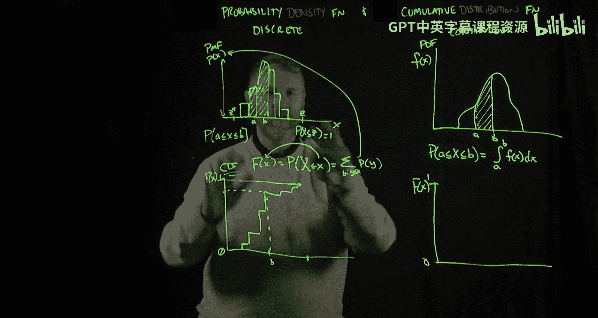

# 约翰霍普金斯大学《计算机科学的统计方法｜Statistical Methods for Computer Science》中英字幕 p37 36_概率密度函数与累积分布.zh_en -BV1r483zbEzN_p37-

。

All right， today we're going to talk about。Probability density functions and cumulative distribution functions with the key term being density and distribution now in previous lectures you've heard of in discrete random variables you've heard of the probability mass function and that's where values can take on a very certain certain discrete number and we're going to talk a little bit about there's some important differences between going from discrete to continuous in that sense。

 but in order to motivate that I just want to do a quick review here so with the with the discrete we're going to use this side here for discrete and we're going to use this for continuous。

Just so you see the difference so let's start with the idea of a probability mass function right so a PMF or P of X right so if you recall right you know you have certain values that X can take on right。

Here， and so that becomes your your probability mass function。

 so there's there's set values here that x can be。 and if I wanted to take the probability。

 let's say that。That a was less than or equal to S is less than or equal to B right then if I've got a and B here then I'm basically just going to sum right across these values A and B and I'm going to sum the frequency right the mass function right so there's some sort of P of x along this axis right here。

 that's you know whatever values something greater than0 and so I can just say what's the probability of getting a。

 what's the probability of getting B， I add them together。

 that gets me the probability of getting between A and B right or if there's three blocks you know then you would add that third block in there so that's how we understood calculating a probability with the probability mass function if you recall and then we added this idea of a cumulative distribution function So this is the CDf and if you recall the equation for the CDf。

 we use capital F of x right so this axis here is capital F of x。

It's a number that goes from0 to1 right and it's the cumulative probability is something's happened right so it's f of x and if we were to say define this it's the probability that our random variable capital x here for a random variable mapping rule is going to be less than or equal to some number x this is the x that actually goes here sum number there that's going to equal to the sum over the values of y such that y is less than or equal to x and it's going to be the probability of y where this p is referring to that PMmF right so don't get tricked out by the fact that I have a different letter here。

 I'm just trying to keep a difference between this letter and this letter right so this is essentially so this is saying y is saying all the values from x and lower from negative infinity all the way up to this value。

Right this x is the upper upper limit of the sum that's what goes into the f of x right so that's a slight difference but when we're constructing this what we're gonna to do is we're basically going to say。

 hey， you know there's a little bit of value here sorry it doesn't go down a little bit of value then we get a little bit bigger and we get a lot bigger。

 a lot bigger， a little bit bigger a little bit bigger and so the idea is where there's big chunks sorry you're seeing bigger step sizes up so it accelerates a little steeper and smooths out So what is you know if this is the distribution then what the CDF is saying is what is the probability that x is this value or less well if the distribution has an upper limit here remember the PMF all these value sum to1 in a proper PMmF over the support those are the range of values that x can be So if we're saying x can go from here to here what's the probability。

That your x is less than or equal to whatever this is， let's call it Z， right？What's the probability。

 Well， the probability is something happened is one， right， all of these things add up to one。

 that would equal1， right， What's the probability that we' less than this value over here。

 Let's call it Z star。 Well， the probability or less than z star is0 because there's no mass there。

 all the probabilities are occurring here And you're just adding those probabilities。 And this。

 if you recall with the CDF。If you were wanting to say what's the probability that I'm less than z。

 well， if I look at z here， I should be able to read that up to the value here over to the value1 and say。

 hey， I have I get the same probability what's the probability that I'm less than B。

 well if I find B here， right I should be able to read that up to the value here。

Read it over and then you know I get my probability or whatever the value is right there。

 That's how I'm reading the CDF okay that's a review I hope that makes that's a good reminder When we're talking about the density function right and we're in the continuous case。

 it looks very similar， what we're going to do is we're replacing the PMF with the PF。

We are replacing P of x with a little letter F of x right and this is a continuous function and so now the function is going to go something like this right right not going to it's not going to have these bins anymore and so with with the smooth function if I want to say hey。

 I'm going from A to B。Right instead of having this equation where I'm going to say， hey。

 what's the probability of a and I'm adding this mass with this mass。

 what I'm going to do instead of adding those， I'm going to be- so I'll say a less than or equal to x less than or equal to B。

 I'm now going to be saying here is my integral， instead of a summation。

 I'm going to go over the integral a to B， and I'm going to multiply I'm going to have f of x。

 that's the distribution function， that's this frequency。Dx， okay？

That is now going to be how I'm going to change that function and it's basically going to be taking the area under the curve in this interval that is the PF now the CDF right in the same way right in the same way is going to be we don't do these stair steps anymore right so how how how are weccumulating the value。

Well， I'm still going to use capital F of x right for this value。

 it's still going to range from 1 to0 because keep in mind， like a PMF。

 the whole thing had to sum to1。

In a P， right， the whole thing has to sum to1， what does that mean。

 that means that the integral from negative infinity to infinity of f of x dx equals1 that's a rule if that doesn't occur。

 it's not a PDF。OkaySo the probability something happens is one。

 so that's what that is saying right so probably from negative infinity to infinity is one。

So what we're doing with the F of x， just like we were saying， hey。

 what's the probability of random value is less than some function and that's the function here。

 right， what we're saying is。F of x。Is equal to the integral from negative infinity to x。

 That's the value that goes there。 And what we're going to do is we're going to say f of y。D Y。

 just like we did here， right And this， this you know。

 is only to tell you that it's a different letter than this， right， So the function in the CDF。

 right， what you're what you're actually plotting is the upper limit of integration， right。

 The thing that you're plotting down here on this X is the upper limit of integration different than the x here。

Which we've just substituted with why。 So now what happens here。 Well。

 just like when we're building it over here， I'm going to start and it it's like little slices。

 right， So it's going to be a little bit of growth。 And then we get to these higher points， right。

 We're going to have the maximum slope of growth。 and then it's going to filter out again and so that is what and it's just going to continue right。

 So this is what my CF。Looks like and so when I ask f of x right。

 what I'm saying is what is the area from negative infinity up to that value。

 how much probability has accumulated right is what what we're doing and so you can see that there is an analogy from the discrete to the continuous from the discrete to the continuous right。

 you'll notice that when the density function is at its highest。

The slope is at its highest here where you're accumulating the most right which means a couple of things right It means that I can also get this right。

 F of x is the derivative with respect to x of f of x right or you could say f prime of x right is the density function。

 So there is this interesting relationship， which we call the fundamental theorem。Of calculus。

hich is that the distribution function。Right the derivative of the distribution function is the density function。

 the density function right， if you integrate the density function。

 you get the distribution function right so there's this relationship with him that's fundamental to calculus Now what that means is the density function is really telling you a rate of change at which you're accumulating probability over time right it's this rate of change in that。

😊，It also means that if I were to say what is the probability， what is the probability？That acts。

 sorry。诶诶。Sa f of x， but I need to say what is the probability that x equals a specific value in a continuous thing right Well think back to calculus a little bit。

 What's the likelihood you exact hit a， not a 0001 or 00001 minus you know like off of a。

 you just miss it a little bit。 There's an infinite amount of points surrounding that exact value of a。

 So the probability that you equal a certain value is。Zero。Well， what does that mean。

 that means that when we're looking at this， right， this is synonymous as saying。

 right the distinction between less than and less than and equal does not matter okay？

The other thing that we're doing with this is we're always dealing with less than probabilities。

 right， so F of x。Is saying the probability that x is less than right， a given value。

 This is the random variable， less than x， right， It's always saying， what's the probability。

 You're less than a specific value， not more than。So how do we ask the question of what's the probability here' greater than B if I want to say what's the probability x is greater than B？

Well， I either now need to say， given that everything adds up to1， I can say1 minus F。Of B， right。

1 minus what I don't need anymore okay or。1 minus the integral from negative infinity to B。F of x。

Or if I have the distribution of the density function， I just want to work with that。

 I can also say B to infinity。F of x。DX okay now these can kind of this is a lot of information。

 this requires some meditation， this is probably one of those lectures you're going to want to replay a few times。

 especially as we go into some examples。