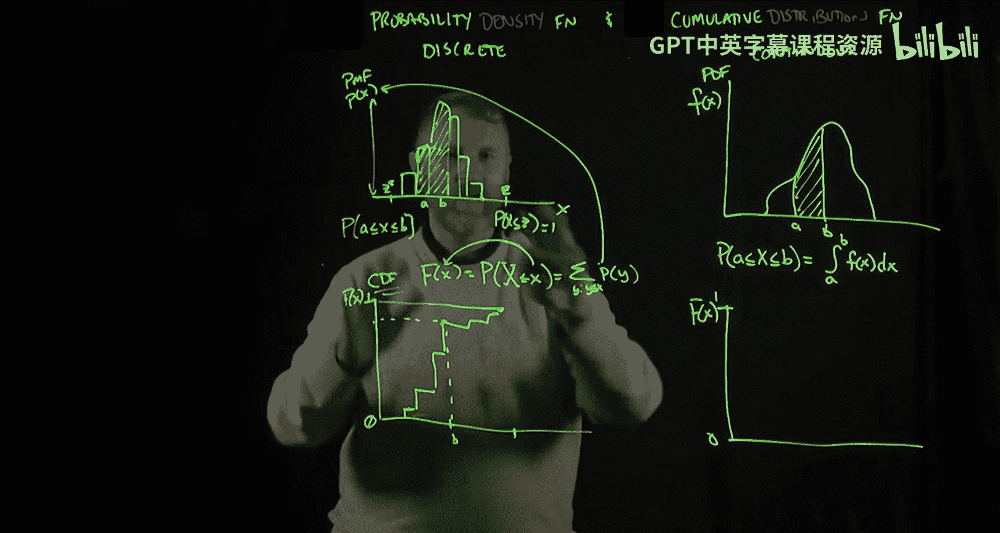

# 计算机科学的统计方法：第36讲：概率密度函数与累积分布函数

在本节课中，我们将学习概率密度函数和累积分布函数的核心概念。我们将从离散随机变量的概率质量函数和累积分布函数入手进行回顾，然后重点探讨连续随机变量的情况，并解释两者之间的关键区别与联系。

## 离散情况回顾

上一节我们介绍了离散随机变量的基本概念，本节中我们来看看其核心函数：概率质量函数和累积分布函数。

### 概率质量函数

概率质量函数描述了离散随机变量取每个特定值的概率。对于随机变量X，其PMF记作 **P(X = x)**。

以下是PMF的关键特性：
*   所有可能取值的概率之和必须等于1。
*   计算随机变量落在区间 [a, b] 内的概率，只需将区间内所有可能取值的概率相加。

### 累积分布函数

累积分布函数描述了随机变量取值小于或等于某个特定值的概率。对于随机变量X，其CDF记作 **F(x) = P(X ≤ x)**。

以下是CDF的定义公式：
**F(x) = Σ P(y)**，其中求和针对所有满足 **y ≤ x** 的y值。

CDF是一个从0单调递增至1的阶梯函数。通过CDF，我们可以直接读取“X小于等于某值”的概率。

## 连续情况引入

理解了离散情况后，我们现在将概念扩展到连续随机变量。核心区别在于，连续随机变量取任意单个具体值的概率为0，我们转而关注它在某个区间内的概率。

### 概率密度函数

在连续情况下，我们使用概率密度函数代替概率质量函数。PDF记作 **f(x)**。

以下是PDF的关键特性：
*   PDF曲线下的总面积必须等于1，即 **∫_{-∞}^{∞} f(x) dx = 1**。
*   PDF在某点的值**不是概率**，而是概率密度。计算随机变量落在区间 [a, b] 内的概率，需要计算PDF在该区间下的面积。

计算区间概率的公式为：
**P(a ≤ X ≤ b) = ∫_{a}^{b} f(x) dx**

### 连续累积分布函数

连续随机变量的累积分布函数定义与离散情况类似，但将求和替换为积分。

CDF的定义公式为：
**F(x) = P(X ≤ x) = ∫_{-∞}^{x} f(t) dt**

CDF **F(x)** 给出了从负无穷累积到x点的概率总量。它是一个从0到1的平滑递增函数。

## 核心关系与重要说明

了解了PDF和CDF各自的定义后，我们来看看它们之间深刻的内在联系。

根据微积分基本定理，PDF和CDF互为微积分运算的逆过程：
*   CDF是PDF的积分：**F(x) = ∫ f(x) dx**
*   PDF是CDF的导数：**f(x) = dF(x)/dx**

这意味着，在PDF最高的区域，CDF的增长斜率也最大，即概率累积得最快。

以下是关于连续概率的两个重要推论：
1.  对于任意具体值a，有 **P(X = a) = 0**。因此，在连续情况下，**P(X < a)** 与 **P(X ≤ a)** 是等价的。
2.  CDF通常直接给出“小于”某值的概率。若想求“大于”某值的概率，可利用互补原理：**P(X > b) = 1 - F(b)**，或通过积分计算：**P(X > b) = ∫_{b}^{∞} f(x) dx**。

## 总结

本节课中我们一起学习了概率密度函数和累积分布函数。我们从离散随机变量的PMF和CDF出发进行回顾，然后重点转移到连续随机变量，引入了PDF作为描述概率分布的工具，以及CDF作为累积概率的函数。我们掌握了计算区间概率的方法，并理解了PDF与CDF通过微积分基本定理建立的导数与积分关系。最后，我们明确了连续随机变量取单点概率为零的特性，以及如何利用CDF计算“大于”某值的概率。这些概念是理解连续概率分布的基础。