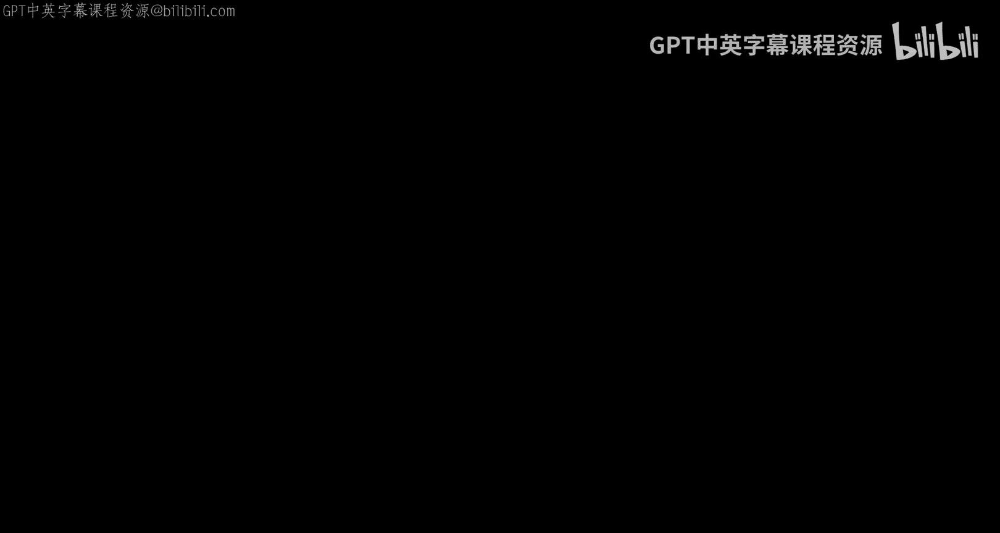
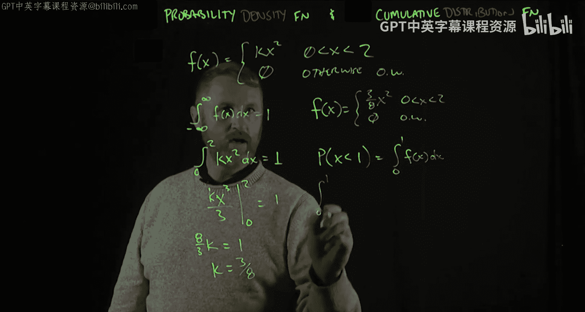
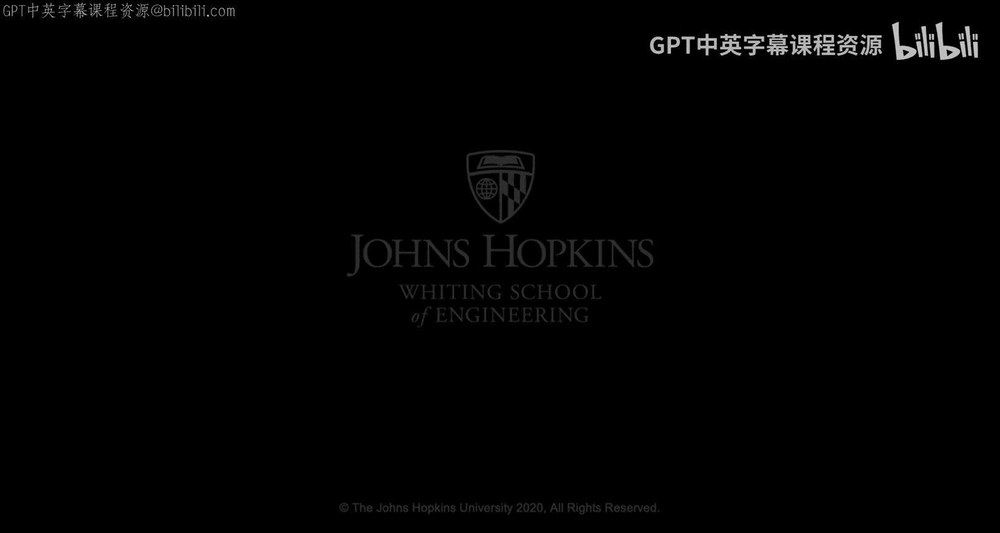

# 约翰霍普金斯大学《计算机科学的统计方法｜Statistical Methods for Computer Science》中英字幕 p38 37_密度函数应用案例.zh_en -BV1r483zbEzN_p38-

。

All right， we're now going to do a couple examples。

 so this is a college professor never finishes his lecture before the end of the hour and always finishes his lectures within two minutes after the hour。

 let X be the time that elapses between the end of the hour and the end of the lecture。

And then suppose that the PDF， this is little f of x， is going to equal。Kx squared。

Such that zero is less than or equal to x less than or equal to 2。0。Otherwise。

You'll also see otherwise written like OW for otherwise now a couple things right so one this is a continuous distribution right so time is an example of things that are typically modeled with continuous density functions second thing is these less than or equal signs they could just as easily be replaced with a zero because the probability to get exactly zero or exactly two there's an infinite range of possibilities it's statistically zero right so it doesn't really matter for us from that perspective and then the question is let us find the value of k and draw a corresponding density curve so if I'm going to find the value of k。

 what property can I use to help me figure that out。Well。

 the property that helps me figure that out is I know that the integral from negative infinity to infinity of F of X D X equals0。

 right， So what that tells me is I can look at this and say the。

The integral now my support only goes from0 to 2， so I can have this go from0 to2。

 Those are the range of possible values of Kx squared dx equals。One， I'm sorry this is a1。

 not a zero， sorry， so I know that the probability of a this is one of our rules for density function。

 right， that the sum of the area under the curve equals 1 okay。

So the integral going from  zero to2 of kx squared dx equals 1， that is following this rule。

 so this is f of x over this support。So if I evaluate the integral， right。

 I can look and say that's going to be x to the third k over 3 is going to give me the integral and it's evaluated over the limits 0 to 2 and I know that that has to equal 1。

So when I substitute the values in， I get two cubed is。E thirds。K。

And minus when that's a0 that goes to 08 thirds k equals1。

 so if I multiply both sides it's going to tell me that K equals38s。

 so this is a common problem where in order to take this unique distribution or density function for this unique density function to actually be a PDF K must equal 38s。

 so what that tells me is I can now rewrite f of x。

As equal to 38 x squared for0 less than x less than 2。

Zero otherwise okay now let's see the next part of the question what is the probability that the lecture ends within one minute of the end of the hour。

 within one minute of the end of the hour so。What that's telling me is。

Let me just make sure I read the question correctly。Yeah。

 so I'm going to assume that that's telling me what is the probability that x is less than。1。

Within one minute， the end of the hour， well， that's going to be the integral from zero to one。

of f of x。Dx， Well， F of x， Dx is telling me that's going to be 0 to one of。

3，8。X squared dx。So bringing the three8s out。And integrating that， that's going to be。

X cubed 1 third。Evaluated from 0 to1 and this three will cancel with that3。

 and so that will give me18 times 1 1 minus 0，1/8 times 1， so that's a 18。

 so the probability that x is less than1 equals 18。Okay。

