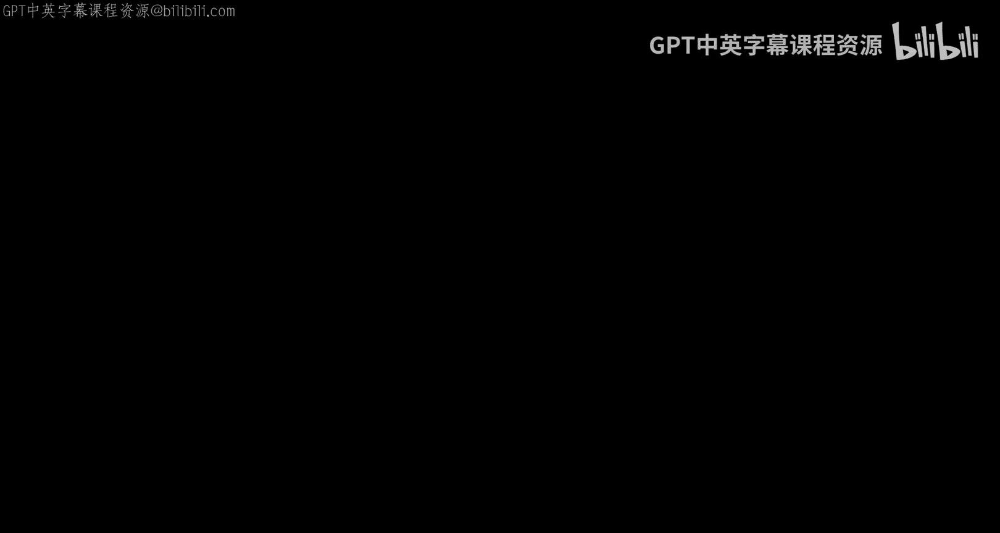
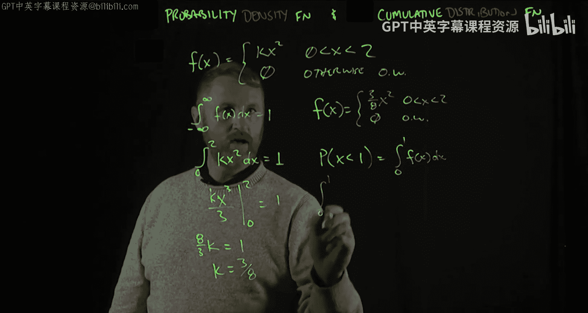
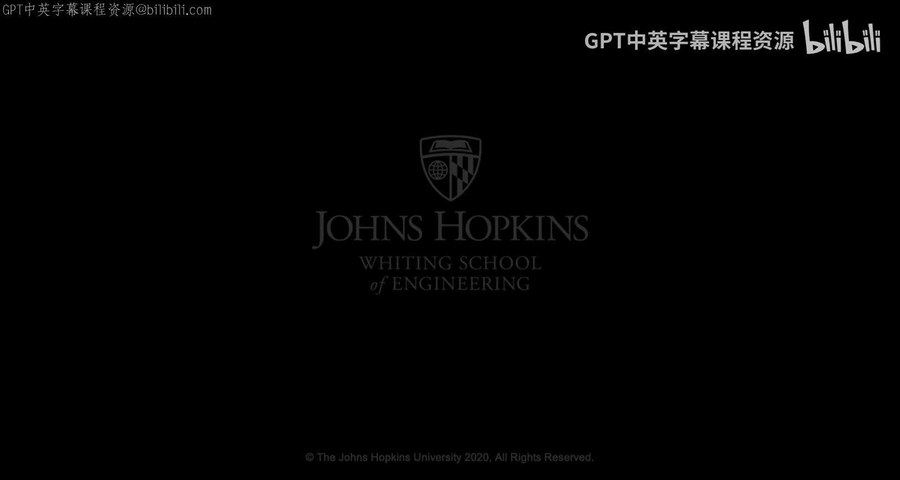

# 计算机科学的统计方法：第38讲：密度函数应用案例 📊

在本节课中，我们将通过一个具体的例子，学习如何应用概率密度函数（PDF）来解决实际问题。我们将使用一个关于教授讲课时间的案例，来演示如何确定密度函数中的未知常数，以及如何计算特定事件的概率。

---

## 概述

我们将分析一个场景：一位大学教授的讲课时间总是超过整点，但会在整点后的两分钟内结束。我们定义变量 **X** 为从整点结束到讲课结束所经过的时间。假设 **X** 的概率密度函数（PDF）为 **f(x) = kx²**，其中 **0 ≤ x ≤ 2**，否则为0。我们的目标是：
1.  确定常数 **k** 的值。
2.  绘制对应的密度曲线。
3.  计算讲课在整点后一分钟内结束的概率。

---

## 确定常数 k 的值

上一节我们介绍了概率密度函数的基本概念。本节中，我们来看看如何利用其核心性质来确定未知参数。

概率密度函数的一个关键性质是：整个定义域上的曲线下总面积必须等于1。这可以用以下公式表示：

\[
\int_{-\infty}^{\infty} f(x) \, dx = 1
\]

在我们的例子中，函数 **f(x)** 仅在区间 **[0, 2]** 上非零。因此，我们可以将积分范围限制在这个区间上：

\[
\int_{0}^{2} kx^2 \, dx = 1
\]

以下是求解 **k** 的步骤：
1.  计算积分：\[ \int kx^2 \, dx = k \cdot \frac{x^3}{3} \]
2.  代入积分上下限：\[ \left[ k \cdot \frac{x^3}{3} \right]_{0}^{2} = k \cdot \frac{2^3}{3} - k \cdot \frac{0^3}{3} = \frac{8k}{3} \]
3.  令其等于1：\[ \frac{8k}{3} = 1 \]
4.  解得：\[ k = \frac{3}{8} \]

因此，完整的概率密度函数为：
\[
f(x) =
\begin{cases}
\frac{3}{8}x^2 & \text{for } 0 \leq x \leq 2 \\
0 & \text{otherwise}
\end{cases}
\]

---

## 计算特定事件的概率

确定了密度函数后，我们就可以用它来计算事件的概率。对于连续型随机变量，概率等于密度函数在相应区间上的积分。

现在，我们来计算“讲课在整点后一分钟内结束”的概率。这对应的事件是 **X < 1**。其概率计算如下：

\[
P(X < 1) = \int_{0}^{1} f(x) \, dx = \int_{0}^{1} \frac{3}{8}x^2 \, dx
\]

以下是计算过程：
1.  提出常数：\[ \frac{3}{8} \int_{0}^{1} x^2 \, dx \]
2.  计算积分：\[ \int x^2 \, dx = \frac{x^3}{3} \]
3.  代入上下限：\[ \frac{3}{8} \left[ \frac{x^3}{3} \right]_{0}^{1} = \frac{3}{8} \cdot \left( \frac{1^3}{3} - \frac{0^3}{3} \right) \]
4.  简化计算：\[ \frac{3}{8} \cdot \frac{1}{3} = \frac{1}{8} \]

所以，讲课在整点后一分钟内结束的概率是 **1/8**。

---

## 总结

本节课中我们一起学习了概率密度函数的实际应用。我们通过一个教授讲课时间的案例，完整地演示了如何：
1.  **利用“总面积等于1”的性质**，求解密度函数中的未知常数 **k**。
2.  **通过积分密度函数**，计算连续型随机变量在某个区间内取值的概率。

这个例子清晰地展示了如何将概率密度函数的理论性质应用于解决具体的统计问题。掌握这些步骤，是理解和运用连续概率分布的基础。