# 约翰霍普金斯大学《计算机科学的统计方法｜Statistical Methods for Computer Science》中英字幕 p43 42_正态分布应用实例.zh_en -BV1r483zbEzN_p43-

。Okay， we're now going to do an example。 so if I tell you that I have an example。

And I have a variable x， and we're going to say x is normally distributed with mean of zero standard deviation of1 and I want to ask the question。

 what is the probability that x is less than one third？

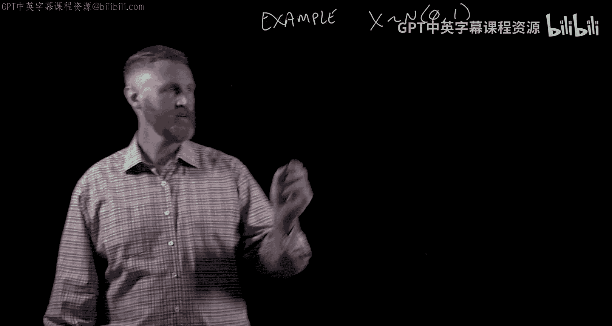

What is the probability that x is less than1 third？So。

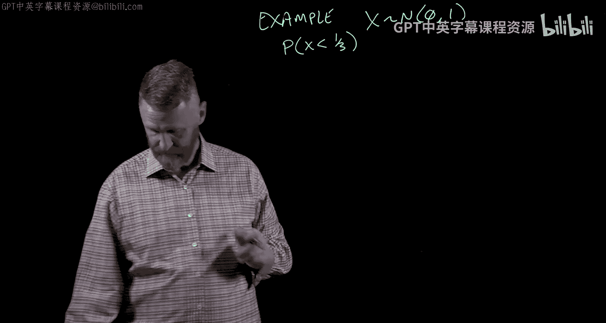

The way we're going to answer that is we're going to look at the integral from negative infinity up to one third。

 right That is the area under the curve from negative infinity up to one third of the。

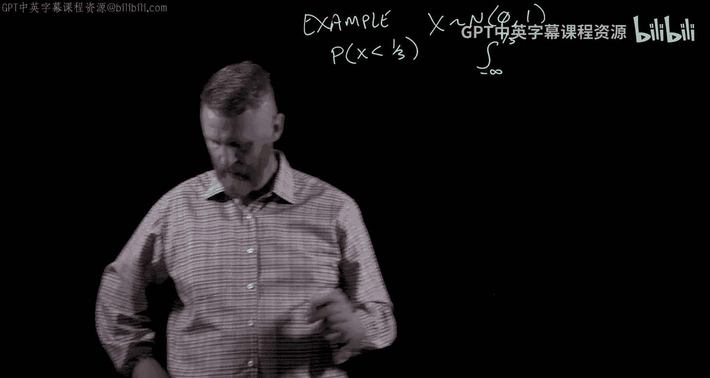

Density function。RightAnd that is going to tell us this area。 Now， again， as I told you。

 that equation ends up being negative infinity to one third and it's one over the square root of two pi。

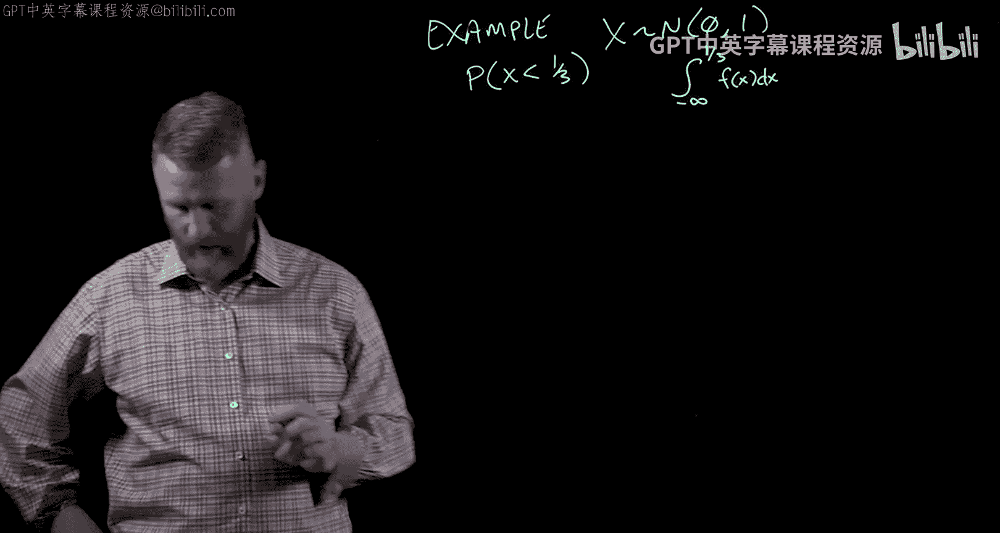

Right standard normal so we would have E to the negative x squared over to dx。

 and I told you I can't calculate that integral because it's too complicated。

 So you're either going to have to go find somebody else to show you how to do it the old way of looking up tables in the back of the book you probably also have to go to somebody else if you want them to show you how to use a slide rule or how to do like those kind of arcane things I'm going to have you do it in R。

 and so there is a separate video lecture that basically is going to take you through the use of R for all of these distributions that we're going to use and in this video what I'm going to do is I'm just going to kind of set up the problems and then tell you this is how you'd set it up for R and after you've looked at this。

 I'm going to want you to go and take a look at that video on how you use R to get the computer to do the calculations for you so we're setting this up for our purposes of saying hey。

 what do we call this function that goes from negative infinity up to some value we call it。

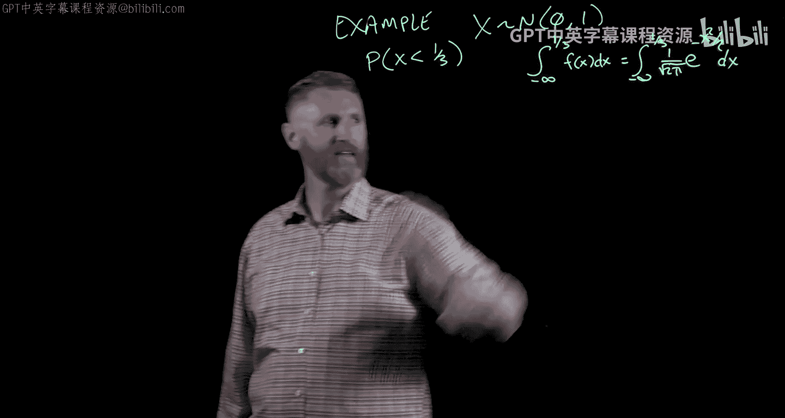

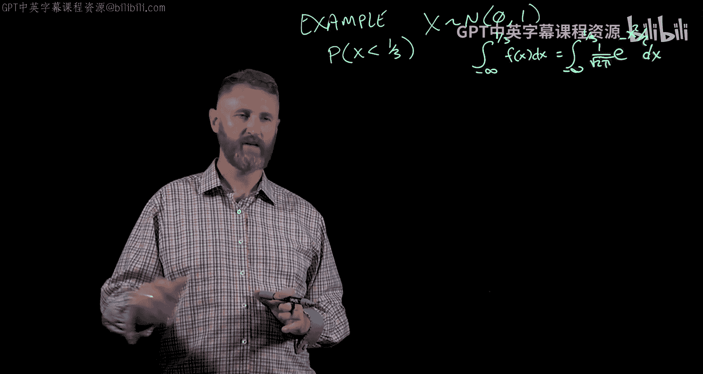

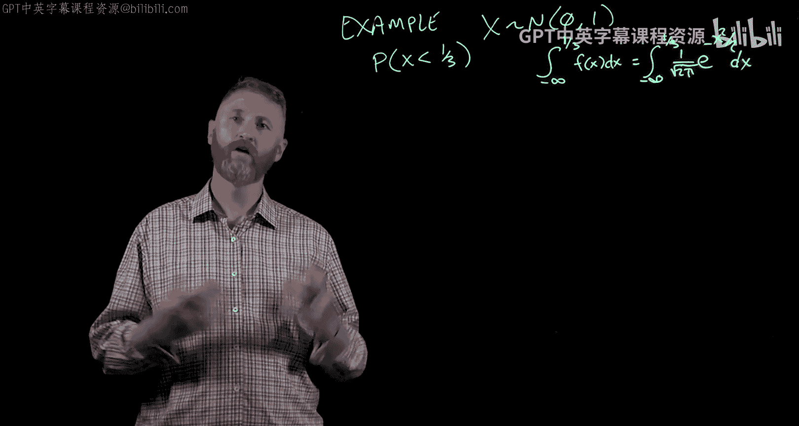

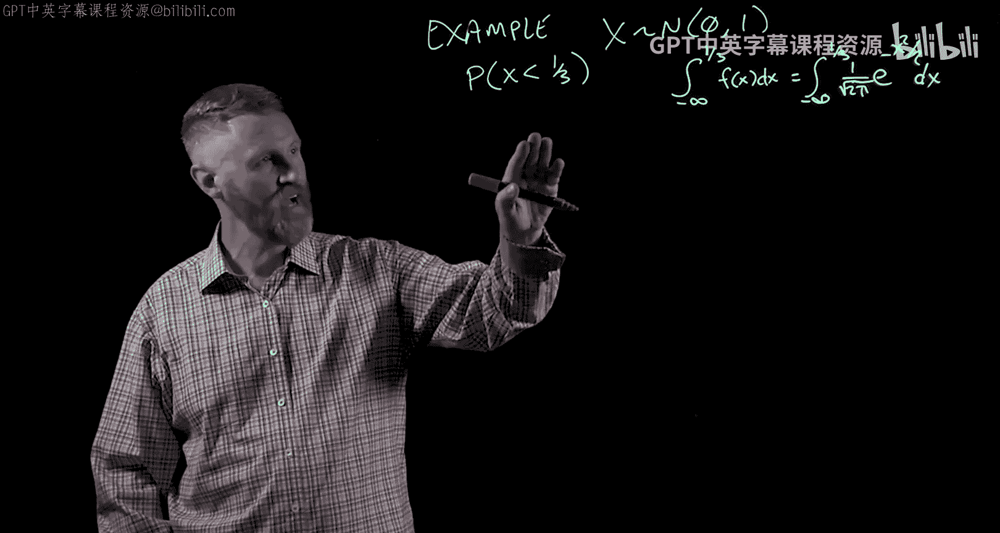

The F of one third， We call it the distribution function is anything that's that integral from negative infinity up to the upper limit of integration。

 So when I。

When I'm actually doing that problem。

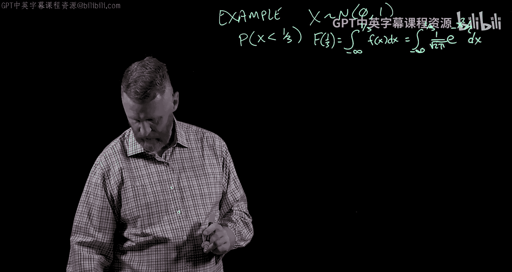

I am going to。Type in essentially something that looks like f of1 third， probably less than x。

 and you'll find that that value should be 0 point。

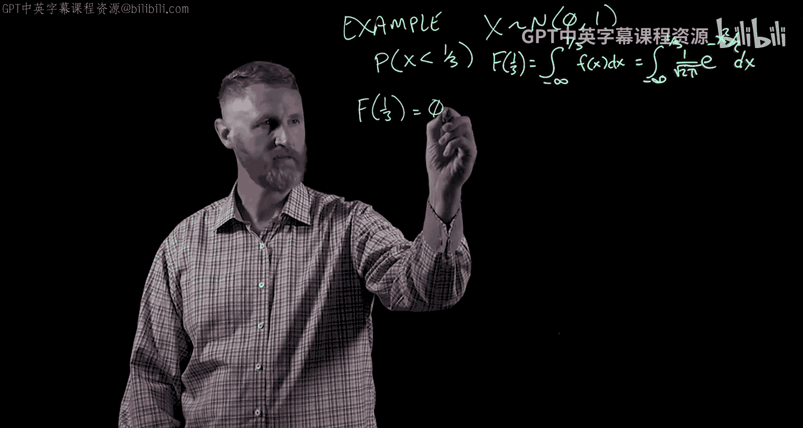

S3，0，6， and you can try this in R and make sure you can do that。

So now what happens if I want to look at the probability？

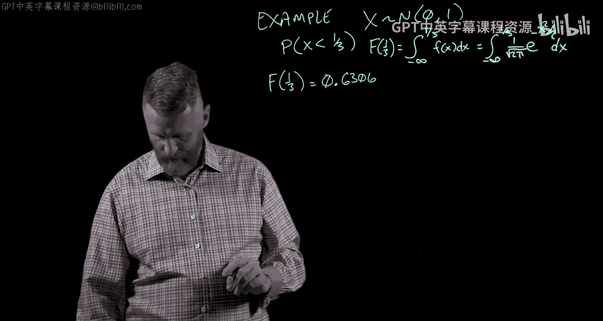

That x is greater than one third。Right greater than one third what do we do here。

 I want you to pause the video for a minute and think about it， kind of dates back to module1。

 some of these principles a little bit of a pause video and I'll wait here until you're ready to resume hit play when you've got an answer。

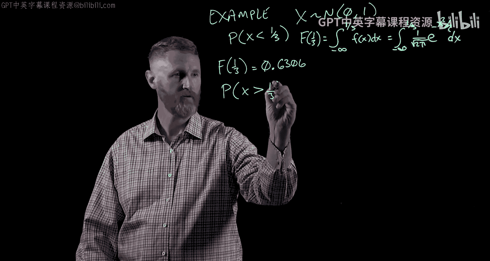

Okay I'm going to assume you've paused the video， you've kind of worked out this probability for yourself and you're ready to resume so if I know that the probability less than one third is this value。

 then the probability greater than one third right， if this is my distribution right。

 whatever that is right and I have some sort of value and I've calculated less than。

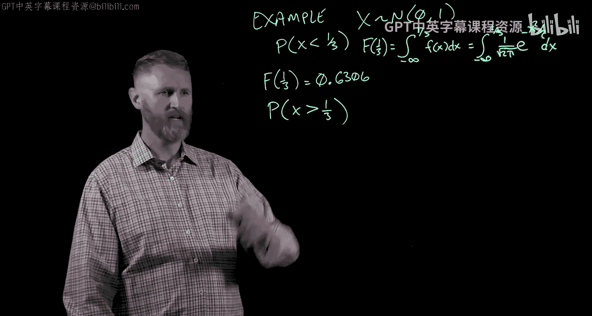

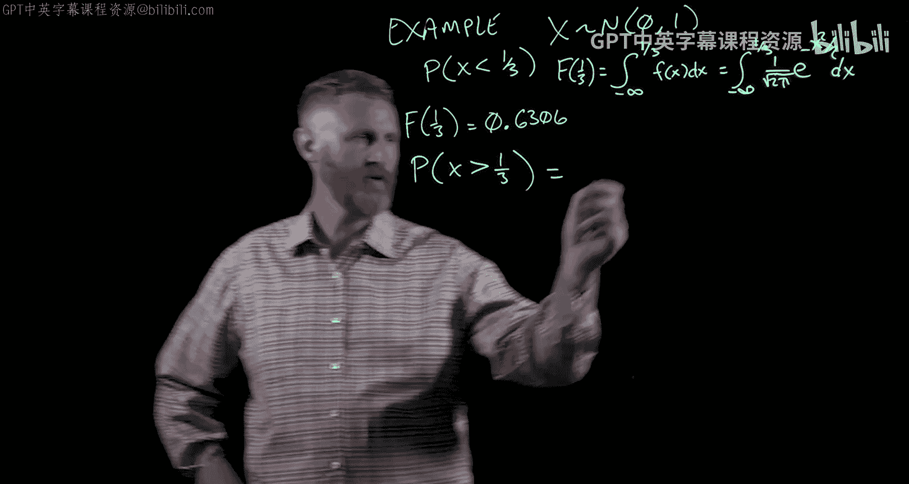

That's not what I'm interested in。 I want this area right up here again。

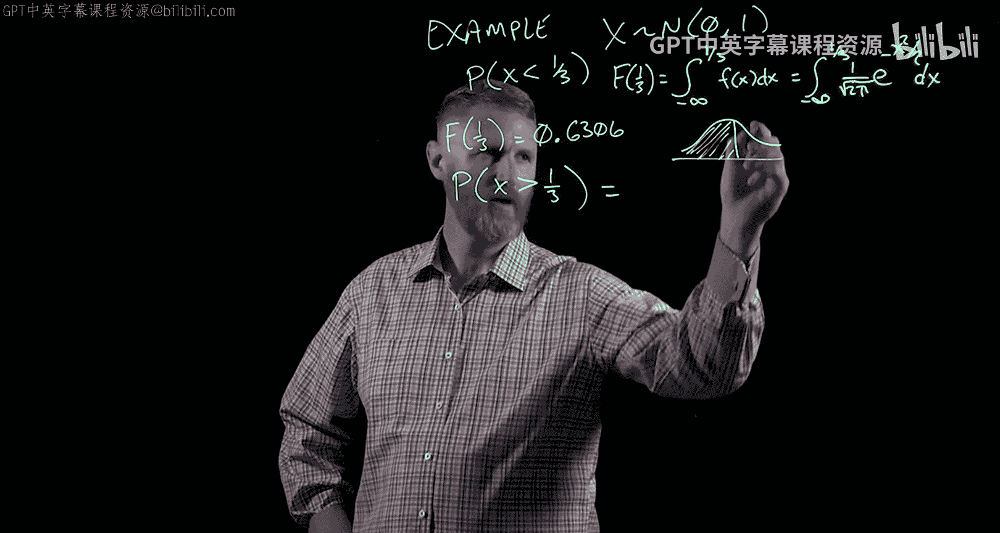

What do we know about the whole area， The whole area is one。

So I can just remove the part that I am not interested in right so 1 minus0。6306。

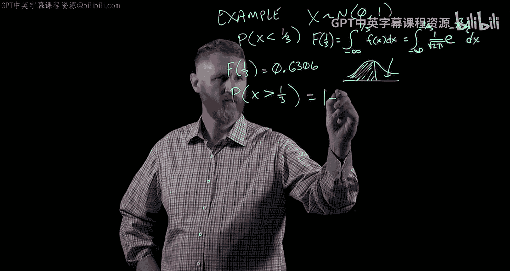

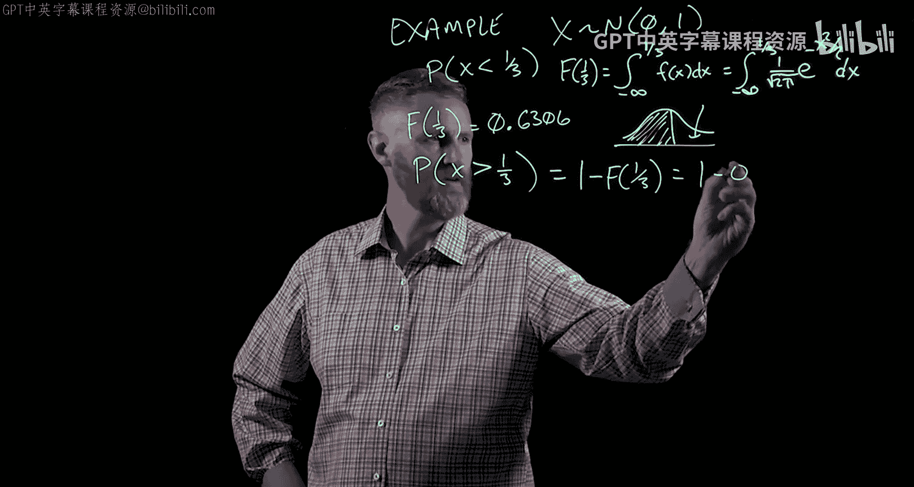