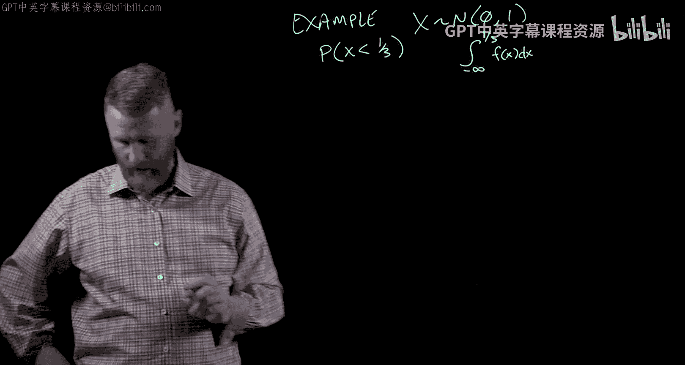
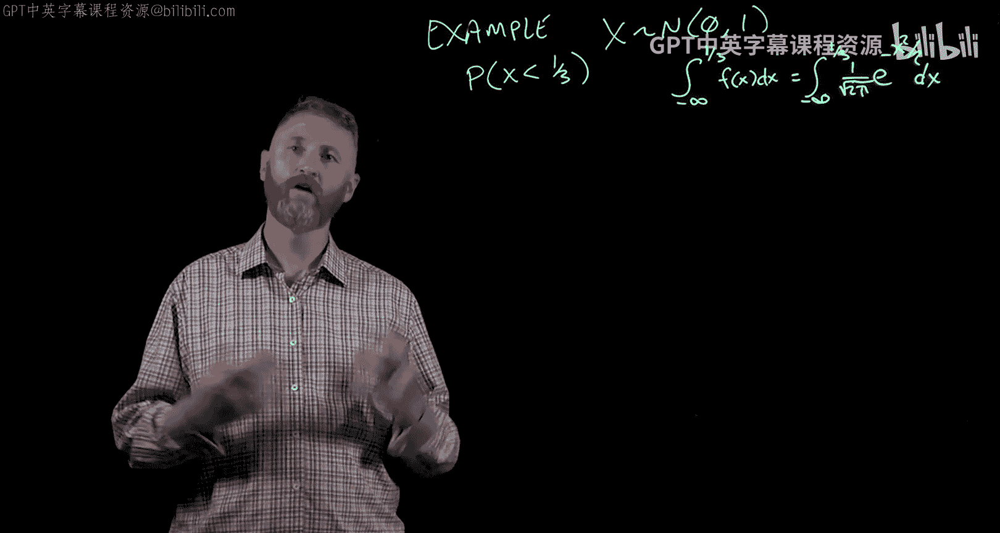
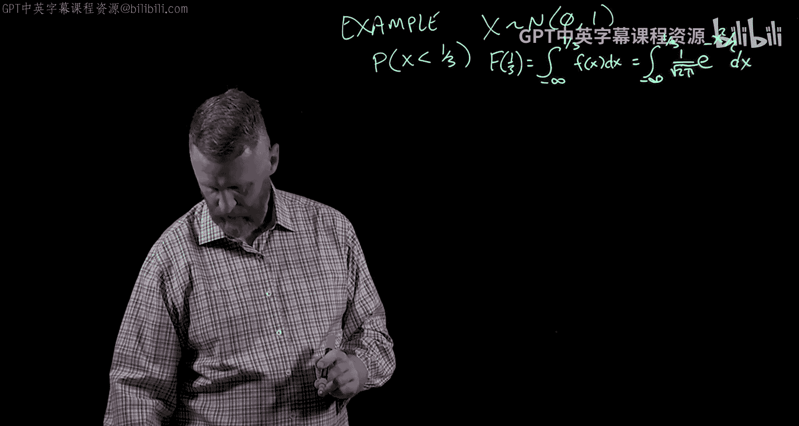
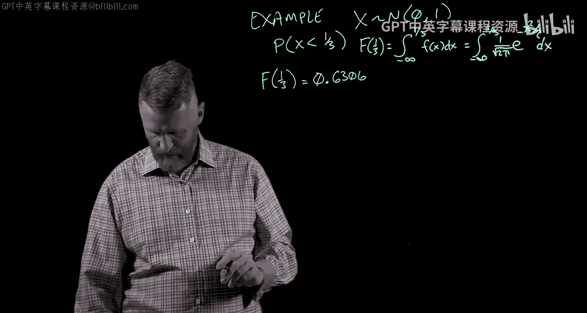
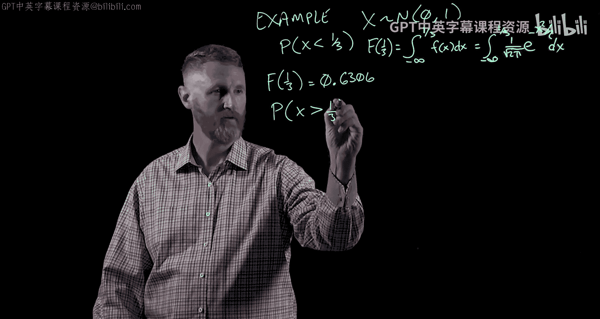
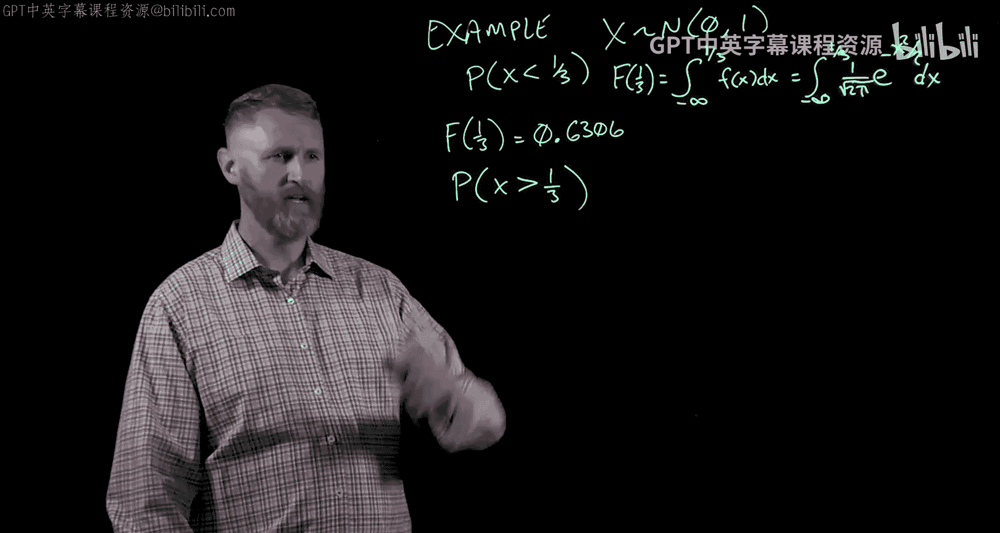
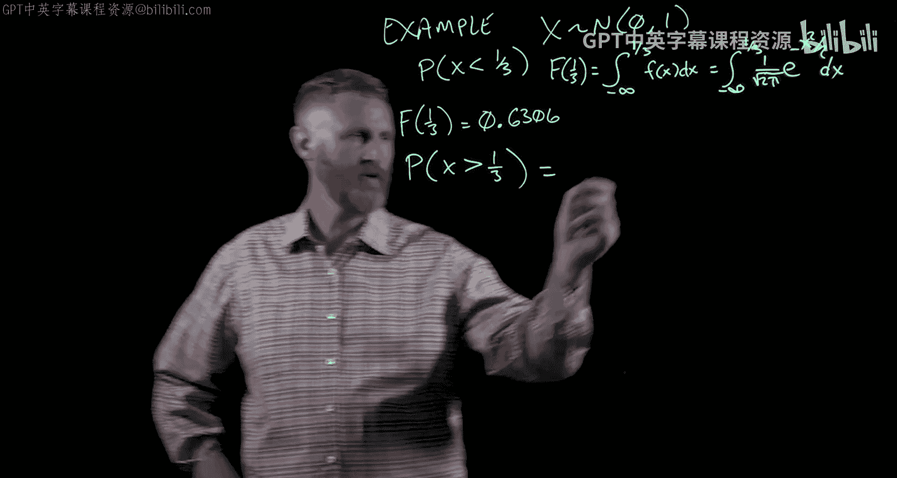

# 计算机科学的统计方法：4.2：正态分布应用实例 📊


在本节课中，我们将通过一个具体的例子，学习如何计算正态分布下的概率。我们将使用标准正态分布，并演示如何利用R语言等工具来求解积分问题。


---


上一节我们介绍了正态分布的基本概念和概率密度函数。本节中我们来看看如何应用这些知识解决实际问题。


假设我们有一个变量 **x**，它服从均值为0、标准差为1的标准正态分布。我们想问的问题是：**x 小于 1/3 的概率是多少？**


为了回答这个问题，我们需要计算从负无穷到 1/3 的曲线下面积。这对应于概率密度函数从负无穷到 1/3 的积分。

该积分的数学表达式如下：



```
P(x < 1/3) = ∫_{-∞}^{1/3} (1/√(2π)) * e^(-x²/2) dx
```

正如之前提到的，这个积分计算起来非常复杂，无法直接手算。传统方法可能需要查表，而现代方法则使用统计软件。

我们将使用R语言来完成这个计算。在R中，计算标准正态分布累积概率的函数是 `pnorm()`。

以下是计算 `P(x < 1/3)` 的R代码：

```r
pnorm(1/3, mean = 0, sd = 1)
```


运行这段代码，我们得到的结果大约是 **0.6306**。这意味着变量 **x** 取值小于 1/3 的概率约为 63.06%。




---


现在，让我们考虑一个相关但不同的问题：**x 大于 1/3 的概率是多少？**




请暂停视频，思考一下如何利用我们已经知道的结果来求解这个问题。


（暂停）



好的，假设你已经思考完毕。我们知道整个概率密度曲线下的总面积等于1。我们已经计算出 **x 小于 1/3** 的概率（即左侧面积）是 0.6306。

那么，**x 大于 1/3** 的概率（即右侧面积）就是总面积减去左侧面积。



因此，计算公式为：

```
P(x > 1/3) = 1 - P(x < 1/3) = 1 - 0.6306 = 0.3694
```





所以，变量 **x** 取值大于 1/3 的概率约为 **36.94%**。


---


本节课中我们一起学习了如何计算标准正态分布下的概率。我们通过一个具体例子，演示了如何利用积分概念定义概率，并借助R语言的 `pnorm()` 函数进行实际计算。我们还利用概率总和为1的性质，从一个概率推导出另一个互补事件的概率。掌握这些方法是理解和应用正态分布的关键步骤。