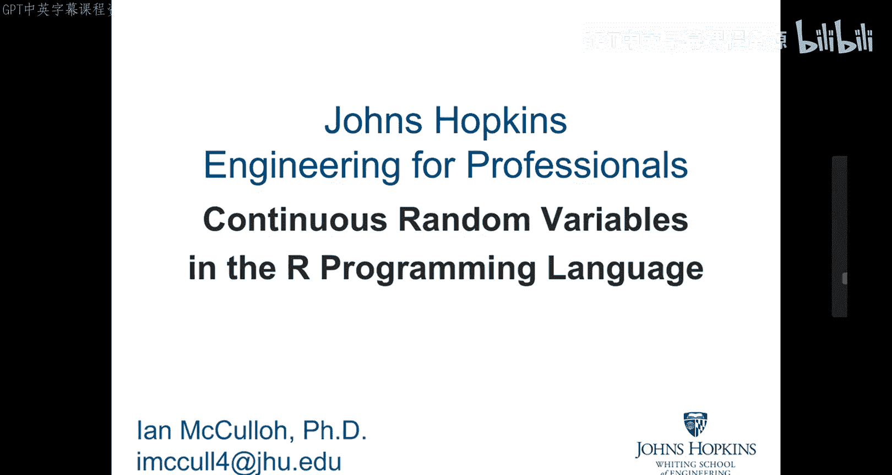
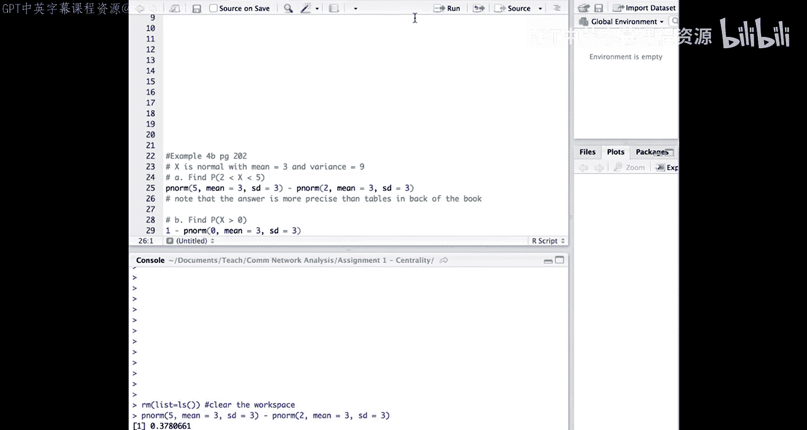
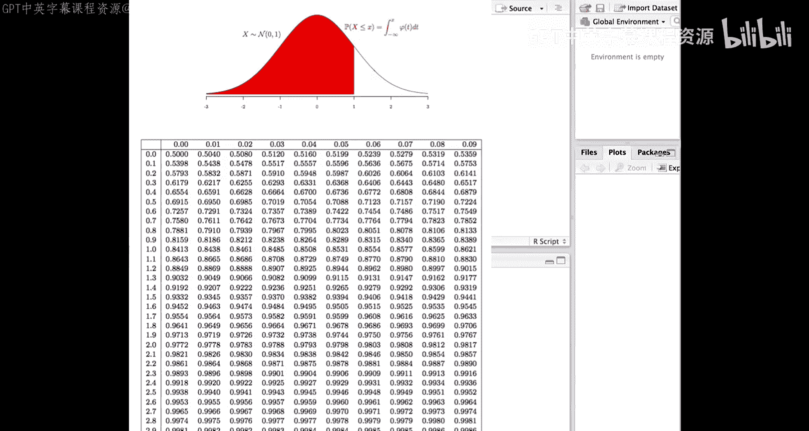

# 约翰霍普金斯大学《计算机科学的统计方法｜Statistical Methods for Computer Science》中英字幕 p45 44_R语言教程.zh_en -BV1r483zbEzN_p45-

Hello I'm Dr。 Ian McCllough of Johns Hopkins University This is a short lecture on the use of the R programming language to work with continuous random variables This is not meant to be a standalone lecture。

 this is meant to accompany another video lecture where we work out some of the principles and theory behind continuous random variables on the board and if you have not seen that lecture then I had asked that you stop this video now review those first and then return to R to see how to actually work problems taking advantage of the software。

So this is in our script and I'm going to draw your attention to the scripting window that we have right here。

 and this is where I'm going to illustrate the commands and then you will see results appear down here in the console for this exercise we will not be using the global environment or any of the other features here in our studio。

So the first thing I'm going to ask you to do is enter the command to just clear the workspace。

 and so we just go up here to the little run command and I can run that command and then the workspace is cleared。

We're now going to look at how we use R to calculate some problems dealing with the normal distribution so if you refer to example  4b on page 2 or two of your text。

 the problem is basically telling you that x is a normally distributed random variable with a mean of  three in a variance of9 and the first question is find the probability that a randomly sampled variable will be between the values of 2 and 5 so we use the p norm command here and so p norm we're going to enter in5 and what this is going to do is this is using the distribution function so this is going to tell us the probability that a randomly sampled variable is going to be less than or equal to5。

And the mean is then defined as 3， and the standard deviation is defined as 3 because the square root of the variance is3。

And then we're going to subtract what we don't need from this set。

 which is the distribution function for a a random variable of two or less。

 same mean and same standard deviation， and so that will give us the probability that a random variable falls between2 and 5。

 given those parameters。So if we go here， we can calculate run。

 and then you can run that to make sure that you have the same result of 0。3780。

And that will also match what you have in your textbook。

 you will note that the answer that I'm using is more precise than the tables。

 so if you look at the book， there are some tables in the back and the tables are basically people back in the day have gone through and calculated the probabilities given a standard normal distribution and then the book tries to have you convert any normal distribution to a standard normal。

