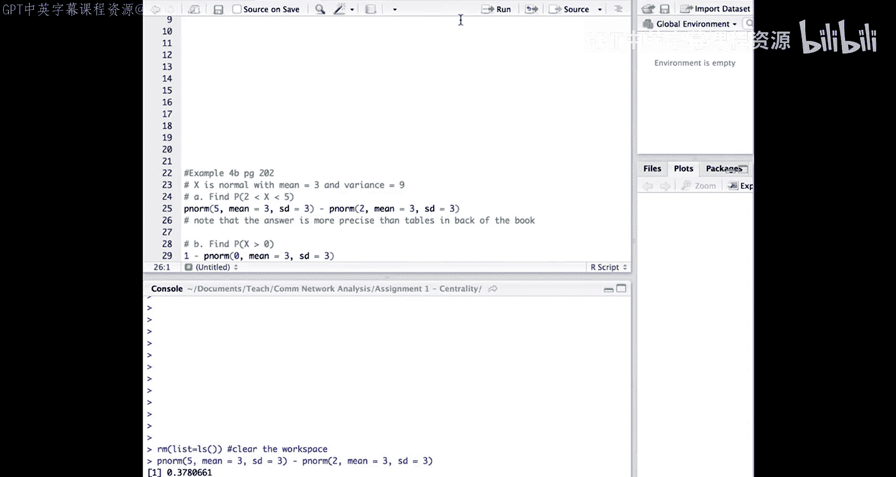
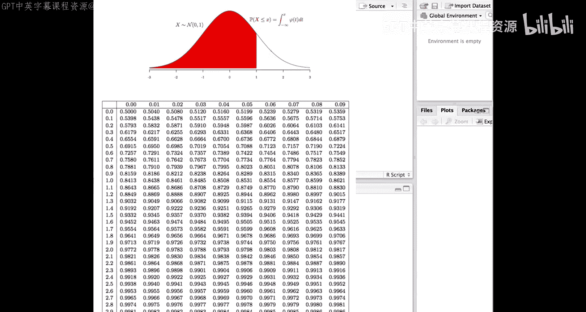

# 计算机科学的统计方法：44：使用R语言处理连续随机变量 📊

在本节课中，我们将学习如何使用R编程语言来处理连续随机变量，特别是正态分布。我们将通过一个具体的例子，演示如何计算给定参数下随机变量落在某个区间内的概率。

上一节我们介绍了连续随机变量的理论基础，本节中我们来看看如何利用R软件进行实际计算。

## 准备工作 🛠️


首先，我们需要清除R的工作空间，以确保从一个干净的环境开始。这可以通过运行以下命令实现：

```r
rm(list = ls())
```

运行此命令后，工作空间将被清空。在本练习中，我们主要使用脚本窗口输入命令，并在控制台查看结果，暂不使用RStudio的全局环境或其他高级功能。

## 计算正态分布的概率 📈

现在，我们来看一个具体的例子。假设随机变量X服从正态分布，其均值（mean）为3，方差（variance）为9。我们的第一个问题是：求X的值落在2和5之间的概率，即 P(2 < X < 5)。

在R中，我们使用 `pnorm` 函数来计算正态分布的累积分布函数（CDF）值。`pnorm(q, mean, sd)` 返回的是随机变量取值小于或等于 `q` 的概率。

以下是计算步骤：
1.  首先计算 P(X ≤ 5)。
2.  然后减去 P(X ≤ 2)。
3.  两者的差值即为 P(2 < X < 5)。

需要注意的是，`pnorm` 函数需要标准差（standard deviation）作为参数，而不是方差。标准差是方差的平方根。本例中，方差为9，因此标准差为3。

以下是实现该计算的R代码：

```r
# 计算 P(X <= 5)
prob_le_5 <- pnorm(5, mean = 3, sd = 3)

# 计算 P(X <= 2)
prob_le_2 <- pnorm(2, mean = 3, sd = 3)

# 计算 P(2 < X < 5) = P(X <= 5) - P(X <= 2)
prob_between_2_and_5 <- prob_le_5 - prob_le_2
prob_between_2_and_5
```

运行这段代码，你将得到结果约为 **0.3780**。这个结果与教科书中的答案一致，并且比传统查表法得到的结果更为精确。

## 关于查表法的说明 📖

在计算机普及之前，人们通常使用标准正态分布表（Z表）来查找概率。教科书中的方法通常是教你如何将任何正态分布转换为标准正态分布（均值为0，标准差为1），然后查表。而R的 `pnorm` 函数直接为我们完成了所有计算，更加方便和准确。

## 总结 🎯

本节课中我们一起学习了如何使用R语言处理连续随机变量中的正态分布问题。我们掌握了：
1.  使用 `rm(list = ls())` 清空工作空间。
2.  使用 `pnorm` 函数计算正态分布的累积概率。
3.  通过概率相减的方法计算随机变量落在某个区间内的概率。
4.  理解了直接使用R计算比传统查表法更便捷、更精确。





通过这个简单的例子，你应该能够举一反三，利用R解决其他涉及正态分布的概率计算问题。