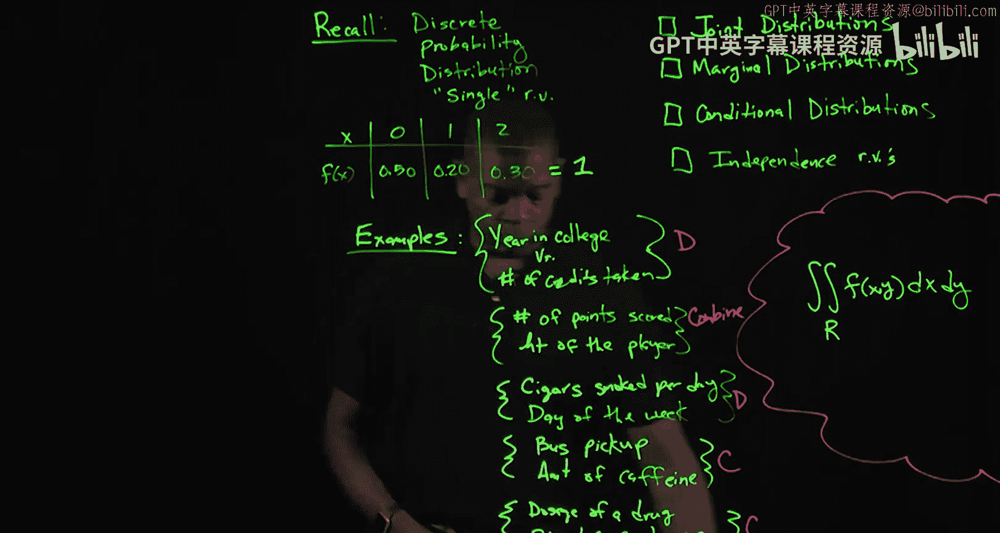

# 约翰霍普金斯大学《计算机科学的统计方法｜Statistical Methods for Computer Science》中英字幕 p46 0_概述.zh_en -BV1r483zbEzN_p46-

I'm Dr。 Tony Johnson， the Johns Hopkins University。

 and in this module with the statistical of methods for computer scientists。

We're going to be talking about joint distributions。

And if I had to kind of lay out an outline of how we're going to progress through this。

 just kind of in your mind as you watch the videos in the different segments。

 we're going to be talking about the overall concept is joint。Distributions。

 so that's the overall concept。 But in talking about that， we're going to get into things。

 We're going to talk about marginal。Distributions。We're going to discuss。

Something called conditional。Distributions。And then finally。

 we're going to talk about what we like to call the independence of these。Random variables。

And particularly， we're looking at。Random variables when they're。

Basically established in this joint distribution type of framework。Okay。

 so when talking about joint distributions， one of the things that you might want to become familiar with in your mind is you may want to go back in your。

Calculus。Let's see， calculus three days， and we might want to recall our old friend。

 the double integral， right？You might want to recall our old friend the double integralgr and this the limits of integration may be a region will define it as R and this is really going to help us to establish some of the groundwork in discussing this idea of a joint distribution based on these a joint probabilities。

 so as a recall，Let's。Just refresh our memory。We're going to refresh our memory on things we've seen before。

 we've seen， let's just talk about a discrete。A discrete probability of distribution。

 So if we we're going to keep it as discrete。Probability distribution。And in this case。

 we're talking about for a single variables， a single。Random variable。Okay， so that's Steve。

 So we would have something。 Let's see if we were to draw， Let's say X。

 I'm gonna see if I can make a little chart here。 And then this is gonna be。

Something like this where this is going to be0，1， and 2， and let's say that this is f of x。

And in this case， F of x here is going to be， so we got some values here， 0。500。2，0，0。30。Okay。

 so in this relationship， we have basically our。Single distribution for all possible values of this in this case。

 x， so if x was some process and the outcome of that process was a 01 or2 in this single variable distribution of a discrete random variable we would see that the probability of me getting a 0 in that process will be 0。

5， the probability of a 1。2， the probability of a 3 and we know in order for this to be a distribution that the total here must equal 1。

We noted that has to be the case， if that's not the case， then it's not a distribution。But now。

 what if we're talking about a process that has two random things occurring at the same time。

 and what we to do is we want to look at the relationship between not just one random variable。

But two。Okay， we want to look at the relationship of not just one random variable。

 but we want to look at the relationship of two random variables。 And so in that regard。

 how now would we structure that， Well， let's take of some examples。

 What are some examples that we can look at。 So if I was to write down some examples here。

So some examples could be。Let's say the number of years。Or we could say。Y。In college。Versus， okay。

So it was a year in college。Versus the number。Of credits。Taken。Okay。

 that's a phenomena we might be interested in looking at。So how about another one。 So that's one。니。

about嗯。The number of points。Scocorre。And let's say， a basketball game versus the。Versus the height。

So， versus the height。Of。The player。Right so we can look at a bunch of players。

 we can look at their heights， and then we can look at the number of points that they scored in a game。

That could show a relationship。 What else could we look at， We could look at the number of， so。

The number of cigars smoked。And let's say， per day。And we could talk about what day。Of the week。

 is it？Yeah。So if you have a propensity to smoke cigars on the weekend。

 then we would see a relationship and there could be a probability drawn from the relationship。

How about。Let's see。 Let's look at some other examples。 How about the time。Let's see the time。

 So let's say。Bus pick up。So are you？This is the time that you're being picked up by the bus。

And how about the amount this is funny。How about the amount of caffeine。Right。

 the amount of caffeine。In the driver's system so if the driver has a certain amount of caffeine。

 they hit their coffee， then they're going to be on time or not。

 I don't know or if they haven't had their coffee they're going to be on time or not Finally。

 let's look at another one one more this is how about the dosage of a particular drug okay。

 and the blood。Composition， okay， measure。So how much？How much？Is a。

Percentage of a measure of your blood。 How much would be in your blood， right？

 So what's interesting about these is that some of these are discrete and some of these are actually continuous random variable。

 So in this case， we have this one right here would be discrete。Put a big D there。

 This one actually is a combination。Because we have the points is discreteet。

 but the height is continuous。Ciggars per week， day of the week， what this one is discrete。

Bus pickup。Which is a time。 So this is a time。 The amount of caffeine is another time。 Oh I mean。

 is a a measurement。 So this is going to be continuous。And this one is continuous。

 So in this idea of joint probability distributions。

 we're going to talk not only of discrete probabilities。

 but we're going to also be talking about continuous probabilities。 So let's。

 let's take this a little bit further。

So I want to， I want to look specifically at what we like to call this joint probability distribution。

 and you may be wondering what does that actually look like， Okay， all right。

 so here is an example of what you would see in sense of what these distributions might look like。

 So you may have excuse me。 a process where we're saying。

We're going to talk about the discrete case here。 the probability。 And in this probability。

 we're looking at。X， cap x being equal to x and cap Y being equal to y。Okay。And so for some process。

 you may have something that looks like this。Okay， and then this is gonna be。嗯。Let's just go。

And then， we're gonna go。So you may have something that looks like this， so we have this will be。

Just draw this。As clear as we can。Alright。There we go， so in this process。

 I have a X random variable and I have a Y random variable。And in this process。

 I have different values that it can take。 Let's say these variables can take a1，2， or3。

 and this will be a 1，2， or3。And what we're saying now is if I was to look at this process。

I'm going to have now。So this is。Same thing。 This is 1，2，3，1，2，3。 And so 1，1。

 the likelihood of that happen is going to be a 0。 I'm saying in this process。Right。

 variable one of y and variable one of X is unlikely， totally unlikely。 Otherwise。

 it's equally likely any combination。 So what you have then is we'll have something like this。

 this will be 1，6，1，6，1，6。6， and then this would be 1，6，1，6。 So this is an example， right。

 of where the entire space of combinations of x and Y。 So if I was to choose， say， x sub 1。

So this is the probability of x sub 1 comma。嗯。Why sub 2。This would be equal to x sub 1， y sub 2。

 this would be 16。Okay。So this is just an example to expose you to what we're going to be talking about and how now where in the single case the probability covered one dimension in this way x in the horizontal but in the joint probability space it could cover multiple dimensions in this case we only looked at two。

 if there was a third dimension cap x equals x cap y equals y and cap Z equals z then you would have a cube right and just imagine you know in a cube you know now the numbers kind of coming out right？

😡，So now they're coming out。嗯。And now you have this。Ce。

Of possibilities now right and so again it becomes more and more probilities that make up this queue now you may say。

 well， can I go to in dimensions， Yes it can go to in dimensions for the number of different random variables you have and so you can see where joint probability distributions can become quite complicated。

 but we're going to be teaching you in this course methods to make it a lot simpler and a lot easier to calculate。

 but suffice for now I want you to understand we're going to be I'm going to be talking in two or at most three dimensions。

 but the ideas carry on to multiple dimensions。