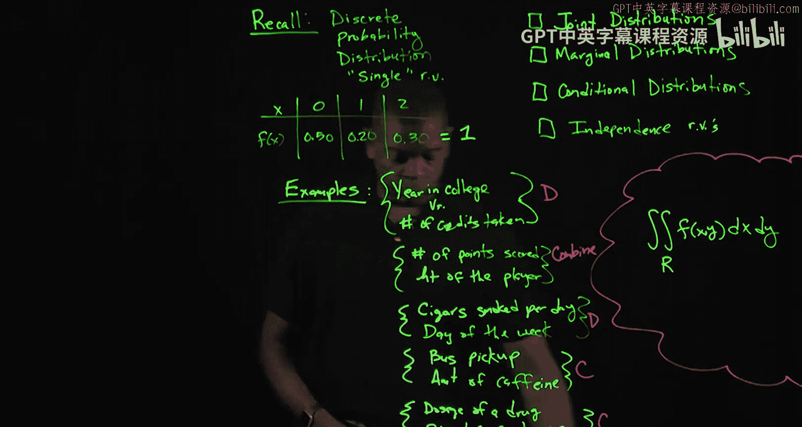

# 计算机科学的统计方法：第46讲：联合分布概述

在本节课中，我们将学习**联合分布**的核心概念。我们将探讨如何描述和分析涉及两个或更多随机变量的概率模型，这是理解复杂随机现象的关键一步。

上一节我们介绍了单随机变量的概率分布，本节中我们来看看当涉及两个随机变量时，情况会如何变化。

## 课程大纲

我们将按以下顺序展开学习：
1.  **联合分布**：理解两个随机变量同时取值的概率模型。
2.  **边缘分布**：从联合分布中提取单个随机变量的分布。
3.  **条件分布**：在已知一个随机变量取值的条件下，另一个随机变量的分布。
4.  **随机变量的独立性**：判断两个随机变量是否相互影响。

## 从单变量到多变量

回顾我们之前学过的**离散型单随机变量分布**。例如，对于一个随机变量 **X**，其分布可能如下表所示：

| **X** | **f(x)** |
| :---- | :------- |
| 0     | 0.50     |
| 1     | 0.20     |
| 2     | 0.30     |

这里，`f(x) = P(X = x)`，且所有概率之和为1：`∑ f(x) = 1`。

然而，许多现实过程涉及**两个或更多同时发生的随机事件**。我们不仅关心单个变量的行为，更希望研究它们之间的**关系**。

以下是几个涉及两个随机变量的例子：

*   **大学年数与修读学分**：研究学生所在年级（离散）与其当前学期修读学分（离散）之间的关系。
*   **球员身高与比赛得分**：分析篮球运动员的身高（连续）与其在一场比赛中得分（离散）之间是否存在关联。
*   **每日吸烟数量与星期几**：观察一个人每天吸的雪茄数量（离散）是否与一周中的某天（离散）有关。
*   **公交车接载时间与司机咖啡因摄入量**：探讨公交车到站时间（连续）与司机体内咖啡因含量（连续）之间的潜在联系。
*   **药物剂量与血液浓度**：研究服用药物的剂量（连续）与其在血液中的测量浓度（连续）之间的关系。

请注意，这些例子中，有些变量是**离散的**，有些是**连续的**。因此，联合分布的概念将同时涵盖离散和连续两种情况。

## 联合分布的概念

那么，联合分布具体是什么样子呢？让我们先看一个**离散型**的例子。

假设我们有两个离散随机变量 **X** 和 **Y**，它们可能的取值都是 {1, 2, 3}。它们的**联合概率质量函数**可以表示如下：

|       | **Y=1** | **Y=2** | **Y=3** |
| :---- | :------ | :------ | :------ |
| **X=1** | 0       | 1/6     | 1/6     |
| **X=2** | 1/6     | 1/6     | 1/6     |
| **X=3** | 1/6     | 1/6     | 0       |

上表中每个单元格的值 `P(X=x, Y=y)` 代表了 **X** 和 **Y** 同时取特定值的概率。例如，`P(X=1, Y=2) = 1/6`。所有可能组合的概率之和必须等于1。

在单变量情况下，概率分布沿着一条线（一个维度）展开。而在双变量的联合分布中，概率分布在一个平面（两个维度）上展开。如果我们考虑三个随机变量，概率将分布在一个立方体（三个维度）中。理论上，这个概念可以推广到任意多个随机变量（n维），尽管可视化会变得困难，但数学原理是相通的。在本课程中，我们将主要讨论二维或三维的情况，但其思想适用于更高维度。

为了处理连续型联合分布，我们需要借助微积分中的工具——**二重积分**。二重积分的形式如下：
`∬_R f(x, y) dx dy`
其中，`f(x, y)` 是联合概率密度函数，`R` 是积分区域。这将帮助我们计算涉及两个连续随机变量的概率。

## 总结

本节课中我们一起学习了**联合分布**的初步概念。我们了解到：
1.  联合分布用于描述两个或更多随机变量同时发生的概率结构。
2.  现实世界中有许多同时涉及离散和连续变量的例子。
3.  离散型联合分布可以用表格表示，所有概率之和为1。
4.  联合分布将概率的视角从单变量（线）扩展到了多变量（面、体）。
5.  分析连续型联合分布需要用到二重积分。

在接下来的章节中，我们将深入探讨如何从联合分布中提取**边缘分布**和**条件分布**，并学习判断随机变量**独立性**的方法。