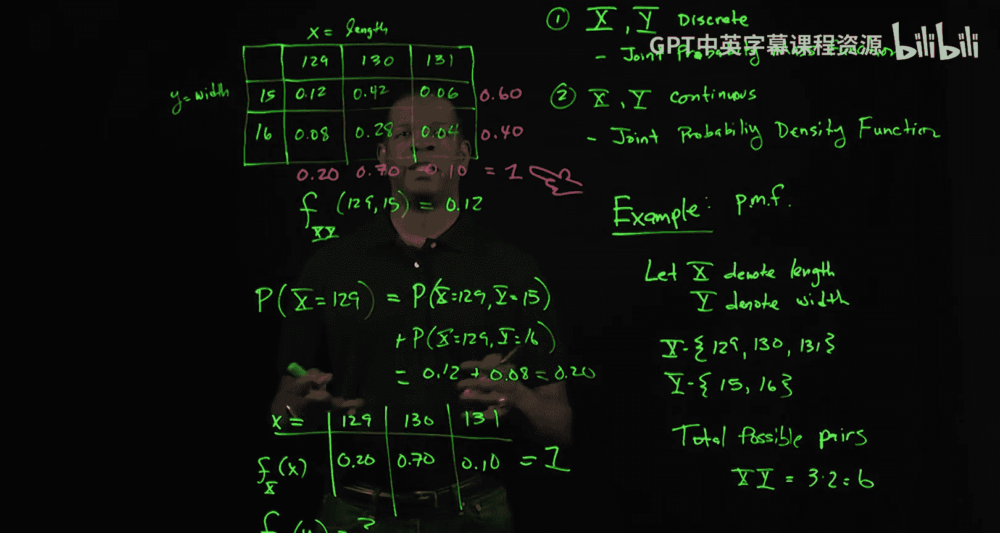

# 约翰霍普金斯大学《计算机科学的统计方法｜Statistical Methods for Computer Science》中英字幕 p47 1_联合分布.zh_en -BV1r483zbEzN_p47-

So we're talking about these joint distributions and there are two types of distributions that we're going to really be discussing。

 we've hit on it before when we' talked about the discrete and continuous。

 but in terms of terminology， what we're saying is that if x and Y， if these random variables。

 x and Y。

If they are discreet。Then really what we're talking about is we're talking about a joint。Probability。

Prober。Dility。Mass function。Okay， and if so this is case1， case  two， if x and y are continuous。

Random variables， then the joint。What we're talking about is a joint。Probability。Density。Function。

Okay， so we have a probability mass function， and we have a probability density function。 Now。

 the best way to kind of go about and really illustrate this concept。Its actually do an example。

 Okay， so here's our example。 So we have a manufacturer。So we're going to do an example。

And this example is going to be using a PMF。Okay， this is a probability mass function。Okay。

 so in this example。We have a manufacturer that's building a， let's say。

 a rectangular type of apparatus to contains something。 Maybe it's a cover。

 Maybe it's a small box or whatever， right， But the measurements of this rectangular this rectangular object has length。

 and it has width。Okay， it has length and it has width。So we are going to establish that。

Although length and width are continuous variables。

 we're going to establish that there are only certain linkss and widths that are possible for this manufacturing process。

 And so let's let。Cap X and we're going to let CA X denote。Length。And we're going have cap Y。Deote。

With。Okay， and these are going to be two。Discrete processes because the manufacturing apparatus can only manufacture certain lengths and certain widths。

Not all of them。 So what are we going to say， We're going to say then that the possible values for x。

So the possible values are going to be， let's say， 129， 130。And 131。

the possible values for cap Y are going to be 15 and 16。Okay。

 and so because we have defined the total space of x and Y。

 this now becomes a discrete process because there are no other possible values that they could be and so if we were to combine these and we were looking for the total possible pairs we would see。

That the total possible pairs。Here。Would be cap X cap times cap Y， and that would be3。Times 2。

And then would equals6。So there are six possible combinations that you could have here。

So let's draw this for a minute。 So if we were to draw this， I would need six bins。

 I'm going to have x go across， so X。Equals。嗯。Length。And we're going to go across here like this。

 and then we're going to have 129。130 in。131 okay， then we'm going to come down here。

I'm to go across like this。Okay， and now we need。Ne one more cell here。For anyone to come across。

아 this。Okay， and then we need this is going to be y is equal to， and this is going to be a width。

And then this is going to be 15。And 16。And now what I need to do in order to define this properly。

 the only thing left to do is to put in some probability， so I'm going to say this is 0。120。

08 I'm going to say that this is 0。42 this is going to be 0。28 this is going to be 0。

06 and this final one is going to be 0。04。Okay， now one thing that we have to note is that。

So let's look at some different characteristics here。

As I established these probabilities inside of this space。

Notice that different from the singular case in the joint probability space。

 I have this direction in the horizontal， but then I also have a direction in the vertical， okay。

 denoting the two dimensions。The sum of all of these probabilities must equal one。Okay。

 the sum of all of these probabilities must equal 1。 And so we could ask questions like。

 if I wanted to know what combination of x and Y is the has the highest probability of occurring。

 right？ Well， that answer would be， I would look at all the probabilitybabilities I'd find the highest one。

 And that would be 1，30 and 15。131 and 16 has the lowest probability of occurring。

 has the lowest probability of occurring。So we're going to so we write this basically。

 if I was going to write this as a function， I would write something like。😡，F。Okay。

 and so I could denote。Cap X， Cap Y。as a joint probability of let's say， 129 and 15。

 and the answer to that would be a probability and that probability would be 0。12。

That's how we would do that， okay？So one of the things that is important in calculating and being given a probability space is that we can do calculations when I'm only looking for the distribution of。

 let's say X， or I'm looking for the distribution of only y。

 and the way we're going to do that is we can do， let's say， if I wanted to find the probability。

Of only cap x is equal to 129。So in this case， I want to know the probability that capex is equal to 129。

 but y is also a variable。 So how do we handle that？ Well。

 the way you handle that is we're going to sum。Across all values of y holding x equals 1。

29 at a constant。 And as you can see， when I sum across y， I get 0。Let's do it in this color here。

 I get0。20。And so what we have is that this value is equal to， if I was to write this， it's equal to。

The probability。Cap X equals 1，29。 Cap Y equal to 15。Plus， the probability cap X equal to 129。

 cap Y equal to 16。That gives me equals to 0。12 plus 0。08， which is equal to 0。20。Okay。

 now we may want to know now。That's a good thing to know。

But what is the probability distribution of all of x。

 What is the probability distribution of all of x， All right， well。

 your intuition is going to serve you correctly If you said， okay， sum all the values。

 And so here I have point。2， this is going to be 0。70， and this is going to be 0。10。Now。

 in order for this to be a distribution， I know that this sum must equal one。 And so it does。

 And so what I have found now， I have found the probability distribution。

 which has been derived from if you think about it。

 it's been derived from a joint probability distribution。 and now I can say that given。

I can say that given my x values， so I'm going to say x is equal to in this case。

Let's just draw this out。I'm going to write。1，29，1，3，1，31。What am I f。

 and so now I'm going to write F， and then I'm going to write cap X to denote that it is a joint probability。

 it is a single distribution probability that is derived from a joint probability。

 and in this case it's the X。And I'm only looking at the changes in the x variable， and in this case。

 it's going to be 0。20，0。70 and 0。10。And again， this is a distribution， as like we said before。

 it is equal to one。Now， this idea is not just for the X。 We could do the same thing in the Y。

 So what I want you to do right now is just pause the video right here for a second and see if you can calculate this value。

 I want you to calculate this value right here。 F of。Cap why。Of why。Okay。

 so you had a chance to try to do it and work this problem yourself。

 I wanted you to find f of cap y of y， and so the first thing you should have done is you should have summed across all x's because I'm trying to find the probability of y equals 15 so y equals 15 is going to hold constant I'm going to sum all the values of x and in this regard I'm going to get a 0。

60。😡，Okay。😊，When I do this sum， I get a 0。40 and notice that these are sum。To one。

 it sums to one in both the X direction。And it sums to one in the y direction。

 And so this then is our probability distribution。 and these are the probabilities of the Y distribution only or the x distribution only they sum to one。

But also the joint probability must also sum to one。 And when that occurs。

 then I know that I'm in the correct space。 if any of these quantities do not sum to one。

 you have done something okay， so you want to go back， you want to take a look， right。Now。

 one other thing I want to talk about， which is pretty interesting because sometimes the terminology is not as intuitive as it could be。

 But in this case， this terminology is extremely intuitive。

And this is the margin when someone talks about margin probabilities or margin distribution。 Well。

 if you notice what I've calculated， I've actually calculated in the margins of our table。

And that's why these values are known as。Marginal distributions。

So isn't that cool that these values which are calculated from the margins of the sum。

 these are what we call marginal distribution， so in terms of terminology。

 this is extremely intuitive so whenever you're trying to calculate the margins you got to make sure that you are actually summing and you're getting these values in the margins and that is in a discrete case how joint distributions actually work。

