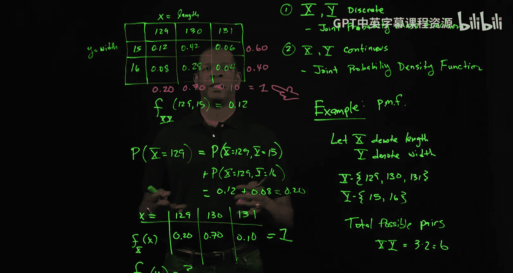

# 计算机科学的统计方法：1：联合分布 📊

在本节课中，我们将要学习联合分布的基本概念。联合分布用于描述两个或多个随机变量同时发生的概率。我们将通过一个具体的例子来理解离散型随机变量的联合概率质量函数，并学习如何从中推导出单个变量的边缘分布。

## 联合分布的类型

上一节我们介绍了随机变量的概念，本节中我们来看看联合分布的具体类型。根据随机变量的类型，联合分布主要分为两种。

如果随机变量 **X** 和 **Y** 是**离散型**的，那么我们讨论的是**联合概率质量函数**。

如果随机变量 **X** 和 **Y** 是**连续型**的，那么我们讨论的是**联合概率密度函数**。

## 一个离散型联合分布的例子

为了更好地说明这个概念，我们来看一个使用概率质量函数的例子。

假设一个制造商生产一种矩形装置。这个矩形有长度和宽度。虽然长度和宽度通常是连续变量，但在这个制造过程中，只有特定的长度和宽度是可能的。因此，我们将其视为离散过程。

我们定义：
*   令 **X** 表示长度。
*   令 **Y** 表示宽度。

以下是可能的取值：
*   **X** 的可能值为：129， 130， 131。
*   **Y** 的可能值为：15， 16。

由于我们定义了 **X** 和 **Y** 的整个取值空间，这变成了一个离散过程。所有可能的 **(X, Y)** 组合总数为 **3 × 2 = 6** 种。

我们可以用一个表格来表示这个联合概率分布：

| **X (长度)** | **Y (宽度)** | **概率** |
| :--- | :--- | :--- |
| 129 | 15 | 0.12 |
| 129 | 16 | 0.08 |
| 130 | 15 | 0.42 |
| 130 | 16 | 0.28 |
| 131 | 15 | 0.06 |
| 131 | 16 | 0.04 |

在这个二维概率空间中，所有概率之和必须等于 **1**。我们可以问一些问题，例如，哪个 **(X, Y)** 组合出现的概率最高？答案是 **(130, 15)**，其概率为 0.42。而 **(131, 16)** 出现的概率最低，为 0.04。

我们可以将联合概率写成一个函数。例如，**f(129, 15) = 0.12**。

## 从联合分布推导边缘分布

有时我们只关心其中一个变量的概率分布，例如只关心 **X** 的分布或只关心 **Y** 的分布。我们可以通过“求和”的方式从联合分布中推导出来。

假设我们想求 **X = 129** 的概率。由于 **Y** 也是变量，我们需要对 **Y** 的所有可能取值求和，同时保持 **X = 129** 不变。

计算过程如下：
**P(X=129) = P(X=129, Y=15) + P(X=129, Y=16) = 0.12 + 0.08 = 0.20**

我们可以为 **X** 的所有可能取值进行同样的计算，从而得到 **X** 的边缘概率分布。

以下是 **X** 的边缘分布计算过程：
*   **P(X=129) = 0.12 + 0.08 = 0.20**
*   **P(X=130) = 0.42 + 0.28 = 0.70**
*   **P(X=131) = 0.06 + 0.04 = 0.10**

这个分布的和为 **0.20 + 0.70 + 0.10 = 1**，符合概率分布的要求。

同样地，我们可以计算 **Y** 的边缘分布。请尝试自己计算一下。

以下是 **Y** 的边缘分布计算过程：
*   **P(Y=15) = 0.12 + 0.42 + 0.06 = 0.60**
*   **P(Y=16) = 0.08 + 0.28 + 0.04 = 0.40**

这个分布的和也为 **1**。

## 边缘分布的含义

一个有趣且直观的术语是“边缘分布”。如果你观察我们计算的表格，这些求和得到的概率值恰好写在表格的边缘（即最右边一列和最下面一行）。因此，从联合分布中通过求和得到的单个变量的分布，就被称为**边缘分布**。

在离散型随机变量的情况下，确保联合概率总和为 **1**，并且每个变量的边缘分布总和也为 **1**，是验证计算正确性的重要方法。

本节课中我们一起学习了联合分布的基本概念，区分了离散型与连续型联合分布，并通过一个制造矩形装置的例子，详细讲解了如何构建离散型联合概率质量函数，以及如何从中推导出单个随机变量的边缘分布。理解联合分布和边缘分布是分析多个变量之间关系的基础。