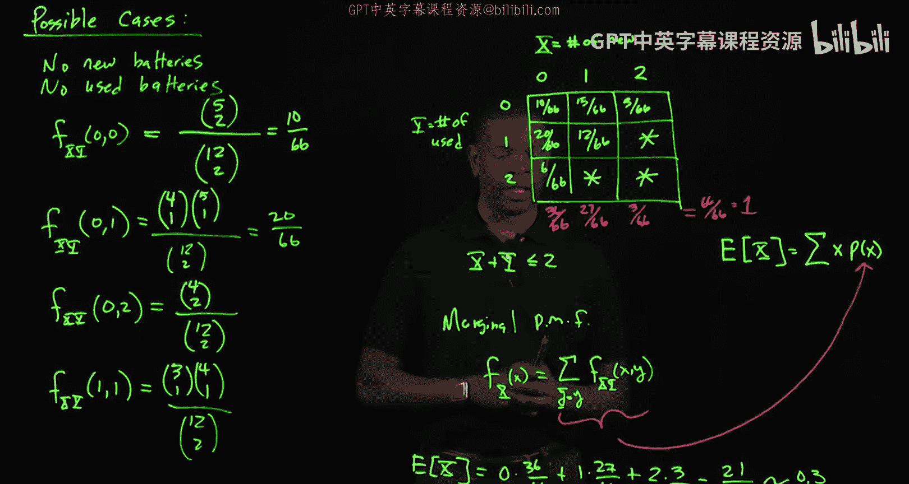
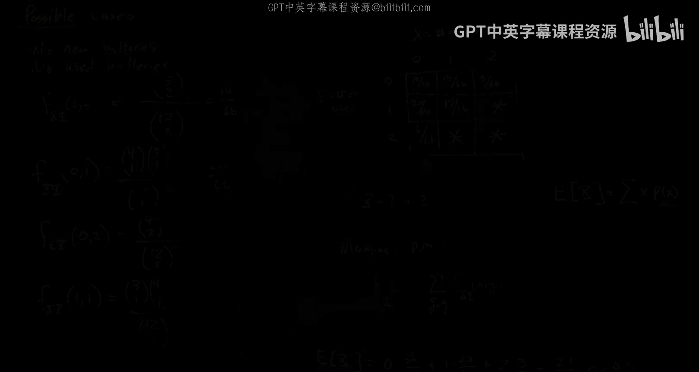

# 约翰霍普金斯大学《计算机科学的统计方法｜Statistical Methods for Computer Science》中英字幕 p48 2_联合概率空间与联合概率质量函数.zh_en -BV1r483zbEzN_p48-

So we've been talking about these joint probability mass functions。

 which by definition are going to be distributions or mass or functions of discrete random variables and there are some properties that we we kind of know in our intuition these properties。

 but I'm just going to spell a couple of them amount， one of them is that if you know。

 but we we denote this mass functions， this PMF。😡。

This probability mass function in this joint way， we deote it by saying that it's actually F。

 and then we're going to。In this case， we just state that the random variables are cap x cap y and then of x comma y。

 and one of the things that we're going to say is that this value。The output of this function。

Is going to be between 0。And one。And you kind of figured that。

We knew that it was going to be between 0 and 1。 right So that's the first one。 Number two， Okay。

 this one here is going to be that the sum now， if I sum over x。

And if I sum over y Capex kept y that this sum。Okay， for all values， X equals X。

 Y equals y for all of these values that the。Some， as we demonstrated just now。

It's going to equal one。 if that is not the case， you do not have a probability mass function。Okay。

 and then the third thing is just basically， what does it mean。

 So when we write F cap X cap Y of this function， X and Y。

 what we mean is we're talking about a probability。

That cap the random variable cap x is equal to some value x。

 and the random variable cap y is equal to some value y。That's what it means。Okay。

 and so there are some other things that we saw。 So that was the PMF。

 We also saw where we looked at what the marginal so we could look at the marginal。PMF。Right。

 and in a marginal PmF， we saw that if I want to find the distribution in the margin across the X random variable。

 I'm going to say F。 and I'm going to let you know which random variable we're talking about。

 and I'm going to say x。 and then that's going to be， remember if I'm summing。

If I'm looking for the margins in x， then I'm summing over cap y equal all values of y。Right。

 I'm summing over all the values of y。 And then I'm taking the。Total， right， So that's going to be。

I'm taking the total function， the joint function， and I'm summing over the values of y to give me the distribution or the marginal distribution of。

Again， if I want to find y， Okay， so that's going to be F。 And then it's going to be a cap Y of y。

 And that's going to be the sum。 Oh， you already know this now， right， cap X equals x。

 and it's going to be。The total function x comma Y again。

 So I'm going to take the joint distribution， and I'm going to sum over the x values。

 And so when I do that， basically， what I have found is I have found。

The marginal distributions and from this margin from these marginal or this marginal PF。

 I can find what is my expected value in the x direction or the y direction and I can use the same methods that we use for the singles。

So now let's look at an example。So another example to kind of bring this point， Okay。

 so here's an example。All right， suppose that。So suppose two batteries。Are randomly。Chsen。

And they're chosen without replacement。Okay， they're chosen without without replacement from。

The following。Group。Alright， so in this bag， okay， in this bag， I have three new batteries。

I have four batteries that are not new， but they're used， but they work， okay？

There's nothing wrong with them， but they are used。

You could kind of say like I've got three that are in the container that hasn't been open。

 I've got four that are open， but they work， and then I have。

 let's say I have five that are clearly defective。Okay， how do I know that they're defective。

 I don't know， Maybe， maybe they got some of the， maybe some of the。

You know that that copper stuff or whatever that acid is oozing out of it。

 or maybe it's blown up or whatever the case。 Okay， it's defective。All right。

So let's set up some kind of experiment here。We have three quantities， but in a joint。

Since if I define two of them， the third one is already is going to automatically be defined if we could kind of look at it that way。

So let's do this。 Let's denote。 So we're going to denote。We're going to say that Capex。

 this guy is going to be equal to the number of new batteries。

Cap Y is going to be equal to the number of used。Okay。So what would we want to find here。

 What am I looking for， Well， given this situation and what we know about counting and how we。

 you know， how we establish probabilities， can we。I want to find。This joint probability。啊。

Find that joint probability。 I want this distribution。 And then I also want to find。

The expected value。Of the new。I want to know， what is the expected value of。Getting a new battery。

Alright， so I got， I'm gonna to pick two batteries out of this bag and I want to know how when。

 what is that what。When can I expect how often。Can I expect to find a new battery in that bunch。Okay。

 so now。How do we do this， How do we do this？So there are going to be six possible cases that we're going to have to kind of look at。

And how do I know that there are going to be six possible cases， Well。

 if we think about it like this。Even though x can take on the values of0，1 and 2。

 and y can take on the values of 01 and 2， I know that if I consider them jointly。

 I have a situation where I'm going to have well I know that x plus y。

 these values has to be less than or equal to 2。Okay。

 so not all combinations are going to be possible。Even though I could have a 0，1 or two。

 So what cases are possible， Well， let's take a look。 So there is a possibility。

 There is a possibility。That I could pull。嗯。Let's just write this， so let's look at it possible。

Possible cases。So the first possible case is I could have。No。New batteries。Okay。

 I have no new batteries and no。Used batteries。Okay。

 and so what would that look like in my function space， that would have to look like F。Okay。0。

 comma 0。That's what it would have to look like。Because I have no use batteries。

 I have no new batteries， and so now I have to ask the question。

What are the only possible batteries I have left if I pull no new batteries and no use batteries。

 Well， first of all， what is my sample space， So this is the way。

 this is how you get after this problem right here。 So I'm going say， okay。

 my sample space now is I have 12 total batteries。And I'm choosing two of them。

So that's going to give me 12， choose2。If there are no new and no used batteries in this particular pool。

 what are the possible ways in which that could occur while that's going to be five？Choose2。 Well。

 why 5， because if there are no new batteries and there are no used batteries。

 then the only possible the only possible batteries left to choose from would be。The defective ones。

 How many defective ones are there。 There are five of them。 Okay， and so x plus y is less than 2。

 So that fits the criteria。0 plus 0 is less than 2。 And in that case， this is a valuable option。

 And this equals 10 over 66。So I have my first probability and is this in the space。

 you bet absolutely is' in the space， why， because I know that it's possible to have no batteries that are new and no batteries that are used。

If I had。You know， if x was equal to let's say， 3 and y was equal to 3。

 I know that even though there are three new batteries in the bag and there are at least three used batteries in the bag。

 F 3，3 is not allowed because of the constraint。 this constraint。Right here。Why。

 because this total combination has to be less than or equal to2。If the combination is equal to two。

 then there are no defective batteries in my draw。Okay， allright， let's take a look at another case。

 Suppose I have no new and one used。 So I'm going have F of X cap， Y cap。 And this is no new。

And one used， what is this going to be。Well， the denominator is going to stay the same， right。

But now， in this case， I have。I have no new batteries。And I have one used battery。

 So if I have one used battery， that means one of my two draw came from the used pile。

 So that's going to be 4， choose 1。And I know that one of the batteries。

 it didn't come from the new pile it had to have come from the defective pile。

 so that's going to be five， choose one。And that's going to be 12。 chooseose2。

 You see how this is working， right， And so this is going to be 20 over 66。嗯。Okay。

 let's say if I had two use batteries。So I have no new and I have two used ones。

 How would I do this one， Well， again， if I've got two new， if I've got two used batteries。

 that means I have no。New ones。 and I have no defective ones。 So that means I would be doing four。

 choose2。And the denominator is oh， this is too easy now， huh？You guys think this is way too easy。

 darn。I'm trying to challenge you， but。How much can I say。You got this now。 I， there's not。 Okay。

 I'm gonna see if I， I'm see if I can give you a hard one。 Okay。

 let's suppose we have a case where we have。 Can I give you a difficult one， Let's say we have。 man。

m trying to think of some hard。 Let's say we have。One new and one used。Okay， so that's going be F。

X cap， Y cap。One comm a one。That's not hard， isn' it。You already got it probably。

 I bet you already wrote three， one。4，1 over 12，2。Oh man。 So how yeah， that's right。

 That's pretty simple。 How easy can it get right， So yeah， so we would continue this process right。

 until we have actually completed and filled in our total joint probability space and what does that total joint probability space look like。

So the joint probability space， when I've completed all possible combinations of my x variable and my y variable。

 which are random variables of a discrete case。I'm going to have a joint probability space that's going to look like this。

We're talking about， so x is going to be the number of new。And this guy is going。

 we're going to have values here。 We're going to have values of。0。1。And2。

And then y I'm going to have values of 0，1 and 2， and this is the number， so this is capex。

 this is cap Y， and this is the number of used。Okay， and so those are my values。 And so now。

I'm going to have these。Okay， and then we're going to come here。Here， here， and across like this。

So we're going to do here。So here are my possible values。 Now， you may be looking and saying， well。

 wait a minute， Doctor J。 there are six boxes there。Right， but let's look at the constraint。

 Remember the constraint was x cap plus Y cap had to be less than equal to 2。

If I apply this constraint to my join probability space。

 there are certain boxes that are not possible okay， so for instance， this is not possible。😡，Okay。

 what else is not possible， this is not possible， and this is not possible。Okay。

 and so now that's going to leave me with the six options that I have to find。 and when I do。

 I get 10，66， I get 15。66。I get three。66。Okay。Were you able to？Fill in the rest of this。

Why don't you pause right here and see if you can fill in the rest of this。Probability space。Okay。

 you had a chance to kind of see if you could fill it in。 Well， let's see how you did。

 so you should have came up with 2066。1266 and then finally you should have had6，66。

 Now could you have made these decimals， of course。

 the thing here that is advantageous is that I wanted you to see that the denominator remained unchanged The only thing you were changing was out of that sample space of 12 choose two the only thing you were changing was the number that fit that combination within your joint probability space。

Now notice that this is a joint probability and it is correct， because if you add 20。

 I mean 10 plus 15 plus 3 plus 20 plus 12 and plus 6。

 what you get is you get as your joint probability space 66 over 6， and that is equal to1。

So now what we'd like to do is we'd like to say， okay， I want to find the expected value of。

 let's say， only the X terms。Okay， the expected value of finding a new， right。

 So what do we know about expected value well。We know that the expected value。

 if we would to write it， we know the expected value is going to be。We know that Cap E。

Of this guy is going to be equal to。 And we know that it's going to be the probabilities， right。

 So it's going to be the sum。Of。The probabilities。So we're going to say x。

 and then it's going to be the sum of probabilities and that's going to be， we said px。Right。Now。

 in this case， our probabilities of x is actually because we're going to have to pull those probabilities from this joint distribution right。

 I want to pull those probabilities from this joint distribution。 So in order to do that。

 we know that we need a marginal， we need a marginal。嗯。Distribution。

So this is going to be a marginal PMF。So what do we say about marginal PMs？Well。

 we're going to look for the case where we're going to have F。Of cap X is what we're looking for X。

 And we know that that's going to be equal to what？ Well， we're going to be summing again。

We're going to be summing。Over the why。And what we going to be sum。

 we're going to be summing all of those x values。Okay。

 we're going to be summing all of those x values。 I mean。

 we're going to be summing all of the y values across the different values of x。 And so in this case。

 it's going to be the joint X Y。X comma Y。 And in this case。

 we can look at our table and we can do this calculation。 So let's sum up the margins here。

 So what do we have。 So here we're going to have when x is equal to 0， the value is going to be 36。

Over 66， when x is equal to1， the value is going to be what do we have 27， what we have 37。Over 66。

 And when the value is equal to 2， it's going to be 3。Over。66。 so now let's see what we got。Oh。

 this is not 37 this is 27 whoops。Okay， so27。So now when we sum these， this sums to 66 over 66。

 which is equal to 1。 so guess what we found our probability distribution and now to find the expected value。

 I just simply need to sum and multiply these probabilities because this guy，Here。Is that。Right。

So now that you have your marginal probability mass function， and we've established a distribution。

 the expected value is according to our previous definition。

 And so now we could say that the expected value。Of getting a new battery is going to be equal to。

 So it's going to be 0 times36。Over 66 plus one times。27 over 66 plus， and then it's going to be two。

Times 3 over 66。 and this is going to give me a value of 21。Over 66， okay， which is about 0。3。

 something about a third and so in this case。This means that the expected value of getting a new battery when I pull two batteries out of that container is the number of new batteries that I would get is close to 0。

 So I'm not likely to get a new battery， because the expected value is 0。3。

 if if this value was  one or two， then the expected value would be that I would get  one or I would get 2。

 But in this case， the expected value is that I would get less than 1， which is probably 0。

 round down。

