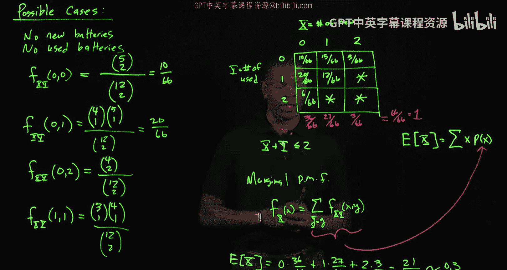
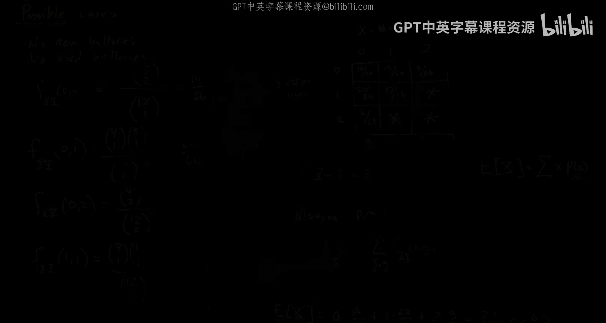

# 计算机科学的统计方法：2：联合概率空间与联合概率质量函数 📊

在本节课中，我们将要学习联合概率质量函数（Joint PMF）的核心概念、性质及其应用。我们将通过一个具体的例子，演示如何从实际问题中构建联合概率分布，并计算边际分布和期望值。

---

## 联合概率质量函数的定义与性质

上一节我们介绍了离散随机变量的基本概念。本节中，我们来看看当涉及两个离散随机变量时，如何描述它们的联合分布。

联合概率质量函数用于描述两个离散随机变量同时取特定值的概率。我们将其表示为 **`f_{X,Y}(x, y)`**，其含义是随机变量 **`X`** 取值 **`x`** 且随机变量 **`Y`** 取值 **`y`** 的概率。

以下是联合概率质量函数必须满足的三个基本性质：

1.  **概率值范围**：对于所有可能的 **`x`** 和 **`y`**，函数值必须在 0 到 1 之间。即：
    **`0 ≤ f_{X,Y}(x, y) ≤ 1`**

2.  **归一性**：所有可能组合的概率之和必须等于 1。这是概率分布的基本要求。公式表示为：
    **`∑_x ∑_y f_{X,Y}(x, y) = 1`**
    如果不满足此条件，则它不是一个有效的概率质量函数。

3.  **明确含义**：函数 **`f_{X,Y}(x, y)`** 直接等价于概率 **`P(X = x, Y = y)`**。

---

## 边际概率质量函数

理解了联合分布后，我们常常需要关注其中一个变量的分布，而忽略另一个变量。这就是边际分布。

如果我们从联合分布 **`f_{X,Y}(x, y)`** 中想得到随机变量 **`X`** 的分布（边际分布），我们需要对另一个变量 **`Y`** 的所有可能取值求和。公式如下：
**`f_X(x) = ∑_y f_{X,Y}(x, y)`**

同理，要得到随机变量 **`Y`** 的边际分布，则对 **`X`** 的所有可能取值求和：
**`f_Y(y) = ∑_x f_{X,Y}(x, y)`**

得到边际分布后，我们就可以像处理单个随机变量一样，计算其期望值、方差等统计量。

---

## 实例分析：电池抽样问题

现在，让我们通过一个具体例子来应用以上概念。假设我们有一个袋子，里面装有：
*   3 节新电池
*   4 节旧电池（功能正常）
*   5 节缺陷电池

我们**不放回**地随机抽取 2 节电池。定义随机变量：
*   **`X`** = 抽到的新电池数量
*   **`Y`** = 抽到的旧电池数量

我们的目标是：
1.  找出联合概率分布 **`f_{X,Y}(x, y)`**。
2.  计算抽到新电池数量的期望值 **`E[X]`**。

首先，注意到一个约束条件：因为总共只抽 2 节电池，所以新电池和旧电池的数量之和不能超过 2，即 **`X + Y ≤ 2`**。这个条件将限制可能的 **`(x, y)`** 组合。

样本空间总数为从 12 节电池中抽取 2 节的组合数：**`C(12, 2) = 66`**。

以下是计算联合概率的几种可能情况：

*   **情况 1：`f_{X,Y}(0, 0)`**（无新电池，无旧电池）
    这意味着抽到的 2 节电池都来自 5 节缺陷电池。
    概率 = **`C(5, 2) / C(12, 2) = 10 / 66`**

*   **情况 2：`f_{X,Y}(0, 1)`**（无新电池，1 节旧电池）
    1 节来自 4 节旧电池，1 节来自 5 节缺陷电池。
    概率 = **`[C(4, 1) * C(5, 1)] / C(12, 2) = 20 / 66`**

*   **情况 3：`f_{X,Y}(0, 2)`**（无新电池，2 节旧电池）
    2 节都来自 4 节旧电池。
    概率 = **`C(4, 2) / C(12, 2) = 6 / 66`**

*   **情况 4：`f_{X,Y}(1, 0)`**（1 节新电池，无旧电池）
    1 节来自 3 节新电池，1 节来自 5 节缺陷电池。
    概率 = **`[C(3, 1) * C(5, 1)] / C(12, 2) = 15 / 66`**

*   **情况 5：`f_{X,Y}(1, 1)`**（1 节新电池，1 节旧电池）
    1 节来自 3 节新电池，1 节来自 4 节旧电池。
    概率 = **`[C(3, 1) * C(4, 1)] / C(12, 2) = 12 / 66`**

*   **情况 6：`f_{X,Y}(2, 0)`**（2 节新电池，无旧电池）
    2 节都来自 3 节新电池。
    概率 = **`C(3, 2) / C(12, 2) = 3 / 66`**

其他组合如 (2,1), (1,2), (2,2) 因不满足 **`X + Y ≤ 2`** 而概率为 0。

我们可以将完整的联合概率分布整理成下表：

| **`f_{X,Y}(x, y)`** | **Y=0 (旧电池数)** | **Y=1** | **Y=2** |
| :--- | :---: | :---: | :---: |
| **X=0 (新电池数)** | 10/66 | 20/66 | 6/66 |
| **X=1** | 15/66 | 12/66 | 0 |
| **X=2** | 3/66 | 0 | 0 |

验证：所有概率之和 = (10+20+6+15+12+3)/66 = 66/66 = 1，符合归一性。

---

## 计算边际分布与期望值

现在，我们想计算抽到新电池数量 **`X`** 的期望值 **`E[X]`**。首先需要 **`X`** 的边际概率质量函数 **`f_X(x)`**。

根据公式 **`f_X(x) = ∑_y f_{X,Y}(x, y)`**，我们对每一行（固定 **`x`**）求和：

*   **`f_X(0)`** = 10/66 + 20/66 + 6/66 = 36/66
*   **`f_X(1)`** = 15/66 + 12/66 + 0 = 27/66
*   **`f_X(2)`** = 3/66 + 0 + 0 = 3/66

验证：36/66 + 27/66 + 3/66 = 1。

得到边际分布后，即可计算期望值 **`E[X]`**：
**`E[X] = ∑_x x * f_X(x) = 0*(36/66) + 1*(27/66) + 2*(3/66) = 33/66 = 0.5`**

因此，从该袋中不放回地抽取 2 节电池，预期会得到 **0.5 节**新电池。这个结果直观上也是合理的，因为新电池只占总数的 3/12 = 0.25，抽取 2 节的期望值就是 2 * 0.25 = 0.5。

---

## 总结

本节课中我们一起学习了联合概率质量函数的核心内容。我们首先明确了联合PMF的定义和三条基本性质。接着，我们介绍了如何从联合分布中通过求和得到单个变量的边际分布。最后，我们通过一个完整的电池抽样实例，演示了如何从实际问题出发，构建联合概率分布表，计算边际分布，并最终求得随机变量的期望值。掌握这些步骤是理解多变量离散分布并进行相关计算的基础。