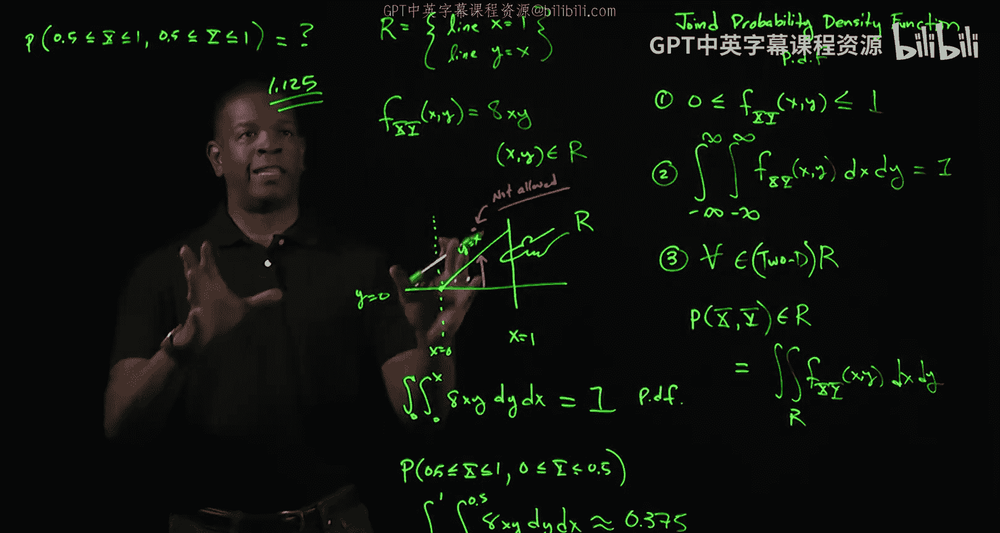

# 约翰霍普金斯大学《计算机科学的统计方法｜Statistical Methods for Computer Science》中英字幕 p49 3_联合密度函数与概率密度函数.zh_en -BV1r483zbEzN_p49-

So we've been looking at these joint。

Probability mass functions。 And we noted that's for a discrete random variable for multiple discrete random variables。

 But now let's take a look at。Continuous random variables。

 And so when we have continuous random variables， we're going to have this joint。Probability。Density。

Function。Okay， and so this is a P。D F， right， And in a joint world。

 this P DF is going to have some properties。 So let's look at some of the properties。

 these are going to be intuitively similar to the properties for the discrete case。

 except we're going to use a different mathematical tool to evaluate。

 So first property is going to be that we know that this function。 You know。

 it's going to be greater than。Or equal to。0。And less than equal to one。Okay。

 that goes without saying。 and then property number two， property number two。

 when we're summing in the continuous world， we know that we're going to be integrating and not taking a summation because these are not discrete quantities。

 and so we're going to be integrating this guy from negative infinity to positive infinity in the x or Y direction and negative infinity to positive infinity in the x or y direction and then we're going to take all these values。

And they all have to equal one。Okay， they all have to equal one。If it doesn't equal one。

 then this joint function， this multivariable function is not a PDF， right， it is not a PDF。Okay。

 and so。The final property is that for any region。 So for any region。That's in。You know， this。2。

Dimensional space， okay， for any region。嗯。You know， we're going to say that this。

For any two dimensional region R， okay， for any two dimensional region R。

We're going to have this whole。 We're going to say that the probability of X。And why。Right。

 and this probability is。This range of values is in R， right？Okay。

 this range of values is in this region。 Okay， this is going to be equal to。

 and this is going to be a double integral over the region。And this is going to be F X， Y。X， Y， D， X。

 D， Y。Okay， so that's what we're gonna to have。All right， and so。

All of the things that we talked about before， all of those things whole。

 except now we're going to be in this twodial space in a continuous sense and not in a discrete sense。

 So the best way again， is to let's look at an example。 Let's look at an example。

 So suppose we have a particle， that's traveling through space。

 And we want to model the movement of this particle。

 Now we assume we're going to assume that the particle is moving a region that's bounded by some value。

 And so in this case， the region R。So R is going to be the region and R is going to be equal to the region。

 a region that's bounded by。 So it's going to have two things。 It's going to be bounded by the line。

The line。X equals1。And by the line。Y equals x。So that's the reason that this。

Particle is bound to in its travels。 And what we want to know is we want to know we want the joint probability of where this particle is going to be located。

 Okay， we want the joint probability of where this value where this particle is going to be located。

 And so a couple things we have to do is， first of all， we're going to be given。

 we're given that the value of the joint distribution is F。It's equal to 8 X y。Okay。

So given the position of the particle in X Y coordinates。

 you give me the position and I could tell you the probability of the particle based on this particular function。

 Okay， and so if I have this。😡，Joint density and this is for all X Y。That's in this region R。

 Then I'm able to actually calculate many， many things。 So let's take a look。

The first thing we want to do is we need to verify that this is actually a probability。Okay。

 that's one thing that you might want to do。 When I want to verify that this is actually a probability And in doing that。

 right， in verifying that this is actually a probability， What I'm going do is I need to integrate。

This。Function。Given property number two。And I when I do that， this value should hold。

So how do we integrate this now， well， let's see。If I'm going to integrate this。

 the first thing I need to do is I need to establish the domain and to establish the domain。

 I'm going to draw a little picture here。 So what we have is we have a line here。

 and this is X is equal to 1。Okay， we have a line here。This line is this is y is equal to0。 Okay。

 we have an origin point。 We're going to call this。 let's do this right here。 This point right here。

 this is x is equal to0 here， and then we've got a line that goes here and this is y is equal to x。

 Okay， so this is our region R。Our region R is here。Okay， this is R。

And so now what we have to ask ourselves is we want to integrate this region and we want the integraltegr of our integral to be our probability or our proposed probability density function。

 and so we're going to integrate in this direction。

And so this integral now is going to be set up by saying we're going to say the integral now。

From  zero to one。The integral from 0 to x。And then this is gonna be 8 X， Y。

 And then this is gonna be D， Y。Dx。Okay， D， Y， D X， and when we do this integration。

 we find that this is actually indeed equal to one。Right so so this is a PDF。So we're good there。

Okay， what else do we want to figure out， What else do we want to figure out？ Well。

 there are a lot of things we could do at this point to really establish all of these rules。

 We can do many things。 We can find the marginal distribution。If we wanted to do that。

 we could find a marginal distribution。 We can even。

Work out margins in different directions so we can work out a margin in the X direction。

 We can work out a margin in the y direction。 So let's look at a couple things that we might want to do。

Suppose I have coordinates of a particle。 And I know that that particle is going to be at coordinates。

 I want to know the probability that the particle is at， let's say， let's say the probability that。

X is between。嗯。Let's say the probability the x。So is's between 0。5。And one。Okay。

 I don't know exactly where it is， but I know it's somewhere in that region and cap Y is between zero。

And let's say，0。5。What is the probability that the particle is in that location， given what we have。

 Well， that's very simple。I'm simply going to use these values as the limits of my integration。

05 and one is within the limits of the overall0 and 0。

5 is also in the limits of overall right So when I do this， I get the integral。From 0。5 to 1。

 the integral of 0 to 0。5 of 8 x， Y， d Y dx， and this is actually equal to 0。375 here。

This is the probability。That this particle will be located in that space。

If we were to look at something else， what if we looked at the probability， Here's a good one。

 The probability that it is。Let's say the probability that this guy is going to be zero。Pot5。Cex。One。

 and then we're going say0。5。Kap why。1。What is this probability equal to。

 Go ahead and pause for a second and tell me what you get when you calculate this probability。Okay。

 you've had a chance to look at this and when you calculated this probability。

 you may have run into a problem。And the problem is， when you calculate this。

 this is actually equal to 1。125 here。Well， wait a minute。

 This is a violation of property number one。And so what has actually occurred here， Well。

 here's the problem。In this space with these coordinates。

 you've gone outside of this original domain or。 where have you done that， Well， if we say。

Y is equal to 1 and x is equal to 0。5 that is located。Y is equal to1。And x is equal to 0。5。

 That location is。Here。That is not。Aloud。So what has happened is you've gone。

 this is not a proper probability statement because you've gone outside the region。

 you have values that are outside the region， and so that would not be allowed in this case。

 that would not be allowed。Okay， so。Let's say now we want to look at the expected value， right。

 And if we want to define find the expected value。We would need to kind of work with what we have and then build upon that。

And so what we'll do is in the next video， we'll look at the expected value of this particular phenomenon。

