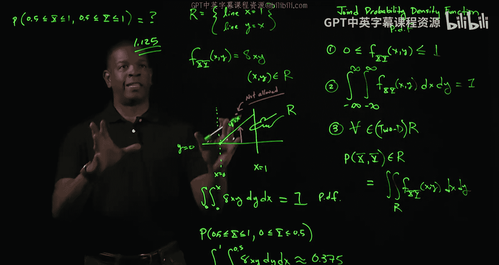

# 计算机科学的统计方法：3：联合密度函数与概率密度函数 📊


在本节课中，我们将要学习连续型随机变量的联合概率密度函数。我们将探讨其定义、核心性质，并通过一个具体的粒子运动例子来演示如何验证和应用这些概念。

上一节我们介绍了离散型随机变量的联合概率质量函数。本节中我们来看看连续型随机变量的情况。

对于连续型随机变量，我们使用**联合概率密度函数**来描述其联合分布。这是一个概率密度函数。在联合分布的世界里，这个PDF具有一些特定的性质。这些性质与离散情况下的性质在直觉上相似，但我们将使用不同的数学工具（积分）来进行计算。

以下是联合概率密度函数需要满足的核心性质：

1.  **非负性**：函数值必须大于或等于0。即 `f(x, y) >= 0`。
2.  **归一性**：对整个定义域的积分必须等于1。即 `∫∫ f(x, y) dx dy = 1`。如果不满足，则该函数不是一个有效的PDF。
3.  **区域概率**：对于二维空间中的任意区域R，随机变量(X, Y)落在该区域内的概率等于联合密度函数在该区域上的二重积分。即 `P((X, Y) ∈ R) = ∫∫_R f(x, y) dx dy`。

之前讨论的所有概念在此仍然适用，只是我们现在是在连续而非离散的二维空间中进行操作。理解这些概念的最佳方式依然是看一个例子。

让我们来看一个例子。假设有一个粒子在空间中运动。我们想要对这个粒子的运动进行建模。我们假设该粒子在一个有边界的区域内运动。

在这个案例中，区域R由两条线界定：
*   直线 `x = 1`
*   直线 `y = x`

这个区域就是粒子被限制在其内运动的范围。我们想知道的是这个粒子位于空间中某处的联合概率。

我们已知粒子的联合概率密度函数为 `f(x, y) = 8xy`。这意味着，给定粒子在XY坐标系中的位置，我可以根据这个函数告诉你粒子出现在该位置附近的概率密度。这个函数对于所有位于区域R内的(x, y)点有效。有了这个联合密度函数，我们就可以计算许多东西。

首先，我们需要验证这确实是一个有效的概率密度函数。根据性质二，我们需要对整个定义域进行积分，其结果应为1。

为了进行积分，我们需要先确定积分区域。区域R是一个三角形区域，由x轴（y=0）、直线x=1和直线y=x围成。

因此，我们的积分设置如下：
```
∫（从x=0到x=1） ∫（从y=0到y=x） 8xy dy dx
```
计算这个二重积分，结果确实等于1。所以，`f(x, y) = 8xy` 在区域R上是一个有效的PDF。

接下来，我们可以计算各种概率。例如，假设我想知道粒子位于以下坐标范围内的概率：X在0.5到1之间，Y在0到0.5之间。

这很简单，我只需要将这些值作为积分的上下限：
```
P(0.5 < X < 1, 0 < Y < 0.5) = ∫（从x=0.5到x=1） ∫（从y=0到y=0.5） 8xy dy dx
```
计算可得，这个概率等于0.375。

现在，考虑另一个概率：`P(0.5 < X < 1, 0.5 < Y < 1)`。如果你尝试计算这个概率，可能会遇到问题。计算结果是1.125，这违反了概率必须小于等于1的性质。

问题出在哪里？当我们设定Y在0.5到1之间，X在0.5到1之间时，我们考虑的区域有一部分（例如点(0.5, 1)）实际上位于原始定义域R之外（因为当x=0.5时，y不能大于0.5）。因此，这不是一个在给定模型下有效的概率陈述，因为它包含了不可能发生的事件（粒子出现在允许区域外）。




本节课中我们一起学习了连续型随机变量联合概率密度函数的核心概念与性质。我们通过一个具体的例子，演示了如何验证一个函数是否为有效的PDF，以及如何计算粒子落在特定区域内的概率。同时，我们也看到了确保概率计算在随机变量有效定义域内进行的重要性。在接下来的课程中，我们将探讨如何计算此类联合分布的期望值。