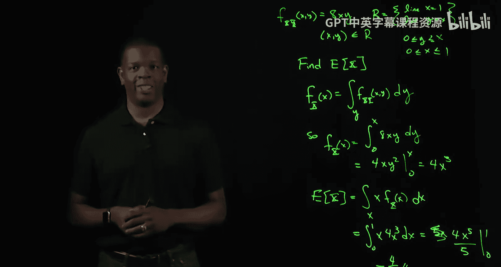

# 约翰霍普金斯大学《计算机科学的统计方法｜Statistical Methods for Computer Science》中英字幕 p50 4_期望值与边缘分布.zh_en -BV1r483zbEzN_p50-

Yeah。

Okay， so we had this joint probability density function。

 which we verified that it actually was a density function， and it was F。Was equal to 8 X， Y， Okay。

 and it was defined in a region， R。That。Was the line？X equals1。I mean， it's bounded by these。

 these lines， and y equals x。Okay that was the region in which it was bounded。

 and in that region it defines a probability mass function。All right， so and we looked at all values。

 x and y that were in R。What we'd like to be able to to do now is we want to find what is the expected value of。

 let's say X。 So let's say， so we want to say find the。X here， want to find this expected value。Well。

 in the continuous world。Just like in the discrete world。

 we know that the first thing we have to do in order to find the expected value of the X distribution is we have to find the marginal P D F。

Of x， we have I find the marginal distribution in the X。Direction。

 so that we can find the expected value having found the marginal distribution。

 And so to find the marginal distribution， we know that F。

X of x is going to be equal to instead of a sum， we're going to be integrating。With respect to why。嗯。

F。And this is going to be D Y。So that's what we're going to do first When I sum across the y variable。

 I get a function of x。Okay， and that is my X distribution function。 So in this way。

 we're gonna to say， so let's do this。 So then I'm gonna have so F。

It's going to be equal to and this is going to be so in the y direction。

 so in the y direction my y variables were0 was less than equal to y。

 which is less than equal to x Okay， and my x variable was0 less than equal to I mean。

0 less than equal to x， which is less than equal to 1。Okay， and so here we go。

 So I can integrate now， and I can say that this is going be the integral。From0 to x。8 X， Y， D， Y。啊哈。

But now this is going to be very simple now， I can say that this is going to be4 x Y squared evaluated from 0 to x。

 and that's going to give me4 x Q。All right。 Well， now that I have my distribution。

 this is my marginal distribution of the joint probability in the X direction now finding the expected value。

Is going to be doable。 And so in this way， the expected value now is going to be equal to Now I'm going to sum over the x's。

 and I'm going to say X times F cap X of x。 This is。This is。D X。

 this is my summing in the continuous world。 the way I did it in the discrete world。 Sam thing。

 right， Okay， And so now I can say that this is going to be equal to a。

 So this is going to be the integral group from 0 to 1。😊，X times 4 x Q D X。

 which is going to be equal to5 x。No， it's going to be4 x to the fifth divided by phi。

Evaluate it from zero to1。And so when I evaluate this now， this gives me four fifth。

So the expected value of where that particle could be located in the x direction。

The expected value of the x coordinate would be4 fifth。Now， what if I wanted define find the value。

 Okay， What if I wanted to define find the value。In the wide direction。

What if I wanted to define find the value in the y direction。If you。

 if you follow along this pattern， you will find the y coordinate and finding the value of the x coordinate and finding the expected value of the y coordinate together will give you the expected value of where that particle would be in that particular space。

 And so you should be able to do that on your own because it's following the exact same pattern that I've done here。

