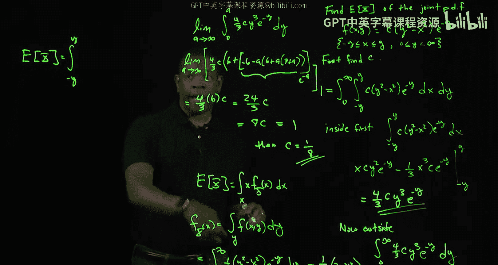

# 约翰霍普金斯大学《计算机科学的统计方法｜Statistical Methods for Computer Science》中英字幕 p51 5_联合概率密度函数例题解析.zh_en -BV1r483zbEzN_p51-

。

Okay， so now what we want to do is we want to work an example。That's going to put it all together。

 like everything that we've talked about thus far in terms of， you know， these joint Pdfs。

talkingal about expected value， understanding the space， all of that。're going try to。

 we're going to put it together。And so you might be asked a question where you're given some information and you're asked to。

 in this case， I want you， we want to find。The expected value。Notice I've put what direction。Of。

The joint。PDf。And the joint Pf is F of x comma y is equal to。And it's going to be。C。

Times y squared minus x squared。E to the negative y。Okay。All right。 Well。

 we know that to find the expected value， I have to find the margin in the direction。

Then I'm looking for the expected value。 So in this case。

 I'm looking for the expected value in the x direction。 Okay， for the x random variable。

 So I need to find the margin。But I've got this C in here。And the sea is just some constant。

For which I don't know right away。 So the first thing we want to do is we want to go ahead and we want to find that C。

 right， And we have an equation。 If you have an equation， you have one unknown。

 you can solve for the unknown。 So what is the equation that I have。 Well。

 I am assuming that and I've been told that this is a Pf。 So it's not like I need to test for that。

 I know that this is a Pf because I've been told that。 And so since this is a Pdf， I'm gonna first。

 the first thing I'm going to do is I'm going to。I'm going to find。Ci。Okay。

 so how am I going to do that， Well， I'm going to use the fact that this is a Pf now。

We need some limits of integration， right？What are the limits of integration， Well， in this case。

Just what I've stated here is not complete because you don't know where this is being defined to determine if it's a P D F。

 So a part of the problem that you will always be given is you would have to be given the region。

 And in this case， the region is going to be negative Y is less than equal to x。

 which is less than equal to Y， okay。And so that's one。

 and for y we're given that0 is less than equal to y， which is less than infinity。Okay。

So those are are my regions， right？ So I've got the function。

 I've got the region in which is defined in the X and in the y。Dires。 and now I am ready to。F C。

 And so what I'm going to use， why I'm going to use the fact that it is a Pf。

 So I'm going to say one is equal to the integral from0 to infinity。

The integral from negative y to y。 And then this is going to be。All this here is C。

 Y squared minus x squared。E to the negative y， and then this is going to be dx because the x is here and then d Y。

啊哈。Okay， so I'm going to do the inside first。 So here's the inside。 So inside。First。So inside。

 I have the integral from negative y to y。Of C。Y oops squared minus x squared。E to the negative Y， D。

 X。 Okay， I'm going to solve this guy。 And when I do， what I get is I get。 So this inside。

 the anti derivative then becomes X， C。Y squared？E to the negative y。Minus1， third。Ex cubeed。

CE to the negative y， and I'm evaluating that from negative y to y。

Okay I'm evaluating that from negative y to y。Well， when you do this evaluation here。

 what you end up with is that after I evaluate these two， I end up with this is going to be。

Negative y y， so what I end up with is four thirds。C， Y cubed。E to the negative y。

 So this is the inside。Okay， that's the integral on the inside。Okay， now I need to integrate that。

With respect to the outside。So， so now。The outside。

So now on the outside now I'm going to have the integral from 0 to infinity。

 and then this is going to be4 third CY cubed e to the negative y。

 and then this is going to be D Y here。Yeah， can be D Y here。 And so since I have this infinity。

 I'm going to take the limit。As a goes to infinity。

 And now I'm going to say this is the integral from 0 to a here。Right。

 and then this is going to be 4 thirds， C， Y cubed E to the negative Y D， Y。

 And when I take the anti derivative here and I integrate this guy， and I take the limit。

 What I get is something like this， I get。The limit。As a goes to infinity， and it's going to be of。

All of this is going to be four thirds。C。Times。This is going to be six。Plus。

 and then this is going be。Negative 6 minus a。And then that's going to be times。 This is crazy。

6 plus a。Times 3 plus a。One more。 And then all of this is multiplied by。二。To the negative a。Yeah。

 all right。 well suffice to say， when you do this here。When a goes to infinity， this term goes to 0。

 and this term is multiplying。By all of those。 So this whole thing over here goes to 0。

 And what I'm left with then is I'm left with。Four thirds。Times6 times c， which is equal to 24。Third。

 C， which is equal to8 C aha。Alrighty。Yeah， okay。 so now8 C， though， has to be equal to  one。

 Remember， that was the original equation。 And so if8 C is equal to one， then。C is equal to1/ eighth。

And so we found C。Okay， just doing some integration。 We found C。 All right， well now that we found C。

 we want to find the expected value。Okay， we can find the expected value now。

 And so now we know that the expected value E。That this guy is going to be equal to。Again。

 we're looking at。啊。It's going to be the integral。This is going to be the integral respect to x of x F。

X， D， X。 And so what I need is I need this margin。 Okay， so let's find the margin then。 Okay。

 so the margin。F。It's equal to， and we know that this is going to be the integral over y。

F of x comm a Y， D， Y。Okay， so I've got F of x comma Y。Here， right， and now I have C。

 so now I can say that this is going to be equal to and then this is going to be the integral。

 So the y values are  zero to infinity。Okay， and then this is going to be one/ eighth。

Y squared minus x squared。E to the negative y， d Y a。Yes， now， what does that equal。 Well。

 when I do this integration now， when I integrate this， I get that this is equal to 1。

8 times2 minus x squared。This now。Is what I need in order to do my expected value。 And so now。

 when I look at my expected value。Right。I can find。This。

Expected value now by simply integrating and doing this。 And so let's do that。

 So it turns out now that E。Cap X is equal to， and I'm going to integrate。 So I'm going to integrate。

 So there is going to be the integral from negative y to y。And I'm going to have X。

Times this guy。 So this is going to be one， eighth times2。Minus x squared。

 and this is going to be dx。All right。 Well， when I do this， the anti derivative of this function。

Is going to give me。1， eighth times。 And I'm going to have x squared minus。X to the fourth over4。

And this is going to be evaluated from negative y to y。Aha， well， look at what we have here。

These quantities that x is going to take on are paraboillas and theyre even this is the paras is even exponent。

 That means that negative y is equal to y。So then this right here evaluates the0。

So the expected value。In this direction， for this function is going to be at the origin。

 or it's going to be zero。