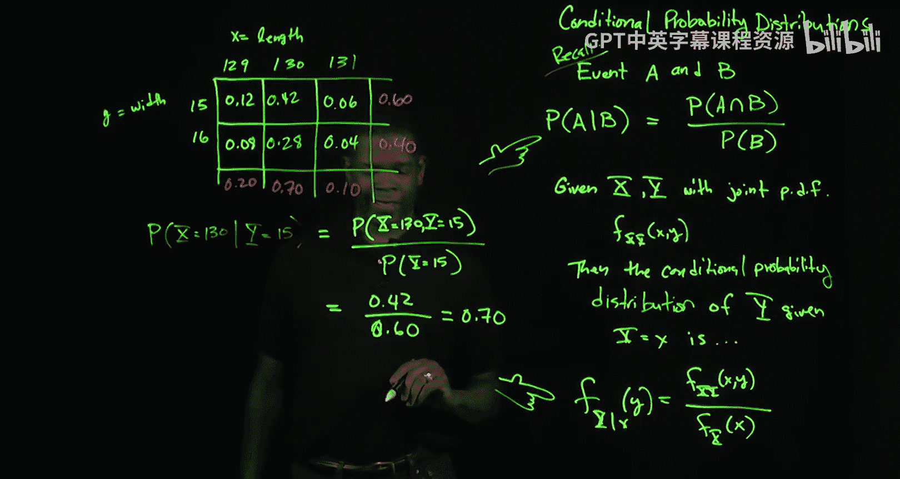

# 约翰霍普金斯大学《计算机科学的统计方法｜Statistical Methods for Computer Science》中英字幕 p52 6_条件联合概率分布.zh_en -BV1r483zbEzN_p52-

Okay， now we're going to change gears a little bit and we're going to actually start to we're going to explore what's known as conditional probability distributions。

 Okay， we're going to look at conditional probability。

Distributions。Okay， and if you recall back in the days of events， you know， single events。

 you might recall that events。If we had events， this is a recall。Thiss just recall。 So recall。

 if you had event a。And B。That the conditional probability of a， given B。

 was written as the probability of a， given that B has occurred。 probability of a event A。

 given that event B has occurred， was equal to the probability of。A and B or A intersect B over。

The probability of B。Okay。The probability of B。Well now when you' talking about these random distributions and certainly we just finished talking about these joint distributions。

 I want to know and I want to apply this same conditioning to when I have more than one random variable say cap X and cap Y right so if I have two random variables。

 I want to be able to apply some type of conditioning on those variables that would give me a reasonable or basically a conditional probability distribution of let's say y given X。

 and so let's just let's just write ourselves a little note here。

 So given we have random variables X and Y。Okay， in this case。And they have a joint。PDf。Okay。

 that's the key with the joint Pf of F cap X， Y， X comma Y。 Okay， that's the joint Pf。

 Then we're going to say then。The conditional。Probability。Distribution。Okay。

 this conditional problem distribution of let's say of let's say， y cap y given。

Cap X is equal to some value。Okay， it's equal to some value。 X， we're going to say that that is。Dot。

 dot， dot。 And here we go。 It's going to be written like this。 We're gonna to say F。Let's say cap y。

 given this value x。Okay， so F。 so this is cap Y。Given this value X。

 and it's going to be of y is equal to。 So that is。

 this is the conditional probability distribution of。Why。

 given some particular value of that has occurred in X。 Okay。

 and so this then is going be equal to watch this F。It is the。Distribution F of x， cap X， K Y， X， Y。

Over。Okay。The the marginal distribution， cap x of x。So let's look at this for a minute。

 let's look at this and let us think about comparing it to this。So let's look at these two， okay？

All right。So this is the probability of A given B。This is the probability of y given X， Okay。

 same thing， right， And over here。 So you have the。Intersection of the two。

This is the intersection of the two。 and you have the probability of B。

 given that you have two events。 So that's almost like a joint。 And here you have the marginal of X。

 which which is going to be extracted from the event。

 so we can state this that the conditional probability can be stated basically as the joint probability over the margin。

It's the joint probability over the margin。 And so now let's look at an example because this will。

 I think， help us to really solidify this concept。And really put it in our brain。

 And I'm going to go back to the manufacturer of the rectangular box。

 the rectangular container or whatever it is， right， And so we had in that case。

 we had X was equal to the length。Okay， and we had that why， and the length was 1，29。130 and 131。😔。

We had that the width was equal to。15 or 16。Okay， and so let's just draw this out for a second。Okay。

 and then we had。 so this is。Why is equal to the width。We had。This was coming up。 So we had that。

And then we had this coming across here。We had that coming across there。So we had this。And this。

Allright， let's look at that。 Okay， so what do we have here。 So we had this was 0。12。This was 0。08。

 This was 0 point。42， this was 0。28。 this was 0。06， and this was 0。04。

So we also calculated the margins previously， right。

 and the margins that we calculated previously were these we had， this was 0。60。4。 this was 0。20。

 let's use。Like that， this was 0。70 and this is 0。10。These were the margins that we calculated。So。Um。

We're ready now to start asking like conditional probabilistic type questions。

 So the first question is， what is the probability that this container has a length of 130。

 given that the width is 15。 Okay， so let's， let's， let's write that， right， let's write that out。

 So we're going to say。We want to know the probability。 So we're going to say P。That x is equal to 1。

30。Given。That， why。It's equal to 15。All right。Okay。So how do we begin？Well。

We know that we're looking at the joint。Probability over the marginal probability， right。

 the joint probability over the marginal probability。

 So let's just write that We're looking for the probability of。X。1，30a why。15。

Over the probability of y equals 15。啊哈。Okay。So when we do that， well。

 let's see So what do we get here， So the probability of x equals 130 and y equals 15。

 130 and 15 is 0。42。Okay， what is the probability of y equals 15？It's a marginal probability。

 and that is 0。0。60。 And so the answer here is。0。70。How about that。Okay， that is the answer。

All right， now。That tells me one thing， okay。That tells me one thing。

 but what if I want to find the actual conditional distribution of X。

 I don't want to just find one of these guys， I want to find the conditional distribution of x。

 given that y is equal to 15。So how， what is that going to look like？ Well。

 why is going to be held steady。And x is going to change right， So I have one of them here。

 I would need to find the other two to find their full distribution， so the other two would be P。X。

And this is going to be， let's do 129。 Y given， excuse me。 this is going to be given。Why。Equals 15。

 and then Px。Equals that be 131， given y equals 15。King。

Why don't you pause right here and see if you can find these two values？

And then come back and we'll check it。So if you did the calculation。

 what you would have gotten is you would have gotten for this one。

 this one would have been equal to 0。12 divided by 0。60 this one would have been 0 point。

06 divided by 0。60。 Well， what is all this telling me， Well， this right here would be00。20。

 and this right here would be 0。10。 Where have I seen these numbers before， right here。

That's where you saw him before。You saw him right there， okay？And so it turns out in this case。

 right， that these that these conditional values。嗯。The conditional probability given 15 in this case。

 is actually the margin。It is the actual marginal distribution。And so now the question is。

 what can we say then， how do we write this， right， Well we write this like this， we say that this F。

And we're going to call this， this is going to be cap X given and this is going to be。Y is equal to。

15。because that's what saying， we're saying the distribution， given that y is equal to 15， all right。

 and we're going to say that this value is going to be equal to and then the distribution is going to be。

 so we have 12913131 this distribution now is going to be 0。20。700。10。That's what we get。

And so we have found now the conditional probability for two random variables。

 and that's how you calculate that。

