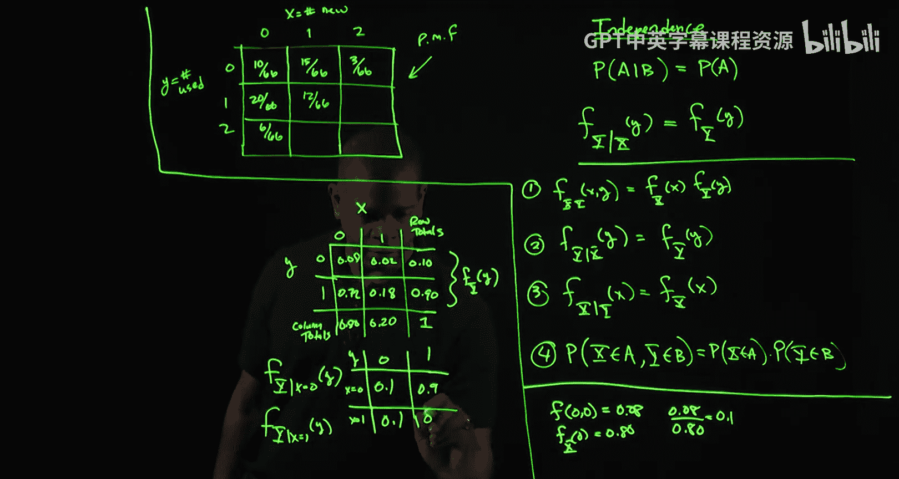
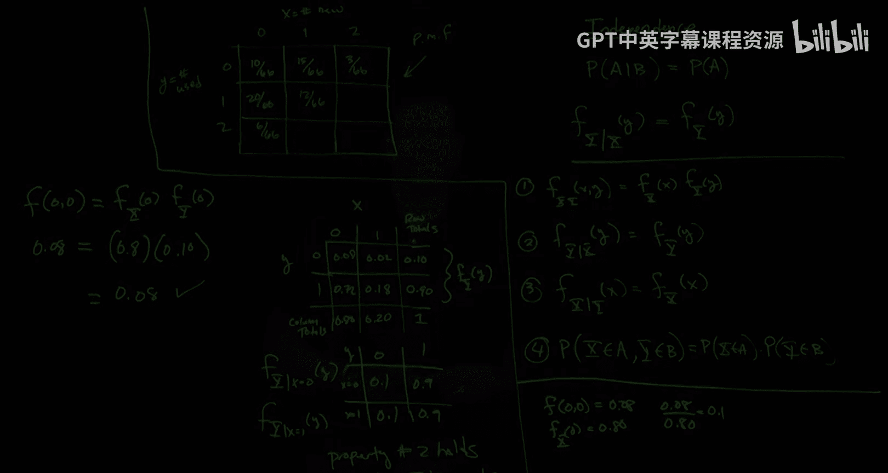

# 约翰霍普金斯大学《计算机科学的统计方法｜Statistical Methods for Computer Science》中英字幕 p53 7_联合随机变量的独立性.zh_en -BV1r483zbEzN_p53-

Welcome back。 We're going to be talking about independence in this last section of this module and basically in talking about independence。

 we're looking at the independence of the random variables of these joint distributions now something came up well let's do a recall so what we're talking about。

 we're talking about independence。

So we're talking about independence， right， and。If you recall back earlier in some previous lectures and modules。

 you saw that if you had a probability distribution，Where you had， I mean。

 if you had a probability where you had A given B。If that end up being equal to simply the probability of A。

 then that told you that the events A and B were independent。Right， that meant that there was no。

There was nothing that。There was no dependence on these variables to one another， A And B。

And so in this same framework， we're going to look at independence of these random variables of joint distributions and what we find is that in the same vein。

 I could say that if I have F and I had， let's say， CA Y， and in this case， given。

 and this is going to be cap X。Of why， if this is equal to， okay。

 if this is simply equal to the margin。Cap y of why， if this is simply equal to the margin。

Then what that tells me is that the two random variables and the distributions of those variables are independent。

 and that's actually something that you saw when we actually worked the problem and you saw that when we actually calculated the conditional distribution of the when we talked about the container。

 the rectangle container， we saw that in fact，The marginal distribution in， I mean。

 the conditional distribution， in fact， was equal to the marginal distribution。

 And the reason why that occurred is because those two were independent。 And so for random variables。

 X and Y， we're going to say if any of the following properties are true。Then x and Y。Independent。

 And， in fact， if any of the following properties are true， all of them are true。

So let's take a look at these properties。 Okay， if any of the following properties are true。

 all of the properties are true。 Okay， so the first property is if。So let's say property number one。

If F cap x cap y of x comma y， if this is equal to okay。

 the product if this function is equal to the product of its margins， so I have F cap x of x。Times F。

Cap why of why。 So if they。Functional distribution of the joint probability density function。

Is equal to if the probabilities here are equal to the product of the margins in the respective directions。

 then the variables X and y are independent。 Okay， let's look at the next one。

 Well this next one you just saw。 this is F of， let's say cap Y given cap X。 Okay。

 and then this is going to be y， if this is simply equal to the margin of y。Then they're independent。

 So guess what。 So if one occurs。2 has to also occur。 Okay。

 and then we can write that 3 is also true。 And that's the opposite here。

 This is going to be cap X given cap Y of X is equal to again， if this is the margin of x。

If this occurs， then the other two has to be true。Okay， has to be true。And then， this fourth one。

Let's look at this fourth one。 This fourth one is if this is kind of akin to the first one。

 But if the probability。Of。Cap X been in。A。And cap Y being in B。

 If that's equal to the probability of x in a。Times the probability of Y and B。

Then that means that they're also， and this is for any set A B that's in the range of cap X and Cap Y。

 so pick any set that's within the range of cap which that is within the range of possible values for cap X and cap Y。

 then that will also be true now。You may be saying， okay。

I see what you're saying and what we stumbled upon。In talking about the rectangle boxes。

Fit into that。 And so this leads us to something that could be useful。 Let's look at an example。

 because I think if we look at an example。We can kind of see where we coming from here。

 If you remember a while back， we did an example with batteries right？

 And so if two batteries were chosen without replacement and we let E capex denote the number of new batteries and cap Y denote the number of used batteries。

 we had a distribution and this is in the discrete world that looked something like this。

 The distribution was we had 10，66。 we had。1566。 And then we had three。66， and then we had 20。66。6。

66 here。 and then there was 12。66。 And so this was。Nice and neat here。Like this。And then。

Come down here。 And this was on。This is zero，1，2。And this was zero，1，2。And so this was our joint。

Distribution。This is discrete， so this is a probability。Mass function。Okay， and so。

Without doing any calculations。Without doing any calculations at all， can you tell whether or not？

This。Variables， and this was a X。The number of。new。And why the number of。Used。😔，Okay。

Without doing any calculations， can you tell whether or not X and Y are independent？

Go ahead and pause the tape at this point and see if you can do that without doing any calculations。

Okay， so how did you do？Al right， well， you know， just to kind of motivate this idea just a little bit further。

 I'm gonna just。Let you guys just marinate on that for a minute。

 But I'm going to give you an example， and I'm going to give you a smaller problem。

 And then I want you to reflect back on what you thought you understood about doing this one。

 So let's suppose that we had， in fact， a process。That had two outcomes。 So we're going to say x。

 we have 0，1 and y is going to be0 and1。So in this idea here， the probability。Let's say， of。

These events， so let's say that this is 0。08。0。02 and this is a sum of 0。10。Okay， so this is a。

This is。Row totals here。And these are going to be the column totals。Okay。

 and here we're going to have 0。72。 we're going to have 0。18 and the total here is going to be 0。90。

This is going to be zero。It's going to be zero point。0。80。 And then this is gonna be 0。20。 And。

 of course， they all total 2，1。So the question first， again， looking at something smaller like this。

 are these two events， X and y， are they independent？Are they independent。 Well。

 I think a cool thing to do would be let's look at the properties over here， right。

 So let's look at the first property。 Let's check property 2 and 3。 So in this way。

 let's ask ourselves。Let's find the。Conditional probability of。F， cap Y， given。That x is equal to 0。

Right。And this is for all the Y variables。And so what we're looking at here is we're looking at y and y is going to be y is going to be zero and it's going to be one。

So what do we get here？So when x is equal to 0。So when x is equal to 0 and y is equal to 0。

 because we're going to go through all y。 When x is equal to 0 and y is equal to 0。

 then I know that the joint probability。F of0， comma 0。Right， because what we're talking about。

 I know that this is going to be equal to 0。08。 Okay。

 so let's say that we're working down here as well。 Okay。

 so this right here is the joint probability。 And I know that for the conditional probability。

 what I'm looking at is I'm looking at the joint probability over the marginal probability of x。

So if the joint probability is 0。08。Right， the marginal probability when x is equal to 0。This is F。

Of 0， what this is equal to。0。80。 And so now I know that this value is going to be。

I know that what I have now is I have 0。08 divided by 0。80， and that's equal to 0。1。

 So this right here is 0。1。 Okay， I can do the same thing for when x now， I mean。

 when y now is equal to1。 So what I get now I get 0。8 times 0。72， and that gives me 0。

9 so for at least when x is equal to 0， this is equal to the margin of which is this right here is f of y。

Of why。But it has to be true for all of them， I only did it for one value of x。

So let's check for the other value of x。 Well， if I do the same thing and I say F cap y given x is equal to1 of y here。

 then this is going to be what's this next thing going to be。 This is going to be。

So this is x equals0， this is x equal 1。So what do we get， Allright， so I'm going to take。Again。

 this is going to be one so x is equal to 1， y is equal to 0，10 is 0。2。Divided by 0。2 gives me 0。1。

And the next one is 0。18， because now I'm at 11。Divided by 0。2 gives me 0。9。 aha。

 And so what does I say that say that property 2。

Hoholes。Therefore。These guys， X。And why。Are independent。But what if we weren't convinced about that。

 Okay， property2 holds， but I want you to see that not only does property 2 whole。

 but property one also holds if I've proven that property2 whole。 And so what is property 1。

 what property 1 says that I can take any point So let's take f of0 comma 0。

 and that's going to be equal to the marginal value of x margin0 times F for the y。Ct Y margin 0。

 So is that true， Well， let's check。 So at 00， I have 0。08。That has to be equal to。

 So I take the x margin。 Okay， x margin at 0 is 0 point。8ight。Times。

The y margin at 0 go across and that's 0。10， and in fact， that is equal to 0。08。

 and so that is true and you'll see that for each one of these， these are equal to that。

These are equal to that。 These are equal to this and these are equal to this。

 and what that tells me again is that these two variables by not only property number two。

 but also property number one are actually independent， and the theory holds。

