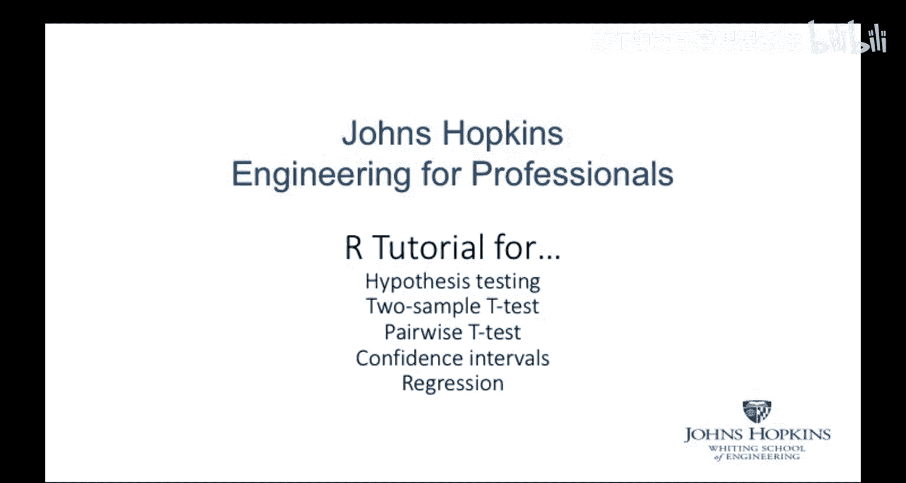

# 约翰霍普金斯大学《计算机科学的统计方法｜Statistical Methods for Computer Science》中英字幕 p73 28_R语言统计检验教程.zh_en -BV1r483zbEzN_p73-

Hello I'm Dr。 I McCellall from Johns Hopkins University。

 this is an R tutorial meant to accompany lectures on statistical testing or regression in the course statistical methodsth for computer science。

 we will cover hypothesis testing， confidence intervals and linear regression。

We'll begin by clearing the workspace of any variables or junk in the environment and then we're going to start with hypothesis testing and we'll just continue the example that was used in lecture so in the lecture problem we took a sample of Twitter accounts and we wanted to know if from one month to the next if there was a statistically significant difference in the number of followers that Twitter accounts would have on average so a month ago the baseline was 707 we then collect another sample of about 50 accounts and we see that the average is 650 we're estimating a standard deviation of 425 in the follow accounts。

And so we want to know is there a significant change Well， 650 is obviously lower than 707。

 but is that a statistically significant difference。

 so we must first apply the central limit theorem and we enter in x here as 650。And then x bar。

 which is these you know the mean that we've had in the past is 707。

 and then we have to calculate the standard deviation of the x bar according to central limit there and will be the standard deviation divided by the square root of n and so now that we have observed。

These values， we can then test to see， does this value x 650 look like it would fall within the normal distribution of a sample mean with 707 and a standard deviation of 625。

 and so we use RP norm function， which basically puts in the x。

 the mean value of this distribution is x bar 707， the standard deviation is Sx bar。

And we're going to use a lower tail because we're testing to see is the you know standard is this new value lower significantly lower and so you'll see that our P value there of 0。

17 does not give us sufficient evidence to reject an nu hypothesis hypothesis we'd say。

 you know it's quite plausible that if the mean of follower counts is actually 707。

 it's quite reasonable that we would see a value in a given month of 650 and so even though that's 57 followers on average lower。

 it does not mean that it's a statistically significant difference。

If however we were to sample the followers at 608， right， and then we were to repeat this test。

Then we would see that we have a P value of less than 0。05。

 and we may conclude that the value is significantly lower。Now generally， however。

 we prefer to use a T test to avoid some bias as discussed in lecture。

 and so I'm going to repeat this test using the T test so we can see the difference and so again we'll put in our value for x as 650。

 the mean that we are testing against that we are hypothesizing is 707。

Standard deviation is still 425 and still 50。 And so now we're going to calculate the test statistic。

 which is the value we observe minus our hypothesized value for it divided by the standard deviation of that x。

 So it's the standard deviation of the x。 And so the reason why it's s over squared of n is because of the central limit theorem and that's what kind of gives us our understanding of the standard deviation sample mean。

So now we're going to use a slightly different function instead of P norm。

 what do you think we would use yesP for the T distribution， there's the test statistic。

 there's one parameter in the T distribution which is degrees of freedom。

 which is n minus1 so when we run this。We see that the value there of 0。

1738 is very similar to the one that we had before。

 and when we correct for the bias we actually find that there's less evidence to reject this hypothesis。

Now， it's interesting is if the P value， if if the observed value is actually larger than the mean right。

 So now what I did is I said instead of 650， I just instead of taking know 57 followers below the average the previous month。

 I've just added 57 followers to give me X2 here of 764。 when we run that。

 the test statistic now becomes a positive number， whereas before it was a negative number。

 So when you have 650-707， that made this a negative number。 Now this is a positive number。 Well。

 if I ran this as a positive number， let me just do that real quick for you。 If I did PT of。😊，Well。

 I can just use the value here if I run this value。Right。We would have a very。

 very high number because it's clearly not less than the mean if it's a larger number。

 So this is where we have to do one minus that value to kind of basically look and see， well。

 what what is the likelihood that that was greater than。

And so then you can see that it's the same number because this is a symmetric distribution but this is just a note that if you have a number that is greater than the mean。

 then you have to put that one minus。Okay now we're going to shift to a two sample T test so just now we've covered one sample and we're comparing it to some reference distribution now we're looking at two samples and we want to know are these two samples likely the same or is there evidence to suggest that they're different and so with the two sample we're going to follow the example I believe I did in lecture but we will it's included is example 10 on page 29 of the data science 101 which is p in Blackboard and so the problem is simply the salary for a sample of 35 private college faculty 88。

19k with a standard deviation of 26。1k sorry， 26。21 me fix that and the salary for a sample of 30 public college faculty was 73。

18k with standard deviation of 23。95 the question is is there a statistically significant difference between private and public college faculty so we will enter。

The data here for the private college， which was 88。19 standard deviation and the sample size。

 and then we'll do the same thing for public college， 73。18。

 you see the standard deviationation and the number in the sample， which is 30。

And now this is our T statistic， which is again， given in in that data science 101 PDF and it was covered in lecture and it's also in your book and it's basically the difference in the means sample means there is the pooled standard deviation and so we will。

Enter that and since the test statistic is positive， you can check by just typing T down here。

And see that it's positive， since it's positive， we would then use one minus this value。

And we would see that we have a significant difference between the two samples。

 so that would mean that there is a difference between these two and because X1 is greater than x2。

 that means that private college faculty are getting paid more than public college faculty。

Now if the hypothesis was not simply saying is it more then if it was different then and we have a two tail distribution and you' got to keep in mind of that 0。

05 area that we're going to use as kind of rejection criteria needs to be split between the tails and so then we would have to multiply this value that we did right here by2 and so when we do that。

 then 0。0196 is what gives you the value that is in the problem in class is saying， hey。

 are they different？Now there's another way we can do this too， if we have a vector of values。

 so I just made up two sets of numbers set one and set two。

 and for set one I just simulated from a normal random variable a meana 5 and standard deviation of  two and for set two I simulated from a normal random variable meana7 and standard deviation of two。

 so let me enter these values in。And now I can simply use this command T test。

 so I don't have to go through this whole long formula， I can simply say T test and put in set one。

 set two and my alternative is a two sided right are they different and so when I run that？

T test right I get some interesting output and in the output I will have the test stat value and that's what would get what would occur if I actually ran this number right if you actually calculated the averages of both set one and set two and the standard deviationation and the number in these and then ran that right you should get this number right。

And then the P value here is going to be the number that we're going to look at so we have 0。01 1019。

 which is not really sufficient to reject the null hypothesis if they're different。Okay。And so。

If I alter this T test slightly and so instead of having two sides I say less right and I'm just doing that because I happen to know that the first set has a mean that's really two points lower than set2 so if I run it as a less than hypothesis right then you'll see that I get a 0。

05 and that's giving me evidence to say， well maybe I'm going to reject that null hypothesis I recognize it's a little over 0。

05 but it rounds to 0。05 so that's good enough for me。

Keep in mind that P value is a kind of an arbitrary threshold that the social scientists have set。

Now I don't know that we covered this too intently in class right but the pairwise tea test is an alternative so let's assume that these aren't just two completely independent samples that are drawn set one and set two let's assume that I'm going to run a taste test and so I'm going to give you each you know you maybe a cookie that I baked and I have you know chocolate chip cookie ingredients recipe1 and chocolate chip cookie recipe2 and I want to see is there a statistically significant difference between recipe 1 and 2 so I give everybody in the class one of each cookie and so you know the first observation means that that person one rated on a scale of you know whatever I said like1 to 10 they rated cookie1 as a 5。

4 and they gave cookie2 a 7。2 and then the second person rated cookie1 is a 3。4 and cookie2 is a 7。

0 and so on so。And these could be anything， but as long as they're paired right in some way。

 then we're not necessarily interested in just saying is the mean of set one different than the seat mean of set two。

 we're interested in saying， do people you know as they're looking here。

 do they prefer one recipe over the other， right it's a nuanced difference？

But let's see what happens So what I'm going to do is I'm going to create a difference vector。

 which is just going to be the difference of set one minus set two。

Now we should know that that should result in a negative number。Right。

And can run and we can just inspect that if you would like。And see that， yeah， for the most part。

 they're negative numbers， you know， there's a couple people that had kind of a different opinion on that。

 but generally they're negative numbers and that makes sense because of the way we simulated this。

So now when I run the T test right I'm going to run it on one vector of values set difference and I'm going to have this alternative two side of test and I'm going to say are they different than0 because if they're the same if there's no difference in recipe1 and recipe 2 then we would hypothesize that on average the difference between these ratings would be0 so when I run that。

 you'll see that I get a P value of 0。03 which is telling me that there is a difference between these two sets of numbers and so what that's doing is it's taking into account each person's observation and so that gives me a little bit more information to be more confident in stating that there is a difference。

Okay now if I use the Tet right T test and I actually reverse the difference right so instead of having a negative number right。

 I actually make it so that I have a positive number because keep mind this comes from a mean of seven and a mean of five right so this should be a positive number and I run the test。

Note that I get the same value and that's because the T test function is going to handle that positive negative issue for you if you're doing it on your own and you're using the formula。

 well， then you're going to have to think about that and deal with the one minus and the two times。

But if you use the T test function， that's included in there。Okay。诶。

If we use the T test and we specify this is going back to the difference right and we specify this alternative of greater than so we're saying prove to me that this set one with a mean of 5 is actually greater than set two with a mean of 7 and we run this command。

 you'll notice that we have a very high P value which is basically saying that's not supported。

 so you may need to kind of go back over that a couple times make sure you understand it but the T test function is generally takes care of a lot of the accounting on the T test function on your behalf。

So we're going to now move to constructing a confidence interval。

 so if we go back to that Twitter example right where we had an X value of 707 followers。

 we had a standard deviation and a sample size。The way we're going to do this is we're just going to calculate the error rate。

 The error rate is that value to the right of the。To the right of the mu when we did that derivation in class。

 and so we're basically looking at for the T test， we're basically doing an inverse of 0。975， y 。

975 because we've taken 0。25。On either side we've taken， we're doing a 95% confidence interval。

 so that means that we're looking at what is the value of T that is going to give us you know 0。

025 in the tail because that 0。05 is on each side of the distribution we're going to get the number for just one side of the distribution right and then we're using the degrees of freedom and the value S over a square root of n because that's the standard deviation that's just our formula。

And once we've calculated that error for one side of the distribution。

 then we can add it to both sides right we can say what is the error rate for and against and that gives us a confidence interval of 586 to 827 so basically we're 95% sure that the real mean on followers is somewhere in this range。

 so we're probably not going to reject。The null hypothesis that there's no change， right。

 in other words conclude that there is a change unless we see some number over probably 828 followers or 586 or less。

Okay。嗯。If we have values you know such as in a set right like we have this set one values right and we run a T test。

 the other way that we can extract the confidence interval is by just using the dollar sign and this command CONF for confidence interval here and so what that does is it says in in this variable。

 this data structure we've created for test1 which has all the information about the T test there is this variable called confidence interval right that's just going to extract that for us right now this is a different one remember this is set one was the data set that I simulated that was normally distributed。

And with a mean of five standard deviation of two， and so it's saying from the data we have a 95% confidence interval would be somewhere between 3。

78 to 7。1， so we're 95% confidence that the mean is somewhere in that range between those two numbers。

Okay。We're now going to turn our attention to regression。 So for a regression。

 I'm going to follow the example that begins on page 33 of data science 101。

 and there was just a notional data set I provided that had the gallons of gas that you would put in your car and how many miles you're able to drive each time youve filled up at the gas station so that's what that is So when we're going to do this。

 we're going to use a data frame to enter the data。 And so this creates two columns of data。

 And I'm going to provide names for my data as gallons and miles And if you want to look and see what that looks like we can just type it down here。

😊，And you should be able to verify that that is the data that was injured in the Excel spreadsheet in data science 101 on page 33 And so here is the just an approach that I think you can take in looking at regression problems So the first thing I like to do is create a scatter plot of the data so I can get a feel for what it looks like So here's a command that we're gonna to create a scatter spot scatter plot smooth what it's going to do is it's going to basically make the line not be a linear line。

 but it's going to follow the data so you can kind of get a better sense as to whether it it's linear is a good estimation or if it should be some other thing you need to do with your data and we're gonna to say the x values are my data that variable gallons and the y values is my data that variable miles and I'm going to put a title on the chart or on the plot and so when I run that we will see that plot over here and so you see miles as a function of gallon and it tells me my variables here and here and it generally looks like a line a linear relationship is appropriate in this particular。

Killlor case。So the next step that I'm going to do is I want to look to see if there's any outliers now generally any point that's about one and a half times the innercorrtile range。

 so the intercorrtile range basically says what is between the 25th percentile and 75th percentile in my data？

Now， if you're one and a half times those that range， that is typically the definition of an outlier。

 now that's again arbitrary， so you don't have to follow that， but that's the general logicist。

So what I would do is I now there are no outliers in this data。

 so let me make one why don't I go up here and turn my data frame here and I'm going to change that to 120 right so thats that will be an outlier so when I run this and I basically said I put 120 gallons in my data so that's a typo right so now。

I will run the data there just so you see what happens with the scatter plot right you can see that it creates this you know weird data point out here and so you kind of see that it's fit this weird function here and and it kind of doesn't look like that would even be appropriate for a linear model the other thing I can do though is check it with this outlier So what this command does is it's going to divide the plot area into two columns because I have to I have two box plots that I'm going to plot next to each other so when I run that and then I plot my first box plot。

We see that there is an outlier right we see that here's the box plot and here's the outlier I'm going to run the other one just so we get a better idea here So what this is showing you is the median value。

 the 75th% the 25th percentile right and so this is a way to kind of compare what the distribution looks like。

Okay。😊，And you can see that this creates an outlinelier so I'm going to go and correct that for the rest of the analysis just so we don't throw things off so and you can kind of see that it doesn't make sense for there to be 120 gallons in a tank so we might conclude that that was clearly a typo and that is part of our data cleaning process right so now I scatter it it looks good。

And I will now run my two plots and we can see that there doesn't appear to be any outliers。几。😊。

We're now going to check our normality assumptions and for the normality assumptions。

 we again make sure we've divided the graph into two areas。

 and I'm just going to plot the density of each of these values。

 the gallons and the miles just to see if the normality assumption might be appropriate。

So I will run that and so I'm going to first plot the density and then I'm going to fill it in with a fancy color because it makes it easier to see and I'm going to put a title on there and then I'm going to do the same thing on the other side。

And I'll put a title。And so we can generally see that this looks bell curvevaish。

 Now you see this little dip here， it's not perfect and that's okay。

 We're just generally trying to see， hey， do we have， you know。

 it is it really skewed or does this kind of make sense， right。

 it does our normality assumption seem reasonable？系。Again， if this was highly skewed。

 then you would need to think about what type of regression you're doing and that probably goes beyond what we're covering in this course。

So I can also then look and see well， what is the correlation of my data。

 so the COR command just shows the correlation and you can see that they're highly correlated as we would expect。

But what we've been waiting for is constructing a linear model for regression and so the command here。

 this is my variable， the command is for LM for linear model and it's going to basically say I want to know what miles is as a dependent variable with a squiggle as a function of an independent variable and if you wanted to add more independent variables you'd literally just put a plus here and add the next sets of variables right so you just keep adding to it。

So we create our model。And then we want to see a summary of the model。

 I make a point too that see how I constructed this linear model。

 my data miles as a function of the gallons， you can also write it with saying the formula is miles gallons so this is just the variables and then you tell it what data it is right so then obviously that data structure has multiple columns which would be different variables that you would have named。

So that's an alternate code that you can use。And then we're going to summarize that model with the output and so when we look at the summary of this model。

 right？You'll see that it includes the formula right。

 so it tells you what that formula is that we used up here。

And then it's going to give you some data on the residuals。

 which we're going to look more about that and look at that a little more closely in a minute。

And we look at our factor here， data gallons and we have a number that says you know 1。

5 and this is notation for times 10 to the negative seventh power。 so that's clearly less than 0。

001 or a highly significant value and it gives you like these little stars to help make it pop out for you and so it gives you like a little key there for what those stars are really referring to now the intercept is not very significant at all。

 and so you may want to remove the intercept， but I generally think when we look at the theory of miles per gallon。

 if I put zero gallons in my car， that should give me zero miles that I can drive theoretically so I'm going to choose even though it doesn't show a significant relationship here。

 I'm going to choose to leave it in my model and this becomes more of a philosophical thing about how do you do model construction if there is a theoretical justification as to why something should be。

the model， like a lot of people have studied this problem before and this has been significant。

 you know in many other cases， I generally recommend that you consider leaving that factor in the model just because you're controlling for those effects and so it prevents you from exaggerating your estimate for the significance of one of these other factors you can also do some sensitivity。

 you can remove it and see how is it you know how does the factors remain significant or not when you take out these other other variables。

But it's in computer science a lot of times people will use the statement。

 let me see what the data tells me and so the danger you have in just letting the data tell you is you have a lot of problems with potentially seeing correlated variables。

 especially if they're inversely correlated might mask significant effects。

 you might you might find spurious correlation so keep in mind when we use that P value of 0。

05 we're saying that that's an error rate of like 1 in 20 so one in 20 times you're going to wrongly reject the null hypothesis with a P value of 0。

05 so you just need to think a little bit more about your model and what that means。

When we look at the R squared， you see the R squared down here， multiple r squared is 0。94。

Now the adjusted R squared， we're not going to go into depth here。

 but an adjusted R squared basically is telling you that as you add more and more terms into the model you can't explain less with more information So R squared will continue to increase as you add more and more terms。

 but that doesn't mean you're adding a useful term and you can overspecify your model So that's penalized and adjust in R squared and that's oftentimes a better metric to use when you start dealing with multiple factors in your model。

So we're now going to say， hey， we have this model we think is really good。

 we have a significant P value， I don't believe that this relationship has occurred if the slope if the rate of change between them is actually zero so I need to make sure that all my other assumptions still hold true so I'm going to check the normality assumption and we did that earlier with the plots you see here。

 but another way of doing that is to look at the residuals so what I'm going to do is I'm going to look at the standardized residuals。

So this is basically saying I'm taking the standardized our standard is the standardized residuals from this regression model。

 and I'm going to create a QQ normality plot where I'm going to put that variable that I've used here model standardized residuals。

 and I'm going to label the Y and X axis and the main axis here。

And then I'm going to apply I'm going to run a line through that right So there's the values。

 and I'm going throw a line through it。 Now I don't really like these two values。

 These two values make me think that maybe my normality assumption might be in question。

 So I may need to go and find these two data points and figure out why those residuals are so different。

 And if we actually look at it， you'll find we'll see those later。

 but you'll find that you there was one case where I put in five gallons of gas I drove 50 miles and another where I put in five gallons of gas and I drove 84 miles。

 So that's a big difference。 So one of those might be another area where I had a typo or maybe I missed getting some gas at some point I didn't record it or maybe there's an error。

 somebody reset the adometer a little two late or something right So that would cause me question that I would need to go back and verify the assumption。

 And then this would now be a decision。 a modeling decision。 It generally follows。

Norality so do you include these points or do you not I might choose to remove them。

 see how that affects my analysis and my findings， and if it doesn't really make a difference。

 then I'm going to continue forward with my conclusions if it does。

 then maybe I need to collect some more data and verify the veracity of that decision。Okay， so。

We'll now look at regular residuals， right， so I can calculate the regular residuals with Reid instead of our standard。

And now I'm going to make a similar plot here where I'm going to look at the data and I'm going to look at residuals and call this my residual analysis and so now what I'm saying I didn't put a line there through it。

 but you know zero would be the ideal and the question is do I have constant variance across this line you'll again see these two little annoying points right that are these two points right here that don't appear like they're giving me constant variance and so these two points are potentially violating my assumptions so I would need to find those points remove them and then relook to make sure that my conclusions hold if they do and if I don't have any really good reason to throw these values out。

 then I might keep them in the data as I continue to do further analysis So what we have covered is we have covered hypothesis testing。

 we covered the T test the two sample T test the pairlyed T test we have covered。

The confidence intervals and we have covered linear regression in linear regression we've not only covered how you actually construct a model and test it。

 but we've also looked at residual analysis and a few commands that you can use with Pilateti I hope you enjoy this tutorial and I'll see you next time。

