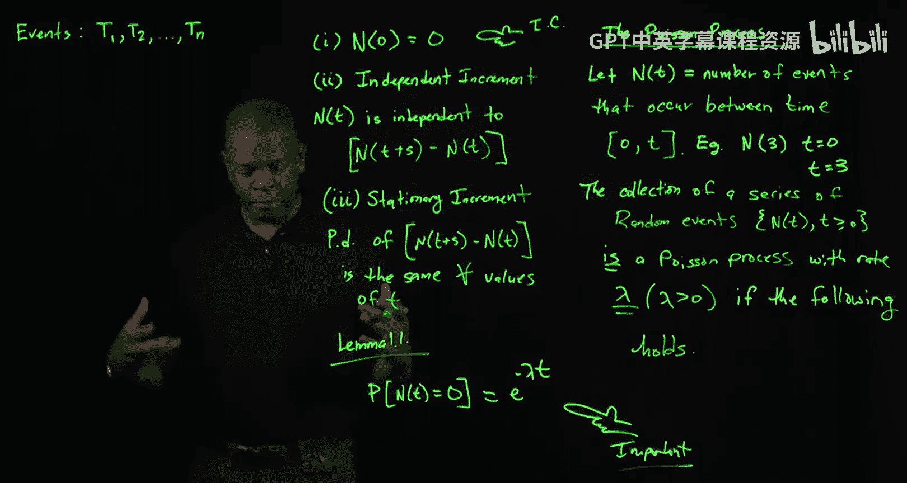

# 约翰霍普金斯大学《计算机科学的统计方法｜Statistical Methods for Computer Science》中英字幕 p74 29_泊松过程.zh_en -BV1r483zbEzN_p74-

Hello， I'm Dr。 Tony Johnson， the Johns Hopkins University in this module we're going to be discussing the process and we're going to be looking at Markov chains and then I want to talk a little bit about entropy in terms of relative surprise and the probability of a particular event。

So we're going to start off in this module discussing what's known as。The poison process。

And so when we think about something known as this thing called a Poson process。

 what we're really asking ourselves is similar to what we looked at in chapter four。

 when we looked at the Poone distribution， we're looking at this thing that has to do with the arrival of events。

And how these events occur。So let's just start by saying。If we let， let's let。Capol Inn。Of tea。Okay。

 capital N of T。 Let's let this represent。The number。Of events。Okay， the number of events that occur。

Between。Time。And this is'm going to say between0 and t。Okay， between0 and t。 So for example， if。

 if I say。嗯。If I was to say。In。Three， well， this would equate to some event occurring between time t equals0 and time t equals3。

Now。If we were to collect a series of random events。We're going to say that the collection。

Of a series。Of random events。And that collection would be。In T。

Where T is greater than the equal to 0， that this series。That collection。Is。A poison song。Process。

And in that process， the rate。It's going to be lambmbda。

And the thing about lambda is lambda is going to be greater than zero。And this is true。

This collection is a poson process with rate lambda if。The following。Hose。All right。

So we have these events。We've collected these events based on again。

 their time T and what we're proposing is that this collection of random events is a Poone process t being greater than it equal to zero。

 with rate lambda where lambda is greater than the zero if the following holes， so here we go。

 so number one。😡，We're going to say that the event that occurs。At time T， okay。

 when t is equal to zero， then we're saying that no event has occurred。That's that is our。Initial。

Condition。Okay。So we have to have a starting point。

 we have to have this kind of initial condition and basically what this says is that the number of events that have occurred at time t equals0 is zero。

Okay。The second。One we're going to look at。Is what we would call the independent increment。Okay。

 independent。Increment。Okay， independent increments。

 so let's take a look at what this means So what we're saying is we're saying that the event so we're going to have an event in of some T。

That's the number of events that occur at some time T。That。This condition of this number of events。

Is independent。2。If I was to move now ahead in the future by some value S so that I had something like。

In。Of T plus some。Motion in the future S minus n of T。So N of T。

 the number of events that happens at time T is independent to the number of events that happen at a future T sometime in the future。

Okay， so as I increment forward into the future。The number of events that take place in that future。

Time is independent of the number of events that take place now。Okay。

The next thing I want to talk about is this thing called。So that was independent increment。

 this is going to be stationary。Increment。Okay， this thing we say is stationary increment。

So what are we talking about with stationary increment？The probability distribution。

 this is what we mean by this， is that the probability distribution。Okay。

 the probability distribution。Of。This value， so we take some value in t plus S minus N T。Okay。

The probability distribution of this interval。😡，The number of events that occur in this interval。😡。

We're saying that。That distribution。iss the same。Okay， for all。Values。Of tea。So think about it。

If T is。Let's say。2。Then the distribution。Of the number of events that occur in any space of length2 is going to be the same。

Okay so that's pretty powerful。All right。Now， given these three， we can do a lot。Allright， given。

 given these three， we can do a lot。 So let's take a look。 So we're going to define。

 and this is going to be a lima that we're going to just， we're going to state。

It's going to be very important。Okay， all right， and in this regard。

 we're stating that the probability。Okay。Since we identified this as a poison process。

 the probability of the number。Of events。At time T。Being none。Okay， in other words。

 there are no events that take place。Between0 and sometime t。Right？Okay。

 so remember we're looking in this interval between0 and time t。

 so this representation is the probability that no events occur between zero and time t well that's going to be equal to okay。

 because we're looking at a Poe process it's going to be E。To the negative lambda times the time。

That's what we're going to get。E to the negative lambda times t。

So let's marinate on let's think about that for a little bit， right。

 so this is an exponential function。We've seen this exponential function before in terms of distributions when we looked at the poe distribution。

😡，And so what now would be of interest to us at this point is。What happens in between？

What happens so I have an event？And then I wait。And to have another event。

 can I make any inferences about the time between events， we call this inter arrival times， right？

So suppose we had a poone process， right？Okay， and we are going to。Basically。

 well let's keep track of this guy。This is important。Porent。Okay， I want to keep track of that。

 but let's say we have these events。And we're going to label these events。

 let's say we label these events as so here we have events and we're going to label these events as T1。

T2 dot dot dot all the way to some T in here。We are interested in knowing。

If I have a sequence of all these events。I want to know something about the inter arrival times。

 right， In arrival times。 What can we do with that， So first thing we want to look at is there is a。

A proposition。Okay， so we want to look at this proposition。 All right， and this proposition。

It's going to state that if I have this。Series of events， these events， T 1， T 2。T in。

And if they are independent， these events are going to be our。Independent。Okay， they're independent。

And these are exponential。Random variables。Okay， these。Exponential random variables。

 And that being the case。Each。Event。T sub I。Okay， each event will have a mean。An expected value。

Of one over lambda。Okay， that's extremely important right that is extremely important and one that we're going to definitely look at later right。

 so we want to keep track of this understanding that if I have a series of events。

And that particular series of events are characterized by an exponential random variable that for each one of those events。

The expected value for those events， is going to be one over lambda。😡，And that's extremely important。

