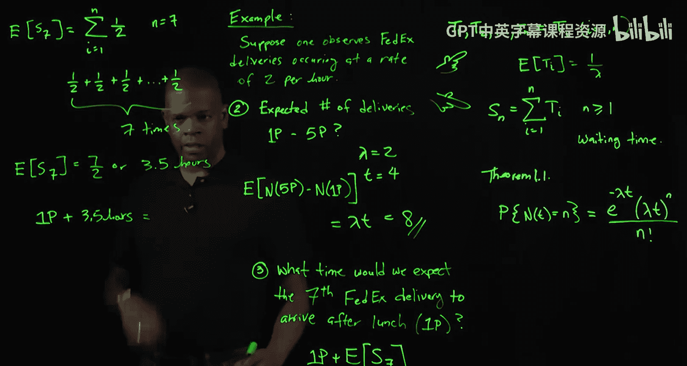

# 约翰霍普金斯大学《计算机科学的统计方法｜Statistical Methods for Computer Science》中英字幕 p75 30_泊松过程应用案例.zh_en -BV1r483zbEzN_p75-

So in our last video， we looked at the events， T1， T2。Dot， dot， dot T in。We looked at these events。

Easily make an equivalent T of I where I。Is equal to or I goes from one to n。

So the idea here is in the preposition that we looked at before。

 we saw that the expected value of t is going to be。

Of T sub I is going to be equal to one over lambda。

So how do we now use that what else can we say all right， well。

 there are some other qualities of interest that we might want to consider as we think about this。

 again， this poisson process and this whole idea of arrival times。

What if we're interested in the arrival of the inth？Okay， so we have T1， T2。

 but I'm interested in the arrival of the inth。Event。Well。

 we have a definition for that that will be very useful， so we can say that S sub n。

 which is the int event。Its going to be equal to the sum， so all we're going to do。

Is some all of the events， right？ So this is going to be from。Ta by。

 we're going to sum all the events。And when we sum all the events in being greater than one。

That will give us the inth event right it give us the arrival of the inth event we also can call that some people will call that the waiting time right so this is waiting。

TimeSo we've looked at now in arrival of events， the events themselves。

 we've looked at waiting time in terms of summing all of the events when those wins will arrive and from there we can move forward to our final theorem。

And the theorem is going to be in terms of one dot。1， the theorem here will be in terms of。

The probability， given a pceon process， the probability of a certain number of events happening。

In that period of time， so for instance， so what we're going to say then is we're going to say the probability。

Of。The number of events occurring at time T being equal to some n notice the difference here from what we saw before is that that probability the number of events we're not saying is equal to zero we calculated or we saw what it would be if it was equal to0 Now we're saying what will it be the probability of equal to n well it's going to be a derivation of what we just saw when it was equal to0 and it's going to be a pushson distribution or exponential distribution I should say exponential function we're going to have e to the negative lambda t。

Times。Lambda T to the N all over in factoral。Okay。And so really in this idea of talking about a Poon process。

 really we have all the tools we need to really examine different problems in relation to。

Arrival times and when events occur。So let's look at an example。So we'll do an example。So， suppose。

One observes。Fedex。Deliveries。Occurring。At a rate of。2 deliveries。Per hour。

 how we come to this particular information is irrelevant。

 Maybe you are standing outside your house and you're watching your neighbor's house across the street。

 or maybe you are。Maybe you are at the Fedex store when packages are coming in。I don't know。

 but this is what we observe Okay， so an interesting question would be let's ask question number one。

Question number one。What。Is the probability that no deliveries。Occur。Between。

So we're going to pick a time， let's say between the hours of。嗯。

So no deliveries occur between the hours， let's say we take a very long lunch and no the FedEx trucks are just not delivering。

 but let's say no deliveries。I don't know。We want to know the probability that there no deliveries between。

 let's say， 11 a。And 2 PMm。So what's the probability that there are no deliveries occurring between 11 a and 2 pm All right。

 so let's look at the problem we can eat there are some things that we can definitely pull out。

We talked about the rate so we can see clearly here that lambda is equal to 2。

Right and from 11 to 2 pm that time is three hours。

 so our time in this problem is an hours so t is going to be equal to three just make sure that whenever you're doing conversions of time that you have the right units right if it was in minutes it certainly wouldn't be three right it would be three times 60 but in this case we're doing hours and it's three so。

How would you would you handle this， like what would you do first？

So what I want you to do is go ahead and pause the video at this point and think through some of the things that we've talked about。

 some of the properties that we've discussed and see if you could figure out what the very next step would be in determining the answer to this particular problem。

Okay， so you've had a chance to kind of think through this particular portion。

And if you're thinking and looking back at your notes。

 then what you're seeing that is that there are some properties that would definitely help us in this regard。

 specifically property number three。If you recall， and that property was stationary increments， okay。

 the property of stationery。Increments。And what we said here was that。The probability。

So if I look at the probability of。In。3。Being equal to 0。Okay。Well。

 I know that this is simply equal to the probability because of the notation。

 this is the probability of n3 minus in0 being equal to0。So these two are equivalent。

The interval here is three， right？Well， we know that。P of N。T being equal to 0。

It's equal to e to the negative lambda t that was lima。1， 1。1， aha。Well。

 what does the stationary increment tell me， it tells me that any interval of t equals3 in the entire space。

We'll have the same answer。 So what I'm saying then is that。P。Of in。

And this is going to be of 2 PM minus N of。11 a equals0。

 that is the identical interval as p in3 equals 0， which is this here。And so now that being the case。

 then this is equal to e to the negative lambda t， and that means that that's going to be equal to。

E to the negative lambda is 2 t is 3。 that's going to be e to the negative6 here。

 and so this is the probability which is very， very small。

 if you notice probability is going to be I mean， the probability is not not very， very large。

But it's a probability nonetheless， and this is the probability that。

This value that this delivery does not come between 11 a。 and 2 p。m。

 having observed that the deliveries were coming two per hour。Allright。

So that's one way of one example of what we can do in basically using what we've understood and what we've learned to solve a particular problem。

Let's look at another example in terms of how we would use what we discussed so far to solve different types of problems。

 So we looked at a problem just now of determining basically。

We were asking we were determining what was the probabilities that there would be no no deliveries during a particular interval Well let's ask another question。

 what would be the expected number of deliveries。In a particular interval so so this one number two is what is the expected number of deliveries so I'm looking for the expected number of deliveries and let's say I'm looking for between two times so all right。

 pick a time。Okay， 1 pm。And pick a note between one and what？5， okay。

 so let's say between 1 pm and 5 pm。Okay， that's a good one。

 So the expected number of deliveries between 1 PM and 5 PM。 All right， so what do we start。

 So in this regard。We can use something that we saw before， which is going to be。

 we know that this process is a poisonillone distribution， do we not？

And since it's a Poone distribution， we know。We know that lambda is。

 we've already said that lambda is equal to2， and in this case t is equal to4 here。Well。

 if it's a poisonson distribution。Then I'm looking for the expected value。So the expected value of n。

We're going to end。5 PM minus N。1 PMm。Okay。And that's going to be equal to the expected value for the poson process is lambda。

T。So that's equal to8。So that was a really， that was a pretty easy one。ok。That was an easy one。

All right。Well， let's see。 How about a little bit more challenging one， Okay。

 how about now let's look at。 So this would be number three。What time，ha， What time。What we expect？

What time would we expect the， let's pick another number， let's say the seventh？

What time would we expect the seventh FedEx？Dliiveing。

What time would we expect the seventh FedEx delivery to arrive after？Let's say after lunch。

And we'll say we have to give it a time， let's just say after lunch is one o'clock。1 PM。Oh well。

 that's a better problem。Yeah， that's a better problem。Okay。

So what we have here now is we have we have these times now and we have we have a time and then we're taking some expectations after those times。

 right， after those times well。To solve this， we we're going to make use of our friend here。Which is。

Proposition number 6。 And we're also going to make use of our。Waiting time。

Right so now what I'm going to do is because I'm looking for the expectation when this will arrive。

 then what I'm looking for is I'm looking for something like this， I'm Sam， starting。

 we're going to start at 1 pm。And I want to add to that。The hours expected。For the expected value of。

What am I looking for， waiting time， so this is going to be， I said the seventh。

 this is going to be S7 here。That's what we're trying to figure out。Okay。All right。

So then what is this guy going to be equal to， So we know that this guy。

Is the waiting time in terms of。In terms of TI。I know that the expected value is one over lambda。

So then this tells me that。嗯。The expected of S 7。Its going to be equal to。

 so this is going to be equal to the sum。I equals one to n and now instead of T。

 because what I'm looking for is not the event， I'm looking for the expected。Event。

 and so in this case， this is going to be。啊。1 over lambda。

So that's going to be one half and here in is's going to be equal to seven。Right。

E is going to be equal to seven。Okay， so when I calculate this then。

 so basically this is going to be， I'm going to actually be doing this。

 so this is going to be one half。Plus1 half。Plus， one half。All the way till I get to plus。

The last one half。And I'm going to do this。7even times。You guys do that， right？

And so what does that give me， That means then that what I'm going to have is I'm going to have E。

To the S7 is equal to7/2s or 3。5 hours。That's given this rate。

 this is my expected time for that event to occur， right？

The seventh delivery is going to be seven/ hals， and so now I can say to answer the question。

 I'm starting at 1 pm。Plus，3。5 hours。The answer is going to be。

4，30。Pian。