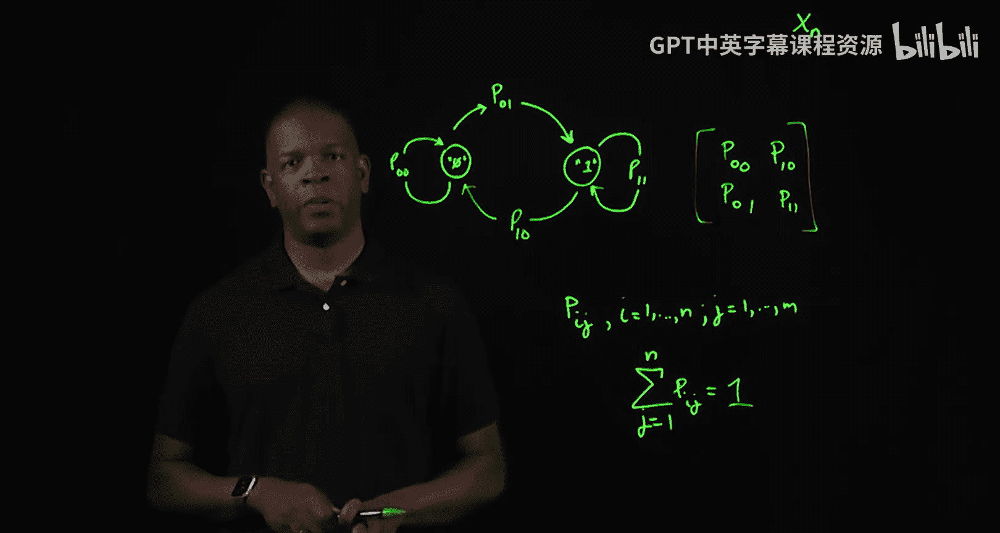

# 约翰霍普金斯大学《计算机科学的统计方法｜Statistical Methods for Computer Science》中英字幕 p76 31_马尔可夫链.zh_en -BV1r483zbEzN_p76-

I'm Dr。 Tony Johnson of the Johns Hopkins University。

In this lesson we're going to be talking about Markov chains and as a part of the module。

 this follows the idea that we presented earlier in talking about a a person process and that poson process。

 we looked at the idea of these innerarri times， we looked at the idea of having the events and then we talked about waiting times。

 and then we talked about waiting for the inth event and so forth。Here with our Markov chain。

We're looking at the situation where。We want to interpret a random variable。Say xcept n okay。

 we want to interpret that random variable as being a part of a system at some time in and in that system it's at a particular state。

 is at a certain state， so time is still relevant in this particular part of the lesson。

 but time now is in discrete increments。😡，We can look at if we look at particular states。

 you could have a state， let's say one state。We're going to say that state is going to be。0。

We have another state。That state is going to be one okay so in this case you have two states。

 you have state one and you have state zero now what we're really trying to capture in this process and this Markov chain is we're trying to capture the relationship between these two states and how one。

 how this variable will move between the two states so for instance。

 if we define this fully then we would have something like this。

 we would say that the probability of going from state zero to state one。

Would be would we would say that this is probability and we label that01 okay。

 there's a probability associated for moving from here。To hear。Okay。

There's another probability associated that if I'm at zero。

 what's the probability that I stay at zero？Okay， so we're gonna say that that's P。0，0。ok。

There's also a probability。嗯。So actually， that's the end of the probabilities for being at state zero。

 so if I'm at state zero， I'm here。I can either move to one or I can stay where I am。

 and thats that's the end of that particular。Cycle， that's， that's all that， that's available to me。

 Allright， so now what if I'm at state 1， I think you got this now， right， so if I'm at state 1。

 I could stay at state 1。 So that's going be， I'm going to stay here。 So that's the probability 1，1。

Or I can move back。To。This state。And so what we've done now is we've captured， you know。

 you can kind of think of as like a sample space， we've captured the totality of this process and if I was to write this in a matrix right。

 that matrix would be something like this， it would be P00 P10 P01 and P11 and in this way。

I have captured。All the possible outcomes being in either state。That is possible。

Now you might be saying okay well well what does that mean like how can I use that Well。

 there are some properties first that we have to discuss about this process in order for us to really do a decent example the first one is that these probabilities I'm going to call it I'm going to call them P sub I J and in this case I is going to be the row J is going to be the column okay and so clearly from my example here you can see that I is going to go from one。

To n， where n being the number of columns and J。It's going to go from one to。

M and M being the number of rows。Okay。All right， so now you may ask me， you may say， okay， doc。

Why are we using M and N， can't we just use in in both locations we could？Yes。

If you have what's known as a regular Markov chain， meaning that or a regular Markov。

 let's just call it a Markov matrix right now， that is a matrix of probabilities of these values。

That we have。Sure， N is equal to M， and so that goes without saying。

The last thing I want to say is because these are probabilities。Because there are probabilities。

It turns out that the sum J equals to1 to n of P of IJ。

That sum must equal to one and what that says basically in a nutshell is that your columns have to sum to one。

They have to sum to one okay， if your columns do not sum to one。

 you do not have a properly derived transition matrix。

 so the sum of PO0 and P01 must equal 1 and P10 and P11 must equal 1。So I think at this point。

 this will be a good place to pause and let's take a look at an example in the next video。

