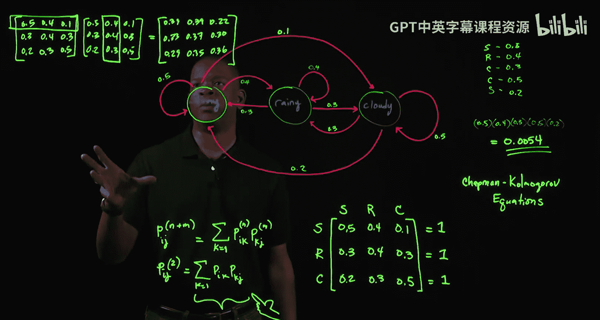

# 约翰霍普金斯大学《计算机科学的统计方法｜Statistical Methods for Computer Science》中英字幕 p77 32_马尔可夫链实例研究.zh_en -BV1r483zbEzN_p77-

Okay guys， what we want to do now is want to look at an example of a Markov chain and how you can use it to make certain calculations。

 I thought I make a small example and use that as a tool to accompany your book and your notes about how you actually。

Use a Markov chain so the first thing in this example。

 this is a very common example that you'll see in a lot of textbooks this example is about the weather and it's very good because the weather does have this predictable pattern of dependency that you could probably track given the enough observations。

But you don't want to continually observe and that be your only means to make predictions， right。

 you want to be able to observe for a little while and then use some type of Markov chain to do inferences about the future and about what you could expect。

 what your probabilities would be。So suppose that in this case。

 that tomorrow's weather depended on today's weather only。

 the only thing you had to think about for what tomorrow's weather was was what the weather was today。

If that was the case， you would have a good case to make to say that it could be that process could be a Markov chain。

The thing about the thing the statement is that the transition from one state。

 and remember in the previous video I showed you that sunny。

 rainy and cloudy now are going to be our states before our states where we just did zero and one。

But now we have three states， okay， if you recall when we had two states。

 we ended up with a square matrix that was two by two。

Can you guess what type of transition matrix you're going to have in this case？Okay。

 if you said three by three， then you were correct。So one question we could ask is。

 given that today is sunny。What is the probability that in the future so we're going to do by day。

 what is the probability that in the coming days， so this is just a question， okay。

 if today is sunny， what is the probability that in the coming days we have sunny。

And then we have rainy。We have a cloudy day， we have another cloudy day。

 and then we end up with a sunny day。What is the probability that that order occurs that we have sunny。

 rainy， cloudy， then another cloudy day and another sunny day？

Given that we have this diagram that we've sketched out of our probabilities。

We can determine what the probability would be for this particular case。 And so basically。

 we know that if it's sunny。That's where we are， right， and so we start with where we are。

 and so that is 0。5。To move from sunny to rainy， the probability of moving in that direction is going to be 0。

4。 Okay， now， once it's rainy to move to cloudy。 that's going be 0。3。 Oh， okay。

 now I think you see it now， right Well， if it's cloudy。 And the next day is cloudy。

 the probability of that is going to be 0。5。 You see here， this is the self loop here。

 It's cloudy and it's cloudy again。 And then finally， it's cloudy。

 but now it is sunny and that's going be 0。2。 So what am I going to do with these probabilities。

 Well， what you're going to do is you're going to， of course， you're going to multiply them。 right，0。

5。😊，Times 0。4 times 0。3 times 0。5 times 0。2， and that is going to give me as my answer。

 this is going to be equal to 0。Zero， zero。5，4。All right。

 so that's an easy one and that is basically looking at your Markov chain and then pulling off the probabilities given you have a pattern。

 right？that you have a pattern we could call that pattern a particular walk right。

 a walk through the system， and this is an ordered walk。

 it is a walk where we determine what the path was going to be right。

 there are things in your book describes a random walk okay， a random walk。

But let's take a look at some other things， right。Okay。Given that today is sunny。

 we'll start with that again， what is the probability that it will be raining four days later aha well now that's a more interesting question right。

 what's the probability that it will be raining four days later。

 so what I'm trying to do in this case is a little bit more difficult？

The only thing I have available to me is what the weather is today。

This is what's known as the start state in this diagram and in this question I said that today is sunny。

 so we're starting at sunny。The final state， wherever it is。The final state has a length of4 y。

 because I want to know what will the weather be four days later， So you may just say， okay， well。

 all right， if I started sunny， now the question is。

 how many number of possible combinations are there。When I start at sunnyny and I go four steps。

 you know， we can just do a couple， I can be at sunny and I could be at sunnyny again， again， again。

I can be sunny four times right， but that wouldn't count in my probability for raining right so what I'm really looking for is the number of possible combinations of length  four where the end result ends in raining。

Where the end result end in raining。 So how would you， So， So when you think through that。

 how would you， how would you do that Well now that's where it gets very interesting。

 And that's where we come to。U。What's known as Chapman？Cal。Mugrov。Equations。

Chapman Kmargurov equations。Okay。And no Kmalrov， I do not believe。

 is akin to the UFC Weterweight champion， that's a different。That's a different person。

 though it sounds very much the same Okay， so in order to in order to now to actually get after that question。

 we're going to need our transition matrix okay， we're going to need our transition matrix so let's do our transition matrix here and so our transition matrix are going to be so so so we know that we're looking at sunny。

Raiy。And cloudy。Okay， so we know we're going to 0。5 for sunny。U0。4 for rainy and 0。1 for cloudy。

 and that's given that I start。It sunny so。This is my source。

 these are my targets so if I start at sunnyny and I move to sunnyny that's 0。

5 if I start at sunny and I move to rainy that's 0。4 and if I start at sunny and I move to cloudy。

 I'm not going go this way because the arrows are directional。

 they give me the path that I'm allowed to take， I have to go this way that is 0。1。

Let's do our next row， this is going to be raining， so now I'm starting at raining。

And if I move to Sunny， that's going to be。0。3。Then we're going to have 0。

4 and then we're going to have 0。3。 you guys check my work， make sure I'm doing this right。Okay。

 and then if I'm at cloudy。At cloudy now， I'm going to be moving to sunnyny at 0。2。

I'm going to be moving to rainy at 0。3， and then I'm going to be moving to cloudy again at 0。5。Okay。

PN 0。5。All right。So。Well， let's see。Do these all sum to one？哦。It looks like if I go here。

 this equals one。This equals。One and this equals one， so I'm good there。All right， so this is my。

Transition。Matrix。Oh， you don't like that。喂hy。Oh， because。

Oh you don't like because I summed it by rows and earlier I said by columns， no worries。Yeah。

 you could easily take the transpos and you'd be in the same situation。

Except now these will be your targets and those will be your sources， but it's the same thing。嗯。

That's no problem， you'd be fine。The question though， is now that I have the transition matrix。

 is what are my chapman Konggorov？嗯。Equ is going to look like， all right， so here we go。

So the equation goes like this， so we're going to say that。P，'s write it over here。I' going to say T。

Of。N plus M。I J right， so p plus n plus m P to the n plus m Ij is going to be equal to and here we go。

 it's going to be the sum。And this is going to be k equals0。And we're going to have。P sub。

And it's going to be in sub I。K。And then P。To the M， and this is going to be sub。KJ。All right。

So now we ask ourselves。Okay， what is the question？What is the question？

So let's do an easy one first and then we'll work on a more challenging one right so the question was what's the probability and this is where it's going to get real powerful right now hold on take a minute so let's see yeah this is gonna to get real powerful right here all right so the question was what is the probability that's going to be raining in four days right？

Okay。😊，So what we going to do？I we're going to take a walk。

I'm on a stutter step to get the four days by talking about what would happen in two days。 All right。

 let's talk about what would happen in two days right。In two days， this will be。The probability。

 I J of。2。Okay。But I want you to look at that too。In terms of M being equal to 1 and M being equal to 1。

ASo what we have then is we have something that looks like this， the sum k equal to zero。

 and then this is P IK times。P。Kj。AhaSo the question is now， what would that look like？Well。

 in order to find that， we need to look back at our transition matrix， right， and so in this case。

This guy is simply。We're going to take the sum。Of the IK。 so in that case。

 it's going to be something like this。 so let's take a look if we。

Iterate on the if we start with k being equal to0。And we're going to say that this is going to be 01。

2。You don't like that， right， you want to do。You don't like the0，1， two， you'd rather do1，2。

 and  three。 I think so too。 why don't we do that。 Why don't we say K is equal to1。Instead of 0。

I mean the whole idea though， depending on the program that you're using and I think in R。

 I completely want to use the one， but depending on the program you're using matrices will start at zero as opposed to starting at one All right。

 we'll tackle that when we look at this in the R tutorial for Markov which is also in this module。

 all right， so basically what we're saying though is if you look at this very carefully here。

Many of you already have recognized。That what this is is matrix multiplication。

 this is simply the dot product， right？This is the dot product。

 And so if we were to write that what we have here is we're looking at a situation that looks like this。

 We're looking at。We're looking at this I'll write it here。So this matrix is 0。5。0。4，0。1。Times。Okay。

 and this is 0。5，0。4，0。1， and then we have 0。3， 0。3。This is 0。2。0。2。This is 0。4。 Oh you get it now。

 You see what I'm doing， right，0。30。40。3。 And then you have 0。3 and 0。50。3 and 0。5。

 So I'm trying to kind of do this。 Okay， so what do we have， right， Well。

 in this matrix multiplication。 What I'm doing is I am multiplying。The Iath row， right？

Times the JF column。Okay。The I row times the J column， right。

 Now we're going to iterate through all I J。 But basically。

 what we're doing is we're saying in this matrix to matrix multiplication， right。

 I am actually looking for。😊，This value， which is going to be this row。Times。This column。

Now you may be saying， well， wait a minute， Doc。How did you know what row and what column Well。

 I told you that we're starting with sun。And we're ending with rain。

 and so if we were to actually do this calculation。

What you end up with is you end up with something that looks like this， 0。39，0。39， and then 0。22。

And then we're going to have 0。33。0。37。0。30。Then we're going to have 0。29。Zero point。Three， five。

 and then zero point。3 six and so the question is what I'm looking for in two days。

 what is the probability that it will be raining and when you take this row。

 which is the sun and this column which is rain， start。

Final。The question is， what value do I get， that value is the probability in the Ih row。

 the JF column。After two steps， in this case would be days， right， after two days， and in this case。

 okay， this is going to be right here。0。39。Now， the challenge to you。Is。I did this for two days。

How would you modify this problem to do it four days。 So what youre。

 what you would be looking for is P， I J of。2 plus2， which is equal to P J。Four。

 which is going to be equal to what so you can think of this as being the sum。K equals1。

 and then this is going to be P。IK squared。P， K， J square。

 Can you now follow along and do this problem， okay。And if you said， well， wait a minute。

 how do I get the squared， well， you're going to take this matrix。And now you're going to square it。

You NS to say 0。5， 0。4， 0。1， 0。3， 0。4， 0。3， 0。2， 0。3 and 0。5， and you're going to square it。

And that's going to give you P J squared。So now what you want to do is once you do that squaring and once you actually do that。

You want to say now， after we do that and we do this calculation， what is the probability？

That you actually get。Rain at the end of four days。

The answer to that question I'm going to show you in the R tutorial。

