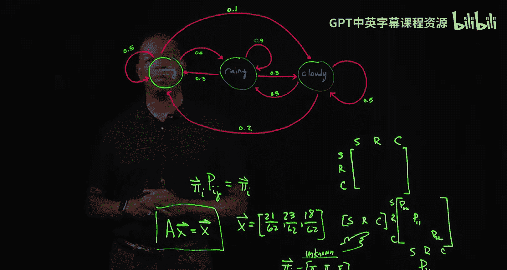

# 约翰霍普金斯大学《计算机科学的统计方法｜Statistical Methods for Computer Science》中英字幕 p78 33_极限概率.zh_en -BV1r483zbEzN_p78-

So we've looked at Markov chains and explored their power in terms of helping us to find probabilities of certain states that occur after our current state。

 for instance， if it's sunny today， what would the weather be in four days。

 what's the probability that it would be cloudy in four days or two days， we've explored that？

But there's something even more powerful that Markov chains provide for us， and that entails。

What happens if？Today， I want to know the probability that it is cloudy or rainy。How many？😮。

Possible paths are there that would lead up to today。Well， the answer。Is infinitely many。

 there are infinitely paths that will lead to today。So we need something even more powerful。

 we need a concept or a principle that will guide us in exploring those kinds of questions。

 so is it equivalent to ask the probability after an infinite number of days？Well。

 if we don't care about the start date， then。There is little effect when there is an infinite number of states or states。

 there's not a lot of effect in that if we don't care about the start date。

And what I mean is there is a point where we approach what's known as a limiting probability and that occurs when our Markov chain reaches what's known as a steady state。

And so how do we find this steady state？We say that if there is， so when we described this before。

 we basically had we said we had source。Sunny。Riny。Clouy， and we had targets， we called it sunny。

 rainy， cloudy。And in this case， this actually defined our matrix。

But if we're looking at a situation where we are at where the source doesn't matter anymore。

 we only have a concern， we only care about the target。Well， in that case， we really don't need。This。

Sunny， rainy cloudy here we only need the target， which means that we can。You know。

 where we had two matrices before now our matrix will actually collapse to just a single vector of。

Sunny。Riny， cloudy。Okay。Okay， so we're basically going to take this。

And we're going to multiply it by。2。Transitional state。Transition matrix。And we know that this was。

Again， sunny， rainy， cloudy， I'm to squishes in， sunny， rainy， cloudy。Now， you may say， well。

 wait a minute。What values go in here？What values go in that vector， Well， I know these values。

 these are the probabilities P， you know， these are the probabilities P0，0， p1，1， p。2，2。All right。

 or one，1，2，2，3，3， whatever。 so we know these values， but what are these， Well。

 it turns out is these values are。They're unknown。They're at unknown right now。

We don't know what those values are， so let's call this vector now。

 let's call its instead of since these probabilities are unknown known let's say this is going to be pi zero pi 1。

Pi 2。We don't know what they are yet。Alright。But a property that we're looking for in this vector。

 okay， and if we want to call this vector。Pie。I。Which is a vector。

And let's call our transition matrix here， let's call it PJ。

Then a property that we're looking for in this process， okay。

 is going to be when pi this vector subi。Times P。I J， when this is equal to。Okay。

 when this is equal to。Pie。啊。In other words， when I multiply。This matrix by this vector。

 the outcome is the identical vector， that is the limiting probability and what it means is that that is the steady state of your Markov chain and once you reach the steady state of your Markov chain。

 then and only then can you make determinations about the probability of today because it's based on a limiting probability of infinitely many states and it gives you the answer for today。

 so let's take a look at the problem that I get。So given that we have。Um。Our transition matrix。

 basically， and you going you're going to recognize this right away。 Basically。

 what we have is we have。A X is equal to。X， and where have we seen this before？Okay。AX。

iss equal to x and you know how to find x right， you're going to use your linear algebra skills and you're going to use your matrix。

 you're going to find the eigenvalues and what we're actually looking for in this case is the eigenvector。

And so if you work this problem correctly， then x is equal to and it's going to be。21 over 62。😔，23。

 over 62 and 18。Over 62。So given our Markov chain。What is the probability that today would be rainy。

 it will be 23 over 62， the probability that it'll be sunny。

 it'll be 21 over 62 and the probability to be cloudy is 18 over 62 we're going to look at this problem in detail in our tutorial module which accompanies this lesson。

😡。

