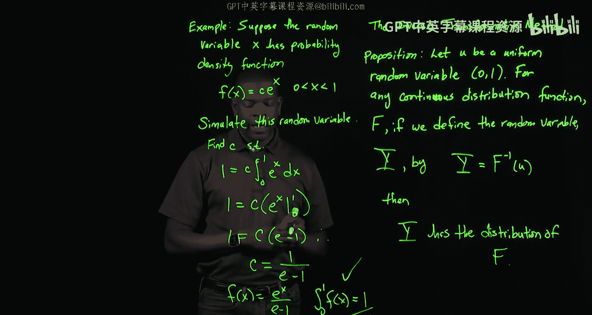

# 约翰霍普金斯大学《计算机科学的统计方法｜Statistical Methods for Computer Science》中英字幕 p82 0_逆变换生成法.zh_en -BV1r483zbEzN_p82-

I'm Dr。 Tony Johnson the Johns Hopkins University。

In this module we' be talking about simulation and simulating different random variables and distributions。

 we need to be aware of how you go about and sample the random variables so that you can do different types of simulations in this talk we're going to talk about one particular way in which you could do some types of random sampling variables。

 or sampling of random variables and this one is called the inverse。

 we're going to be talking about the inverse transformation。Method。

And this method really is one in which it is。Predicated upon a proposition。

 And the proposition states this。 So the proposition。The proposition is such。

 it says that we're going to let。You。B a， and this is going to be a uniform， random。Variable。Now。

 when we're talking about this uniform random variable。Of course。

 you know from your study in distributions earlier that we're simply talking about a variable that is between0 and1。

And the probability of getting a value between zero and one is uniform， or it is the same。

So if we have this uniform random variable U， we're going to。Make a statement that says for now。

 this is the power for any。Continuous distribution。Function。And note this is going to be cap F。ok。

Cap F。If。We define。The random variable。And now this very random variable is going to be kept Y？Okay。

 if we define that random variable cap， y？Bye。Cap why。It's equal to。F inverse of u。

Then this is the power。 If we do that， then cap Y。Has。The distribution。Of。f。Okay。

 then cap Y has the distribution of F。 So now we need to talk about， okay， so。

What does it mean to have cap Y， what does it mean to have a distribution and how are these things kind of apportion in in the proposition。

 how do we actually use it？So the best way to do it is let's give an example。So in this example。

 so let's look at an example here and we can explain all the pieces。 So in this example， suppose。

The random variable。So we have a random variable here。And this random variable， X。

Has a probability density function。And that function is given by。F of x。

Is equal to some constant C times E to the x， and that's going to be valid for all values between 0。

M1。ok。So here is a random variable x that has a probability density function that's some constant e to the x。

 and what you want to be able to do here is we want to simulate。This random variable。Aha。

We want to simulate this random variable。Okay， so what we do so you may be you may be tempted to say oh that looks like a exponential distribution or something that we might know don't fall for that because the problem is is that you don't know what C is and remember there are some things that you want to check first before you can even begin to do this type of simulation and the first thing was notice that the proposition the proposition talks about cap F and we know that CA F is not the PDF or the density function CA X is actually the。

Cex is going to be the CDF and we're going to talk about that and the implications of that in a second。

 but before I could simulate this particular variable the first thing I'm going to need to do is I'm going to need to find C and because we said that this was a PDF then I know that finding C is going to be straightforward because I have an equation for that and so the first thing I'm going to do is I'm going to find C。

So I'm going to find。C， such that1 is equal to c times the integral from 0 to 1 of e to the x dx。

 and I noted this has to be true simply because of the fact that C to the x is a PDF。All right。

 so at this point， but you have a constant or some unknown in your density function。

 you have to do whatever you have to do in order to prove or to make sure that F of x is， in fact。

 a PDF。And so that be in the case， then clearly if we define C as such， then F of x。It's equal to。

E to the x over e minus1， and now the integral from 0 to 1 of f of x is clearly going to be equal to 1。

So that is clear。All right。Well that's still， we again， we want to simulate this random variable。

 I've demonstrated I found C， the constant， blah， blah， blah。

 that's all good and now in order to actually simulate the random variable now。😡。

What am I going to have to do？I need， if I'm going to use this proposition。

 what I need is I need the CF。 And so that means then that I'm going to have to integrate my PF。

 Okay， so that's straightforward。 We know how to do that。 And so now F。It's going to be equal to。

So I'm going to have my constant C， this is going to be 1 over e minus1 and this is going to be times the integral from 0 to x from 0 to x。

 and now this is going to be E to the y dy， and of course in this case the y is dummy variable。Again。

 we're going from zero， less than x， which is less than equal to1。So what do we get。

 so we integrate now and I get F of x。This is my CDF is going to be equal to。

 and this is going to be1 over e minus1 times， this is going to be e to the y evaluated from0 to x。

And this gives me as my CDX， the final value of here I'm going to have。E to the x minus1 over。

E minus-1。Okay。So， now。What I want to do is I need to find F inverse。

 and I'm going to use my uniform distribution of U。To give me the distribution y。

 which is going to be the distribution of the random variable that is defined by F。

 And so in this case， basically what that means is that I am trying to find，😡。

And I totally encourage you to follow these steps when you actually do it。

 but I am trying to find the value X。Which is equal to F inverse。Of you。

 That's what I'm trying to find。 So let's write out， so。If。If f of x is equal to this。

Then I'm going to say I'm going to find an inverse。

 I'm going to say u is equal to e to the x minus1 over。E minus1。So we start here。

And now what you want to do in this case。You want to solve。For what。I want to solve for X。

 That is correct。 I want to solve for X。 And when I do， what am I going to get here。

 I'm going to get。E to the x minus-1。Its equal to。U e minus1。And then I'm going to get。

 and then this is going to lead to e to the x is equal to。嗯。U e minus1。Plus one。

Now I'm going to take the log on both sides and what I end up with is x is equal to the log。Of。

U times e minus1 plus1。And now this。Now is how I'm going to simulate。

This distribution using now as input， notice the input is the uniform distribution。

 and then the output will be a random variable in this case and now once I do this I set，😡。

I'm going to set Y cap。It's equal to x， and now this right here is the proposition。Info。

And so this is a very simple way to go about if you have a uniform distribution， which is。

Pretty readily available because it's again， constant it's equal probability for all values between0 and1。

You will have infinitely many of them， and from that distribution now we can simulate a random distribution。

 a random variable of any continuous distribution so long as you have the density function。

