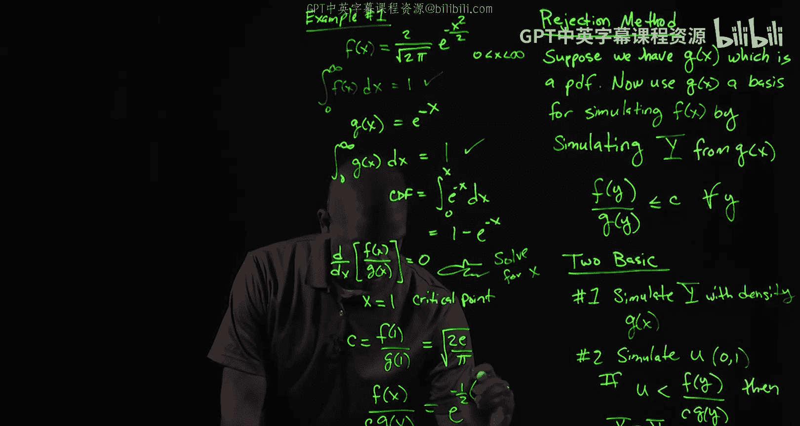

# 约翰霍普金斯大学《计算机科学的统计方法｜Statistical Methods for Computer Science》中英字幕 p83 1_拒绝采样法第一部分.zh_en -BV1r483zbEzN_p83-

Welcome back。

In our last video， we looked at the inverse transformation method in order to simulate a random variable based on a probability density function and a distribution that was given and using the uniform distribution in order as an input in order to conduct or to do that simulation。

However， that was one key thing you had to be able to do the PDF had to have an inverse and while inverse is trivial for I mean not trivial。

 inverse can be found for some functions， other functions might be a little bit more difficult。

 other distributions or PDFs may not be as easy and you know the whole idea is that you're assuming that every PDF is going to have an inverse。

So we need another method， a more robust method that will work。

 whether or not the inverse exists or not。And that's where we get to a method known as the rejection method。

 and so in this video we're going to look at the rejection method。

 Sometimes it's known as the rejection or acceptance rejection method。

 but we'll just call it the rejection method here。And again， this method method， it starts with。

 suppose we have。G of x and G of x is a PDF。Which。Is。A P， Df。

Okay so this method is starting with G X as a PDF， and we have that。However， we found it， we have it。

Now we're going to use this as the basis。So now。Use G of x。As。Basis。For simulating。F of x。

And so the way we're going to do this is。We're going to。So we suppose we have G of x， which is a PDF。

 Now we're going to use G of x as a basis for simulating F of x。

And we're going to do this by simulating。 So here's what we're going to do our cap Y。

 We're going to simulate this cap Y。From G。From G of x。

And then what we're going to do is we're going to make a decision about whether or not we want to accept or reject。

😡，The value that we simulate based on the proportion of F of y。G of y。

And we're looking for the proportion that's going to be less than or equal to some constant C here。

 and that's going to hold for all y。Okay， for all， why。So again。

 probably the best thing to do here in understanding this proportion。

 understanding this notation in this term is to work an example， but in summary。

 let's just talk about what you're going to actually do there are actually going to be two basic steps that you're going to perform here okay two basic steps we're going to perform。

😡，And this will， these two basic steps will apply to every time we're going to use this method。

 it's two steps。 Okay， step number one。We're going to。Simulate why。Okay， so step number one。

 we're going to simulate。Why。With。Denssity。G of x。Now we know how to do that。

If you you are like wondering what you do there， go back to the previous video。

 this is where simulating Y with G of X。😡，We could do that with the previous method。

 the inverse transformation method will help us to do that。And， of course。

The next thing we're going to do is we're going to simulate。The uniform U。

 which is a uniform random variable between zero and1。ok。Which is very easy to do。 Now。

 you may be saying， okay， well， what， what， what do we do now？ Well， once we do that。

 we're going to make a statement。 We're going to say if。Okay。

 here's the big if we're going to say if you is less than。Okay。

Meaning that it's smaller than the proportion F of y。Over see。G of y。Okay， if that's the case。

Then we set。X equal to y， and that is true。Two steps。Okay， simulate the y。Use the you。

As a means to test and then evaluate this term and if this is true。

 then x is y is a accepted value in our simulation and we put that into the x and it is a random variable so if we were to look at some examples。

 let's look at a couple of examples because I think the example will will be best for helping you to understand how you would use this。

😡，And also make sure that you look at the R code that we have online。

 I walk you through the code because what I'm going to do now is just an example by hand。

 but you need to be able to see how do you generate many。

 many thousands of values from this random from this simulated process。Okay。

 so let's look at an example， so example number one。All right， suppose F of x。It's equal to two over。

Route 2 pi。Times E to the negative。X squared over2。Allright。So the first thing， of course。

 we want to do is we want to verify。That this is a PDF。And in fact。

 it is the integral of this guy in the interval that we're discussing here from zero。

 so we want to say that this interval that we want here is going to be from zero。To infinity。

And so if we integrate from zero to infinity of f of x。DX， we in fact get one。Okay。We in fact。

 get one here。All right， so let's look at the next one。The next。

Function we' to look at is G of x and in this case G of x is going to be equal to e to the negative x again。

 we want to ensure that G of x is in fact a density function so again we're going to perform this analysis。

0 to infinity， G of x， we're going to check it dx， and if you do that from0 to infinity。

 you also get one， that is a good function。Now， keep in mind。The G of x is。A PDF。 it is a PDF。

If I wanted to find the CDF of G of X， I would have to integrate。 so in this case， the CDF。

Is going to be equal to the integral from0 to x here of e to the negative x dx。

 and what I get in this case is I'm going to get1 minus e to the negative x here that's the CDF。

So if I was going to do any kind of simulation or if I was going to use my uniform distribution。

 I would use the CDF in order to do what we showed in the previous videos now what we need to find。

 however， is we are actually looking for a specific value okay and what we're looking for is we need to be able to calculate we need to find what the C is and notice that this C is a upper bound for the ratio of F of Y and G of y。

😡，So there are a couple ways we could do we could go about finding that probably the easiest。

 probably the most consistent way would be if we were to look at these。

 if we were to look at this function，And we're looking for the value C， which is the upper bound。

 And we're looking for kind of a max。 So one of the things we can do is we could take。

We could take the derivative。Of。F of x over G of x。And we can set that equal to zero。

We can solve this equation。Okay， so what we want to do is we want to solve。For x。

And it turns out that when we， for this particular problem， when we solve for x。

 we get that x is equal to one， and this is our critical point。

And we know from calculus that that critical point is where the derivative is equal to zero。

 meaning that our function crs right at that point and that actually turns out that is our maximum and that's what we're looking for right we're actually looking for that as the maximum and so that being the case I can find C and I can say that C is equal to。

F of1 over G of1。And then that is going to be equal to。

 And I know now that C is going to be equal to， in this case， going to be equal to the square root。

Of2 E over pi。Okay。Of 2 E over pi。 And so now that is the value that I need now in order to actually do this particular calculation。

 So what we can do now is now that I have C。I can simplify this term。

And this term is going to be F of x。Over G of x。And that's going to be times C。

 And this now is going to be equal to。 So what I'm going have here is this is going to be E to the negative one half times。

X minus1 squared。So this term right here。Is the term。That we have in question this is。

This term on the right hand side of my conditional statement。Okay。

 so now let's generate some random numbers and let's see if we're going to accept or reject。Okay。

 so we start off with。Choosing a value。 So I know that you。It's going to be a value。

Between zero and one， notice that u is not going to be zero and u is not going to be one。

 it's going to be a value between zero and one。So let's choose one。Choose U equal to in this case。

 I'm going to choose some numbers， so this is going to be 0。5。3，5， two。

 and I'm putting some numbers in here so you can actually go in and as you write your code or whatever。

 or if you want to check your code， you can check your code with some real numbers。All right。

 so now that I have you， what I need now is I need the density function to simulate y with joint density G of x aha。

Well。We know how to simulate when I have the CDF。What we're going to do is we're going to take the CDF。

 and so right here I calculated the CDF before， and so what we can see is that we can say that。You。

It's equal to， and then this is going to be the CDF。

 which is going to be 1 minus e to the negative x。And so what I'm going to do now at this point is I'm simply going to solve for x here。

And when I do， what I get is I get x is equal to negative。Log 1 minus u。啊哈。Okay， well。

 that's very nice now because now what I can do is I can actually make a statement to say that。

I could say that x is equal to negative log of u as well these two。Our equivalent。

 can you tell me why？Can you tell me why these two are equivalent？Aha，So if you're thinking， okay。

 that one minus u。Is a random number？That's equivalent to you。You are correct。

 They're both random numbers that will fall in between 0 and 1。

 So it doesn't matter what you put in error the one minus U or you。Same thing。Okay。

 so let's pick a number。So let's do some evaluation。 So going back to what we need to do here。

 now we're going to do why cap Y now is going to be equal to negative log。You。And I picked to you。

So this is going to be equal to negative log。Of 0。5352。And when I do that。

 I get a value of zero point。6，2，5。1，1，5。嗯哼。All right。

 well now what I want to do now is I'm going to hold that value。

 I have this value here because I need this one。And I'm going to take this value now for y。

 and now I'm going to evaluate this right hand side here。😡。

And so what does the right hand side evaluate to， it evaluates to this。

 So now I'm going to say F of cap Y。Over G of cap y。Times C is equal to。

 and now this is the right hand side， it's going to be e to the negative1 half。Times。

 and this is going to be。0。6251，15。Minus1。Squat。And this value is going to equal 0。9。3，2。One， four。

 three。And now the question is。Theres。You is you less than。F cap y。Overs G。So the question。

Implies whether or not。0。5。3，5，2 is less than。0。932143， and the answer here is true。Therefore。

 we accept。And the last part of your。Simulated program then should assign。

Your random variable should be equal to， and this is where a lot of students that get tripped up。

 it's not equal to this。Okay， it's not equal to 9，3。 Okay， look at the theorem it's equal to。0。6251。

15。