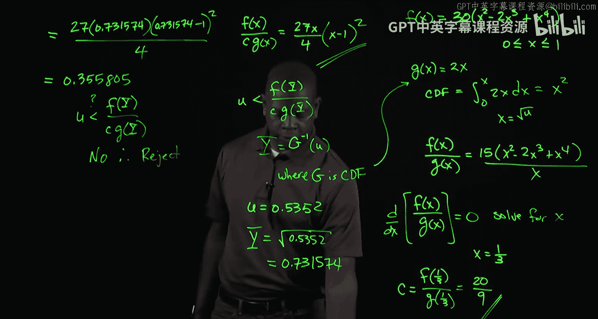

# 约翰霍普金斯大学《计算机科学的统计方法｜Statistical Methods for Computer Science》中英字幕 p84 2_拒绝采样法第二部分.zh_en -BV1r483zbEzN_p84-

Let's look at another example of the rejection method。

In this example， we're going to use a polynomial PDF。

 so in this case we're going to have our PDF be defined as F of x。Is equal to。And this time。

 we're going to have。30。Times。X squared。Minus。2 x Q。Plus。X to the4。Okay。Of course。

 one of the first things you want to do is you want to verify that this guy is a PDF。

And the range that we're going to be looking at at the particular f's or x's are going to be x in the range of0。

Less than equal to x， which is less than8 equal to1。Okay。G of X。It's going be equal to。2 x。And again。

 in the interval from0 to1， G of x is， in fact a。PDF。While I'm here。

 we want to go ahead and calculate the CDF。For g of x， okay， and so in this case。

 we're going to have the CDF is going to be equal to the integral from0 to x。Of 2 x。DX。

 and that's going to be equal to x squared。So we have that and of course， that means that X。

Is equal to the square root of U。So now that we have our CDF defined。

 we have a inverse function for the CDF now what we can do is we can go ahead and we can calculate the ratio and so the ratio that we're looking for is f of x divided by G of x and in this case what we have here。

 this is going to be simply equal to 15 times x squared minus 2 xq plus x to the fourth。Divided by。X。

Okay， so what we're looking for now is we want to find the critical point and。

What value of x maximizes this function within the particular interval between0 and1。

 And so then what we're going to do here is we're going to go ahead and we're going to take the derivative So we're going to say I'm looking for。

F of x。Over G of x。And I'm going to take the derivative of this guy。Set it equal to0。

 I'm going to solve for x。And what I get in this case is I'm going to get a critical point here of x。

Its equal to。One third。OkayX is going to be equal to1 third。

 so now when I when I substitute C is equal to F of1 third over g of 1 third what I end up with is I end up with a value of 20 over9。

 and this。Is my value of C， that is my critical point， meaning that that's where it is maximized。

Allright， and so now what we want to do is want to go ahead and we're going to say， okay。

 that being the case。 I'm going to say。I want to calculate this value。F of x。Over。C G of x now。Okay。

 I want to calculate what that value would be and what I end up getting here is I get 27。Times。Well。

 let's do it this way。 I'm going get 27 x over four times。X minus-1。Square。Yeah。27 x over4。

Times x minus1 squared。Okay， so I think I have everything I need。I've got this， I've got this value。

 this is what I needed， and now what I'm calculating is the uniform distribution being less than when I actually do this F of cap Y。

Over C G of cap Y， where cap Y is equal to the inverse。Function of the uniform distribution， where F。

Is。CDF。And the CDF。The CDS that we're talking about is。The CDf of that guy。Okay。Oh， you don't like。

You don't like that I put an F there。 You wanted me to put a G。Yeah。Okay， I don't mind。

 that just takes me， I just have to do this if you guys are okay with me making this little correction for you so okay。

 now the book is going to use a CA app， but if you want me to put a CA G here。

 I don't mind doing that。Yeah， sure。All right， well， let's work a problem。 Let's actually do one。

 So I'm gonna so we're going to calculate now one of these values by hand。 But， you know。

 in your computer program， you got to write it so that it calculates what youre want to do is put in any value you and then you want to get the。

The random variable out。 Allright， so here we go。 So let's let's pick a u。

 So we're going to pick u is equal to and we're going to say 0。5352。 That's going be my U。 Okay。

 so my cap Y now is' going to be equal to。 This is going to be the square root。Of 0。5352 right。

 because remember it was a square root of u。Okay， now this value now is going to be equal to this is going to be。

This is going to give me a zero point。7，3。1，5，7，4。Now what we have to do is we have this now we need to calculate this value and so this value is going to be so now we need to calculate。

27。Times， so this is going to be cap last is going to be 0。73。1，5，7，4。Times。

I got to write that again， 0。7。3，1， five， seven， four。Minus1 squared。

And that's going to be divided by。4our。Okay， so now this amount right here， this value gives me。

So this equals zero point。3，5，5。8，0，5。So now we do our condition is U less than F。Ct Y overea。

G kept y。And the answer is。No。Therefore， we。Reject。Well。

 what if you were looking for a value that you would accept？What value would you accept？

Let's look for a value that we can accept， why don't we try a different U。

 let's try U is equal to let's make it 0。099。Okay， and this one。

 y now cap y is equal to square root of 0。099， and this is equal to。0。31。4。6。4，3。Okay。

 and now when we put now when we calculate the right hand side。Okay， when we calculate that。

 what we get is we get。0。9。9，7。5，9，8。 And so now when we do our calculation， you less than。

Right hand side， the answer is yes， and we accept。And what did we do we accept。

 we've got to make sure we put。The value of why this guy here。This is what goes here。Okay。

So make sure that you're not putting the right hand side value again that's a mistake that students will make they'll put the right hand side value as opposed to putting the value of cap Y so that is the rejection method this lecture is designed to go along with the R tutorial where I will walk you through some code that would take you step by step and how to navigate the problems that are in this chapter and this is what you would expect to see also on the quiz。

😡。