# 约翰霍普金斯大学《计算机科学的统计方法｜Statistical Methods for Computer Science》中英字幕 p85 3_R语言教程.zh_en -BV1r483zbEzN_p85-

Hey guys， Dr。 Tony Johnson again， here in this tutorial。

 we're going to be looking at some of the concepts that we developed in the lecture in module 10 here on simulation。

We start with the normal， we're going to we're going to clear our global environment。

We're going to go ahead and clear all of our plots if there were any。

 and then we're going to go ahead and source our stat tools。And we get out functions。

 whichever ones we have developed。So one of the first things you noticed was that we needed to have a uniform random variable。

 and while R has a uniform random variable method，Called our Uni。There is a。

There is something to be gained by being able to do your own。

Let's say you were using a different program other than our。

One way we can create a pseudo uniform random variable is using this linear conruential method。

And as you can see， you know， we start by setting a in of， let's say， in this case， it'll be 10，000。

And our random variable is going to use is going to basically， I'm going to set a number。

ThisThis kind of vector I'm going to repeat。10，000 zeros。But the first one， I want to be one。

And so what that looks like is， you know， I have 10，000 a vector of 10，000 zeros。

 but the first entry is a one， so it's one and then 10，000 zeros。

Now you know that a linear function is y equals M x plus B。 and so I'm going to identify the slope。

 the intercept。 and then I'm going to have a modulo here in this modulo in this case。

 it's going to be a pretty large number right， And you're going to see why I have a large a modulo this large in just a second。

 but let's go ahead and set these variables。 So I've got a slope。Is equal to that。

 my intercept is going to be 0， and my modo is going to be this very large number here。Okay。

 so what are we going to do so basically we're going to repopulate。Starting with。

The second number in my vector。Okay， so the first number， I is1， so the first number is one。

But the next number is going to be based on this idea， so I'm going to take the slope。

Times the previous number or the current number。Okay。Plus， the intercept。

And then I'm going to take that modo this very large number here， and so when you have modo。

 you know， this very large number， what you end up with is you end up with another very large number。

And it's going to be on the same order of the modulo， right， it's going to be on that order。

And so when I run that。You can see I have this。Aray of very， very large numbers here。 Okay。

 and they are on the order of this particular modo。

 And so now the uniform random variable is simply going to be this random variable that I've generated divided by or normalized by this modo。

And so if we do a histogram of this。Then we get exactly what we expect to get。

 This is pretty uniform。 This is the frequency out of the 10，000 numbers that they occur。

 and you can see that it's pretty flat across the top。

Now it' would be difficult for you to for a person to。You know， this is not truly random。

 it is pseudoran。If we would apply this distribution， it's pretty well distributed。

Over this particular space。However， I would say that， you know。

 if you didn't choose sufficient numbers here for your slope and intercepted modo。

 one might or could actually discern a pattern， but in this case it's okay this is just a way to generate your own uniform distribution and not necessarily depend on。

What's available in R？Okay， so the first method that we talked about in terms of simulation was this inverse transformation method。

And this was basically a method that if we had a distribution that we didn't know how to sample。

We could use the uniform distribution that we just created。

And we could use that with the inverse of the CDF to actually sample that particularum。

Distribution now， I mean， we we looked at this at length in the lecture。

 but what I want to show you here is here is we have a uniform random variable that we just created。

I'm going to make that you。Here is an exponential。Distribution where what I've done is I have gone ahead and I have。

I've gone on ahead and done the inverse。 K， as it says here， right， I found the C D F。

 and then I said it equal to you， and then I saw for X。And that gives me this equation here。

 So now if we run this。

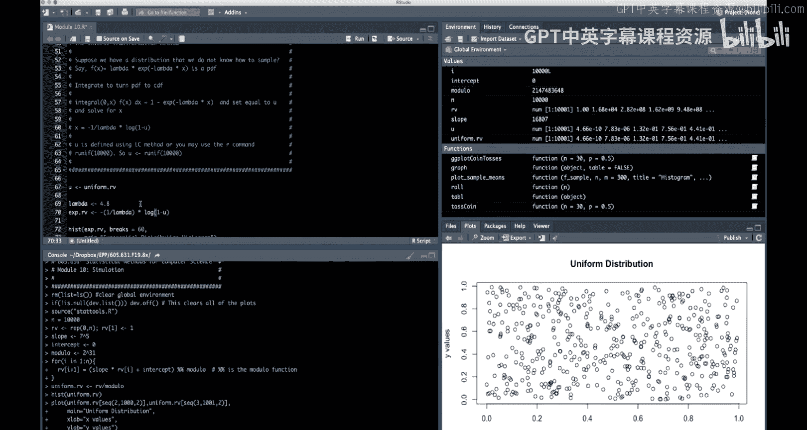

Right， so I'm going to run that。There's my lambda， I'm going run that。If I do my histogram now。

I see that I've got a nice exponential distribution here。 And if I plot this。

This is exactly what you expect to see。 so I've got a lot of the numbers here， right。

 and then very few of the numbers out here。And that's a nice exponential random distribution。

So that's just an example， you can do this with any distribution so long as you can find the inverse。

And that's why it's called the inverse transformation method。Well let's take a look at an example。

 suppose we had a random variable X that had a PDF that was C times E to the X。Over this interval。

 So we want to simulate this random variable。 So the first thing you want to do is you want to find C。

We kind of did that before I showed you that in the lecture。And now what we can do is。

Lets using our same U， we found the inverse。 we're going to make that our example random variable。

 so we run that。And we do a histogram of this guy。We see that this is exactly what we expected to see。

 right， based on that distribution。And when we plot that。Yeah。But we're getting a， I mean。

 it's almost uniform， but it's， you know， that is the plot of that particular distribution。

So you could do this with any。You know， you can use this inverse transform method with any distribution。

 you just got to make sure you follow the steps， make sure you integrate。

To get the CDF and then set that value equal to X and then solve for you。It is that simple， I mean。

 set that value equal to U and then solve for x。All right。

 the next thing we want to talk about now is the rejection method。

Now the rejection method we went over on the board really has two steps。You're going to simulate。嗯。

Adentity function G of x。Using a uniform， and there should be uniform。嗯。Uniform random variable。

And that uniform variable is from zero to1， and then you're going to use that variable as a qualifier to either accept or reject。

Um， the value， so I'm just going to show you how to do this in R， we did this on the board。But again。

 suppose that you have a random variable。That has a PDF， and I have a function G of x。

 which is also a density function。So if we code this up， so the first thing we do is code up F。

And we want to check to see if it's a PDF， so I'm going to integrate that and you see I get one with an absolute error of very small。

I know that the range is from zero to infinity， but I'm going to go from0 to3 here because I know that this particular distribution is going to fade really fast and I don't have to go that far。

 so three is enough。And then G of x。Or G of x is equal to e to the negative x。

 to run that I'm going to also check to make sure that that is a PDF and indeed it is。

 and I'm going to call that range2。So now what we want to do now is we want a plot。F of x。

So that is F of x， and now I'm also going to plot G of x。

And what you see here is you see basically the G of x is。I mean， it's tracked along pretty good。

 but then at this point it dips below F of x， right？

And we're looking for the proportion of F of x or F over G。 We're looking for the max。

 And so this is not going to be it。 In other words， graphically。

 that max will occur when this orange。AGraph， which is G of x， is tangent。To the blue graph right。

 where it just touches that blue graph， that's the maximum， and this clearly isn't it。

So now what we have to do is we have to find that value of C。 and so we had defined that。You know。

 this。This C value that we were looking for， there's a couple ways we could do it。

We looked at C as being a critical point of the two functions together。

 and so if you go here and if I was to plot， I'm going to plot both functions together， I get this。

So this plot is the plot of。If。Over G。And clearly， there is a maximum， right？

 And that maximum is somewhere here。 now by I， I could think is somewhere round one。

 but let's be a little bit more deliberate in our approach。

 So the first thing I'm going to do is we're going to divide F by G。 and that gives me this。

 I'm going to find the derivative instead set it equal to 0 and then solve for x。 And what I get。

 in fact， is x is equal to 1。😊，So let's take a look here。😊，It turns out in this particular case。

 if I do max of this range， right， and I run it。What I get is I get 1。315， right？

And it turns out that this function max in R is actually correct because I found the critical point。

Equal to x equals 1。So when I set x is equal to1 in my function and I run that， I get。

The identical value。Right， so I can go down here and I can say see。

And C is equal to the identical value， so the max function does work in arm。Okay。

 so now that I have this C， what happens when I multiplied G by this C。 So let's see。

 So first I want to do。There's my function R。And now。G。Aha。

 so you can see now that G is the appropriate G and it is tangent。To F。Okay。Well。

 now that that's the case now I can actually do I am ready to perform my analysis。

 and so here we're going to say we're going to take 100，000。 we're going to make a vector of 100，000。

up。Elements。Okay。And now what I'm going to do， that's just allocating the memory。

And now what I want to do is for every value。From one to the length of this vector。

I'm going to repeat this， right。 So what I'm going to do。Is I'm going to take。

Here I'm using the uniform the uniform。U。Function。From。嗯。R。But we could easily use our own。

And maybe you could try that and see if it does the same thing。Okay。

 and then I'm going to set that value equal to U。So I get X here。

And this x is actually our cap Y up here。Oh， you don't like that I use the X when I use the cap。

 you want me to use the cap Y， Okay， so I'll use a cap Y here。And I'll use a cap。

 No nogle there's no problem If you don't like the little X because of my notation， I use a cap Y。

Cap what it is。Okay， so I'm going I'm going to calculate cap Y using my。My distribution。

 my uniform distribution， which is the density of G。And then I'm going to。

I'm going to store that number in U and then I'm going to do the if U is less than this ratio。

Right if U is less in this ratio， I'm going to stop。And once I stop。

 I'm going to now I'm going to take that ratio。And I'm going to take the number that I calculate。

 whatever it is。And I'm going to put that in Z。Right， and then。This little deal right here。

 what this does is normally I'd be done， but I want to see both sides of this distribution。

 so I'm going to calculate this negative side as well。and if you walk through this。

 you'll see exactly what it's doing。

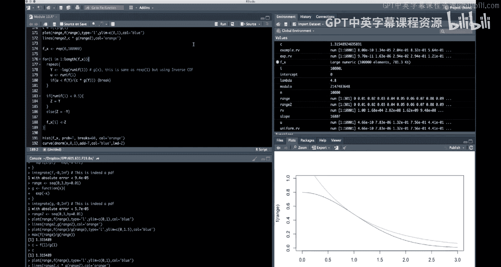

And when we run it。Okay。So there's my Y and Z。 And now I'm going to do a histogram。

 And this is what I get。How about that？And if I was to take the normal distribution and just to see how well my simulation actually ran to simulate this random variable。

 I'd say that was pretty darn good。Okay。All right， moving right along， let's work an example。

 so suppose we had an example in this case， right？And in this case， I have this problem。

 so the first thing I'm going to do is I'm going to go ahead and set it up。

 I'm going to integrate to make sure that it is a PDF and it is。

 and in this case I can go from zero to1， that's my range here。My range is from 0 to 1。

Whereas up here。I went from zero to three， and that was okay because。Because I knew that the。

That the function was sufficiently behaved at the tails。 Okay。

 so now what I'm going to do is I'm going to set my range。And I have another function。😊。

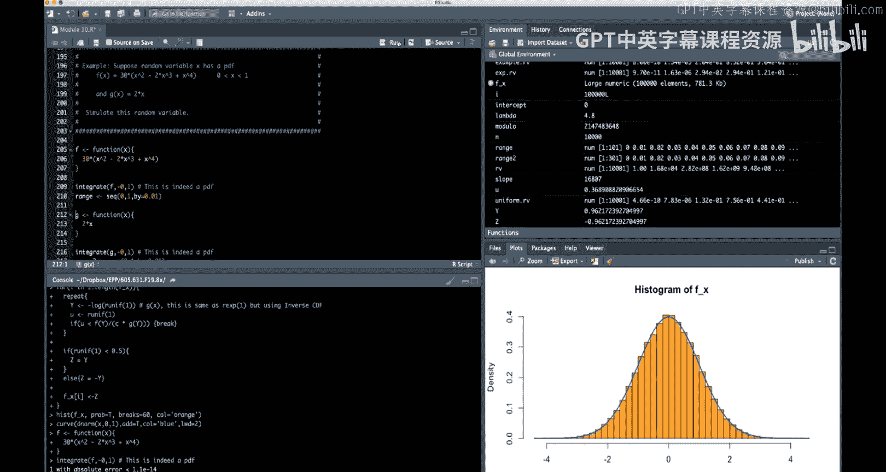

I'm going to integrate that to make sure it's a PDF and it is， and I' set the range for that。

 so we plot it。So there's my plot。Okay。And here is the line that I want to。

 here here is the the function that I want to actually。

You know that I want to use to as a basis to actually pull or to。Simulate this random variable。 Okay。

 so let's plot the two together。And I get this， right。

 and so now I'm going to find that critical point。And so in this way now， I'm going to have。

So you can see。When I take F over G is going to be equal to this to this。

 I'm going to take the derivative。Set it equal to0 and I get a x is equal to1 third。We said， well。

 Doctor J， why are you going do all that， We is use the max。 All right， let's just use the max then。

 Oh， not a number。HSee， the problem is is that in this case， G of zero is equal to zero。

And 0 is a number in my domain。 So this max has limitations。It does， has limitations。All right。

 so what you want to do here is you want to go ahead and say， all right。

 I understand that the max has limitations， but this procedure does not。

 And so now I'm going to find C。I'm going to plot。And I'm going to hit my line and there it is。

 and that is tangent， right？嗯。Now what we're going to do。Is we're going to do the same thing。

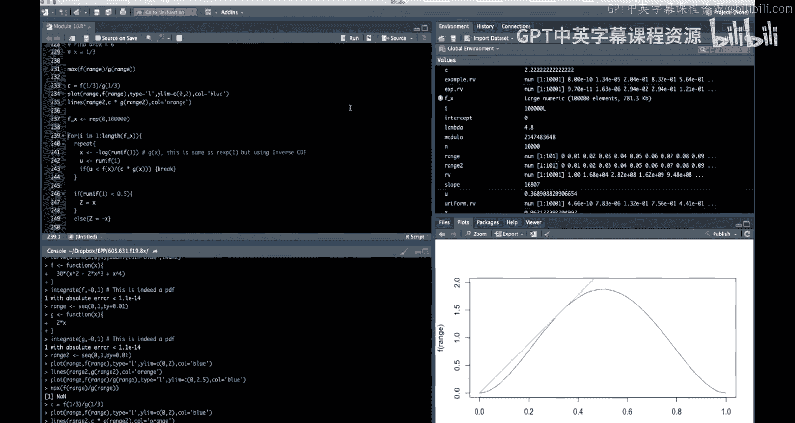

And we can run our for loop。And we can do the histogram。 And in this case。

 this one is going to be like this。 Now， if you notice。Not so good。

I wonder why can you think of reasons why。This isn't so good。So I'm going to ask you that。On， on。

 on the quiz， I want to ask you， you know why。You know， why isn't this good。

 Why does that look so bad， And the answer is， because the distribution。

 the density function that we used。Here is very bad。 Okay， it's very bad。Now。

 what could we do to make this better？Well， one thing you could do is if you had a function that was maybe piece wise that went up here and then maybe had another one that come down there。

That may do better。Or if you had something that could give some because I mean if you think about over here。

 this function is all the way up here and the density F is all the way down here。

 so that's going to cause you some problems， but kind of think through different ways you think that that might actually be better。

All right， some other things just some ppry， miscellaneous things。

 if we had a uniform distribution on X and we wanted to plot it if you sort it。

You can see what your values would be。This first one that I just plotted is when we use the inverse transformation method。

But if we were to do it using the R exponential method。And you plot that it's almost identical。 Okay。

 you can see that the。So method has little issues there， but I mean， that's still pretty good。Right。

One of the things that the a has that you can do also is a gamma function。Which is another way。

All right， the final thing we're going to talk about is some basic Monte Carlo。

So Monte Carlo is a simulation technique whereby you try something and you figure out if what you experiment it。

 if the observation meets the criteria or if it doesn't。And so in this case， we set our C。

And we say x is some。Random normal， we take the 1000 random normal is a random normal variable。

This vector is going to have  a thousand numbers in it。

And we take y as being just a vector an empty vector that we're initializing。 right。

 Then we could say， in this case， if the absolute value。Of x， which is a random number。If that value。

Is greater than。呃。2。😡，Then we're going to set why for that particular place is equal to one。Right。

Does that make sense？So if the absolute value。Is greater than two。Then y is equal to1。All right。

 so let's take a look， so we run this。And we take the sum of why。And immediately。

 we could come up with a probability， right， because all I have to do then is set this number over 1000。

 So 47 times。Out of a thousand tries， the absolute value was greater than two。嗯哼。😊。

If I said the absolute value was greater than one。Do you expect that number to be greater or less than 47？

Well， if it's a random normal variable， right， then it would have to be greater because you're getting closer to the mean。

If it's a normally distributed random variable。Of course， the mean is going to be 0。

So you're going to have most of the values surrounding or close to close to that value and conversely if I was to put3。

 you could see that three is going to give me oops。Let's do this again。

 it's going to be greater than three。Why am I not kidding me if I said too。Oh。

 because the ones are already set， so in order to do this， if I go back and I change it to say three。

Then what I'm going to have to do is I'm going to have to remove that variable， so remove。why。

And now I need to go back and reinitialize y with zeros， now set it and now take the sum。

 and there was only one。Far less than 47。Okay。Far less than 47。So I'll change that back to two。

 All right， so let's look at and that's just a simple Monte Carlo。Let's take a look at another one。

So in this case， we have， we're going to take 100，000 trials of this in。

We're going to set up a data frame。That。Has。嗯。Random。Uniformly distributed it。Variables of x and Y。

And so with the data frame， you can see there are two variables。And there are 100，00 observations。

Now。We're gonna to say。If。嗯。X squared。So we're going to take。X squared and y squared， right。

 we're going to take those together as indices。What we want to do now is we want to print。

When the length of the indices。We're going to print the length of the indices divided by in。

And is going this ratio is going to give us a simulated。Approxiation of the area。

And so what did we get？So we get30。33132。Right。嗯。If we were to take now the same thing。

And what we're going to do is we're going to run a function。Will we integrate。嗯。

This function x times the square root of x， and we print the actual area versus the absolute。

Arrra of the area， this is what we get so the actual area is equal to this。

 and we have an error on the order of 7。8 e to the negative 5。So that's。Pretty good， I would say。

That's not bad。All right， let's look at something more visual in terms of a Monte Carlo simulation。

So in this case， we want to。嗯。By simulation， try to approximate the value of pi。

So here we have 100 runs。And we have a excess。Right。Which is going to be a uniform variable。

We have a wire。And if it's in the circle。Okay， if it's in the circle。

Then x squared plus y squared is going to be less than equal to。One half squared。

 That's what we're saying。So that's our Monte Carlo test。And so now we're going to run。

 take the sum of all those that are in the circle over the total number of runs and multiplly by four。

 and what that gives us is a value。Of。3。32。 So let me just add that here so we can see that printed out。

 So MC。Pie。So we run that。We get 3。32。If we plot it。嗯。Oh。

 invalid pla type da da da da da da da da da。What is going on here。If we plot it。嗯。Oh， here we go。

 Let's just， we don't need this。Let's try this now。So this is what we give when we plot it。Now。

 what's interesting here is。I， it's hard to see。 So we got blue dots。

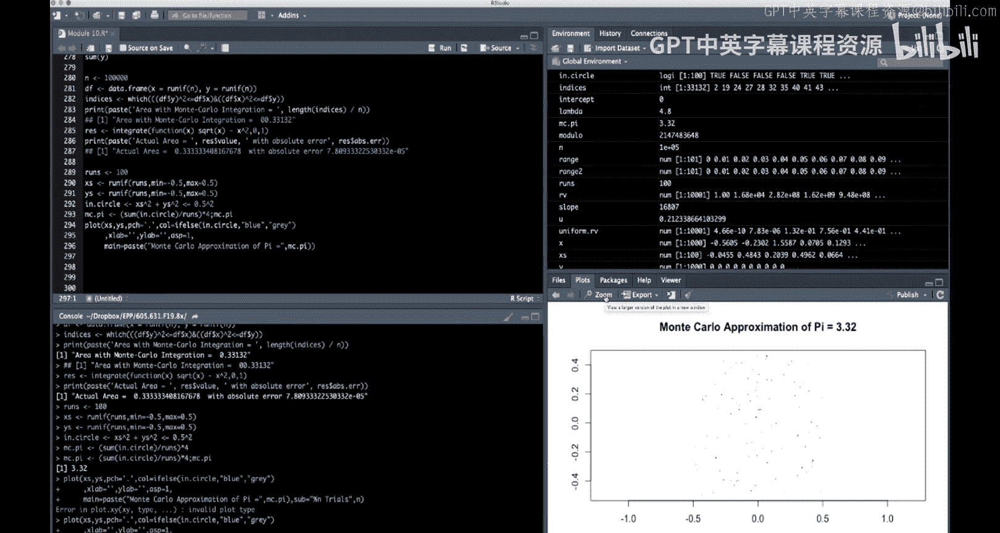

And we got gray dots。 but you can hardly see what。In the circle and what's out the circle。

 and this approximation of pi， though it's three point something is not very good。

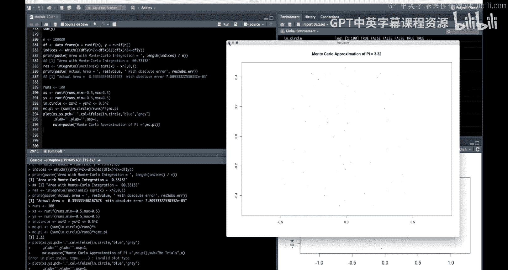

So what do you do with a Monte carlo simulation， you need to increase the order of runs。

 and so then let's increase it to 1000。And let's see what we get。We calculate in circle， we plot。Ah。

 well now。

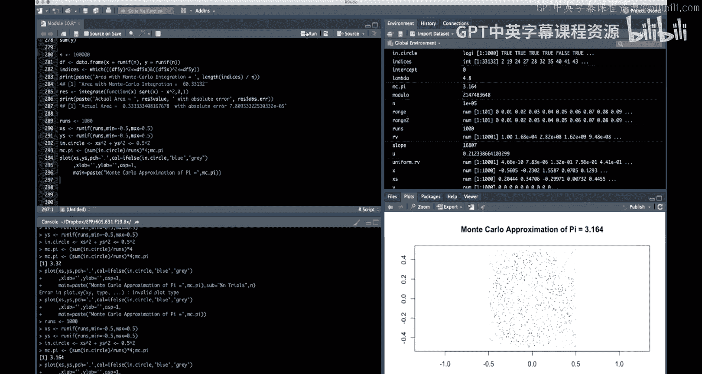

That is a lot better。嗯。

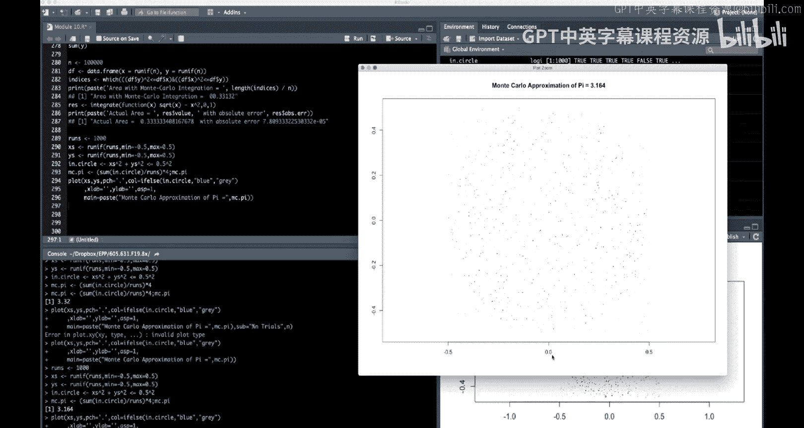

But still。3。1。 All right， let's increase it to。100000。

So while we can't do this or it take a long time for us to do it。

 the computer is very good at doing it。Okay， and so when we take a look now at this plot。啊ha。

How about that？And now we get a much better approximation。

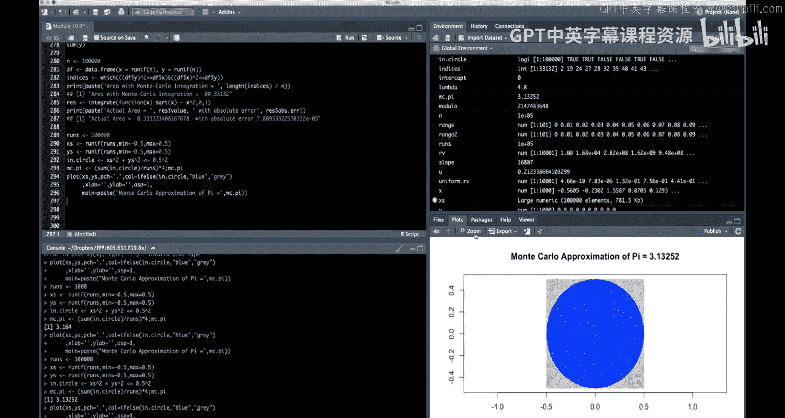

In this case。And basically， if it's in the circle。😊，It's blue and if it's outside the circle。

 it's gray， and in this Monte car simulation we're simply going to take the ratio of blue。To gray。

Well that's it guys， I hope you gained something out of this tutorial。

 I hope that you'll be able to use this in some way in your analysis if you have any questions or if there are any problems I'll just give us a ho。

 no worries and。

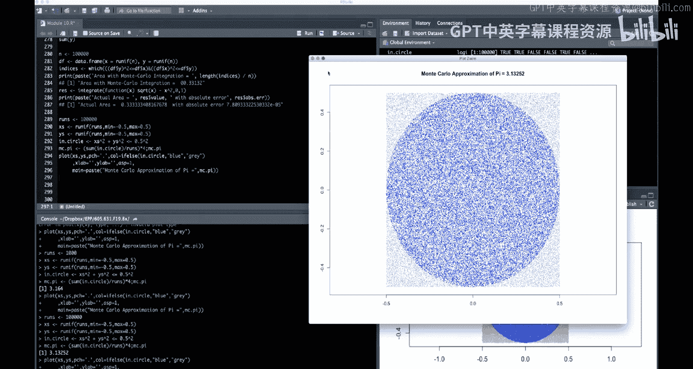

I'll see you in the next video。

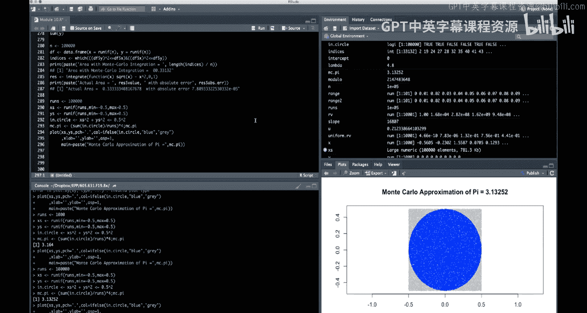

