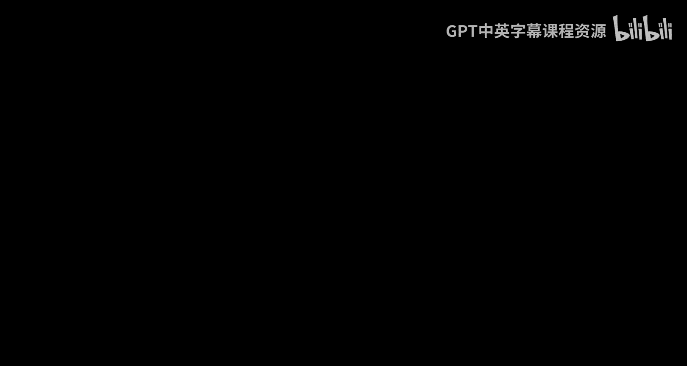

# 约翰霍普金斯大学《计算机科学的统计方法｜Statistical Methods for Computer Science》中英字幕 p86 4_指数随机图模型.zh_en -BV1r483zbEzN_p86-

🎼。

🎼，I'm Dr。 Ian McCllough of Johns Hopkins University。

 this is a short lecture on exponential random graph models。

Our learning objectives are to understand how structural dependence in networks impact statistical analysis of data one of the necessary assumptions in most statistical inference is that data are independent and identically distributed。

That independence assumption means that the values of other data points do not impact the value of the data point that you're looking at and of course in networks that's not true。

 your connections to other people is going to be completely dependent upon their connections to yet others。

The the attributes you have， the beliefs， the values you have are going to be impacted by those that you're in social interaction with。

 so that dependence assumption is not or independence assumption is not valid in most network cases and we need to understand how to treat that so we can do proper statistical analysis with networks。

So we want to also calculate the likelihood of a link in a network by hand。

 and then be able to understand how we would do hypothesis testing of various social forces you learned earlier in the course using empirical data from a network。

Last thing we'll do is construct an exponential random graph model using the statnet Pack in R。

So many of you at this point are already familiar with R I hope you are。

 if not you need to make sure you download our studio is what I would recommend and you familiarize yourself with the CrN or the comprehensive R archive network。

 these are where the packages are located and where there's some description about the packages。

 some tutorials， etc。Why are we using R？The most basic reason is it's the software that has access to the statistical analysis packages。

 Errum and RCNA in particular。It also is very flexible in analytics in that if there's something you want to do and there's not a package for it。

 you can write your own。And there's a large user community of people that are always doing that。

 and so there's more types of analytics available in R probably than anywhere else。

And it's being increasingly used by academic and practitioner communities。

 so when you're looking for a job， if you can put down that you're proficient in R。

 that you've done social network analysis in R， statistical analysis of networks in R。

 those are things that definitely will help you in the job market。

The downside of course is you've got to use a command line。

 it's not like an easy friendly user interface， some people don't think that that's necessarily a downside though。

 depends on your comfortable， you your familiarity with the command line interfaces。

The tutorials may not be available for particular functions you're trying to use or they may not be that good or that comprehensive and you can easily treat the data incorrectly if you're not careful so in social network analysis there's two leading packages。

 statinnet and iGraph they have different data objects when you coerce one from one data class into another you can oftentimes mistreat the data and that can cause problems in how it's loaded into that data object you may not be aware of it so then you run like anerum on data that's really not structured as a network and you get bad results so。

How you treat the data is something you just need to be careful of and mindful of as you're going through this。

 the two key packages， statnet and iGra are totally not compatible。

 iGraph is probably better for accessing social media data for visualization for a variety of functions。

 but when it comes to the statistical analysis of networks， you really have to use statnet or RCNA。

So now we're going to talk about what the likelihood of a link is。

Just some basic premises that we have going into this lecture。

 we understand that links in a real social network do not form at random。

 we discussed that earlier in our lecture on subgroups and I hopefully prove that to you that the likelihood of two people being connected completely at random is very low。

So we know that people kind of form。Connections around social Foci。

 and I think you've looked over the paper by Feld from 1981 that talks about social foci theory and what it is that causes people to form into communities。

We also know that people have limitations on the number of connections they can maintain。

 so we have this from the Dunbar number which I think we've discussed previously and you know that。

If you're Google or Yahoo you can have millions of links。

 if you're Kim Kardashian and on Twitter you can have millions of links because that's not a real relationship。

 there's nothing that's required to maintain that relationship so when we talk about a real social network of people that are interacting。

 there all of a sudden becomes constraints on time on energy on a lot of things that limit how many people you can have。

But we also know that people have a biological need to interact with others and so all of these things kind of interact in an interesting way to form networks。

And we want to be able to model these in a way that allows us to do hypothesis testing and statistical inference。

So I'm going to give you a simple example with the smallest network I can think of。

 which is a three node network， so I'd like you to pause the video here for a minute and just think about how many different configurations can you have with three nodes and undirected ties。

I'm going to assume you have paused the video and maybe sketched out these eight networks that we see here。

There are eight configurations that you can sketch。So you know this one here would be no links。

 this one everybody's connected and these have two and these have three， right？

So what is the likelihood of a link occurring in the network， just one link in the network？

Well we can look at the images there and we can identify that there are three configurations that have only one link。

 so the probability of observing only one link is3/8s。

Now I'd like you to pause the video and just work out for a minute。

 what is the probability of having zero lengths？What is the probability of having two links。

 it's a second problem， and what is the probability of having three links？

I'm going to assume you've paused the video and you've answered those questions and so now we'll show you the solution。

Okay。So what's interesting about this is the likelihood of one or two links is much higher than the likelihood of0 or 3。

 and we find that as the networks scale up， there will always be more configurations around the density of 0。

5 than around the density of 0 or1。嗯。So what we're interested in asking is given that there's this distribution of the likelihood of different configurations and you look at an empirical network that kind of tells you what range of values you're looking at。

 how do we use that to control for our statistical inference so in other words for this problem。

 given that there is only one link in the network， what is the likelihood that there is a link between node I and node J so that would be let's say this is node I and this is node J。

 what is the likelihood that there is a link here， given that there is one link in the network？

So I'd like you to pause the video and think about that for a minute and try and write down a solution。

I'm assuming you've paused the video and written down a solution， so what we see is the link。

 the likelihood that there is a link from node I to node J。

 given that there is only one link in the network is one third。

So when we say given that there's only one link in the network。

 we are eliminating these other possibilities where there is。

Either more or less than one link in the network， and we're restricting our search。

 our sample space to just the configurations with one link。And then the likelihood from I to J。

 there's one option where that's success and two where that's not a success。

 so the answer would be 13。Well， why is that important？

It's important because a lot of the variance in likelihood between two nodes being connected can be explained by the density of the graph。

 and so this becomes something that we want to control for when we're doing statistical analysis on the network。

Okay。Failing to control for the density of the network it creates a significant bias in the estimation of effects if you're saying what's the likelihood that two people that are similar interact well you have to control for the fact that like everybody can't be connected to everybody that is unrealistic for potential for the type of network you're dealing with so we wanting to control for how much the number of edges in the network effects。

😊，That probability of connection。OkayWhat happens if the network is directed。

 we were only looking at undirected and there were eight configurations。

 what happens if we make it directed？Well。There are n times n minus1 possible links each which can be 1 or0。

 so that ends up being 2 to the n times n minus1 or 64 possible configurations you can have in your network。

Okay。The number of ways to have only one link then becomes2 times 3。

 chooseose 2 or 2 times 3 or6 of those 64。Include only one directed link。

So if we want to say what is the probability that we are observing a link between a specific node I and nodede J。

 given that there is only one directed link in the network？That likelihood is one sixth。

So we're going to now turn this to more of a formal statistical distribution。

 we're going to use the Bernoulli distribution， so the Bernoulli distribution is a probability distribution where a random variable can either be 1 or zero with some sort of probability P of success so we're saying the link between two actors can either be a1 or a0 depending on some probability if we are dealing with a random graph。

So what does that distribution look like Well I've drawn it out here for you。

 so the likelihood of observing x， given a parameter or probability of success P is going to be equal to this distribution here。

 Let's see what this looks like。If I。Say the likelihood of observing a1 given probability p。

 well we're going to put 1 in for x， and you'll see that p raised to the first power is just p。

 this term raised to the zero power is 1， so p times 1 is p。

If we look at the likelihood of getting a zero。Then this term becomes p raised to0 is 1。

 this term is raised to the  one power once you get 1 minus p。 so with this distribution。

 you are going to get the value of one their presence of a link with likelihood P。

And the absence of a link with probability 1 minus P makes sense。A network however。

 has multiple links， therefore， the probability must be multiplied。

 just like when we're enumerating the different possibilities of a tie to raised to the。

However many ties there are in the network power。Well the way we represent that statistically is we're going to say the likelihood of x as a function of given p is going to be the product so and in this case x will be the specific network configurations it's a set of x's。

😊，Is going to be the probability of I going from one to the total potential ties in the network。

 all the different potential edges。And that's going to be this same formula， P raised to the X。

 1 minus p raised to the 1 minusxii。Now I'm not going to do all of the math derivation here for you。

 I'll leave that for you as an exercise， but in order to find an estimate for the probability of a link P so there's one parameter p here so that's going to maximize the likelihood。

 well we have to use some calculus， we're going to take the derivative of this term and set it equal to zero。

But that is really， really hard because you're going to use taking the derivative of a product like this is going to require you to use the product rule with T iterations。

That is very， very difficult， so what we are going to do is a little trick。

 we are going to take the log of the likelihood on both sides and taking the log converts that product into a sum。

 making it a much easier math problem。So let's take a look at how we would derive the parameters for that。

 so the log likelihood right is displayed here。So after lots of math。

 we can actually come down to the estimate for P， the probability equals the sum of the x's that the successes divided by the total number of ties。

 well， what is the sum of the x's？They're either a1 or a 0。

 It's the sum of a bunch of ones representing edges in the network。 So it's the number of links。

Divided by the number possible， and if you don't believe me。

 I encourage you to work out that math problem。So the most likely estimate for the probability of a link occurring in the network is the density of the network itself。

So。Now what I want to do is I want to estimate a parameter in。And an exponential function。So。

If I want to take this E raiseds to some function， think of it like a regression function。

 and so theta is a coefficient and ZX is some statistic I can calculate on the network。

 that could be the number of edges， that could be the number of triangles。

 that could be the number of reciprocal links right it could be a lot of different things。

 we want to estimate the theta on that。Well， the log of the ratio of the probability that a tie exists divided by the probability a tie does not exist is going to equal。

Model here of some sort of coefficient times the various statistics。What we call those theta values。

 the constant of proportionality。So if I take and exponentiate both of these。

 I take E to the log P over 1 minus p。That allows me to get a simpler expression for P。

And then I'm able to multiply both sides by the denominator there。

 and I'm able to to get some equation like E to the。Theta。ZX minus p times e to the theta zx。

And then when I。Subtract P from both sides。I'm able to factor out a P and I'm able to get an expression for a relationship between the probability of a link occurring。

And this E raised to a model。 and now keep in mind。

 the Zx are a bunch of different statistics so we could have theta 1， z1 x plus theta 2。

 z2 x plus theta 3， z3 x， so on so whatever terms you want to throw in the model。

This now describes a model of statistical terms， and we have a relationship between that and the probability of a link occurring。

嗯。So these become two key equations that you're going to want to take note of。

 maybe pause the video and write them down because we're going to be using them a little bit more。

What we want to do in an exponential random graph model is we're going to estimate the coefficients of the constants of proportionality for various network terms that we include into the model。

What we like to be able to do by hand is say， well， how does that？

Help us estimate the probability of a link occurring。

So let's take a simple example of our network with only one edge， right the density is 16。

 the probability of that occurring is 16 because keep in mind we're looking at this as a directed example。

 I'm sorry I didn't put an arrow on that figure。So remember。

 I told you that our equation there that was relating the probability to that estimate of the exponential random graph model。

Right， well that theta is going to be。The log of P here is 16。The1 minus 16 is going to be 56。

 so 16 divided by 56 equals the log of 1/5。Which when we actually calculate that is negative 1。609。

So now what I'll ask you to do is I'll go through this example and then I'm going to ask you to pause the video and run through these this slide and the next slide again and then reverse the video and make sure that you got the same answers but I want you to generate a network so the way we're going to do this in statinnet so I'm assuming you've installed the statinnet package you've done library statinnet to invoke that into memory and now you can use this command N is being assigned a value of network initialize3node network and I want to make it a directed network so it's true。

Then I want you to assign a value n in this network n from node1 to 2 that has a value of1。

 the rest will be zero。And then you can G plotot that to make sure that you've got a network that looks something like this。

OkayWe're now going to run anerum and the way we run anerum is we say e1 is just going to be the variable with the information for anerga。

 here's the commanderga， this is the network that is our dependented variable and I want to look at controlling for the number of edges so you put this little tlde sign here number of edges hit enter and then hit the summary of E1 and now we're going to look and see what the output looks like keep in mind here's the value we estimated by hand for theta。

When you look at your summary of model fit。Okay， it'll always， hey， summary model fit up here。

It's going to give you the formula you use， so we set n as a dependent network as a function of edges。

Okay， don't worry about the iterations yet。So。We're going to look at our term here and the coefficient estimate is that negative 1。

609， which is the same thing we calculated by hand。

Now it has a standard error because the way it's calculating these things in an Uum is it uses a numerical process where it does a lot of trial and error in a Markov chain Monte Carlo process。

And then we get a P value which says， you know what is the you know statistical significance。

 you know， what is the statistical likelihood of edges having nothing to do with。😊。

With T formation in the network。Right。And so the idea would be if the P value is low enough。

 the hypothesis that it has no relationship is unlikely。

 and therefore we would conclude with a low P value that that term is significant。

 this is just basic statistics okay。The other thing I'll draw your attention to is AIC and BIC these are information criteria so when you're trying different terms in the model。

 the idea is the smaller that value is the better model you have。

 you haven't overspecified the model when you start having a bunch of overlapping redundant terms that you're throwing into the model that share a lot of the variances then then you don't have as clean of a model and so we like to think that a smaller information criteria is as a better network。

 just keep in mind that as the size of your network grows。

 the size of that information criteria will also grow with it。Okay。

 so what we've just done here if I go back is。We have looked at。

This long likelihood of the likelihood of a of a。of a link occurring in a network。

 and we have derived the most likely estimate of that link occurring as the density of the network right just in a network in general。

 that's the maximum log likelihood。We've then taken that term and we said， hey。

 the likelihood the log of a probability that a link has occurred versus not occurred right we also call that a logit can be modeled as a function of various properties of the network which we've represented as z to the x and there's a constant a proportionality which is going to tell us hey is this zero meaning that it's not a particularly significant property or is it some number higher than zero that's going to say。

 hey， you know there's something going on here with this property inform forming the likelihood of a link occurring and we derived how we can either you what the relationship is between that model。

😊，And the probability of a link occurring。We then went through an example where we know what the probability of a link occurring is。

 because we can inspect it and identify what that probability is， which we did earlier。

And we can then put that value in there and calculate the coefficient。Directly。

 and then we can generate a network and we can run an exponential random graph model in R and see that we get the exact same result。

So if you have not done so already， I would like you to pause the video and go back to this code that you see here and just run through that example in R really quick and ensure that you can get this value。

So go ahead and pause the network and do that or the video and do that now。

I'm assuming you've paused the video， you've determined that you can recreate this example and get the same value that we have here。

So now we're going to do a bigger example we're going to use this example that I pulled off off the Internet from Gary Wiseman。

 he assembled a network from Gray's Anaatomy I also use this in a public health class I teach so I think it's kind of fun to use something that's sort of medical and kind of ray as well so you'll have 44 nodes in this network and 49 links it's undirected so it is what it is and so the density then is 0。

05 with some change and I would encourage you to look at calculating the density right now and making sure that you get the same result so I'll ask you to pause the video and just calculate the density real quick make sure you get the same result。

I'm assuming you've paused the video， you've calculated the density， and we're ready to move on。Okay。

I would like you to load the network in and you should see in the course files the data set is there as well as an R script that kind of gives you some commands to go through this example。

So what we would like to do is run the Gray's Anaatomy network as a function of edges。Okay。

you should get an estimate here for the number of edges that we have here。

 and I would think that you could probably calculate that as well by hand for just the edges term。

Okay。Now the problem you have is we've controlled for the edges。

 but we haven't really done any kind of hypothesis testing or tested anything of interest。Okay。So。

Before we do that， we'll just go through this example here。

 the value we're trying to recreate is at negative 2。9072。

 so here's our formula that's going to allow us to take the probability of a length occurring and estimate that parameter coefficient that you're seeing there so we're going to take the log of the maximum likelihood estimate of the P value which is the density 0。

0518。Divided by 1 minus 0。0518 gives us this value and gives us the estimate of negative 2。9072。

Now we can take the P value of that equation。Right。And you can then take the。

Exponentiate the theta z of x right so that's exponent of negative 2。9 over  one plus exponent of 2。

9， and then you can recreate the density of the network that we see there so this is just showing that we can go from the coefficients。

To a probability of link formation， or we can go the other way and say given that we have a maximum likelihood estimate for a link formation。

 can we derive what a parameter is on a very simple example like edges now as I was saying。That。

When we're doing this， yes， we want to control for this space。

But we want to add additional terms that are of interest。

So if I look at a network and conclude that you know this is gray's Anaatomy。

 so it's like a soap opera kind of show right， the blue nodes are guys and the pink nodes are girls。

 so when I look at this， I can conclude that there are a lot of men who are not hooking up with a lot of women。

 so I might conclude that hey， because there's not a lot of men and women hooking up in this network that heterosexuality is rare。

But if I notice in this network picture that there are a few links throughout the whole network。

 I might have changed my assessment of what is significant， right。Most men and most women。

 you know the combination of most men and most women are not hooking up。

 that's because the density of this network is like 0。

05 right so it's a fairly sparse network and of the links that are actually there。

 it's more common for guys to be hooking up with girls than the other way around。Right。

I have to control for the density of the network in order to make any kind of intelligent findings about whether in this particular case。

 heterosexuality is a thing here or not。Okay。So you have to control for the network effects in your model。

Okay。So。Typically density is going to explain most of the variant in a model the next most common property that explains a lot of the variance is reciprocity or mutual ties。

 but in this network it's undirected so we're not going to include that term in there。

 mutual would be the term you would want to use in anerum。

RightThe third most common things are transitive effects， in fact。

 Katie Faauust did a paper whats where she said she could do a rank approximation and estimate over 90% of the variance in any kind of network structure based on these three properties in the network。

So what we've done is we've done anotherer where we've added edges plus triangle so we can get the edges term and the triangle term。

 triangle is just basically saying how many triangles are there in the network。

And you'll notice that it is significant here， this P value is below 0。05， so we generally call that。

A significant network。Okay。So once I have done that with the graph we call this a restricted model because I've now controlled for typical network effects in the model at this point I can add other hypothesis tests for various things the one we're going to try here in what we call the unrestricted model is we're going to keep the edges and triangle term but now I'm going to add this property that says node match sex。

 so what I'm saying is if I add sex similarity so there are both men or both women。

 does that increase the likelihood of a link。All right， so what we see here is for node match sex。

We see that it is highly significant。And we see a negative coefficient on the network。Well。

 the reason why we're seeing a negative coefficient is because， yes， it's significant and opposite。

So it's not homosexuality that's significant， it is heterosexuality that is significant。

 so we might conclude that if we did， you know if there was a term for node dissimilarity or a node not match that that would be the same level but just a positive estimate。

 so what this is is a homophily test and so we're saying when homophily is significant with a negative coefficient。

 what we're saying is there's significant level of heterophily in the network。

You'll also notice that this NA that has come across this triangle term。Well。

 why is that I would like you to look at the network and pause the video for a moment and see if you can find the triangles。

Okay I'm assuming you've paused the network the video and you've searched for the triangles。

 I think there are two triangles that I can identify right one is here this guy to this girl to this girl right so that makes a triangle。

The other one is this triangle of all girls that are in here。So what we found is。

The the presence of a triangle is almost perfectly correlated with node match sexuality。

 so even though homosexuality in this network is significant in the opposite direction。

 meaning it's highly unlikely， it also kind of if you think about it for a triangle。

Coins with homosexuality completely， so you can no longer estimate the effects of a triangle when you include the node match in there as well。

So once we inspect it and say， you know what， there is not incidence of very much tritic closure or tritic effects in this network at all。

 I can then make the decision that I'm going to remove that term from my network and I'm just going to run it with edges and node matchch。

Allright。So when I do something similar here， I can say I'm going to take out that triangle term。

 I'm now going to test the different property， I'm going to test race。

 so does race have some sort of significant impact。

 we see that the P value is less than 005 so we would conclude that there is significant race homophily in the network。

Okay。So some cautions on exponential random graph models when I say don't go crazy。

 what I mean is there are any number of network properties that you can code up and put into a model。

 I mean you could have a cycle so note A to B to C to a right you could have some property that I don't know。

I mean， if there's any number of things in network configurations that you can kind of code up to say if this is significant or not。

 but you really have to ask what are the hypotheses you're testing？Does that cycle。

 does it have some sort of meaning to you of why there would be a connection from A to B to C to back to A without there being any reciprocal ties in that triad or something more exotic？

So you need to think about that and the chart that you have over here is some of those things you might want to test。

 so reciprocity right looks like this type of network structure here， two nodes connected。

 popularity is where a node has high in degree and a lot of people are connecting to him。

There's expansiveness which is a node is selecting a lot of people right what is that maybe model some sort of social activity or expansiveness trytic closure right so this is the tendency for the more shared partners that two nodes have the more likely they are to connect and actually a better term to use is GWP so that stands for geometrically weighted edgewise shared partner I'd encourage you to look that up in the help file that tends to be a better model term and essentially what it does is hey if we have two friends in common we're more likely to connect if we have three friends in common we're more likely to connect but if we have like 30 friends in common well how much more likely are we to connect now we haven't connected before so there's a marginally diminishing value for increased shared partners and that tends to model better and model social theory a little bit better。

Okay。You know this term is a similar thing where how many shared partners do you have which is lacking a tie there's the senders。

 there's something about the attribute of the sender that makes them more likely to form a tie or something about the receiver or something about the difference or the properties of the two of them together that's kind of like a node match。

 so these are kind of just eight categories to help you think about what is the sociological meaning of the things you're trying to model in the network。

Also don't include multiple tritic terms so if you have done something like the term triangle。

 you're not going to add a cycle as well or a triangle， a cycle。

 some sort of balanced term if these are all tritic terms and what ends up happening is they have a lot of covariants and so you're not going to be your goal here is to control for tritic effects because we understand that a lot of network properties have this tritic structure that you need to control for。

 but you're not getting anything by adding a bunch of different terms just because they're significant so you want to try and pick one of the triad terms that seems reasonable to you and use only one of them。

The last thing is do the coefficients on your erum make sense right are they going in the right direction we would expect to see for networks with lower than 0。

5 density we would expect to see a negative significant effect on edges in the network if you see you know a network like we did in the grays anatomy and you saw that node match sex was highly significant in the positive direction yet you're looking at the network and you're seeing that it looks like no blue and pink nodes are more likely to connect well that's telling you that there's probably something wrong with the model that you're developing so you know just look back at your model to make sure that the findings you have make sense both visually and intuitively。

So why use R while R is providing us a tool that enables a statistical analysis of networks。

 we understand that the network effects are important they impact and influence the adoption of some sort of behavior or attitude or value inside a network。

 and so it's important to include these effects when doing any kind of research on social groups。

I don't know of any easier way to conduct statistical analysis of networks than this。

 and you can also use R for other social network analysis requirements as well as some of you have discovered in the course already。

So this has been a， I guess a medium lecture on exponential random graph models， I'm Dr。

 Ian McCllough with Johns Hopkins University。

