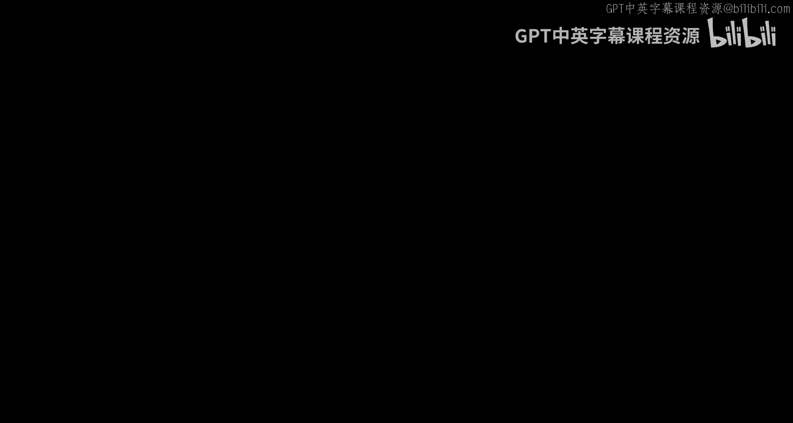
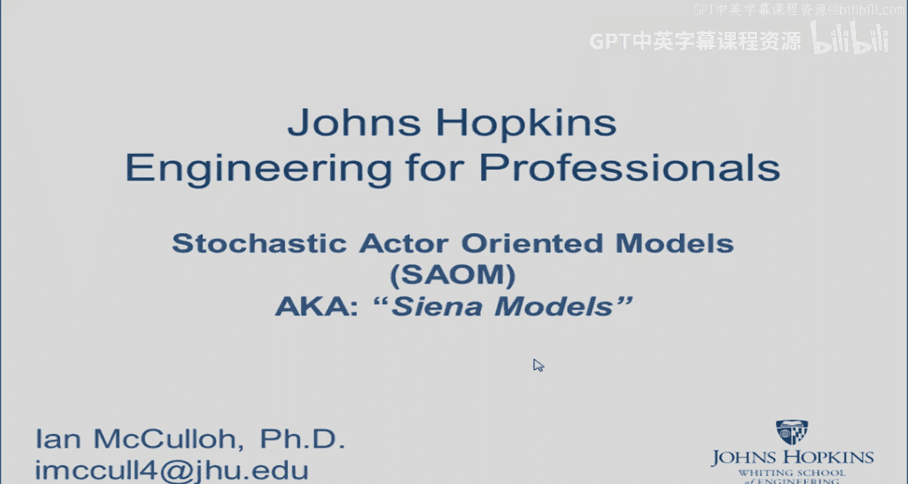

# 约翰霍普金斯大学《计算机科学的统计方法｜Statistical Methods for Computer Science》中英字幕 p87 5_随机导向行动者模型.zh_en -BV1r483zbEzN_p87-

🎼。

。I'm Dr。 Ian McCllough from Johns Hopkins University。

This is a short lecture on stochastic actor oriented models， also known as Siena models。

In this lesson we are going to understand how structural dependence in networks may impact statistical analysis of data we are focusing in this lecture on longitudinal network behavior well also be conducting hypothesis testing of social forces in network using empirical data。

 but we're going to be focused at networks over time at the end we will also construct a stochastic actor model using the RCNA package in R so there is on our script file available to you with a sample data set and we'll be using that in this lecture so I'd encourage you if you haven't done so already to install RCA in our studio on your computer and familiarize yourselves with where the data files are it is the S50 data sets you'll see all the files have an S50 in them。

If you haven't done that， you can at least follow along with the lecture and see what we're talking about with Sina。

 you just won't be able to test it out on your computer without those files。

If you haven't done so already， you need to have R Studio or R on your computer and familiarize yourselves with the CRran Compresive R archiveive network。

So we've used Ergus for cross sectional networks and these are static one single time periods。

 so if you see a network and you're wanting to make some sort of correlation or inference on why nodes might be linked together or what you can describe about that network you would use anerm if however。

 you recognize that there are some sort of multiple time periods in your data。

 if you want to look at how behaviors evolve。based on the network that they're part of or how networks evolve based on certain attributes of actors。

 in that case， you're going to need to move beyond anerm into a stochastic actoroid model。

What we're looking for here is an estimation of the likelihood for a certain network behavioral or network behavior combination and understand that these go grow dynamically so the attitudes and behaviors you're going to implement as a node is going to be based upon the network that you're embedded in the network that you're going to be embedded in is also a function of these kind of attitudes。

 ideas homophily that you'll share between actors and so they kind of grow dynamically and so this is what we're trying to model in a stochastic actor orienter model。

So and that's the idea of coevolution， what is the likelihood that a certain network or behavioral configuration exists at time two as a function of its configuration at time one。

 right， what social forces guide that network？Sttochastic a models make extensive use of Markov chain mono Carlo。

 so Markov chain is kind of like looking at there's different states and what is the probability you would transition from one state to the next state in this case a state might be a particular network configuration。

 what is the likelihood you would transition from one network configuration to the next。The， the。

Mar Monte Carlo piece is that it's basically going to generate a bunch of these and do it over and over and over again so you can kind of create numeric distributions to see what's significant or what's an anomaly。

So we'll generate a series of micro stepss， which are small changes in the network to mimic how the data might evolve from time1 to time two。

In the Sina approach， there are so Sina is a package， social network package。

And it's implemented in R and that's what we're going to use to do this stochastic act oriented modeling。

So in the Si approach， you have to specify an objective function。

 so this is what you're going to specify is the social forces like reciprocity， transitivity。

 etc cetera， that you're going to model so you're saying， hey。

 these are the factors that I think are driving network evolution or the changes from one observed network to the next。

You also must specify the rate function， the rate function is the frequency of behavioral changes or network changes between one time period and the next。

 so this is how many little transitions are going to occur between observed waves of a network。

So we specify these two things。Then what happens inside Sina is it's going to generate hundreds of possible networking behavioral configurations at each step。

 this is the Monte Carlo piece right it's going to compare the generated networks to the empirical one and use a T test calculation and then it's going to do that multiple times and then the average of these T tests over the estimated simulation is going to determine if there is an actual tendency in the data to suggest any of these structural or behavioral processes affecting the network behavioral configuration and change。

So the questions that we're going to ask of a Siena model is， again， why are ties formed？

We might ask how behavior is going to affect the network。

 so I'm using a public health example for this， so we're going to look at smoking and alcohol consumption as well as friendship networks so in this particular case。

Does smoking status predict friendship， right that's a selection or homophily process。

Do birds of a feather actually flock together， does the shared attributes between actors drive selection of friendships？

The other question we'll ask is， do friendship ties predict ones？

Behavior right so do who you become friends with affect your decision to start smoking。

 this is an influence contagion or socialization process。So two slightly different factors here。

 but these are questions we can ask of Sina models。

The dependent variables we're going to be looking at are networks as well as individual attributes。

So there is an assumption that goes into CNN modeling and that is that actors are making a choice regarding their network ties and behaviors based on the state of the network at a given time。

So。The issue that can break a Cna model is an example where multiple ties are being formed or changed at once。

 so a classic example that we have would be chess， so there's a chess example that a colleague of mine Mark Johnson at West Point had done where he modeled chess pieces as nodes in a network and if they could attack the same space on the chess board they were connected。

Well when we went to model that with an actor oriented model。

 we found that it didn't converge what was happening is that when you made a move of one chess piece to a new space on the board。

 it would sever multiple links and add multiple links at the same time。

which was causing a violation of that assumption where actors are making individual choices and the ties that they were making。

 it was making kind of multiple decisions at the same time。

 and C models don't work very well with that， it's assuming that an actor is going to evaluate each tie that they have and make these kind of microde based on some set of parameters that you've specified in your objective function。

U。So it has not been fully explored as to how changes like this might be affected for mass communications。

 like what if you're looking at an email network where you have large distribution lists where you're communicating to many people at the same time or not how do those kind of effect factors or。

Contextual variables affect the ability for a CA model to converge。

 they're open questions that have not been answered。

I bring this up to help you understand what the modeling assumptions are and when you might have problems in that。

The other assumption is that these local rules of how actors make decisions have global impact on structure。

So we're going to get a little more specific into RSna。

 I've included the bottom here of the slide papers that you can use to get more detailed information and the Sina website has also listed down there the example we're going to go through is also the data is also hosted on that website so you can go through and see how they have coded things for the accompanying R script I've basically just made some slight modification to Ruth Ripley's R code that she does。

 she puts exquisite detail in her R script and there's just a ton of information in there we're not going to go through all of it in these slides but I figured it's better to just give you the file with all of her documentation because she does such a nice job with that and then as you make other decisions on what you're going model you can kind of reference that as well and you can go to much more detail with these sites depending on your time and interest。

There are five main steps in RCA， data formatting， specification where you kind of define what's a variable。

 what's an object， the model specification is where you're defining the objective function you're saying hey。

 what are the effects that we're going to be testing？

Then you do model estimation where you actually create the model and run the simulations and then final step is results interpretation we're going to step through each of those and if you take a moment to pause and install packages aa。

Do library RCNA so you can load that into memory and then load the R script that I have for the S50 data set。

 you can kind of follow along what you see in the slides， take a pause on the video。

 run it on your R studio and make sure that you can follow along with what's going on。

Step1 is data formatting so what we're gonna to do is we're going to read in the network data and so what I've done is I've created this object S501D for the data and we're reading the table this is one of the data sets that we have this is the network1 so this is time period1 on this S50 data set by the way S50 is is a group of 50 actors from a a public health study that was done in the west of Scotland there should be word document that gives you some more detail on the background of the data so we're taking 50 actors that occurred in all three of the data sets in a particular school so we have network wave1 wave2 and wave3 for the different time periods that we observed then there's also attribute data sets on alcohol consumption and smoking behaviors that we have and what that does is it shows hey what is their behaviors at time period 12 and3 and there's a scale that you can reference in the word document as well so this first。

here read table is going to take S50 network1 data。

 so this is the data structure for the social network of 50 actors。

 adjacency matrix essentially at time period one。There's no header in this data。

 the separations are a space， and this is just to prevent errorant characters。

The problem I have with this data set when we're loading it is there's a space in the very beginning。

 so it creates this extra column， so in order to get rid of that extra front column I'm just making the S501 as a matrix and I am taking this and just running columns 2 through 51 what this will do is it'll give me a 50 by 50 matrix which is what the input is that I need to have going into RCNA。

I can also do the same thing with waves 2 and3， I'm just going to create a different data set here。

 probably 502， 503 for wave2 and 3， and then of course I would change this file to network2 and network3。

 but you'd change that to whatever data structure you're loading into memory。For the attributes。

 I'm going to do something similar I'm going to read in the alcohol behavior and the smoking behavior。

 and these also have no header。So now what I'm going to do is I'm going to create intuitive names for my data structure。

 so I've got friend data， wave one， wave two， wave three， and then I've got D。

 I'm doing the same trick here where as matrix， I'm chopping off that first blank column and the same thing for smoking behavior as well。

So this is bringing in the data and formatting it into the appropriate form we're now going to move to step two。

There are five kinds of explanatory variables that you may have， one is constant actor covariates。

 these are typically things like race， you know tribal affiliation。

 something about you as an actor that does not change over time。

Varying covariates are time dependent， so like your smoking behavior or your drinking behavior very well。

Will change over time hopefully you know you'll。Smoke glass， drink more， no， I'm just kidding。

 you you'll have some sort of varying variants that are going to be time dependent are going to change over time。

We have the same thing with dyadic covariates， so there's certain constant dyadic covariates that are not going to change。

 like family ties don't change， your brother is your brother for life， right？

There's varying dietic covariates， which might be friendship。

 might be the level of respect between people， might be location。

 might be any number of other variables that are not going to necessarily remain the same over time。

And then composition change indicators we're not going to cover in this。

 that's the fifth category I would refer you to the readings if you want to explore that in more detail。

It's important to note that you need three waves of data for time varying covariates because what we' estimating is not the activity at time1 and at time2。

 but rather the change between time1 and time2。So if you're going to have a varying covariate。

 you need to have at least two things that you're modeling to see change。

 so you need the change between time1 and 2 and the change between time two and three in order to estimate how those varying covariates might have changed in that process。

 so you need three waves of data if you're going to use any of these time varying covariates。

So the way we're going to model that is we're creating a structure here variable called friendshipend。

The command that R is using is Cena dependent， that's case sensitive。

 so you do have to have a capital D there， lowercase letters everywhere else。

 and then the structure you're going to do is array。

 C for concatenate parentheses and notice we put all the three waves of data here。

If I was going to have more waves of data like5 right， then I would just continue that structure。

 right comma friend data W4， comma， friend data， W of5， et cetera along in these parentheses。

 and it's creating a big array， so know the first two dimensions of the array are the adjacency matrix and then there is a different level for every single subsequent time period。

 so it makes it kind of three dimensional array。You also have to tell it what the dimensions are。

 so we hear at Ccateten8 50 by 50 is the dimensions of the adjacency matrix and then there's three time periods。

 so if I added that fourth and fifth I'd have to change that3 to A5。

If I was going to make it 100 node network， so I had 100 by 100 adjacency matrix。

 I'd have to go in here and say 100 comma 100。Smoke1 is going to be a constant covariate so what I'm doing for example here is I'm just basically saying whatever variable you had at time period one for your smoking behavior is just a constant variable that never changes now we know that's not realistic but this is for illustrative purposes so I set that variable as just the first column of that smoke data structure。

We can set drink as a varying covariate， so this is alcohol consumption and there were three time periods。

 so we just say alcohol is this varying covariate of drink。Now notice that these are commands。

 so S1 iss not good enough to just leave smoke comma1 here。

 I have to say to Siena that S1 is a variable that is a constant covariate。

And I tell it then where to get the data for that， but I am defining it as a constant covariate just like for alcohol。

 I'm defining it as a varying covariate。Once I have defined where my networks are and where my variables are。

 I will now say my data is SiA data Cate， that's a command。Kase sensitive， so capital D， capital C。

 everywhere else is lowercase， Friend are the networks， so these are the networks over time。

Smoke1 is the constant covariate and alcohol is the varying covariate okay now you should get an error message if for some reason you don't have variables for time all three time periods for this varying covariate and if you have somehow like messed up the dimensions in doing this data specification step。

OkayI would ask you to pause the video right now and go into R and see if you can load in the R script file。

 load in the data sets， and make sure that they're all working。

 and then go ahead and do the data specification step。

I'm assuming that you have paused the video and you have gone and loaded in the data and done the data specification step。

 so you now have friendship， S one， alcohol all kind of loaded into the Sina data C of my data。

We're now moving into model specification so we have to specify what effects are going to be included in the model now if you run this first command。

 my effects get data， get effects my data， it's going to show you what data is or sorry what effects are included in the restricted model I'm going to ask you to pause the video and just go ahead and execute that command。

So I'm assuming you have positive video and you've executed that command and you've found that there are some basic factors that are included such as out degree and reciprocity。

 if you recall from Sina， the number of edges explains most of the variances in any network model or configurations。

So in an actororient model， instead of looking at the edges。

 we are looking at the out degree of a node， so if you look at the average out degree of a node。

It is equivalent to the density of the network。 So these are very analogous terms。

 but because we're dealing with an actor oriented model。

 rather than just having this ambiguous thing called edges， we're looking at it as the。

Actor property or the out degree of the network， so we want to always include that in any model that you're going to do。

Reciprocity now is going to explain another large portion of the variance， as will a tritic effect。

So let's say we want to add effects。RightBecause maybe you don't have the transitive effects that you're looking for。

So if we go to the next commands here， right again， this is just saying hey， what's currently there。

 it's always good to see what's there。Then we're going to include effects。

 this is how we add effects， so we're going to add transitive triple and a three cycle。

 so I'd like you to pause the video， execute that command and then after you've included the effects。

 run the My effects， get effects line here to see that those have been included。

I'm assuming you've paused the video， you've executed that command。

 and you've satisfied yourself that we have in fact added two additional Tratic effects。

Recall what I said about theerum modeling。We don't want to add multiple tritic effects because they will tend to be highly correlated and that can create some poor model specification as you're going forward so what happens if I want to say。

 hey， this particular model term wasn't that great。

 I want to remove it as a potential effect I didn't show you this you'd be angry with me later because you'd keep adding these terms and you couldn't get rid of them。

So if we want to remove an effect， such as the cycle3 term。

I'm going to say my effects include effects again。I specify where the effects are stored and I'm going to say cycle3 comma include false right and so that's going to remove cycle3 from the MyF model specification。

So at this point I have showed you how to do model specification for your Sina Actctor oriented modeling。

 I'd like you to just pause the video， execute this command so that you are back to having just the restricted model。

 including the transitive triple term。Okay， assuming you've stopped paused the video。

 you've done that， we're going to move on to step four， which is model estimation。

So in estimating a model， you need to initially create an algorithm。

 so we're going to call it my algorithm。And we use this command in Siena Siena algorithm C。

 and we're just going to give it a project name here。

 so I'm basically saying my project name is the S50 underscore three waves of data。

 but you can change that to whatever you wish so we've kind of identified what that is。Okay。Then。

We're just going to redefine the model specification you can look and see get effects to see what you have and what we're going to include is like everything in the kitchen sink so I'm going to include the transitive triple and the cycle3 or three cycle term I'm going to include other effects such as the attributes of ego。

 the alters， an interaction term between the two ego and al terms and then I'm also going to include an interaction of this variable alcohol usage okay。

And you can play around with each of these things what I'm going to ask you to do when we pause here is I'm going to ask you to run a Seattle model with just my effects or you know the restricted model。

 run it with the two extra terms that were should have some covariance to them。

 run it with these additional terms in alcohol covariate and run it with the constant covariate smoke one that we had used and then。

The way you're actually going to estimate the model is with the command down here， answer Siena 07。

Now I don't know why it's Siena 07， I think it's because this was published in 2007 as a package。

 and so I think there was actually like Siena 06， Si05 in like beta version and when they got to the final version。

 they just never dropped the 07， but Siena 07 is the command to execute the model estimation。

You're going to say my algorithm because this is where you're kind of saving it in this project name up here。

The data that you are using is my data， remember we did that in the previous step here where we kind of told it here are the three waves of friendship data and here are the covariates you're going to use。

And then the effects right， the objective function that we're going to be using is going to be specified by my effects。

 which is what you've included up here Okay so you're going to run my effect。

 you can either make this my effect one， my effect2， my effect3， my effect4。

 and then when you run this estimation each time just try the different terms it is。

Another approach to doing that。But what I want you to do is pause the video and go ahead and run the。

The model and then estimate the terms if you prefer we can go on to the next step and I'll go through how to interpret the results and then you can do this part or you can kind of do it first and try and look at the results on your own and see if based on what you learn from the Erum if you can kind of make sense of what the interpretation looks like。

At this point， if you wanted to try it yourself first， I'm assuming you've done that。

 I'm going to move on to the next slide。So step5， this is going to be the results what goes in the model well it doesn't give you a nice little model thing up at the top like anergen would do。

 but what you can see is here are the parameters that were modeled so out degree and reciprocity that came from your restricted model。

 remember we added these terms transitive triples and three cycles。We added smoke similarity。

 that was a term that we had added in there。 We added alcohol alter interaction， alcohol e sorry。

 the alcohol al。 So this is does the behavior of。A connections， alcohol。

 you see usage affect your tie formation。Does egoalter is does the level of your alcohol consumptions affect your choices and the ego alterar is do people like if an actor ego node has a certain alcohol consumption are they looking for people that have similar alcohol usages themselves so is there a homophily test in there？

The rate parameters are giving you an estimate on whether there's significant change between time periods right so does is there you know you might find that there might be significant change over a certain period of time in the network and then that rate parameter changes and becomes non-significant well what that would be telling you is that the behavior of the network is kind of leveling out and is no longer having a lot of dynamic change we can sometimes see that depending on how you've collected data and modeled it that there is certain dynamics that go into a network evolution as a new group is forming and those relationships are kind of like sorting each other out and then you get to a place where if you're asking people friendship over time those friendships may not change very much they may just remain very much the same if you have a very stable group that's not having much change and so that's what you can kind of interpret from the rate parameters。

The way we would estimate all of these terms is you look at the coefficient of the estimate。

Okay and we don't have standard deviation because we don't have an underlying distribution。

 what we have is we have an empirical distribution where you know you kind of run this a bunch of times with Markov chain Monte Carlo。

 and so you have an idea of what this estimate might be under a bunch of different circumstances。

 and so the standard error is kind of like the standard deviation on that empirical data but we call it standard error。

So we can interpret it very much the same so if you are we would say a factor is significant if it is more than two standard errors away from zero right so in this case a standard error of 1。

11 right or a 12 would be，Two point。2，2 or 2。23 if you want to round it if you don't want to truncate。

 round it to there， you know， but let's just say 2。2。Is two standard errors so is 6。62。2 away from 0。

 well let's subtract 6。6 minus 2。2 would be 4。4 yes， that's still far away from zero。In fact。

 we could almost say that this is approximately five or six standard errors away from zero。

 which would indicate that it is highly significant that there was change from period。

From wave1 to wave2， which is rate parameter period1。Okay。

We interpret the parameters in a similar way， and so what we can do is we can highlight the parameters that are more than two standard errors away from zero。

 and this would tell us that these are the factors that are likely to be significant。

So what are we seeing here？Out degree on density is similar to density。

 but the out degree in a real social network should always be significant with a negative coefficient。

If you do not see a significant outeg with a negative coefficient。

 you really must question whether or not you're dealing with real social network data。

People are constrained on their ability to make connections， on their ability to make relationships。

 therefore， the more nodes more links that an actor has。

 the less likely they are to link to other nodes， and so that's what that's modeling。In this case。

 we found that reciprocity is significant and high we found that transitivity is significant and high note three cycles were not significant。

 and the question we might ask ourselves is， is a lot of the variance in transitivity explained by the transitive triples and therefore it doesn't really leave anything for the three cycles to detect？

You would have to run this again where you either have just transitive triples or just three cycles and investigate that for yourself。

We find that smoking similarity is not significant。

We find that the alcohol usage of an individual or a connection is not significant in friendship tie formation。

 however， this ego to alter interaction suggests that maybe the homophily in alcohol usage is significant in the friendship。

 now whether that means that the friendship causes the alcohol similarity or whether the alcohol similarity causes the friendship is another question。

So I would ask you to pause right now and just go through this entire exercise and make sure that you can repeat the results and kind of explore what happens when you go back to this step and you try different effects in your model and try and get an idea of what those are telling you。

So what are the takeaways， the exponential random graph model is really important in that it provides an ability to control for structural dependency when you're doing statistical estimation of a network。

 this is a single static network at time1。Sna is providing you a means to compare selection versus influence so we can go over time now and see hey。

 do behaviors of nodes affect friendship formation。

 do friendship links affect adoption of behaviors so there's a whole lot of applications we can look at in overtime networks and obviously I haven't gone into thorough explanation and explain all of those different ways of doing overtime estimation or all the different features that are in there。

 but what I have done is I've given you a fairly comprehensive R script to begin with so you can start playing around and exploring it I've identified the five steps in building a Sina model I've given you a sample data set that allows you to kind of explore and play around with it and I've given you references to academic papers and the Sina website for additional information additional examples additional datas etc there will also be at the annual social network analysis conference that's held every year and at the north。

American Regional Social Network Conference that's also done in the US every year。

 there are often workshops at the beginning of that conference that gives more details or more instruction on how you can do Errum and CNN modeling they're very popular topics。

 probably about a third of the workshops focus on that in some degree and gives you an opportunity to meet other people that are working on those problems if you would like to get into that area。

And one of the areas where Siena modeling is really， really useful is in public health applications。

 so we're finding that it's so important in selection and adoption practices of health behaviors that it's a very powerful model that's creating great traction。

The problem we have with social media data is that the data can be very。

 very large and because of the computational complexity of a Sina model。

 you can quickly run into issues with the size of networks that you can actually process over time that's going to be a function of how many waves of data you're looking at。

 how many attributes you're going to define on that data structure as well as how large the data sets are I don't think that you would be able to adequately do1 thousand node networks and hire using Sina but that's going to of course change with the power in your computer and the processing power what else you have running in all of those other great things but it's just a warning that you're going to have the biggest trouble with Sina model so if you're trying to do a network that's too big and you're running into problems well it's either something you need to set to run and go to sleep for a while or come back to it the next day or maybe a few days or it's just too big for you to handle。

This has been a short lecture on stochastic actor oriented models also known as Siena models。

 my name is Dr。 Ian McCllough， have a great day。

