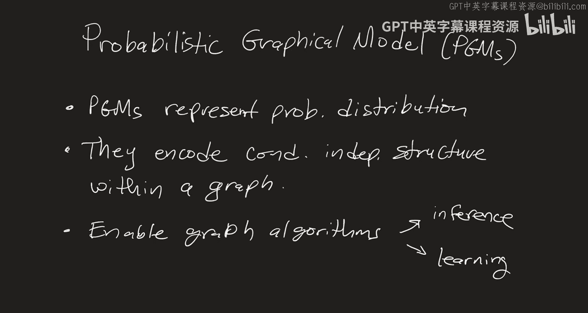
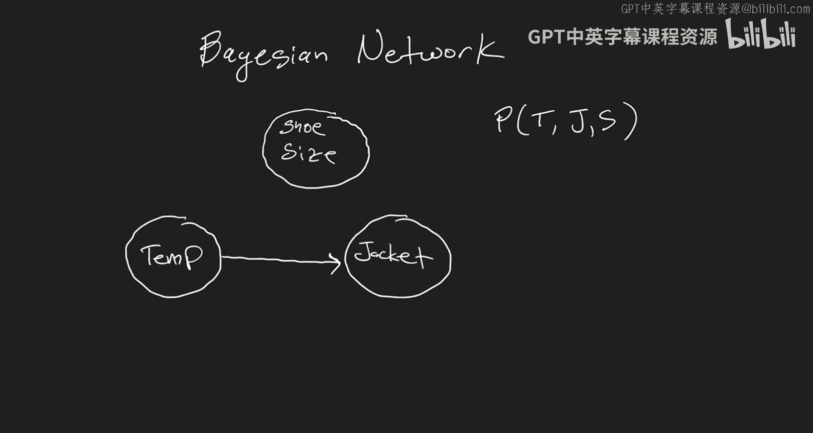
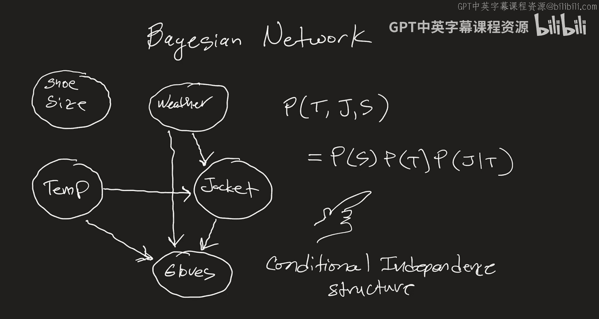

# 约翰霍普金斯大学《计算机科学的统计方法｜Statistical Methods for Computer Science》中英字幕 p88 6_贝叶斯网络.zh_en -BV1r483zbEzN_p88-

Okay， guys， welcome to this this video lecture on。Probabilistic。Graphical models。Or。

What we would call PGMs。For short。And in this lecture， we're going to talk about。嗯。

You know what PGMs are in terms of the fact that we're going to talk about the three things that we want to really look at。

Among other things， in terms of， of as specific examples of PGms is the fact that。PGMs。

They are going to represent。Probability distributions。Now， this is。

This is going to become very important。In the sense that when we look at these probability distributions。

In terms of。How we can represent very complicated distributions in a way。That we can actually encode。

嗯。We're going to be able to encode the conditional independent structure within a graph。

 So we're going to encode the conditional。Independence。Structure。Within a graph。Now。

 this is going to become extremely valuable in the sense that when we look at this structure。

Being able to place it within a graph is going give us。An advantage。

In terms of using computers to help us with complicated。Problems， and basically， this will enable us。

We will。 this will being able to do this will enable us。Graph algorithms。

Which are very already a well established feel and being able to use graph algorithms。

 we can use that for inference， so there are two ways we can use it， we can use it for inference。

And we can also use it for learning。So this is going to be extremely powerful in terms of what we can do。

 how we can use the computer to enable。This process。And。

What we have to basically comprehend here is how these graphical models encode the conditional independent structure。

And once we know that， you're going to see that we can do some very， very powerful things。

Using these probabilistic graphical models。

So let's look at an example of kind of what we're talking about when we're talking about this。

Conditional。Independent structure。So basically， when we're talking about a graph that really is going to encapsulate or encode this conditional independent structure。

 this is what we mean when we talk about a Bayesian。Network。

So let's take a look at examples so suppose we had。嗯。For example。We have。A， let's say。

 the temperature。So we're going to call this node temp。

And we have another node and we'll call this node。Jacket。Okay。And so。

 there is some dependency between。Whether or not。You know， you wear a jacket conditioned on。

UWhether or not。What the temperature is。 And here I want you to see that， as you can see this arrow。

 this arrow goes from temperature。To jacket， and we interpret that as meaning that the probability of jacket。

Is conditioned on。The temperature， so it's P of J probability of jacket given the temperature。Now。

 if there was some other quantity here。That was not。

Let's say that jacket didn't depend on this quantity， for instance。嗯。Maybe we have here。

A quantity that jacket， whether or not you wore a jacket would depend on， would be， let's say。H。

Sho size。So in this case， there would be no arrow between the two because the size of your shoe has nothing to do with whether or not you're going to be wearing a jacket that day。

So you can see there is no。Connection。Here or here。So what makes this。Again。

 a Bayesian network is that。The variables are the nodes and the edges between the variables。

Basically describe the dependencies， and so this is an example of a Bayesian network。Now， ultimately。

 what we're attempting to do。Is to basically。Establish the joint probability space for these three variables。

 And so really we're looking at something like。Pi。OfAnd let's say we're talking about P of T。Comma J。

Coma S。And we're looking at okay， how do we define this joint probability space well this is a in this case。

 this would be a three dimensional space because I have three variables。

You could imagine if we had more than three variables， this hypercue become would quickly become。

Too hard to really， too complex to really calculate。

But what we want to do is we want to look at the conditional independent structure and we want to use that。

To rewrite this probability space in terms of its conditional。Independent structure。 So in this case。

 we would have something like we could say that。Let's。Let's smooth this over here。Okay， so。

Let's see if we can move this without copying it。Doesn't look like it， hold on。Let's move this over。

So we have a little bit of room to right。All right。

 so what we want to do is let's say we can say that this structure then could be equal to something like this。

 this would be so we got T， so we got P。We're going to say the probability of S。The probability。

Now we're going to say probability of T。And then we're going to take the probability。Of now。

 this is going to be。Ze。Given。Qi。So as you can see。In this。Joint probability space here。

We're taking advantage instead of having to list out all the possibilities。

To describe this joint probability space， I can calculate the joint probability based on knowing these probabilities and taking this conditional independent structure。

Okay。This is the conditional。Independent structure。嗯。And I can use that。

To determine what the value for a particular probability in the joint probability space would be。

 and basically as you see again， P of S。Gay has no dependencies。PF T has no dependencies。

 but P ofJ has a dependency on T。Now， I could add。Nots to this network。For instance， if I was to。

Let's say we're going to move this guy。And in doing so。

 I'm going to move this over here and let's say I add a new note。And that note。Okay。

 let's say this node then is going to be weather。Okay。And now。With this node weather。

 this node would have a。Effect on Jack。嗯。We could。Also。Add another node if we wanted to。

 let's say we add another node here， we call it。Gloves。

And certainly gloves could jacket could have an effect on whether or not I'm wearing gloves。

That could also have something to do with the weather。Also。

That could also have something to do with the temperature。So there are a lot of different ways。

 as you can see in which this network could grow。And this is the power。

Of the Bayian network and probability graphical models in general。

 we can again simplify this hyper cube， this hyperspace。

 which is the space of all of our joint probabilities。

Into a network which can be then transmitted or translated or encoded using a computer。

 and we can find these conditional probabilities of these joint probabilities with relative ease。

