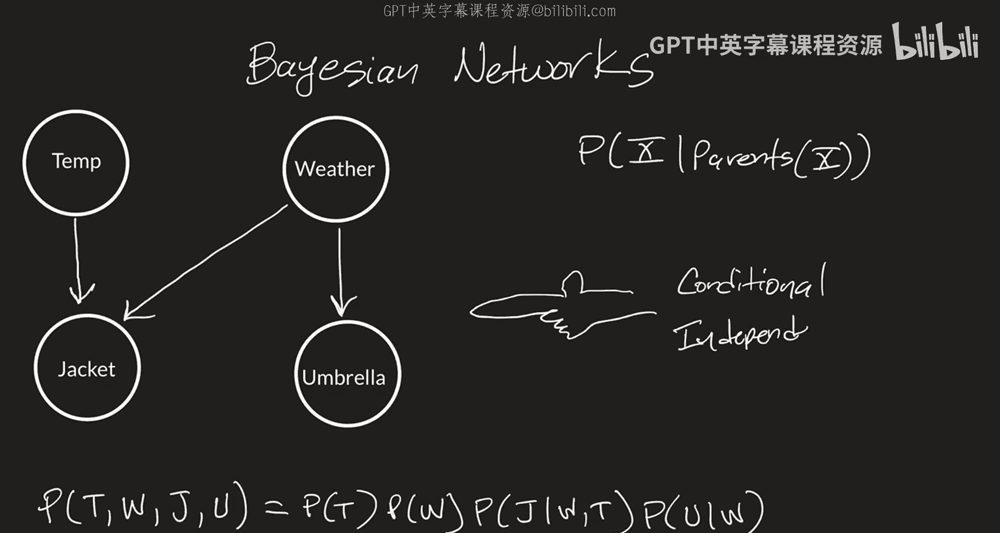
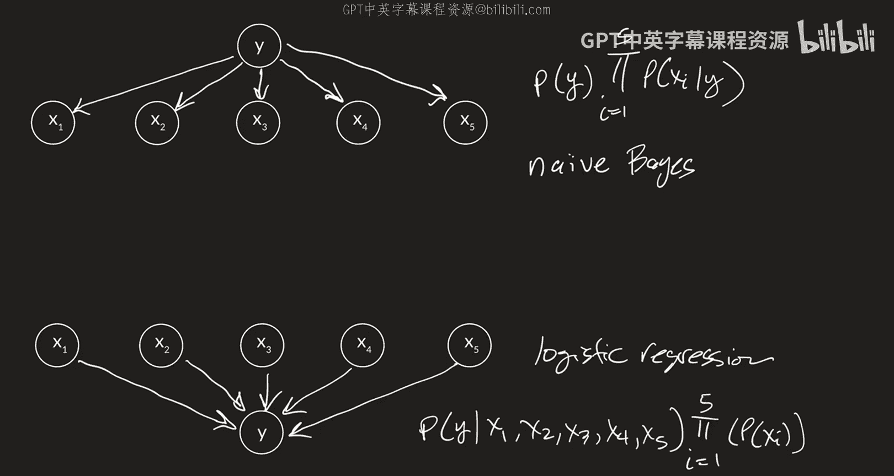

# 约翰霍普金斯大学《计算机科学的统计方法｜Statistical Methods for Computer Science》中英字幕 p89 7_朴素贝叶斯.zh_en -BV1r483zbEzN_p89-

Hi guys。 welcome back。In this lecture， we're going to kind of go into a little bit more detail。

About our Bayesian networks and if you recall from the last example。from the last video。

 this was kind of an example that we put up when we were talking about， you know， jackets。

 temperature， weather and such。And so if we were to look at this particular network。

We can add some edges that would reflect。Our conditional independent structure here。

 So let's just say that whether。That umbrella is conditioned on weather， but so is jacket。

 so well put that there， and then we'll say that temperature jacket is also conditioned on temperature。

Okay， so here we have a structure now。And if we were to write this out， we could say。

That the probability。Of。We're going say we could say T for temperature。Weather。价格。An umbrella。

Is going to be equal to。 And then how would we write this out。

 Well we would have the probability of temperature T。Then we'd have the probability of weather。

And then， we'd have。This probability。It'll be the probability of jacket。Given。Weather。

And temperature。And what do you think the last one would be。Okay， because。

We want a term that represents each node。And their dependency in the graph。So if you were thinking。

 yeah， the probability of U， which is umbrella。Given whether then you would be correct。And so。

Now we have this statement。And really。We really want to hone in on kind of some of the aspects。

That makes this entire process kind of special。So what we want to look at then。

In this kind of special way， this process kind of special。

 What we want to look at then is another way of。Kind of。Viewing。

How we factorize this probability space or these conditional inencies。So basically。

 what we're going to say then we're going to say that the probability。Let's say， of。You know。

 my capex here。Is going to be conditioned。On what we call the appearance。Of Capex。Aha。

 so now let's think about this for a minute。So。When I look at。You know， a particular term。

For instance， when I look at this term。The probability of jacket。Now。Is basically conditioned on。

The appearance in the graph。So your intuition may have told you that before the probability of umbrella。

 is going to be conditioned on its parent。In the graph。

ASo this now gives me a new thing to kind of think about because。If jacket。

Is conditioned on its appearance in the graph。Right。

Then that would mean that if I go beyond the parents in the graph。There is some independence there。

 and I can simplify my calculations by only knowing。嗯。

Who the parents of the know that that is in question and we're going to look at that as well。

So what actually is needed here。In order to really。呃。

Make inferences about what's going on in this particular this particular case， so I mean。

 I have a temperature。Which is。Not dependent on anything。And weather。So we would need margins。

 the marginal probabilities for temperature and weather either way。

 because those two things are independent of any other nodes in the network。Basically。

 these are my parents。Okay， and then jacket would be the child， and umbrella would also be the child。

Notice that there is no dependency between jacket and umbrella。

But our intuition tells us that there is some independence and we're going to talk about how that works。

In in in the。Succeeding videos in this particular module。But， but for right now。

 really want to hone in on。This concept。Of。You know， parents。And children based on nodes。 and。

 and again， you know， we're looking at， you know， this。Structure。For what we call again。Conditional。

Um。This idea， this conditional independence。

So let's take a look。So here。We have。Or what I want to represent are two different Beijing networks。

So this first one， let's draw some edges and this first one we're going to go to here。Here。Here。

Then we're going to come across here。And we're going to come out to here。Okay。

 so this is the first one and this next one on the bottom。

 we're going to actually go the opposite direction so we're going to go here。I'm going to come here。

Here。😔，Here。😔，And here。So what can we say fundamentally about these two Bayesian networks？Well。

There are some interesting。Facts that we want to take into consideration when we look at these two。

I mean， just by observation。We clearly see that。These variables。These variables here， x1 through x5。

 have a single parent， which is y。As opposed to the variable y down here。

 having basically five parents。What that looks like in the probability space is basically we have something like the probability of why it's going to be。

You know， basically， we're going to take。The product。I equals 1 to5 of basically these conditions。

 P of x sub I， given y。Okay。Give him why。Conversely。Down here。

We're going to have something a little bit different。In fact。

 this is going to be a little bit more complicated。Down here， we're going to have， basically。P of y。

Given。Okay。Given is going to be。Except one。Exccept two， except3， except 4， except5。

And then we're going to take the product equals1 to5 of p of xab I。Okay。So。

These two are a lot different， but what does that actually mean？Now， looking at this。And。

Going through your， if you recall your reading。For this module。

 you will quickly notice that this is actually。The naive bays。Representation here。Right in。

What do we have down here Well， this is kind of like。A logistic regression。

Kind of like a logistic regression。Um，Of course， if you know， you know， the naive B in your reading。

 it told you that it was also a cup。Also called I base and because there is an independence assumption that's built in for the variables x1 through x5。

However， naive Bayze is very useful because it's simple。

And so it's utilized a lot of times in classification problems and such。The naive Bay's approach。嗯。

Here。Is going to be much more simpler to implement than the bottom approach。

And so let's just think about it。嗯。This is the Bayesian。You know。

 this is the simplest Bayesian representation。And basically， like I said before。

 the children here only have one parent。Okay， as opposed to this child having five parents。

 and so the probability space here of calculating the one probability on five conditions is enormous。

 it is ginormous。As opposed to having each of the children only conditioned on the one parent。

 And so this is a simplification。 Bayesian networks are going to。Basically。

 be a generalization of this。And this generalization is going to be predicated on what we call before this idea of conditional independence。

Now， one of the things that you want to keep in mind is there are naive Bay models and those models are useful。

In their place， we certainly wouldn't use a naive Bay approach on every model。

 but the generalization of naive Bays to。Or Bayian networks too。Involving， let's say。

 more than one parent。Is is there， but we want to be careful about how we actually have， you know。

 the child and the parent relationship。And that's something that we're going to explore as well but again。

 it's all related to what we talked about as structure and so in your reading it goes into great detail explaining how we use the conditional independence assumption。

To produce a very compact representation when you have these high dimensional probability distributions。

