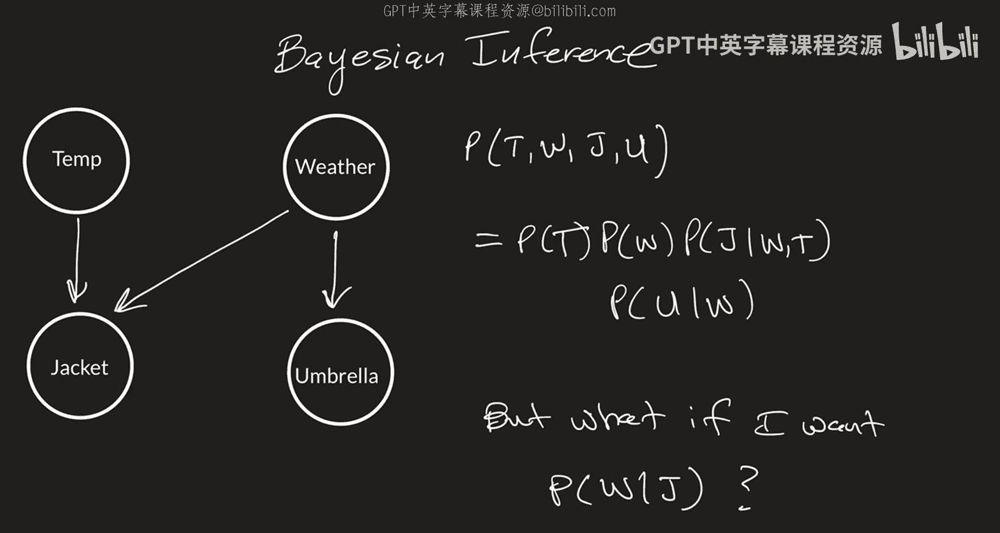
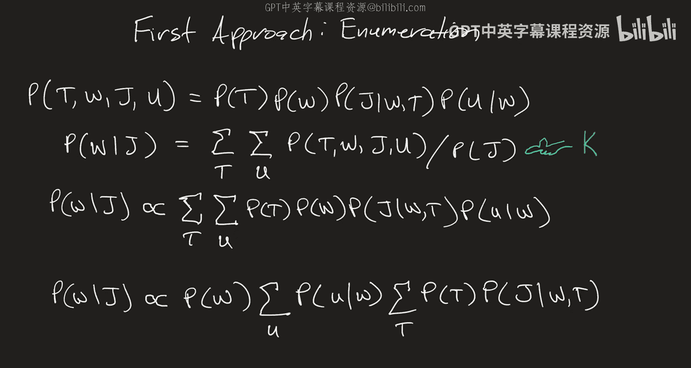
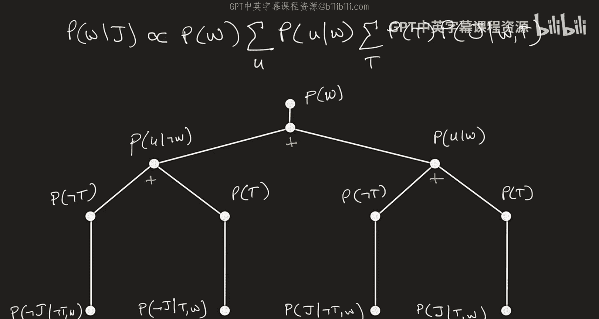
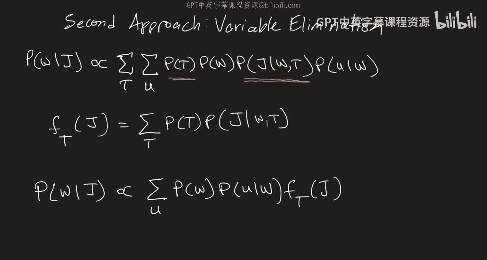
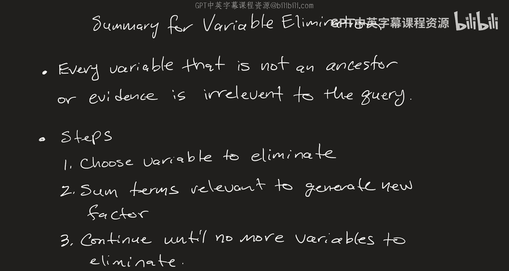

# 约翰霍普金斯大学《计算机科学的统计方法｜Statistical Methods for Computer Science》中英字幕 p91 9_贝叶斯推断.zh_en -BV1r483zbEzN_p91-

Okay， in this video we're going to be talking about。Baesian inference。And so as you can see。

 this is the problem that we had before。 And you notice I have these variables。

 I've got the temperature。 I've got the weather。The fact of whether or not you're wearing a jacket。

 and then we're looking at the umbrella here， right？

And so if I wanted to kind of look at the joint probability of all these variables listed here as T W。

 J and U。 then what I'm going to be looking at is， again。

 the structure that's given in the Bayesian network。And factored out。

 I have the probability of T times the probability of W。

Then I have the probability of wearing a jacket， given the weather and temperature。 And then finally。

 I have the probability of carrying an umbrella， given the weather。Now， all of these are。Are good。

 And， and， and this is definitely the the joint probability。

 hyperspace or hypercube that we're actually dealing with。But in terms of inference。

What if I want to know， given。That the weather is a certain。Thing。

Or what is the weather given that you observe that I am wearing a jacket。Oh。

 that I'm not wearing a jacket。 Basically， what is the weather。Given。😔，A jacket。Now。

 that is going to be。A different type of question。 And this is where baysnets really come into their own in terms of their usefulness。

So let's look at a couple of approaches here， we'll actually look at this from two points of view to approaches。

The first approach we're going to look at is this approach where we're talking about enumeration。

 So if we start with。嗯。What we had is our joint probability space here。Then if we。

 if we go ahead now and we look for the probability of the weather， given the jacket。

That's going be a double sum over all the T and U variables that are not。Represented here。

And so that's going to give me a sum over temperature and a sum over umbrella。

And it's going to be divided by the jacket。So here is the joint probability。

And here is divided by jacket。This is just the definition of conditional probability。However。

 what we want to do here is we want to go ahead and simplify this。

 And so maybe I'm not looking for the probability， but I'm looking for a probability that is going to be proportional。

 And so if I'm looking for something that's proportional。

 I'm looking for the probability that's going to be proportional。

 then here is where I'm going to be looking at something like。This， where I have this key。

And if we let this P of J be just some K， then this now becomes basically a proportionality constant。

And as a proportionality constant now， I'm going to remove the equal sign here。

I'm going to multiply both sides by this K value。 And so now what we're looking at is we're looking at。

I'm looking for the probability that's proportional now。 And so now， as you can see。

 what I've written here is just simply the definition。Which is up here。Okay。

 so I don't want you to think that something weird is going on。 and that's why。

I'm going to be using the proportionality symbol， as opposed to the equal symbol。All right。

 so now what we're going to do is we want to separate out。All values that basically， do not have。

A T or U dependence。And clearly， we can see that this value， P of W。

Has no you and has no T dependence。 And I rewrite it this way。

We could now take our proportion， and we can enumerate it。As a kind of tree here。

And so we see we have starting off with P of W。And so P of W is going to be here。

And given whether or not we're talking about。A negative W， because these's a， let's say， binary。

 you see the。Yes or no or something like this， but I know that's kind of。Not intuitive。

 but let's just say that it is a binary。嗯。We good。I mean， yeah， weather bad。

Whether good or something like that， right， that takes you down a different branch。

 And so we go from here。To the first level。And then from here we go to the next level。

 which is P of T， and so in this case， because I have two branches， I got P of not T。P of T。

Pea of not tea。MPFT。And then finally， we get down to the final。

And the final here is going to be taken into consideration。P of not J given， not T and W。

P of not J given。T and W， P of J given not T and W and P of J given T and W。

 and so basically through enumeration， if I want to find the probability that's proportional to the weather given a jacket。

 then I would simply multiply，Id follow my branch， right， I'd follow my branch all the way through。

And summing over these terms following my branch。Is how I would enumerate。

Now you can see that this would be rather challenging。If you had， more variables here。

But this is just a small example of how you would actually go about and do this。

So keeping in mind that， you know， we might want to make a note that。At these points。

 this point here。🤢，We're going to be summing。We're going to be summing here。

And we're going to be summing here。we make the point that these are the places where we're going to be summing and we're going to be summing over all the possible values。

 so we're going to be summing， we're going to take P of w and then we're going to be summing over all the possible values of P given W。

 I mean if P of U， given W。And then when we get down， so that would be kind of the first you know。

 wave all the possible values of U given W， we're going to sum there。

 and then again we're going to sum here and here the same way。

Well， let's now look at a second approach。To。This to determining the probability that's proportional to the weather given that you have a jacket。

 and in this case we're going to use this thing called variable elimination。

Variable elimination and this approach you count on really looking at。

Almost the same thing except you going to， there is a systematic way depending on the structure。

Of your。Beijian network。Whereby this could be more advantageous。So remember we had this term。

 so just think of this term actually could be actually removed and set outside because we see that there is no T or u dependence here。

But really， what I want to do is I want to now look at all values of T。

And I want the terms that have a T dependence， and so as you can see。

 what I want to do is I basically want to create a function。This is going to do this summing for me。

Overall， the possible values of T， so I'm looking for where there's T dependence。

And so in this case I have these two terms in t dependence and I'm going to substitute a function of J。

 so you input a J。Right。And。This function will calculate the summing over all T。Right。And so。

This is very useful because now this proportion。Becomes just one summation here。

So I'm only summing the one time and notice I'm not even summing。Over P of W。

RightSo this is going to be P of w because I can pull this out and P of w is going to be multiply。

By the sum of P of U given W for all you。And then it's going to be multiplied by this function。

So that's a very nice way to simplify something that could be extremely complicated in other terms。

 but we can use this variable elimination。To kind of make it simpler to find those or to make those inferences about things that are not specifically given in the problem。

And so to summarize， you know， variable elimination here。

 it's really two things that we want to kind of look at， I want to talk about。

The first one is that every variable that is not an ancestor or an or evidence。

Is you really going to turn out to be irrelevant to the query， And you can see that when you。

 when you do the math， you'll find that if it's not an ancestor。

And it's not providing evidence to your query， then the variable is irrelevant。Okay。

The steps involved in actually doing verbal elimination are not hard。Okay， first。

 you're going to choose the variable that you want to eliminate。Next。

 you're going to sum terms that are relevant。To generate a new factor。

 and that's where you come in with that new function。

You sum the relevant terms to create that new factor。

You're going to continue this process until there are no more variables to eliminate and what you find is that factors will roll up into other factors。

 and as you continue the process， variables will begin to be eliminated until you get down to something that's very simple to calculate and that process will provide inference in terms of things that are not provided a priori that you can calculate and you can infer from the variables that you have at your disposal。

We're going to look at some of these and we're going to see how doing this in R makes inferencefr in all of these things that we've talked about so far。

 so much simpler and a lot more intuitive in terms of actually doing analysis on your data。

