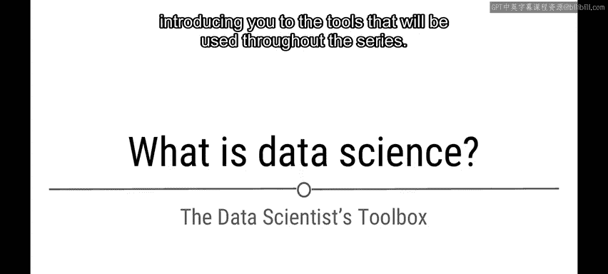
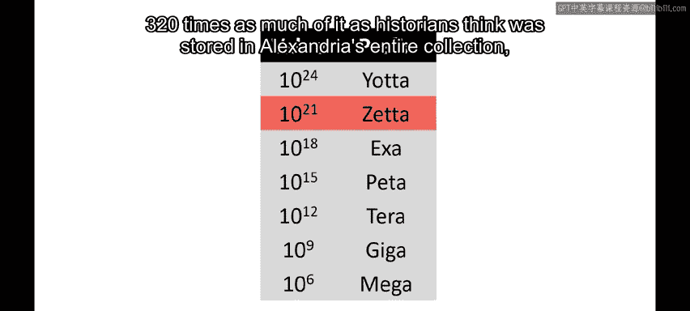
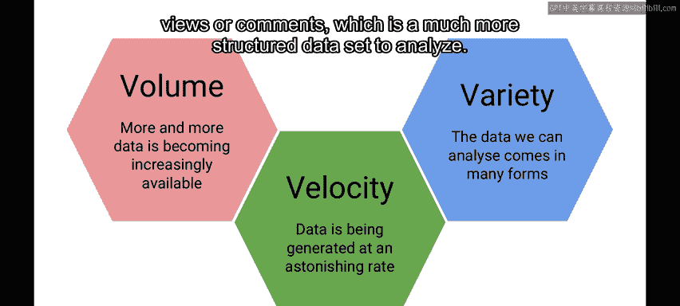
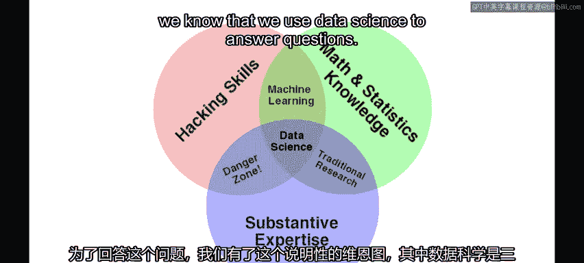
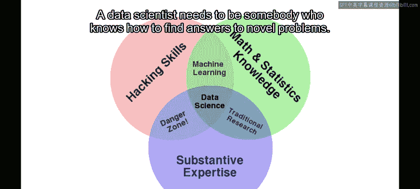
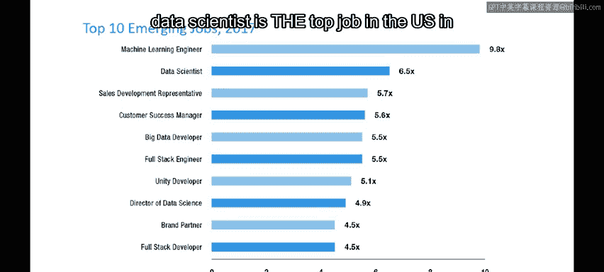
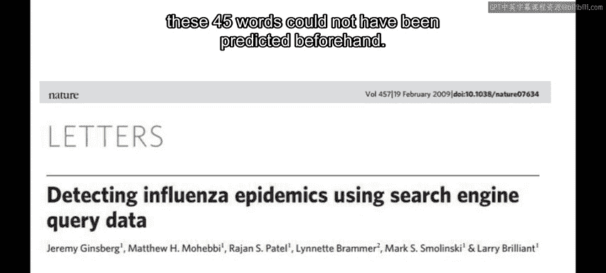
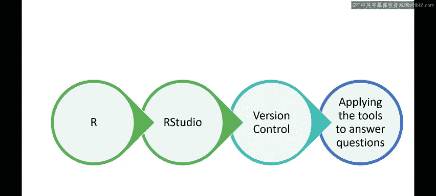

#  002：什么是数据科学？ 🤔

在本节课中，我们将要学习数据科学的基本概念，了解其核心定义、兴起背景、关键特征以及数据科学家所需的技能。我们还将探讨数据科学的应用领域和市场需求，并简要介绍本系列课程的学习路径。

---

## 什么是数据科学？ 🎯

数据科学的核心是**使用数据来回答问题**。这是一个非常广泛的定义，因为数据科学本身就是一个广阔的领域。它可能涉及统计学、计算机科学、数学、数据清洗与格式化以及数据可视化。

《经济学人》的一份特别报告很好地总结了这种技能组合，报告指出：**数据科学家被广泛定义为结合了软件程序员、统计学家和故事讲述者/艺术家技能的人，他们从海量数据中挖掘出隐藏的宝贵信息**。通过本系列课程的学习，希望你最终能掌握这些能力。

---

## 数据科学的兴起：数据与计算的完美风暴 ⚡

数据科学近年兴起的原因之一，是目前可用和正在生成的数据量极其庞大。不仅关于世界和我们生活的方方面面正在收集海量数据，同时廉价计算能力也在崛起。这创造了一场“完美风暴”：我们既拥有丰富的数据，也拥有分析它的工具。

计算机内存容量提升、处理器性能更好、软件更丰富，以及越来越多掌握技能的数据科学家，使得利用这些数据来回答问题成为可能。有一个小故事描述了数据生成的指数级增长：公元前三世纪，亚历山大图书馆被认为收藏了人类知识的全部总和。而今天，世界上的信息量足以让每个在世的人拥有的信息，是历史学家估计的亚历山大图书馆全部馆藏的320倍，并且这个数字仍在增长。

---

## 大数据简介 📊

我们将在后续课程中更详细地讨论大数据，但在此有必要进行介绍，因为它对数据科学的兴起至关重要。大数据有几个特征：

以下是定义大数据的三个关键特征：

1.  **体量**：顾名思义，大数据涉及大型数据集，这些大型数据集正变得越来越普遍。例如，如果你想研究在线视频，YouTube每分钟大约有300小时的视频被上传。你将有大量数据可供分析，但也可以看出处理所有这些数据可能是一个难题。
2.  **速度**：数据生成和收集的速度比以往任何时候都快。在YouTube的例子中，新数据每分钟都在产生。另一个完全不同的例子，如果你有关于运输时间或路线的问题，大多数运输卡车都有实时GPS数据。如果你具备相应的工具和技能，就可以实时分析卡车的移动。
3.  **多样性**：在我提到的例子中，你可以接触到不同类型的数据。在YouTube的例子中，你可以分析视频或音频（这是非常非结构化的数据集），或者你也可以分析视频时长、观看次数或评论的数据库（这是更结构化的数据集）。

---

## 数据科学家是谁？ 🔍

我们已经讨论了什么是数据科学以及它处理的数据类型，但我们还需要讨论数据科学家究竟是什么。最基本的定义是：**数据科学家是使用数据来回答问题的人**。但更重要的是，数据科学家需要具备哪些技能？

为了回答这个问题，我们参考下面这个说明性的维恩图，其中数据科学是三个领域的交集：**领域专业知识、编程技能以及数学和统计学知识**。

我们来解释一下这意味着什么。我们知道数据科学用于回答问题，因此首先我们需要对我们想要提问的领域有足够的专业知识，以便提出我们的问题，并知道哪些类型的数据适合回答该问题。一旦我们有了问题和合适的数据，从数据科学处理的数据类型来看，数据通常需要经过大量的清洗和格式化，这通常需要计算机编程/黑客技能。最后，当我们有了数据，我们需要分析它，这通常需要数学和统计知识。

在本专业课程中，我们将花一些时间关注这三个领域，但我们将主要侧重于数学和统计知识以及编程技能。对于编程技能，我们将重点教授两个不同的部分：计算机编程（至少是使用R语言进行编程），这将使你能够访问数据、处理数据、分析数据和绘图。此外，我们将重点让你学习如何寻找编程问题的答案。数据科学家需求旺盛的原因之一是，大多数问题的答案并未在教科书中预先列出。数据科学家需要知道如何找到新问题的答案。

---

## 数据科学家的市场需求与多样性 💼

说到需求，市场对具备数据科学技能的人才需求巨大。根据LinkedIn的数据，机器学习工程师、数据科学家和大数据工程师是2017年新兴的顶级职位之一，但需求远远超过供给。报告指出，自2012年以来，数据科学家职位增长了650%以上，但目前美国只有35，000人具备数据科学技能，而成百上千的公司正在招聘这些职位，甚至包括零售和金融等你可能意想不到的行业。这些职位的候选人供应无法满足需求。

现在是进入数据科学领域的好时机。我们不仅拥有越来越多的数据，以及越来越多的收集、存储和分析工具，而且数据科学家的重要性在众多不同领域（不仅仅是商业和学术界）日益得到认可。此外，根据Glassdoor的排名（基于工作满意度、薪资和需求），数据科学家是2017年美国最佳工作第一名。

数据科学应用的领域多样性可以通过数据科学家的例子来体现。一个我们可能不会立即意识到数据科学需求的领域是体育。达雷尔·莫雷是美国篮球休斯顿火箭队的总经理。尽管没有深厚的篮球背景，莫雷凭借其计算机科学学士学位和麻省理工学院的MBA学位获得了总经理的职位。他被选中是因为他收集和分析数据并据此做出明智招聘决策的能力。

另一个你可能听说过的数据科学家是希拉里·梅森。她是Fastforward Labs（一家最近被数据科学公司Cloudera收购的机器学习公司）的联合创始人，并且是Accel的驻场数据科学家。她广泛地利用数据来回答关于网络挖掘以及理解人类通过社交媒体互动方式的问题。

最后，内特·西尔弗是当今世界上最著名的数据科学家/统计学家之一。他是FiveThirtyEight网站的创始人和主编，该网站使用统计分析、硬数据来讲述关于选举、政治、体育、科学、经济和生活的引人入胜的故事。他利用大量完全免费的公共数据对各种主题进行预测，最著名的是预测美国选举的获胜者，并且拥有非常出色的准确记录。

---

## 数据科学实例：谷歌流感趋势 🦠

数据科学应用的一个很好的例子来自2009年。当时谷歌的研究人员分析了五年内5000万个常用搜索词，并将其与美国疾病控制与预防中心关于流感爆发的数据进行比较。他们的目标是观察某些搜索是否与流感爆发同时发生。数据科学和使用大数据的好处之一是能够识别相关性。在这个案例中，他们发现了45个与CDC流感爆发数据高度相关的词汇。利用这些数据，他们能够仅根据常见的谷歌搜索来预测流感爆发。如果没有这些海量数据，这45个词是无法事先预测的。

---

## 本课程内容概览 📚

现在你已经对数据科学有了初步了解，接下来需要总结的是我们将在本课程中教授的内容。

首先，我们将介绍R语言的基础知识。R是我们在本课程中将使用的主要编程语言，因此扎实理解它是什么、如何工作以及如何在你的计算机上安装它是必须的。

接着，我们将过渡到RStudio，这是一个非常友好的R图形界面，应该能让你的工作更轻松。

然后，我们将讨论版本控制，包括它为什么重要以及如何将其整合到你的工作中。

一旦你掌握了所有这些基础知识，你就可以准备好应用这些工具来回答你自己的数据科学问题了。

期待与你一起学习，让我们开始吧！

---

## 总结 ✨

本节课中，我们一起学习了数据科学的核心定义——**使用数据回答问题**，并探讨了其兴起的背景（数据爆炸与廉价计算）。我们了解了**大数据**的三个特征：**体量、速度和多样性**。数据科学家被定义为**领域知识、编程技能和数学统计知识**的交集，市场需求巨大且应用领域广泛。最后，我们预览了本课程将学习的工具：**R语言、RStudio和版本控制**，为后续的实践打下基础。