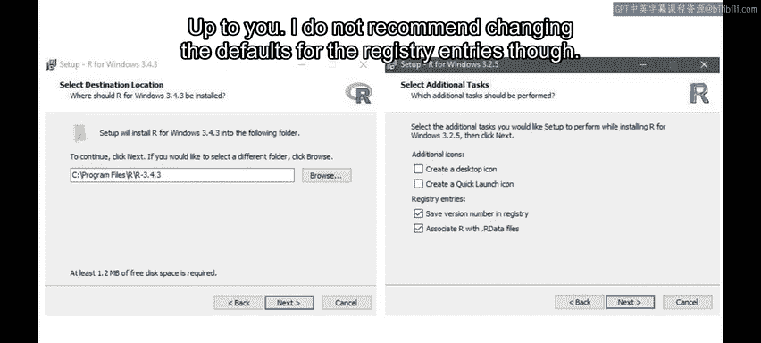
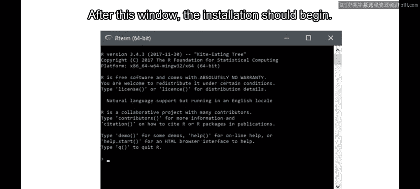

#  006：安装R 🛠️

在本节课中，我们将学习如何安装R。R是数据科学领域一个核心的编程语言和环境，主要用于统计分析和图形绘制。我们将首先了解R是什么以及为何要使用它，然后详细介绍在Windows和Mac操作系统上的安装步骤。

---

## 什么是R以及为何使用它？ 🤔

上一节我们介绍了数据科学家的角色和寻找答案的方法。本节中，我们来看看数据科学家的一个核心工具——R。

R既是一种编程语言，也是一个专注于统计分析和图形绘制的环境。它将是您在本课程及后续课程中使用的主要工具之一。

以下是您可能想要使用R的几个关键原因：

*   **流行度与标准**：R正迅速成为统计分析的标准语言。越流行的软件，其新功能开发越快，功能越强大，社区支持也越好。此外，下图显示，掌握R是数据科学家职位要求中排名前五的技能之一。
*   **免费开源**：R的所有方面均可免费使用，这与一些商业统计软件（如SAS或SPSS）不同，不存在使用成本障碍。
*   **功能广泛**：R是一种非常通用的语言。除了统计和绘图，其功能还可扩展到许多不同领域，例如制作网站、使用GIS数据制作地图、分析语言，甚至制作本课程这样的讲座视频。下图展示了一张用R制作的欧洲人口点密度地图，每个点代表50人。通常，您能想到的任务，都有现成的**R包**可供下载安装。
*   **活跃的社区**：围绕R已经形成了一个强大的社区。个人和团体不断开发新的R包来扩展其功能。对于R初学者来说，这个社区是一个巨大的优势。由于其流行度，存在多个专门讨论和解决R问题的论坛，这在“获取帮助”课程中已讨论过。

---

## 如何安装R？ 💻

现在我们已经了解了R的优势，是时候安装它了。我们将分别介绍Windows和Mac系统的安装指南。请注意，这些是一般性指导，具体细节可能会随软件更新而变化，请以此作为安装框架。

R从**综合R档案网络（CRAN）** 下载。虽然这可能是您第一次接触CRAN，但在后续安装R包时，我们会经常回到这里。

### 在Windows上安装R

1.  **访问CRAN主页**：打开浏览器，访问CRAN官方网站。
2.  **选择下载**：点击“Download R for Windows”链接。
3.  **选择安装包**：如果是首次安装，请点击“base”分发版，然后点击页面顶部类似“Download R [版本号] for Windows”的链接。这将下载一个可执行（`.exe`）安装文件。
4.  **运行安装程序**：打开下载的`.exe`文件。如果出现安全警告，请允许运行。
5.  **跟随安装向导**：
    *   选择您偏好的安装语言。
    *   同意许可信息。
    *   **选择安装位置**：通常会默认到 `C:\Program Files\R\R-[版本号]`。除非有特殊原因，否则使用默认位置即可。
    *   **选择组件**：除非磁盘空间紧张，否则建议安装所有组件。
    *   **启动选项**：使用默认设置即可。
    *   **选择开始菜单文件夹**：这完全取决于您。您可以允许创建开始菜单链接，也可以勾选底部“不创建开始菜单文件夹”的选项。
    *   **创建快捷方式**：选择是否创建桌面图标或快速启动栏图标。**注册表项**的默认设置不建议更改。
6.  **完成安装**：点击“安装”后，安装过程将开始。
7.  **验证安装**：安装完成后，首次打开R程序，测试安装是否成功。

### 在Mac上安装R

1.  **访问CRAN主页**：打开浏览器，访问CRAN官方网站。
2.  **选择下载**：点击“Download R for (Mac) OS X”链接。
3.  **选择版本**：在此页面找到可供下载的各个R版本。**注意**：如果您的Mac系统早于OS X 10.6 (Snow Leopard)，则需要按照此页面说明下载与旧操作系统兼容的R版本。
4.  **下载安装包**：点击最新版R的链接，将下载一个`.pkg`文件。
5.  **运行安装程序**：打开下载的`.pkg`文件，按照安装程序的提示操作。
6.  **跟随安装向导**：
    *   在“欢迎”页面点击“继续”。
    *   在“重要信息”页面再次点击“继续”。
    *   阅读并同意软件许可协议。
    *   **选择安装位置**：可能会被询问是“为所有用户安装”还是“为特定磁盘安装”，请根据您的设置选择最合适的选项。
    *   **开始安装**：R会选择一个默认目录。如果对该位置满意，请点击“安装”。
7.  **输入密码**：此时可能会提示输入管理员密码，输入后安装将开始。
8.  **验证安装**：安装完成后，前往“应用程序”文件夹找到R。首次打开R程序，测试安装是否成功。

---

## 总结 📝

本节课中，我们一起学习了R的基础知识及其安装方法。

我们首先探讨了**R是什么**——它是一种用于统计分析和图形的编程语言与环境。然后，我们列出了使用R的四大理由：**流行度高、免费开源、功能广泛**以及拥有**活跃的社区支持**。

接着，我们详细讲解了在**Windows**和**Mac**操作系统上安装R的**分步指南**。关键步骤包括访问CRAN官网、下载正确的安装文件、跟随安装向导进行操作，并在最后验证安装是否成功。

在进入下一讲之前，请确保您已正确安装R并能成功打开它。

