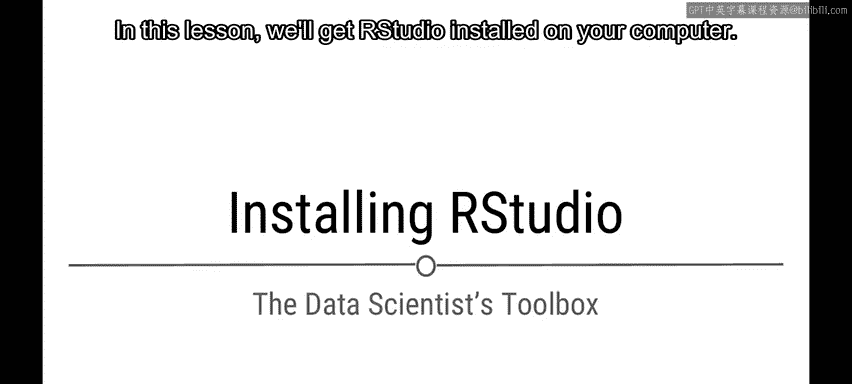
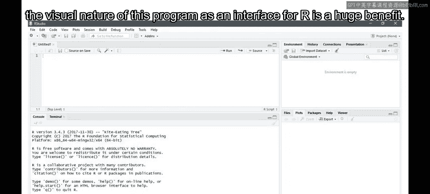
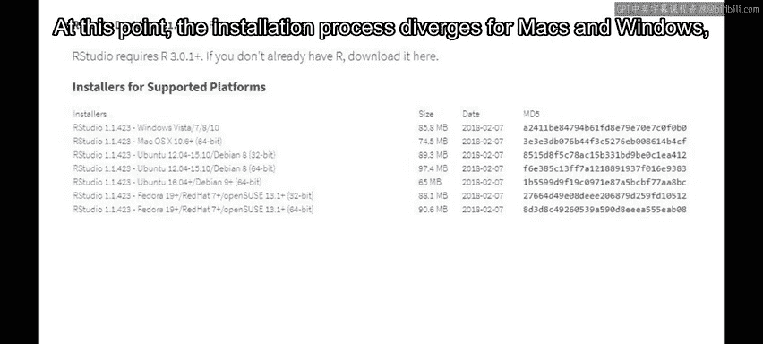
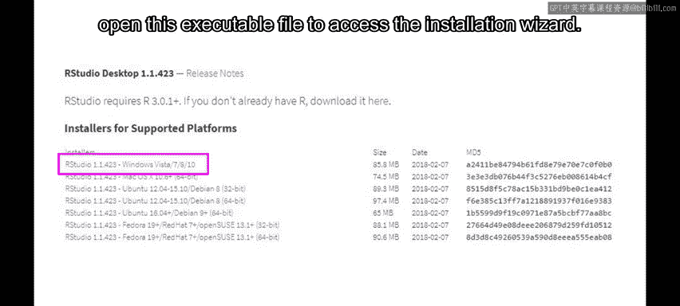
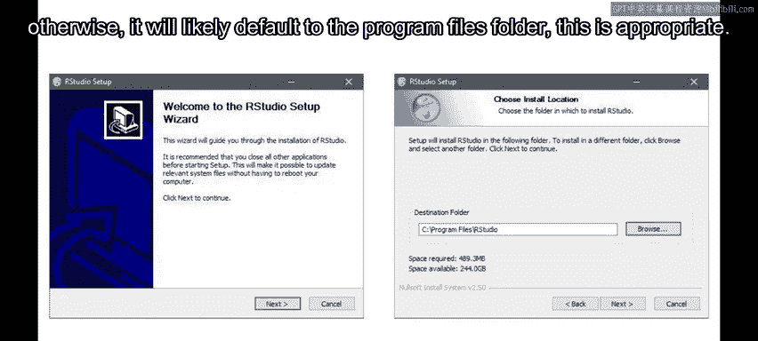
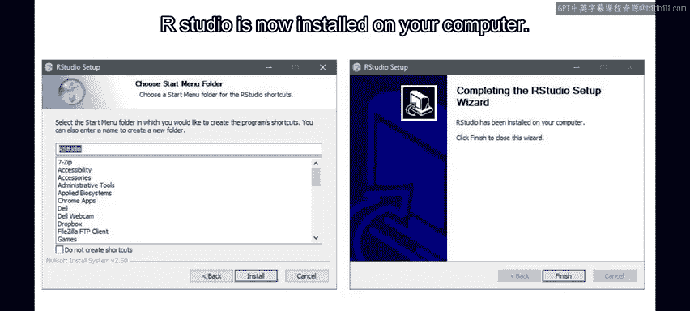
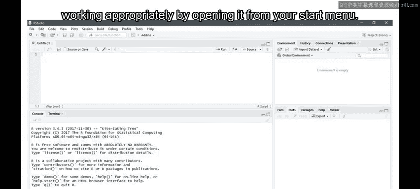
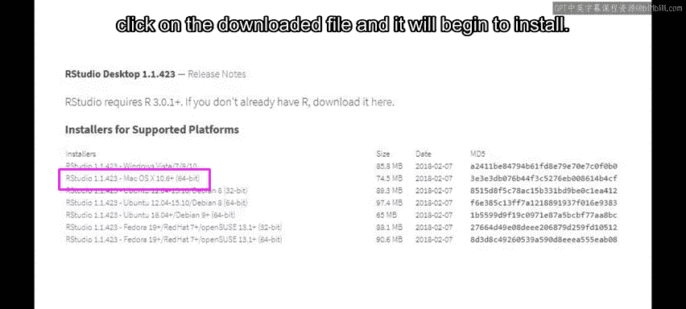
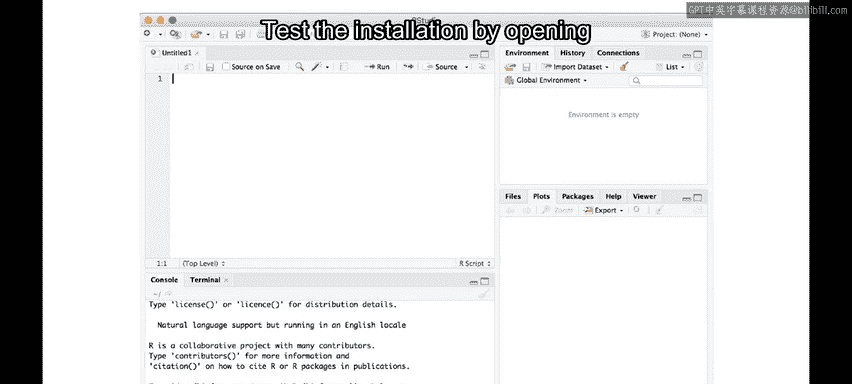
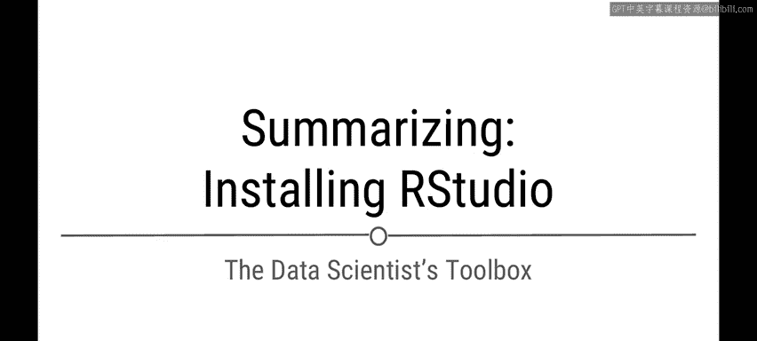

#  007：安装R Studio 🖥️

在本节课中，我们将学习如何安装R Studio。R Studio是一个强大的图形用户界面，用于编写、编辑和运行R代码。通过安装R Studio，你可以更高效地进行数据分析和可视化工作。

---

我们已经安装了R，并且可以通过R界面输入代码。但是，还有其他方式可以与R交互，其中一种方式是使用R Studio。在本节中，我们将在你的计算机上安装R Studio。

R Studio是R的图形用户界面，它允许你编写、编辑和存储代码，生成、查看和存储图表，管理文件、对象和数据框，并与版本控制系统集成。在未来的课程中，我们将详细探讨R Studio的功能。对于刚开始学习R编程的人来说，R Studio作为R的视觉界面具有巨大的优势。

---

## 安装步骤概述 📋

R Studio的安装过程相对简单。以下是安装R Studio的基本步骤，我们将分别介绍Windows和Mac操作系统的具体安装方法。

以下是安装R Studio的主要步骤：

1.  访问R Studio下载页面。
2.  选择适合你操作系统的安装程序。
3.  按照安装向导完成安装。
4.  验证安装是否成功。

---

## Windows系统安装指南 🪟

对于Windows用户，安装过程如下。首先，你需要下载适用于Windows的R Studio安装程序。

以下是Windows系统的详细安装步骤：

*   **步骤1**：访问R Studio下载页面，在“RStudio Desktop”标题下点击相应的下载链接。
*   **步骤2**：选择适用于Windows各版本（Vista、7、8、10）的R Studio安装程序，开始下载。
*   **步骤3**：下载完成后，打开可执行文件以启动安装向导。如果出现安全警告，请允许其对计算机进行更改。
*   **步骤4**：安装向导打开后，按照默认设置逐步进行。在欢迎界面点击“下一步”。
*   **步骤5**：如果需要更改安装位置，可以浏览文件系统进行选择；否则，默认安装到“Program Files”文件夹即可，然后点击“下一步”。
*   **步骤6**：在最后一步，允许R Studio创建开始菜单快捷方式，然后点击“安装”。
*   **步骤7**：等待安装过程完成。安装完成后，点击“完成”。
*   **步骤8**：从开始菜单打开R Studio，检查其是否正常工作。

---

## Mac系统安装指南 🍎

上一节我们介绍了Windows系统的安装，本节中我们来看看Mac系统的安装步骤。Mac用户的安装过程略有不同。

以下是Mac系统的详细安装步骤：

*   **步骤1**：访问R Studio下载页面，选择“Mac OS X R Studio installer (Mac OS X 10.6+, 64-bit)”以开始下载。
*   **步骤2**：下载完成后，点击下载的文件，开始安装。
*   **步骤3**：安装完成后，“应用程序”窗口将打开。将R Studio图标拖拽到“应用程序”目录中。
*   **步骤4**：打开“应用程序”文件夹，启动R Studio软件，以测试安装是否成功。

---

## 总结与下一步 🚀

本节课中，我们一起学习了如何在Windows和Mac计算机上安装R Studio。在进入下一讲之前，建议你点击R Studio中的可用菜单，稍微探索一下这个软件。我们将在后续课程中专门介绍R Studio的详细功能，但事先熟悉一下界面会很有帮助。