#  009：R包 📦

在本节课中，我们将要学习R语言中一个核心且强大的特性：**R包**。我们将了解什么是R包、如何查找、安装、加载和管理它们，以及如何利用包中的函数和文档来扩展R的基础功能。

---

## 概述：什么是R包？

上一节我们介绍了R和RStudio的基本安装与协作。本节中我们来看看是什么让R如此特别——**R包**。

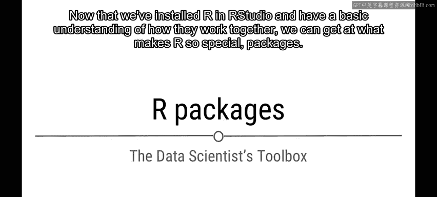

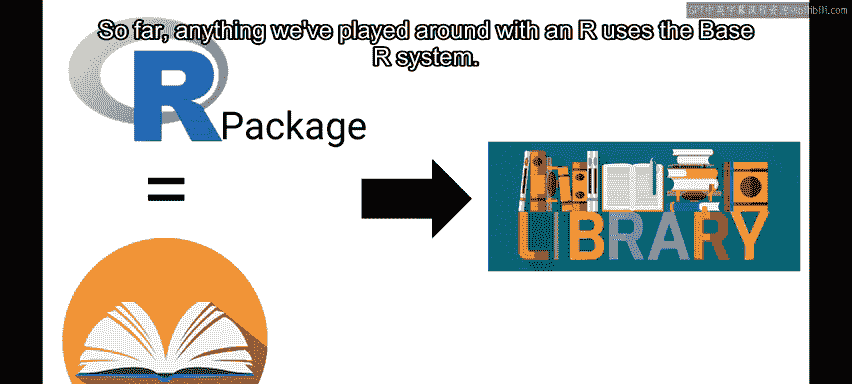

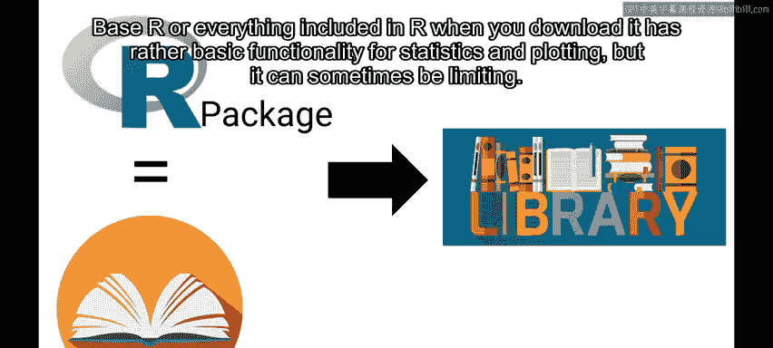

到目前为止，我们在R中尝试的所有功能都属于**基础R**系统。基础R是下载R时包含的所有内容，它提供了统计和绘图的基本功能，但有时功能有限。为了扩展R的基础功能，人们开发了**包**。

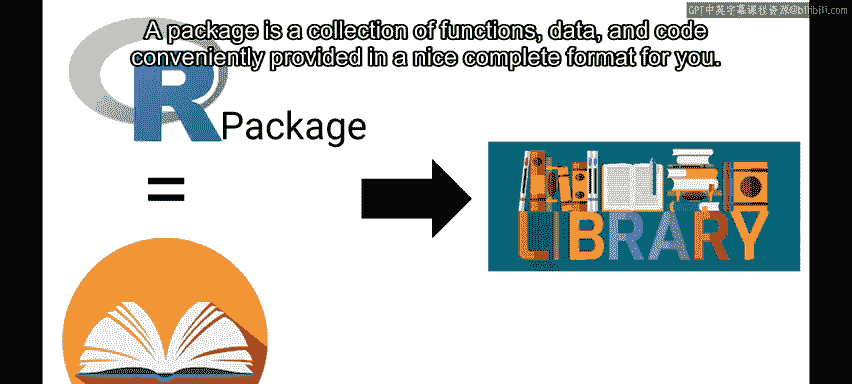


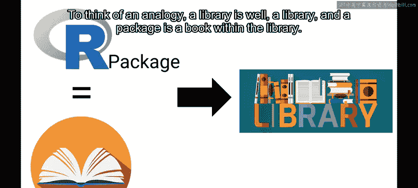

一个**包**是一个**函数、数据和代码的集合**，它以完整、便捷的格式提供给你。在撰写本文时，有超过14,300个包可供下载，每个包都有其专门的函数和代码，服务于不同的目的。

**包**不应与**库**混淆。在关于R的日常讨论中，这两个术语经常被混用。**库**是包在你计算机上的**存储位置**。可以这样类比：**库**就是图书馆，而**包**是图书馆里的书。

**包**是R如此独特的原因。不仅基础R本身功能强大，这些包还极大地扩展了其功能。最特别的是，每个包都是由广大的R社区开发和发布，并存储在**代码仓库**中。

一个**代码仓库**是许多已开发包集中存放并可下载的中心位置。主要有三个大型仓库：
1.  **综合R档案网**，简称 **CRAN**，是R的主要仓库，提供超过12,100个包。
2.  **Bioconductor** 仓库，主要面向生物信息学包。
3.  **GitHub**，一个非常流行的开源仓库，并非R专用。

---


## 如何查找R包？ 🔍


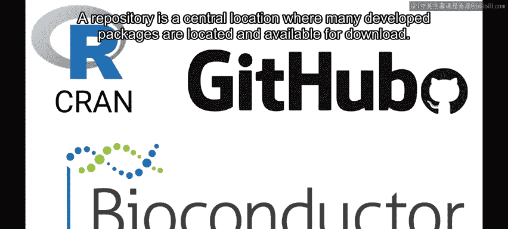

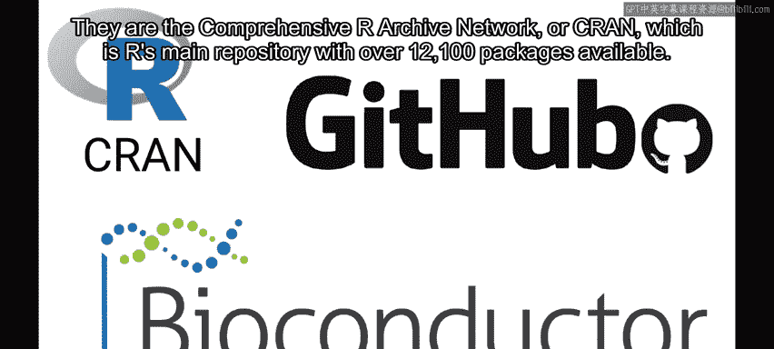


现在你知道了在哪里可以找到包，但包的数量如此之多，如何找到能完成你特定任务的包呢？有几种不同的途径可以探索包。

首先，CRAN根据功能主题将其所有包分为35个类别，称之为**任务视图**。这至少可以让你将搜索范围缩小到与你兴趣相关的主题。

其次，有一个很棒的网站：**R Documentation**。这是一个针对来自CRAN、Bioconductor和GitHub（即三大仓库）的包和函数的搜索引擎。如果你有明确的任务，这是搜索特定包以帮助你完成任务的好方法。它也有类似CRAN的任务视图，允许你按主题浏览。

更常见的情况是，如果你有明确的任务，在谷歌搜索该任务并加上“R package”是一个很好的起点。从那里，查看已经做过你想做事情的人的教程、小册子和论坛帖子，是找到相关包的好方法。

---

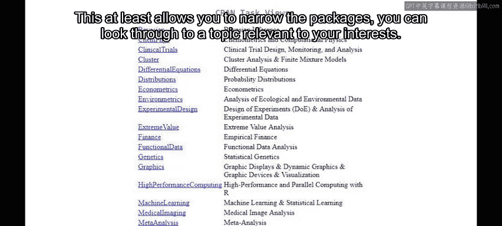

## 如何安装R包？ ⬇️

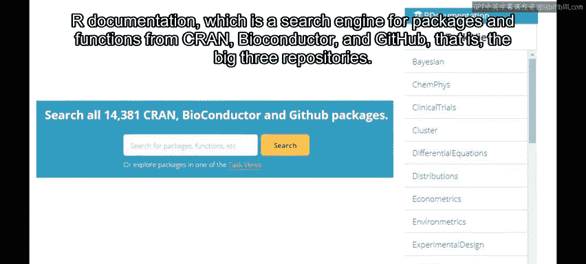

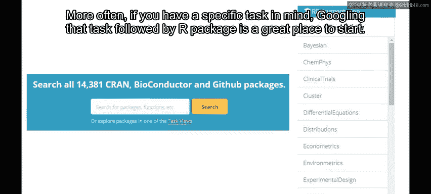


太好了，你找到了想要的包。如何安装它呢？安装方法取决于包的来源。

### 从CRAN安装

如果从CRAN仓库安装，使用 `install.packages()` 函数，将你想安装的包名用引号括起来放在括号内。注意，引号可以是单引号或双引号。

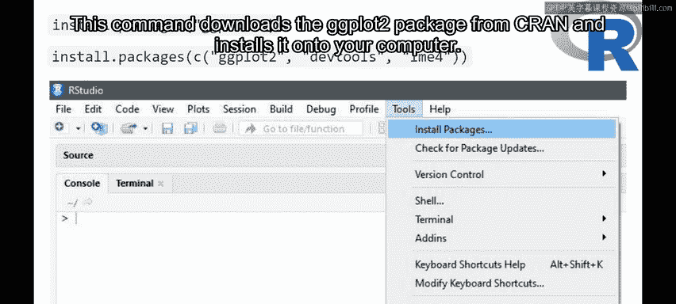

例如，如果你想安装 `ggplot2` 包，你可以使用：
```r
install.packages("ggplot2")
```
尝试在你的R控制台中执行此命令。这个命令会从CRAN下载 `ggplot2` 包并安装到你的计算机上。

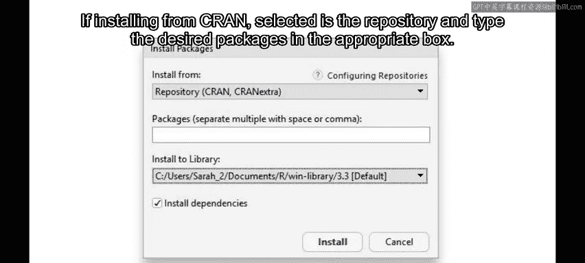

如果你想一次安装多个包，可以使用一个字符向量，包名之间用逗号分隔，格式如下：
```r
install.packages(c("ggplot2", "dplyr", "tidyr"))
```

如果你想使用RStudio的图形界面安装包，可以转到 **Tools** 菜单，第一个选项应该是 **Install Packages**。如果从CRAN安装，选择它作为仓库，并在适当的框中输入所需的包名。

### 从Bioconductor安装

Bioconductor仓库使用自己的方法来安装包。

首先，要获取通过Bioconductor安装所需的基本函数，请使用：
```r
source("https://bioconductor.org/biocLite.R")
```
这使Bioconductor的主要安装函数 `biocLite` 可供你使用。

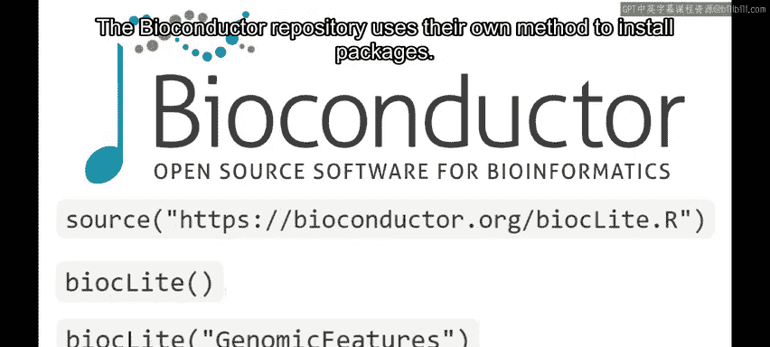

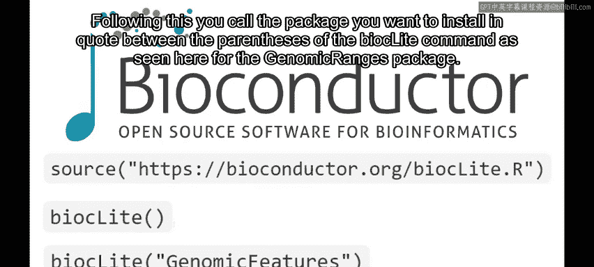

之后，你可以调用 `biocLite()` 命令，将要安装的包名用引号括起来放在括号内，如下所示，用于安装 `GenomicRanges` 包：
```r
biocLite("GenomicRanges")
```

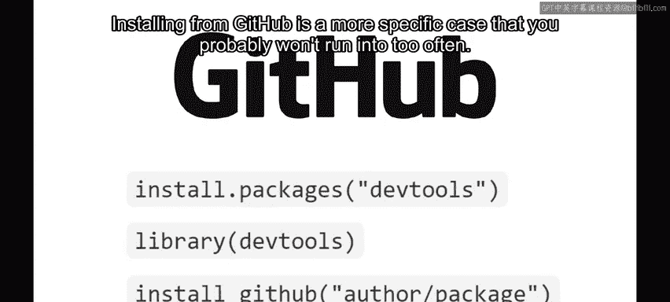


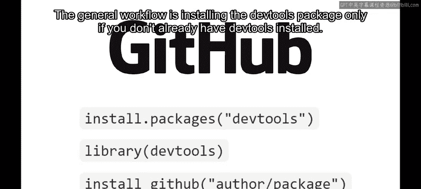

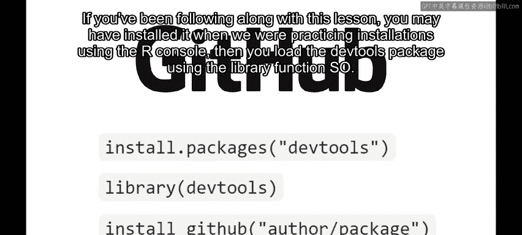

### 从GitHub安装

从GitHub安装是一个更特殊的情况，你可能不会经常遇到。如果你想这样做，首先必须在GitHub上找到你想要的包，并记下**包名**和**包的作者**。

一般工作流程是：
1.  安装 `devtools` 包（仅当你尚未安装时）。如果你一直跟着本课学习，可能在我们练习使用R控制台安装时已经安装过了。
2.  使用 `library()` 函数加载 `devtools` 包。
3.  最后，使用 `install_github()` 命令，调用作者的GitHub用户名，后跟包名。例如：
    ```r
    install_github("hadley/ggplot2")
    ```

---

## 如何加载和使用R包？ 📂

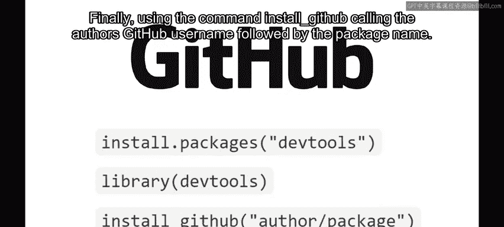

安装一个包并不会立即使其函数可供你使用。首先，你必须将包**加载**到R中。

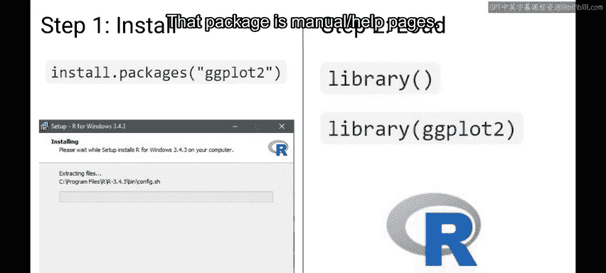

要加载包，请使用 `library()` 函数。可以这样想：就像你在计算机上安装的任何其他软件一样，仅仅安装了程序并不意味着它会自动运行，你必须**打开**程序。R包也是如此，你已经安装了它，但现在你必须打开它。

例如，要加载 `ggplot2` 包，你可以使用 `library()` 函数并调用 `ggplot2`：
```r
library(ggplot2)
```
**注意**：与安装包时不同，`library()` 命令中**不要**将包名放在引号里。

加载包是有顺序的。有些包需要先加载其他包（即依赖项）。包的帮助手册会帮助你找到正确的加载顺序。

如果你想使用RStudio界面加载包，在右下角象限有一个名为 **Packages** 的标签页，它列出了所有已安装包的简要描述和版本号。要加载一个包，只需点击包名旁边的复选框。

---

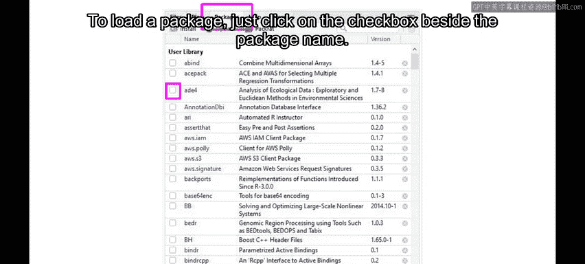

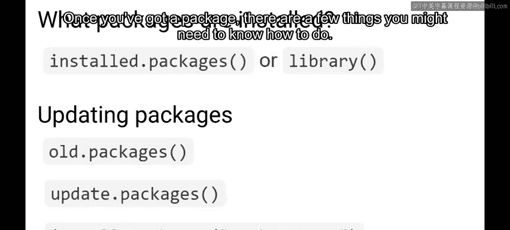

## 包的管理与维护 🔧

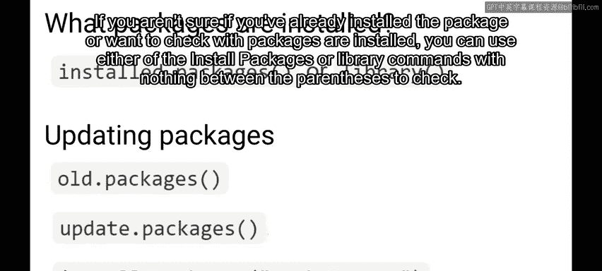

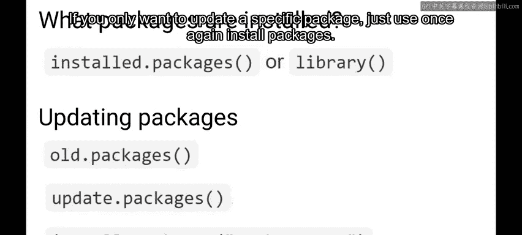

一旦你有了一个包，可能需要知道如何做一些事情。

### 检查已安装的包
如果你不确定是否已经安装了某个包，或者想查看安装了哪些包，你可以使用 `installed.packages()` 或 `library()` 命令，括号内不填任何内容来检查。在RStudio中，前面介绍的 **Packages** 标签页是查看所有已安装包的另一种方式。

### 更新包
你可以调用 `old.packages()` 函数来检查哪些包需要更新。这将识别出自你安装或上次更新以来已更新的所有包。要更新所有包，请使用 `update.packages()`。如果只想更新特定的包，可以再次使用 `install.packages()`。

在RStudio界面中，仍然在 **Packages** 标签页，你可以点击 **Update**，它会列出所有不是最新版本的包。你可以选择更新所有包，或选择特定的包进行更新。

你需要定期检查你的包，看看是否已经过时。但要小心，有时更新可能会改变某些函数的功能，因此如果你重新运行一些旧代码，命令可能已更改甚至完全消失，你将需要更新你的代码。

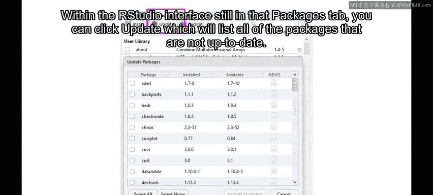

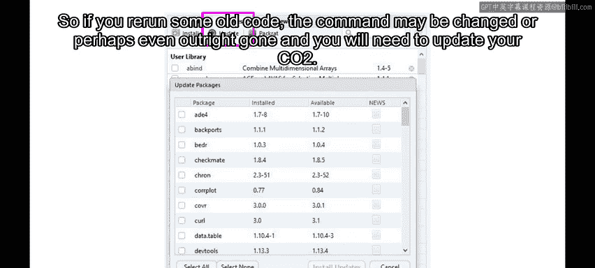

### 卸载和卸载包
有时你可能想在脚本运行中途**卸载**一个包。已加载的包可能与你想要使用的另一个包不兼容。要卸载给定的包，你可以使用 `detach()` 函数。例如，你可以输入：
```r
detach("package:ggplot2", unload = TRUE)
```
这将卸载我们之前加载的 `ggplot2` 包。

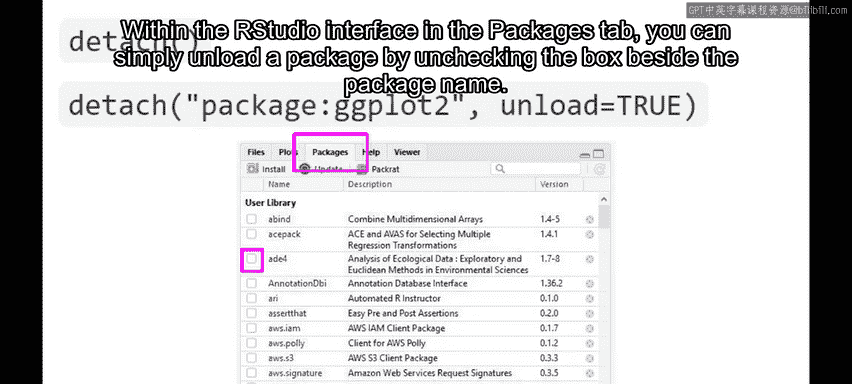

在RStudio界面的 **Packages** 标签页中，你可以通过取消选中包名旁边的框来简单地卸载包。

如果你不再想安装某个包，你可以使用 `remove.packages()` 函数简单地**卸载**它。例如：
```r
remove.packages("ggplot2")
```
尝试一下，但之后请重新安装 `ggplot2` 包，它是一个非常有用的绘图包。在RStudio的 **Packages** 标签页中，点击包行末尾的 **X** 将卸载该包。

---

## 检查R版本与获取会话信息 ℹ️

有时，当你看一个可能想安装的包时，会发现它需要特定版本的R才能运行。要知道你是否可以使用那个包，你需要知道你运行的是什么版本的R。

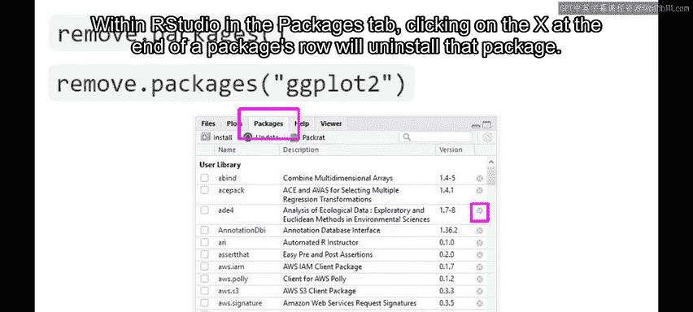

了解R版本的一种方法是检查当你首次打开R或RStudio时，控制台输出的第一行信息会告诉你当前运行的R版本。如果你一开始没注意，可以在控制台中输入 `version`，它会输出你运行的R版本信息。

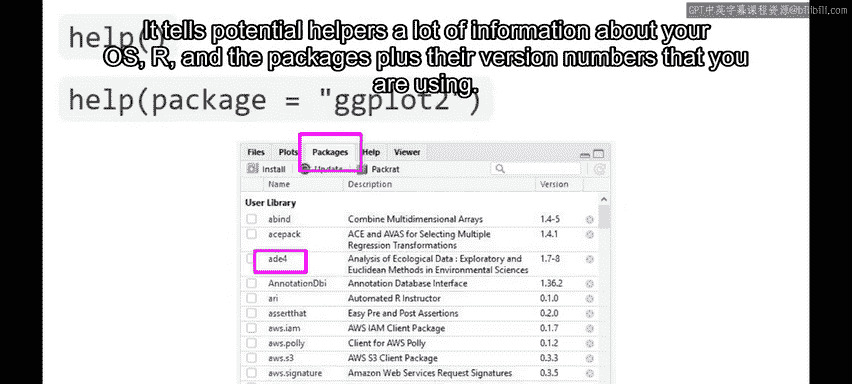

另一个有用的命令是 `sessionInfo()`。它会告诉你运行的R版本，以及所有已加载包的列表。这个命令的输出是发布问题到论坛时**非常值得包含的信息**，它向潜在的帮助者提供了大量关于你的操作系统、R版本以及你正在使用的包及其版本号的信息。

---

## 探索包的功能：帮助文件与小册子 📚

在了解了所有这些关于包的信息后，我们还没有实际讨论如何使用包中的函数。

首先，你需要知道一个包中包含哪些函数。为此，你可以查看所有制作精良的包中都包含的**帮助页面**。

在控制台中，你可以使用 `help()` 函数来访问包的帮助文件。尝试使用 `help()` 函数，调用 `package = ggplot2`，你将看到 `ggplot2` 提供的众多函数。

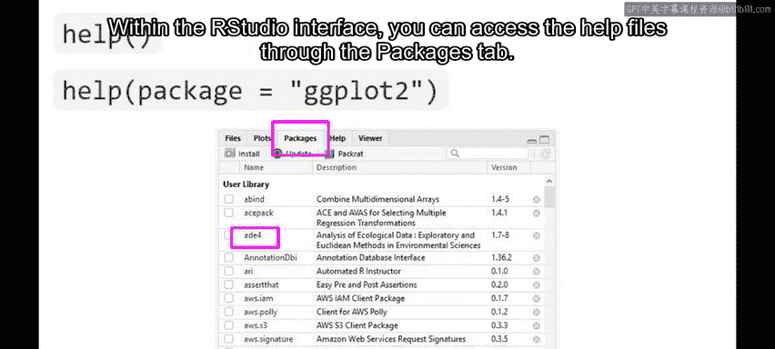

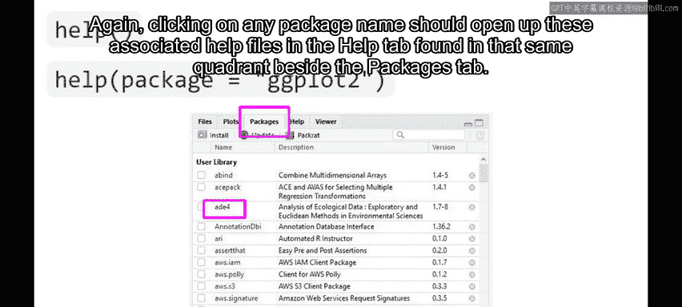

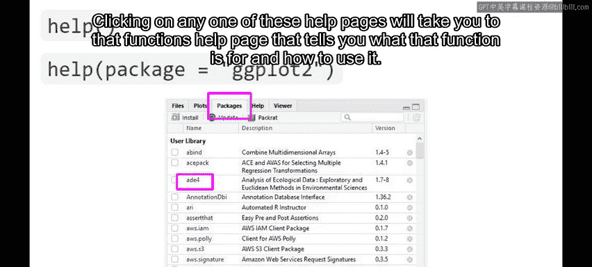

在RStudio界面中，你可以再次通过 **Packages** 标签页访问帮助文件。点击任何包名，都应在同一象限的 **Help** 标签页（位于 **Packages** 标签页旁边）打开相关的帮助文件。点击这些帮助页面中的任何一个，都会带你到该函数的帮助页面，告诉你该函数的用途以及如何使用它。

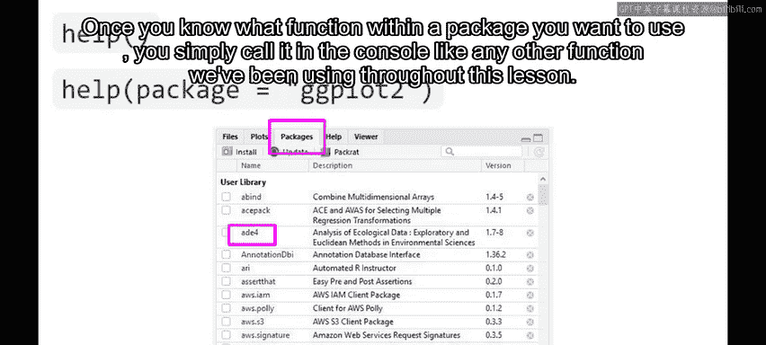

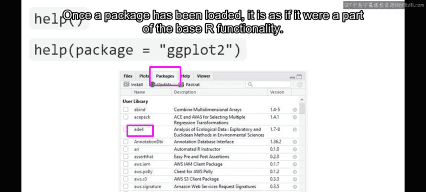

一旦你知道想在包中使用哪个函数，你就可以像在本课中一直使用的任何其他函数一样，在控制台中简单地调用它。一旦一个包被加载，它就好像是基础R函数的一部分。

如果你对包中的哪些函数适合你或如何使用它们仍有疑问，许多包都包含**小册子**。这些是扩展的帮助文件，包括包及其函数的概述，但它们通常更进一步，包含如何使用函数的详细示例，用通俗易懂的语言描述，你可以跟着学习如何使用包。

要查看包中包含的小册子，你可以使用 `browseVignettes()` 函数。例如，让我们看看 `ggplot2` 中包含的小册子：
```r
browseVignettes("ggplot2")
```
你应该会看到包含两个小册子：“Extending ggplot2” 和 “Aesthetic specifications”。探索 “Aesthetic specifications” 小册子是小册子如何提供帮助的一个很好的例子，它清晰地说明了如何使用包含的函数。

---

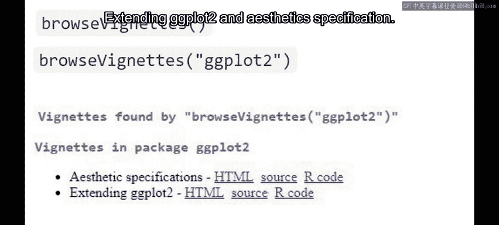

## 总结 📝

本节课中，我们一起深入探索了R包。

我们首先了解了**什么是包**，以及它与**库**的区别。然后，我们认识了**代码仓库**，并学习了如何查找与你兴趣相关的包。

接着，我们全面研究了包的工作方式：如何从不同的仓库**安装**它们，如何**加载**它们，如何**检查**已安装的包，以及如何**更新、卸载和卸载**包。我们还稍微绕道，学习了如何检查你拥有的**R版本**，这在安装包时通常是一个需要了解的重要细节。

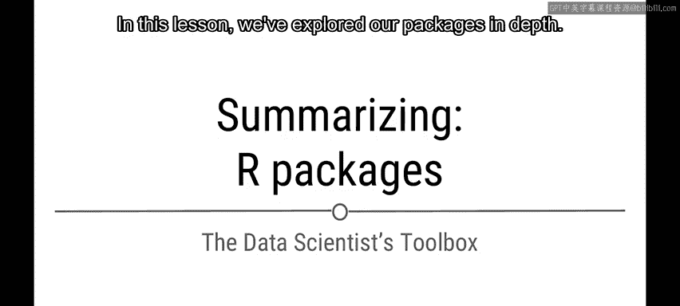

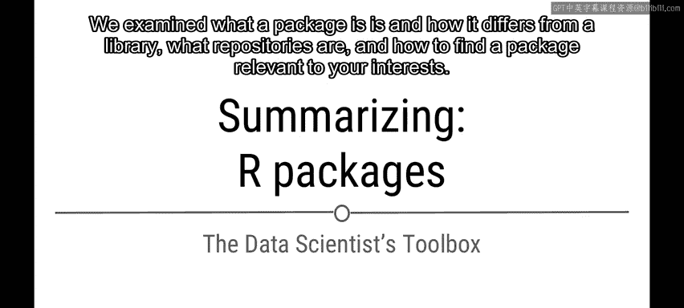

最后，我们花了一些时间学习如何探索**帮助文件**和**小册子**，它们通常能让你很好地了解如何使用一个包及其所有功能。

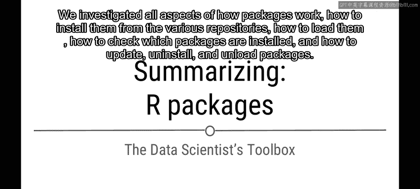

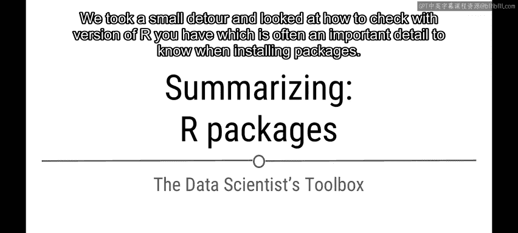

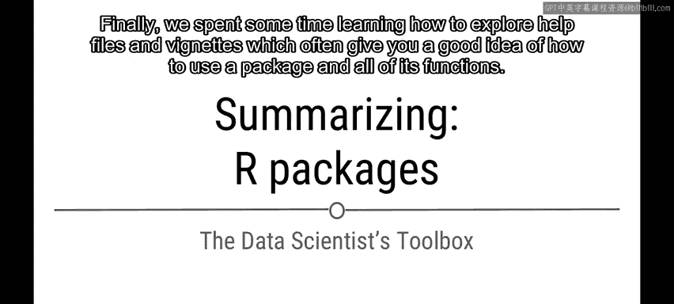

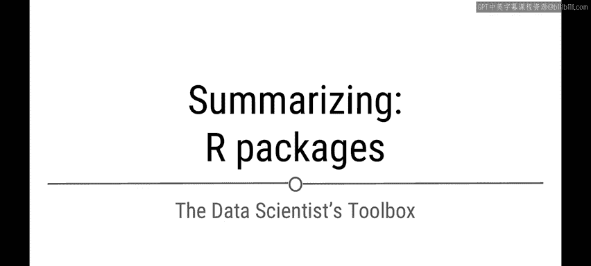

掌握R包的管理和使用，是释放R语言强大潜力、高效完成数据科学任务的关键一步。