#  012：GitHub与Git入门教程 🚀

在本节课中，我们将学习如何注册GitHub账户、熟悉GitHub网站的基本功能、安装并配置Git。这些步骤是为后续将GitHub和Git与RStudio链接所做的必要准备。

## 概述

上一节我们介绍了版本控制的基本概念。本节中，我们将实际操作，完成GitHub账户的注册与Git的安装配置，为管理代码版本做好准备。

## 注册GitHub账户

GitHub是一个基于云的版本控制文件管理系统。类似于Dropbox，你的文件既本地存储在电脑上，也托管在线上便于访问。其界面允许你管理版本控制，并为用户提供了基于网页的界面来创建项目、分享项目、更新代码等。

以下是注册GitHub账户的步骤：

1.  访问 [www.github.com](http://www.github.com)。
2.  在首页填写你的信息：创建用户名、输入邮箱、选择安全密码。
3.  点击“Sign up for GitHub”。


完成注册后，你现在应该已登录GitHub。


未来登录GitHub时，请访问Github.com。如果你尚未登录，首页将显示登录提示。


点击顶部的“Sign in”链接。

随后，你将看到登录页面，在此输入你之前创建的用户名和密码。


登录后，你将回到Github.com，此时页面应如下图所示。

## 熟悉GitHub网站界面

我们将快速浏览GitHub网站，并特别关注用户设置、通知、帮助文件和GitHub指南这几个部分。浏览之后，我们将使用GitHub指南创建你的第一个代码仓库。

首先，让我们查看你的用户设置。

### 用户设置与个人资料

登录GitHub后，我们应该填写一些个人资料信息并熟悉账户设置。

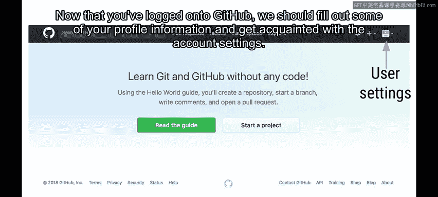

在右上角有一个带箭头的图标，点击它可以进入你的个人资料页面。在这里你可以控制你的账户，查看贡献历史和代码仓库。由于你刚刚开始，目前还没有任何仓库或贡献记录，但我们希望很快能有所改变。

现在我们可以编辑你的个人资料。在页面左侧找到“Edit profile”选项。花些时间填写你的姓名，在简介框中写一些关于自己的描述，如果你愿意，还可以上传一张个人照片。完成后点击“Update profile”。


在此页面的左侧有许多选项供你探索。点击每个菜单以熟悉可用的选项。作为开始，请进入“Account”页面。

在这里，你可以修改密码。如果你对当前的用户名不满意，也可以更改它。但请注意，更改用户名可能会带来意想不到的后果。如果你刚刚起步且没有任何内容，更改可能相对安全。请自行继续查看个人设置选项，完成后返回你的个人资料页面。

当你对GitHub有更多经验后，最终会拥有一些以你命名的代码仓库。要找到它们，请在个人资料页面上点击“Repositories”链接。目前它可能看起来是空的，但在本讲座结束时，请返回此页面查找你新创建的仓库。

### 通知菜单

接下来，我们查看通知菜单。在窗口顶部的菜单栏中，有一个铃铛图标代表你的通知。点击这个铃铛图标。

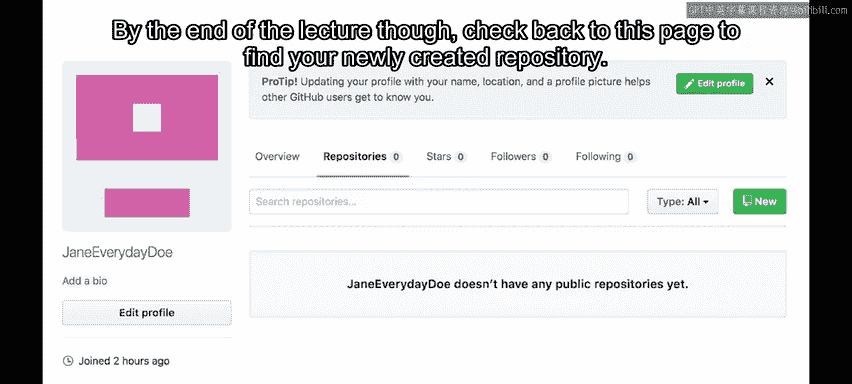

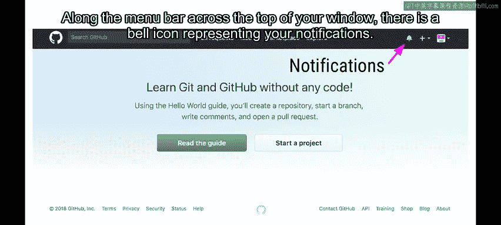


当你在GitHub上更加活跃并开始与他人协作时，这里可以找到你参与的所有仓库、团队和对话的消息与通知。

### 帮助系统

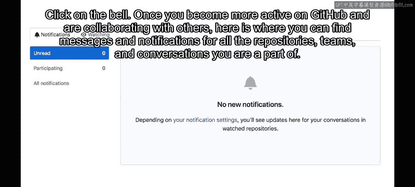

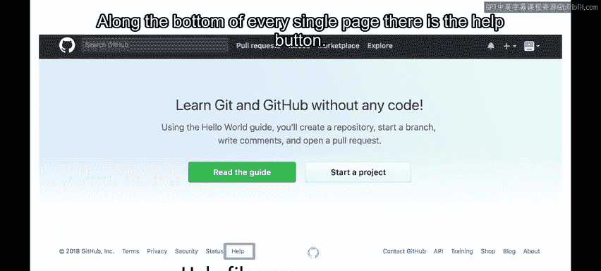

在每个页面的底部，都有一个“Help”按钮。


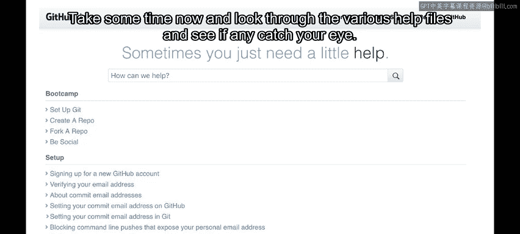

GitHub拥有一个完善的帮助系统。如果你对GitHub有任何疑问，这应该是你首选的搜索入口。现在花些时间浏览各种帮助文件，看看是否有吸引你的内容。


## 创建你的第一个代码仓库

GitHub认识到这对新用户来说可能是一个令人不知所措的过程，因此开发了一个迷你教程来帮助你开始使用GitHub。现在请按照这个指南操作，创建你的第一个代码仓库。

完成后，你应该会拥有一个类似下图所示的仓库。花些时间探索这个仓库，查看你到目前为止的提交历史。在这里，你可以找到对仓库所做的所有更改，并可以看到是谁在何时做出了更改。如果你撰写了恰当的提交信息，还能了解他们为何进行更改。

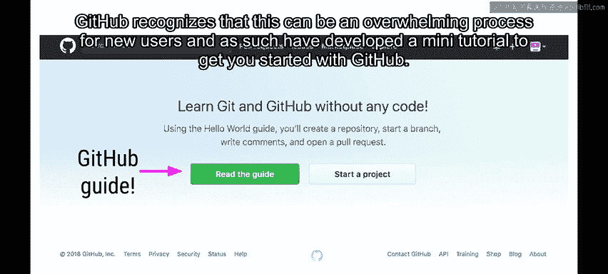
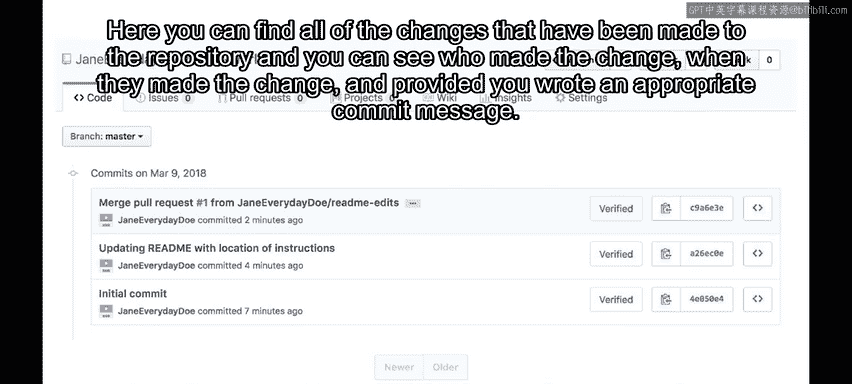

探索完仓库中的所有选项后，返回你的用户个人资料页面。现在它看起来应该和之前有些不同。在你的个人资料页面上，可以看到最新创建的仓库。要获取仓库的完整列表，请点击“Repositories”选项卡。

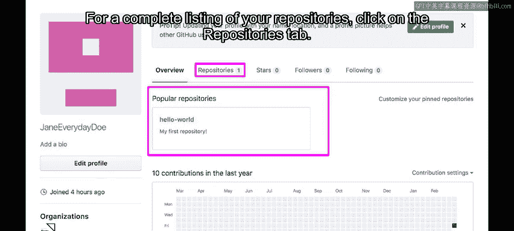


在这里，你可以看到你所有的仓库、简要描述、最后编辑的时间。在右侧还有一个活动图，显示了对仓库进行编辑的频率和次数。

## 安装Git

正如我们在上一讲中回忆的，Git是免费的、开源的版本控制系统，GitHub正是构建于其上。使用Git系统的主要好处之一是其与RStudio的兼容性。然而，为了将两者链接起来，我们首先需要在你的电脑上下载并安装Git。

要下载Git，请访问 [git-scm.com/download](http://git-scm.com/download)。点击适用于你操作系统的相应下载链接，这将启动下载过程。

我们将首先介绍Windows电脑的安装过程，然后是Mac的安装步骤。请根据你的操作系统跟随相关说明。

### Windows系统安装步骤

对于Windows电脑，下载完成后，打开`.exe`文件以启动安装向导。如果收到安全警告，请点击“运行”和/或“允许”。

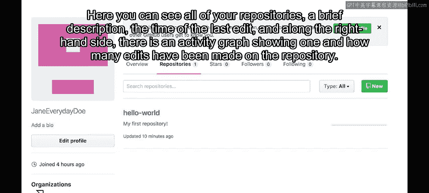
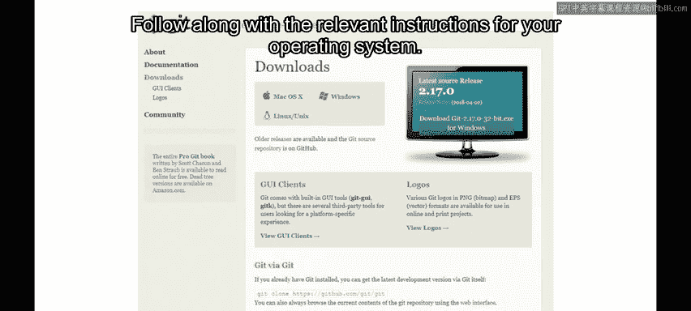

随后，点击进入安装向导，通常接受默认选项，除非你有充分的理由不这样做。


点击“安装”并允许向导完成安装过程。完成后，勾选“Launch Git Bash”选项。除非你好奇，否则取消选中“View release notes”框，因为你现在可能对此不感兴趣。

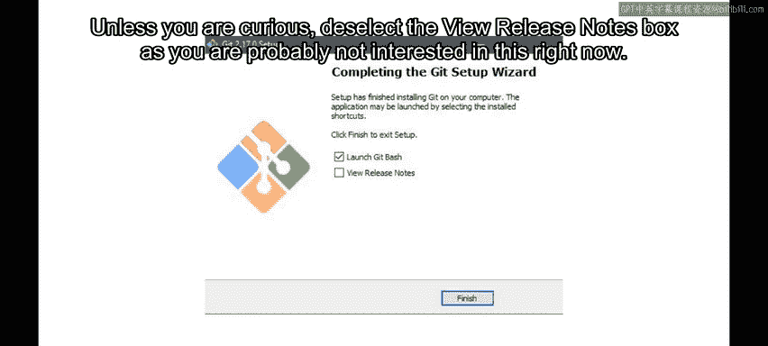

这样，一个命令行环境将会打开。假设你在安装过程中接受了默认选项，未来在开始菜单中会有一个快捷方式来启动Git Bash。至此，你已为Windows安装了Git。


### Mac系统安装步骤

对于Mac，我们将指导你完成最常见的安装过程。然而，有多种方法可以在Mac上安装Git。你可以访问 [www.atlassian.com/git/tutorials/install-git](http://www.atlassian.com/git/tutorials/install-git) 以获取替代的安装途径教程。

下载适用于Mac的相应Git版本后，你应该已下载一个`.dmg`文件用于安装。在Mac上打开此文件，这将把Git安装到你的电脑上。

一个新窗口将打开，双击其中的`.pkg`文件，安装向导将启动。点击进入选项，接受默认设置，然后点击“安装”。出现提示时，关闭安装向导。你已成功安装Git。

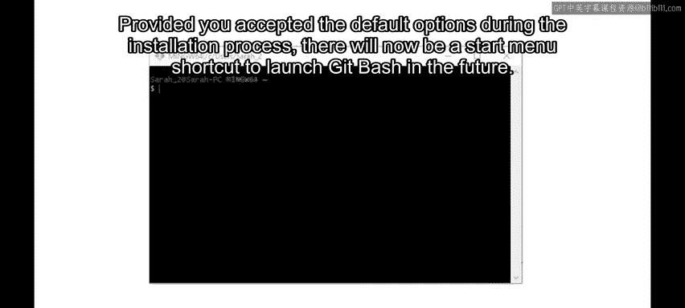
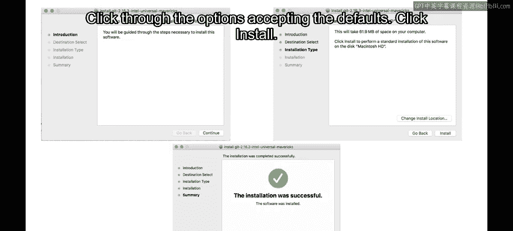

## 配置Git

现在Git已经安装，我们需要对其进行配置以便与GitHub一起使用。为了准备将其与RStudio链接，我们需要告诉Git你的用户名和邮箱，以便它知道每次提交是来自你。

为此，在命令提示符（Windows是Git Bash，Mac是终端）中键入以下命令。将 `JaneDoe` 替换为你想要的用户名，这将是每次提交时标记的名称。


```bash
git config --global user.name "JaneDoe"
```

接着，在命令提示符中键入以下命令，确保使用你注册GitHub时所用的邮箱地址。

```bash
git config --global user.email "janedoe@gmail.com"
```

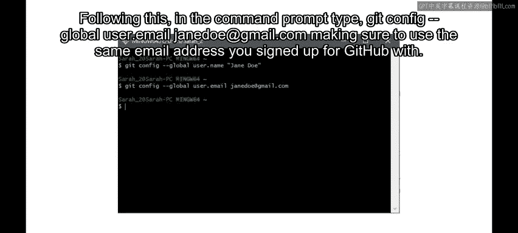

此时，你应该已经为下一步做好了准备。但为了确认，可以通过键入以下命令来检查你的更改：


```bash
git config --list
```

执行此操作后，你应该能看到上面选择的用户名和邮箱。如果你发现任何问题或想更改这些值，只需用你想要的更改重新键入之前的原始配置命令即可。

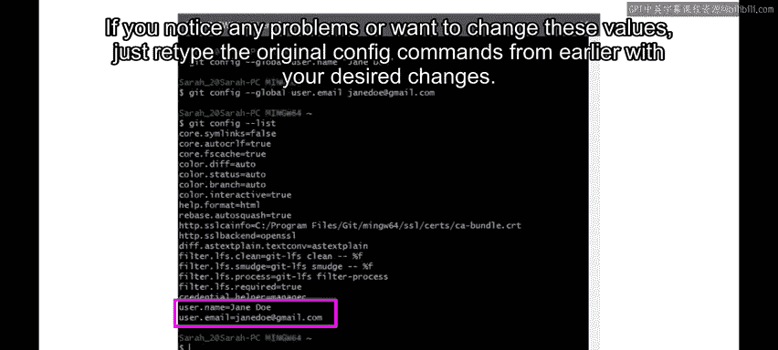


一旦你确认用户名和邮箱正确无误，可以通过键入 `exit` 并按回车键退出命令行。

至此，你已为下一讲做好了全部准备。

## 总结

本节课中，我们一起学习了如何注册GitHub账户并浏览了GitHub网站。我们创建了你的第一个代码仓库，并在GitHub上填写了基本的个人资料信息。随后，我们在你的电脑上安装了Git，并为其配置了与GitHub和RStudio的兼容性。

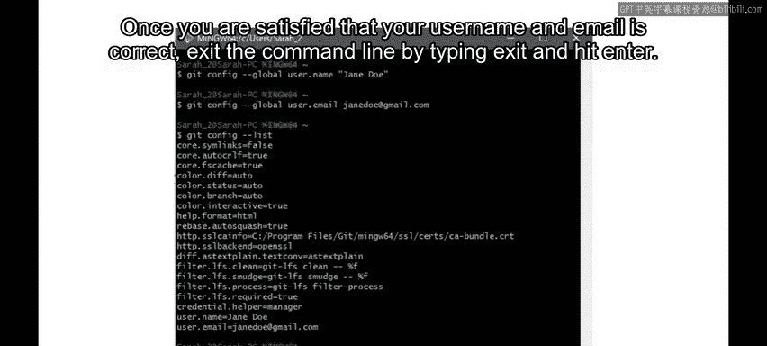


