#  015：R Markdown入门教程 📝

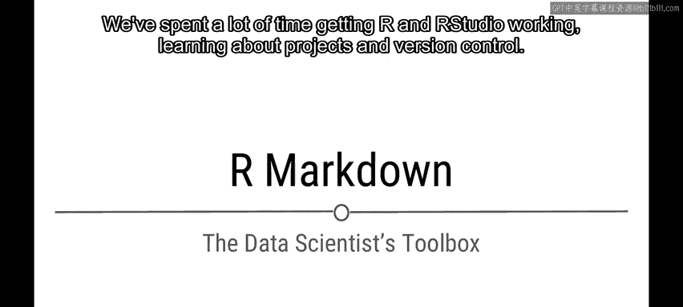

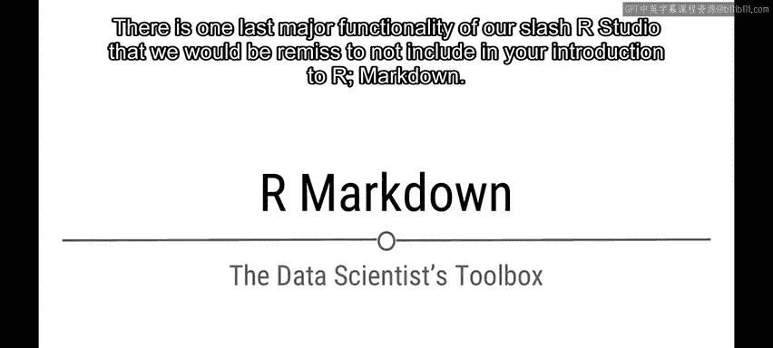

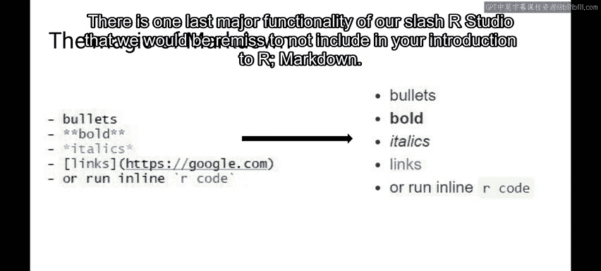

在本节课中，我们将要学习R Markdown。这是一种将文本和代码结合，创建完全可重现文档的强大工具。我们将从了解其基本概念开始，逐步学习如何创建、格式化并最终“编织”你的第一个R Markdown文档。

我们已经花费了大量时间来配置R和RStudio，学习了项目和版本控制。现在，你在这方面几乎已经是专家了。在R/RStudio的介绍中，还有一个主要功能不容忽视，那就是R Markdown。

R Markdown是一种创建完全可重现文档的方法，它可以将文本和代码结合在一起。事实上，本课程就是使用R Markdown编写的。我们用它来制作项目符号列表、加粗和斜体文本、内联链接，并运行内联R代码。在本课结束时，你也应该能够完成这些操作，甚至更多。

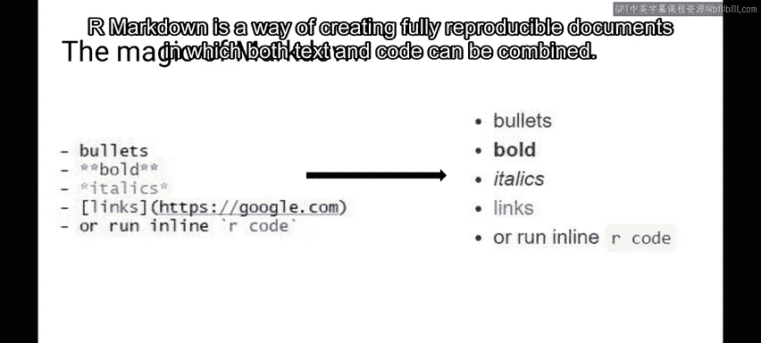

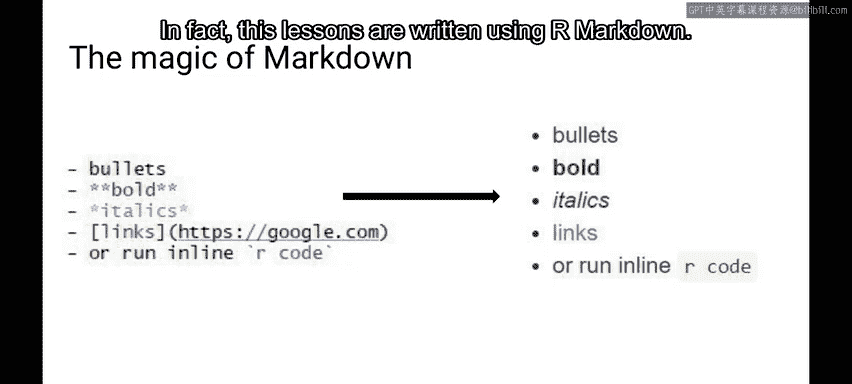

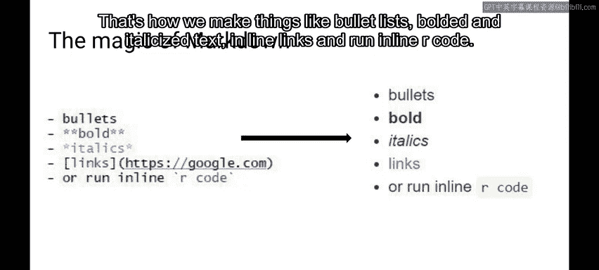

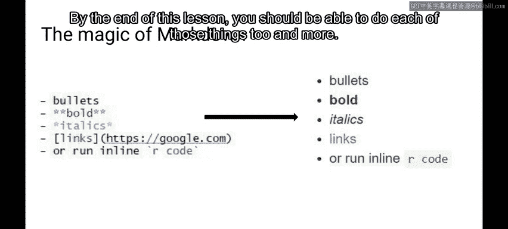

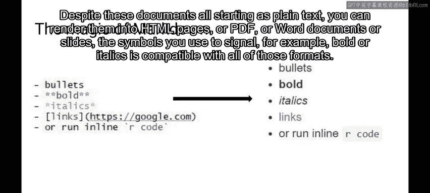

尽管这些文档最初都是纯文本，但你可以将它们渲染成HTML页面、PDF、Word文档或幻灯片。你用来表示加粗或斜体等格式的符号，与所有这些输出格式都兼容。

## 为什么使用R Markdown？ 🤔

上一节我们介绍了R Markdown是什么，本节中我们来看看使用它的主要好处。

其中一个主要好处是使用R Markdown的可重现性。由于你可以轻松地将文本和代码块组合在一个文档中，你可以轻松地整合引言、假设、正在运行的代码、代码运行结果以及结论。分享你的工作内容、原因和结果变得非常简单。收到文档的人可以重新运行你的代码，并获得与你完全相同的结果。这就是我们所说的可重现性。

此外，有时你可能会进行一个需要数周才能完成的项目。你希望能够查看很久以前所做的工作，或许能确切地回忆起当时为什么要这样做，并且可以看到你运行了哪些代码以及代码的结果。R Markdown文档允许你做到这一点。

R Markdown的另一个主要好处是，由于它是纯文本，因此与版本控制系统配合得非常好。与那些非纯文本格式不同，它可以轻松跟踪提交之间发生的字符变化。例如，在某个版本的课程中，我可能忘记加粗某个单词。当我发现这个错误时，我可以修改纯文本以表示我希望该单词加粗。在提交记录中，你可以看到为加粗该单词而发生的具体字符变化。

R Markdown还有一个“自私”的好处，那就是它非常易于使用。与R中的所有功能一样，这个扩展功能来自一个R包：`rmarkdown`。安装它只需要运行 `install.packages("rmarkdown")`，然后你就可以开始使用了。

## 创建你的第一个R Markdown文档 🚀

了解了R Markdown的优势后，现在我们来动手创建第一个文档。

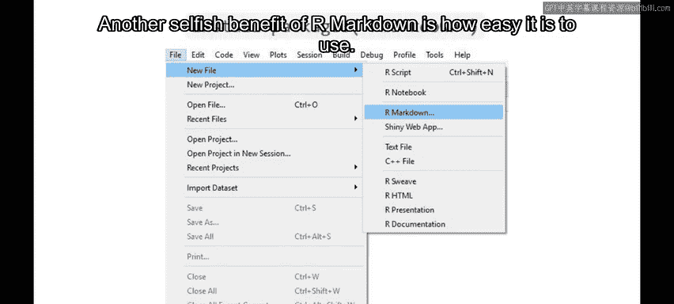

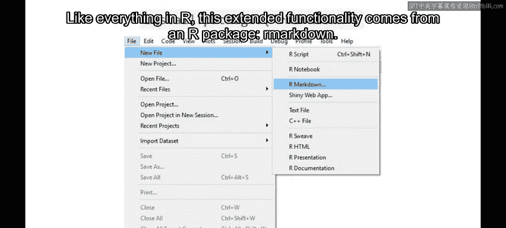

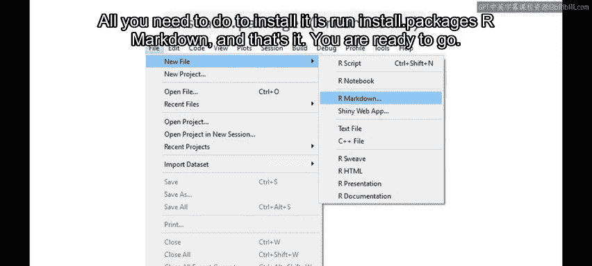

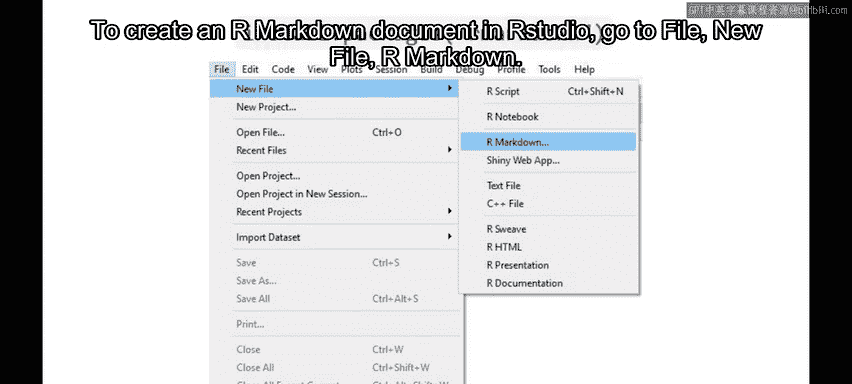

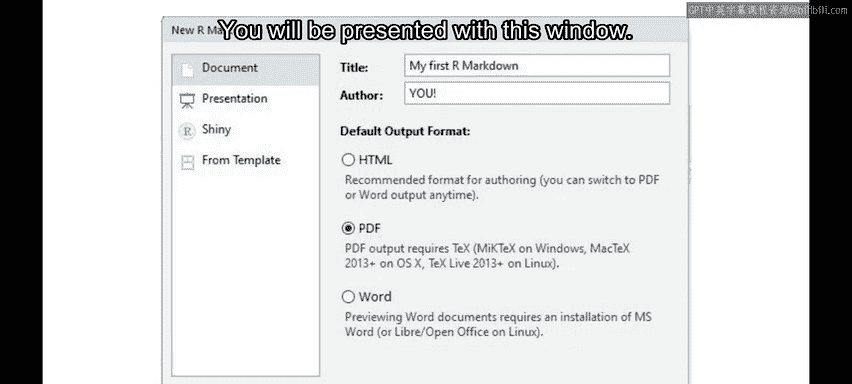

要在RStudio中创建R Markdown文档，请转到 `File` -> `New File` -> `R Markdown...`。你将看到这个窗口。我已经填写了标题和作者，并将输出格式切换为PDF。你可以浏览左侧的选项卡，查看所有可以输出的不同格式。完成后，点击“OK”。

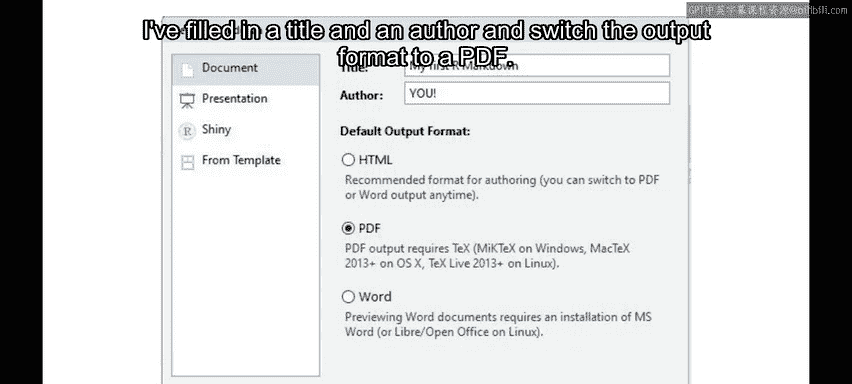

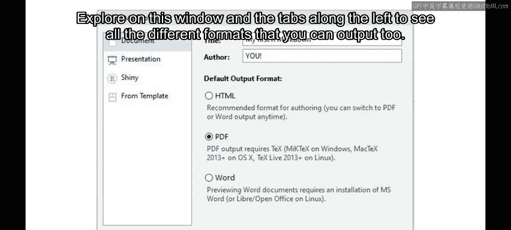

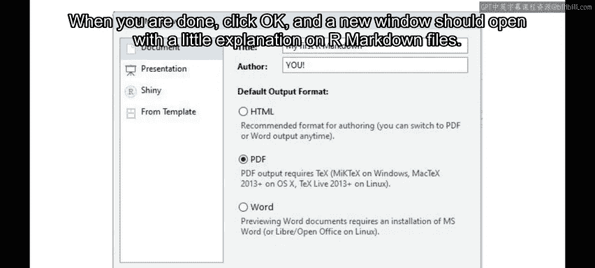

一个新窗口应该会打开，其中包含对R Markdown文件的简要说明。一个R Markdown文档主要有三个部分。

第一部分是顶部的YAML头部，由三个短横线 `---` 界定。在这里，你可以指定详细信息，如标题、你的姓名、日期以及你希望输出的文档类型。如果你之前在窗口中填写了信息，这里应该已经为你填好了。

你可以看到文本部分。例如，一个以 `# R Markdown` 开头的部分。我们稍后会详细讨论这意味着什么。当你生成此文件的PDF时，此部分将呈现为文本。你将学习的所有格式设置通常都适用于此部分。

最后，你会看到代码块。它们由三个反引号 `` ``` `` 界定。这些是R代码块，你可以直接从文档中运行它们。当你创建PDF时，此代码的输出将包含在PDF中。

了解这些部分如何运作的最简单方法就是生成PDF。当你完成一个R Markdown文档时，你需要将纯文本和代码“编织”成最终文档。为此，请点击源代码面板顶部的“Knit”按钮。点击后，它会提示你将文档保存为 `.Rmd` 文件。保存后，你应该会看到一个类似这样的文档。

在这里，你可以看到头部的内容被渲染成了一个标题，后面跟着你的姓名和日期。文本块生成了一个名为“R Markdown”的章节标题，后面跟着两段文本。接着，你可以看到R代码 `summary(cars)`，重要的是，后面跟着运行该代码的输出。再往下，你会看到用于生成图表的代码，然后是图表本身。这就是R Markdown的巨大好处之一：将代码结果内联渲染。

回到生成此PDF的R Markdown文件，看看你是否能看出如何表示你想要文本加粗。看看单词“Knit”，看看它被什么包围着。

## R Markdown基础格式设置 ✍️

到目前为止，我希望我们已经让你相信R Markdown是管理代码和数据的有用方式，并为你做好了准备，让你可以尝试使用它。为了让你入门，我们将练习一些R Markdown文档固有的格式设置。

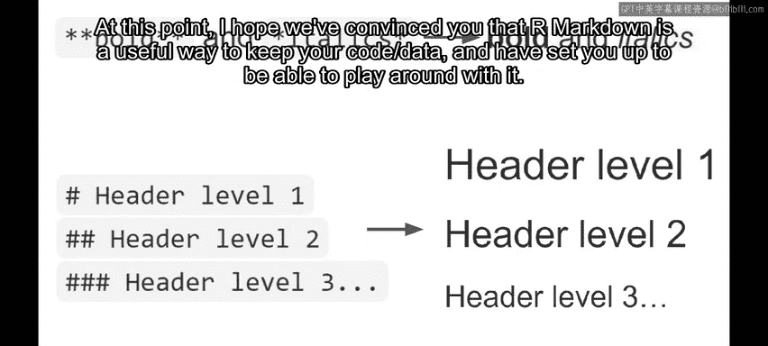

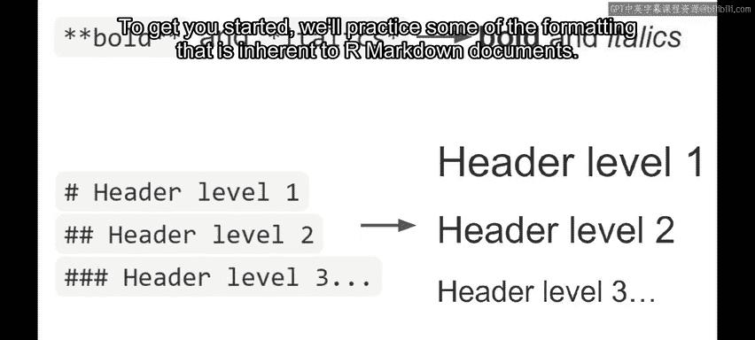


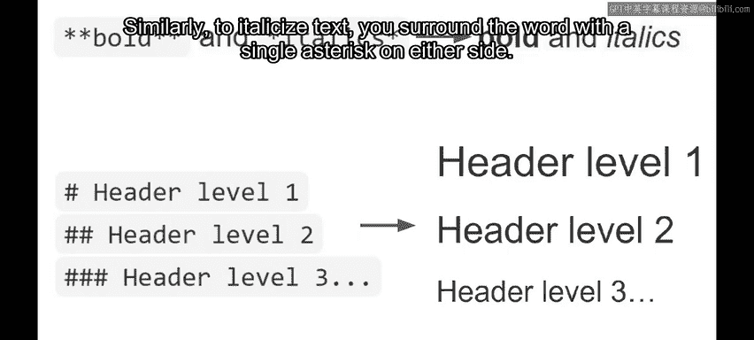

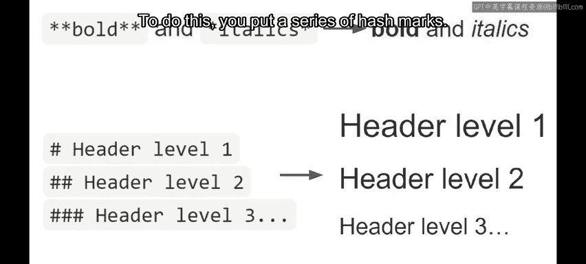

首先，让我们看看如何加粗和倾斜文本。要加粗文本，你需要在文本两侧各加上两个星号 `**`。类似地，要使文本倾斜，你需要在单词两侧各加上一个星号 `*`。

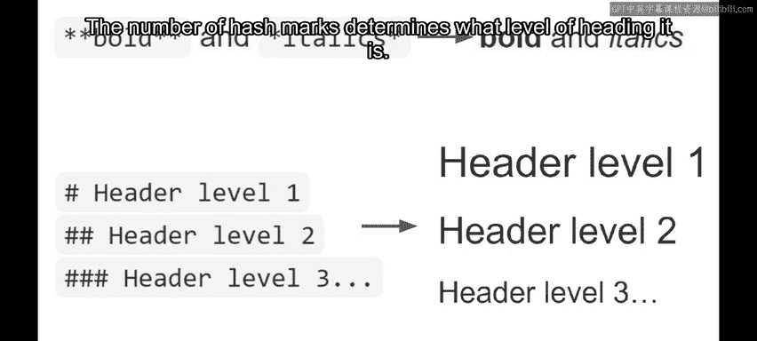

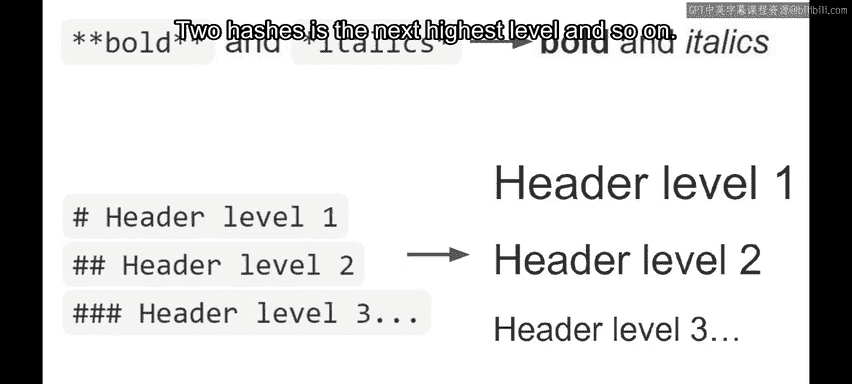

从默认文档中我们还看到，你可以制作章节标题。为此，你需要放置一系列井号 `#`。井号的数量决定了标题的级别。一个井号是最高级别，将生成最大的文本；两个井号是次高级别，依此类推。尝试使用这种格式，制作一系列标题。

## 代码块与列表 📋

到目前为止我们看到的另一件事是代码块。要创建一个R代码块，你可以键入三个反引号，后跟花括号包围的小写字母 `r`，在新的一行输入你的代码，然后用另外三个反引号结束代码块。幸运的是，RStudio知道你经常需要这样做，因此提供了快捷键：Windows系统是 `Ctrl + Alt + I`，Mac系统是 `Cmd + Option + I`。此外，在源代码面板顶部有一个“Insert”按钮，也可以生成一个空的代码块。

尝试创建一个空的代码块。在其中，键入代码 `print("hello world")`。当你编织文档时，你将在PDF中看到这个代码块以及该代码块的输出。

如果你还没有准备好编织文档，但想查看代码的输出，请选择要运行的代码行，然后使用 `Ctrl + Enter` 或点击源代码窗口顶部的“Run”按钮。文本“hello world”应该会输出到你的控制台窗口中。如果一个代码块中有多行代码，你想一次性全部运行，可以使用 `Ctrl + Shift + Enter`，或点击代码块右侧的绿色箭头按钮，或转到“Run”菜单并选择“Run Current Chunk”。

我们将详细讨论的最后一件事是制作项目符号列表，就像本课开头的那个一样。列表很容易创建，方法是在每个预期的项目符号点前加上一个短横线 `-` 和一个空格。重要的是，在每个项目符号行的末尾，要加上两个空格。这是R Markdown的一个特性，如果不包含它，可能会导致间距问题。

## 总结与后续探索 🎯

本节课中我们一起学习了R Markdown。这是一个很好的起点，你还可以用R Markdown做更多事情。幸运的是，RStudio的开发人员制作了一份R Markdown速查表，我们强烈建议你去查看，了解R Markdown的所有功能。可能性是无限的。

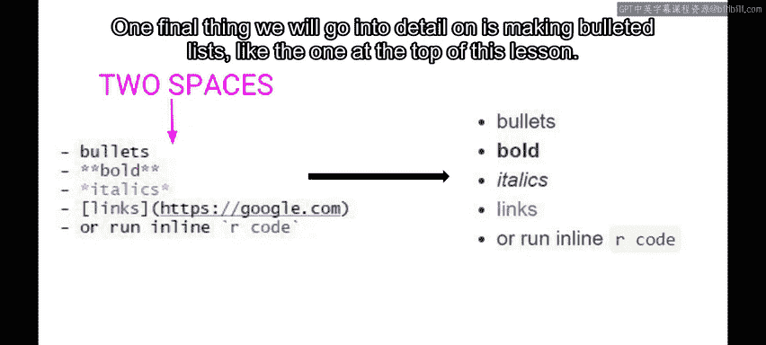

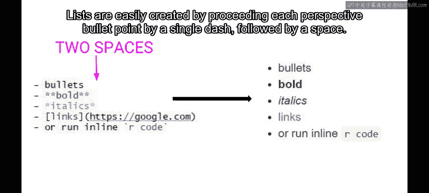

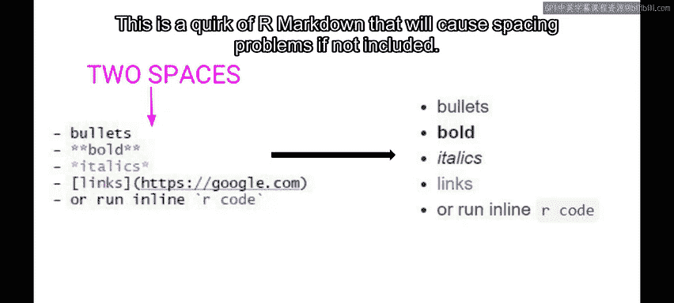

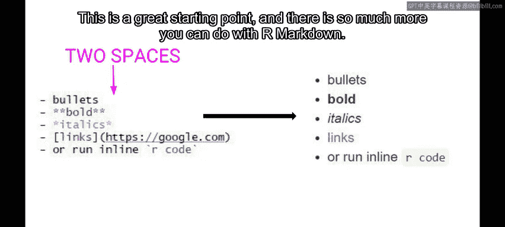

在本课中，我们深入探讨了R Markdown，从它是什么以及为什么你可能想使用它开始。我们希望引导你入门，首先是安装它，然后生成并编织了我们的第一个R Markdown文档。接着，我们研究了一些可用的格式选项，并练习了在RStudio界面内生成和运行代码。

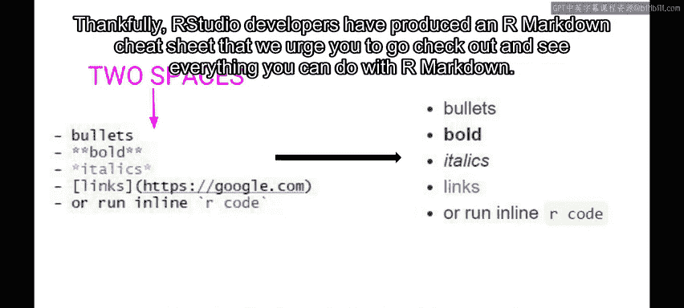

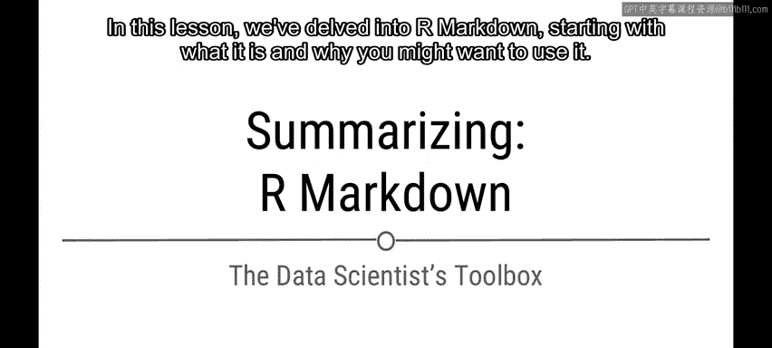

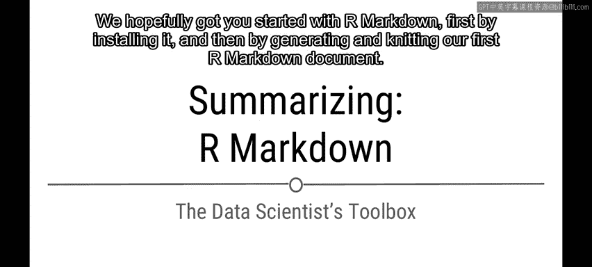

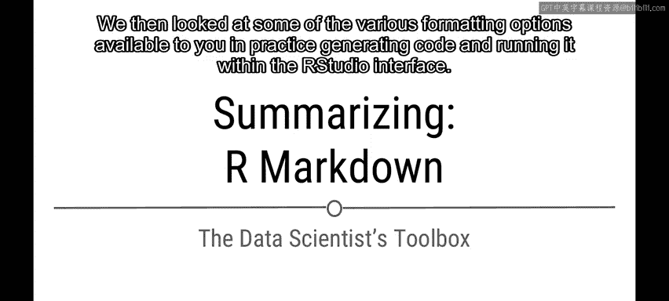

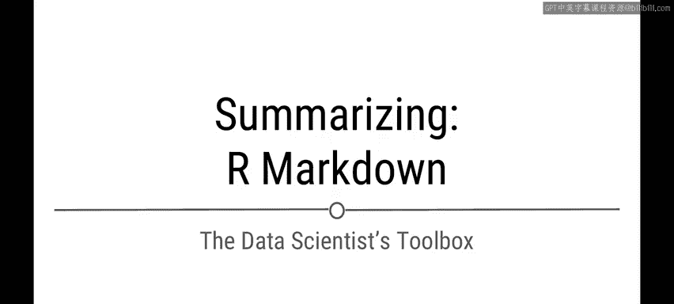

通过掌握R Markdown，你将能够创建专业、可重现的报告和分析文档，这对于数据科学工作流程至关重要。