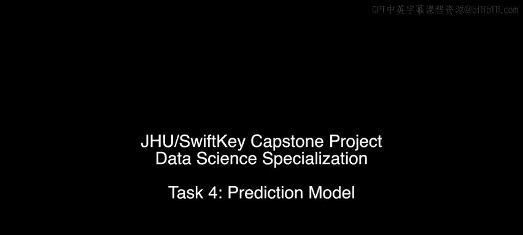

# 数据科学毕业课程（约翰霍普金斯大学）｜P10：任务4介绍 - 构建预测模型 🎯

在本节课中，我们将要学习毕业课程的第四个核心任务：构建最终的文本预测模型。我们将整合之前的所有工作，并专注于提升模型的效率与准确性。

---

到目前为止，你已经获取了数据，并对其进行了清洗与初步处理。

你也完成了一些探索性分析，并构建了一些初始模型。

现在是展示成果的时刻，你需要为文本构建你的预测模型。本任务的基本目标是，将你迄今为止完成的所有工作整合起来，构建出你能做到的最佳预测模型。

在此阶段，你需要仔细审视你的代码，检查其效率与准确性。

思考你算法的计算复杂度，或许可以考虑使用性能分析器等工具来为代码计时，并寻找性能瓶颈。同时，也需要稍微考虑一下你的代码将在何种环境中运行。它是运行在高性能服务器上，还是你认为它更适合在移动电话上使用？因为代码的运行环境将决定你可用的资源类型，因此你甚至可能需要考虑以一种易于适应不同环境的方式来编写你的代码。

😊 因此，在本任务结束时，你需要拥有一个性能良好的完整工作模型。

同时，尝试列出一系列可以尝试的想法，这些想法可能从不同方面提升你模型的性能。祝你在本任务中好运，我们非常期待看到你构建的模型。

---

本节课中，我们一起学习了如何整合前期工作以构建最终的预测模型，并探讨了优化代码效率与适应不同运行环境的重要性。现在，是时候将理论付诸实践，打造出你的最佳模型了。