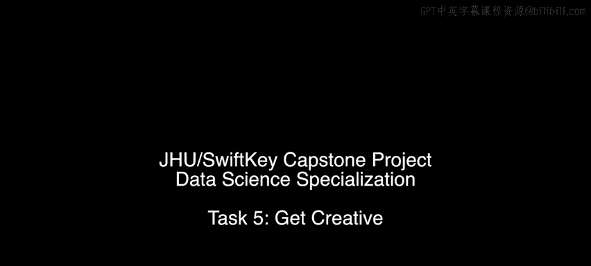

# 数据科学毕业课程（约翰霍普金斯大学）｜课程10：任务5介绍 - 创意探索 🚀

在本节课中，我们将要学习数据科学项目流程中的第五个任务：创意探索。这个阶段的目标是超越基础模型，通过尝试新想法来提升模型的性能。

---

上一节我们完成了预测模型的构建与初步评估。本节中我们来看看如何对模型进行优化与改进。

你已经构建了预测模型，并且它似乎运行得相当不错。它可能速度合理，并且在大多数时候能预测出正确的单词。那么你的工作就完成了吗？

并非如此。可以这样比喻：如果你正在演奏马勒的第三交响曲，你现在可能只进行到第四乐章。你仍然还有大约两个乐章需要完成。

因此，本任务的目标是让模型变得更好。请记住，在上一个任务中，你应该已经列出了一个想法清单，这些想法可能从各个方面提升模型的性能。

我们现在要做的是，按照这个想法清单逐一尝试，跳出固有思维，看看哪些方法有效，哪些无效。

以下是执行此任务时需要遵循的关键步骤：

*   **评估性能**：在尝试清单上的想法时，你需要持续评估模型的性能。
*   **保留测试集**：请务必保留一部分测试数据，以便能够客观评估你正在构建的这些新创意模型。
*   **享受过程**：尝试在此任务中找到乐趣，因为，如果你没有乐趣，你就不是在真正地做数据科学。😊

---

本节课中我们一起学习了数据科学项目创意探索阶段的核心目标与步骤。我们了解到，在拥有一个基础工作模型后，需要通过系统性地尝试新想法、持续评估并利用独立的测试集来验证改进效果，从而优化模型性能。这个过程需要创造力和严谨的评估相结合。